<p align="center">
  <a href="https://ollysalanson.github.io/escape-from-pallet-town-web/">
    
  </a>
</p>

<p align="center">
  <b>Kanto, but it's a heist.</b><br>
  Drop into a town with five minutes on the clock, grab everything that isn't nailed down, and get
  out before time runs out or your rival catches up. Whatever you carry out is yours. Whatever you
  don't... well. Blue says thanks.
</p>

<p align="center">
  <a href="https://ollysalanson.github.io/escape-from-pallet-town-web/"></a>
  
  
</p>

<p align="center">
  <a href="#the-idea-in-one-breath">The idea</a> ·
  <a href="#how-a-raid-goes">How a raid goes</a> ·
  <a href="#home-sweet-harbour">Home</a> ·
  <a href="#the-cast">The cast</a> ·
  <a href="#draw-your-own-map">Make a map</a> ·
  <a href="#controls">Controls</a> ·
  <a href="#run-it-on-your-own-machine">Run it locally</a>
</p>

---

## The idea in one breath

**Escape from Pallet Town** is a Pokémon-flavoured *extraction* game that runs in your browser. You
never played an extraction game? Lucky you, here is the whole genre in five words:

| Word | What it means |
|---|---|
| **Raid** | One trip out into the world, on a five-minute clock. |
| **Extraction** | Walking out through an exit before the clock hits zero. It is the only way to keep anything. |
| **Stash** | Everything you own back home: your Pokémon, your supplies, your loot. |
| **Wipe** | Losing a raid, because your last Pokémon fainted or the clock ran out. The pack goes, with everything in it. |
| **Secure container** | One small pocket a wipe can't touch. Choose wisely. |

That's it. Go out, get greedy, come home. Or don't come home, and learn something about greed.

<p align="center">
  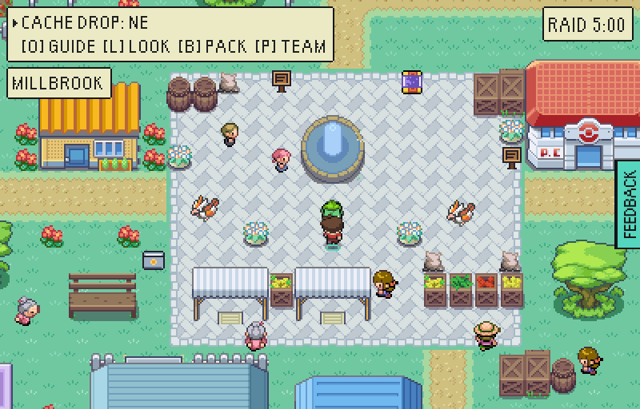
</p>

## How a raid goes

### 1. Kit up at the Raid Arena

Walk into the Raid Arena at the west end of the harbour, and the loadout is the first thing you
see. Pick who comes with you and what goes in the pack. Everything you take is at risk, which is the
point: a Potion in the pack is a Potion you might lose, and a Potion left at home is a fight you
might lose instead. The pack is a grid of squares, not a list, so a Super Potion and a crate of
parts are fighting for the same space.

<p align="center">
  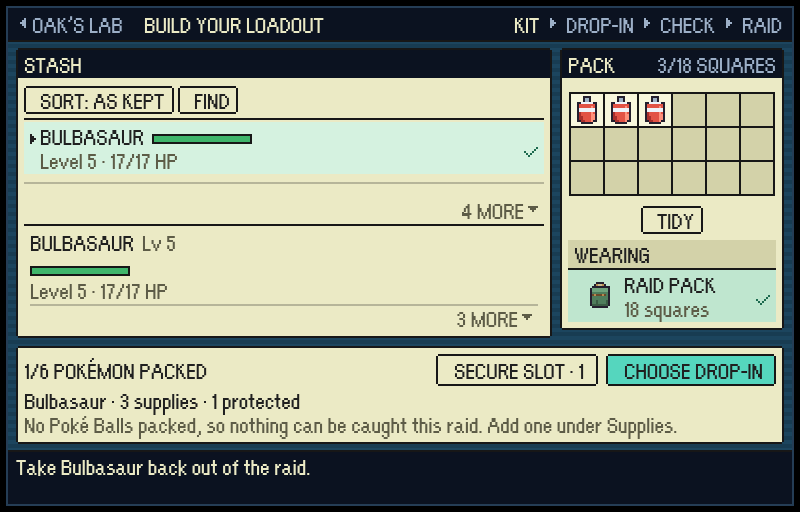
</p>

### 2. Drop in, and the clock starts

One map, Greystone Vale, drawn tile by tile and far bigger than one raid can cover, so there is
always somewhere you didn't get to. Tall grass rolls wild encounters, and whatever lives in the water
bites on a rod, if you can spare the clock to stand there. Landmarks hide caches, and the good
ones are padlocked: bring a Lockpick, and expect it to snap. There is a gate only its own key
opens, and somewhere on the map is the key. Find it, get it home, and from then on you can bring
it along for a shortcut out. Lose a raid with it in your pack and it's gone. Contracts
from the board send you looking for something specific. Somewhere on the map there is a prize,
glinting, that is definitely worth the detour. Probably.

<p align="center">
  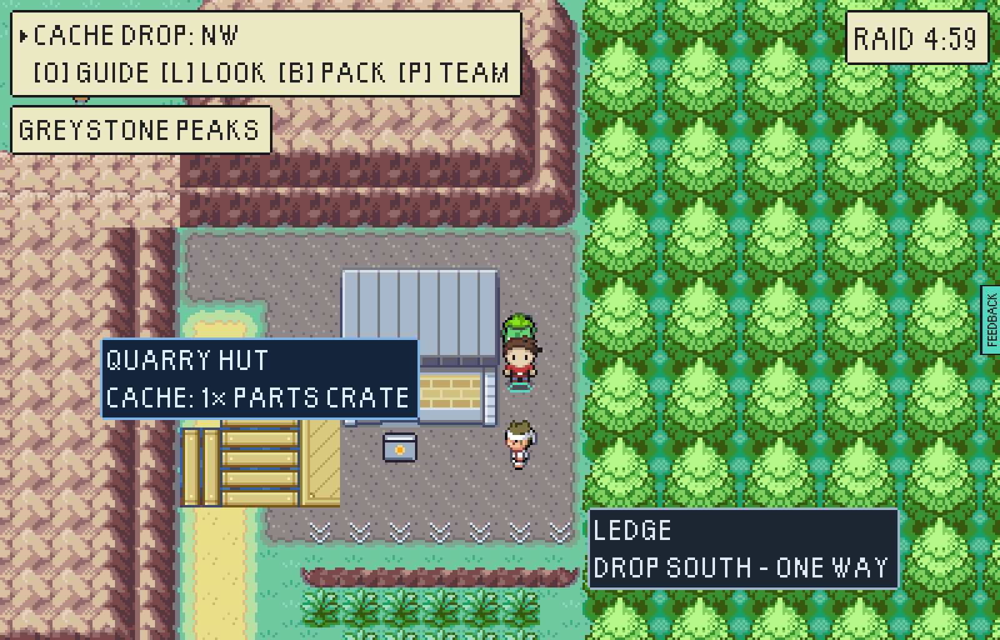
</p>

### 3. Somebody's coming

Every raid, one of five rivals is sent after you, and you'll know about it. They bring one Pokémon
for each of yours that can still fight, a few levels below it, led by their own favourite and
evolving as they level, so a Charizard gets a Raticate, not a Rattata. Walking into them, or letting
them walk into you, means a fight. They close in as you walk, and standing still won't hide you
either. Running away always works, but costs you a chunk of the clock, so a raid that runs from
everything ends up running out of time instead. Beat them and they're gone for good. Well, until the
clock runs out.

<p align="center">
  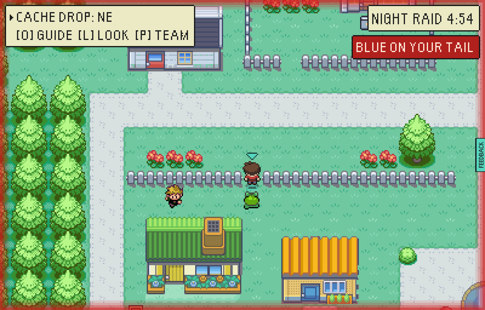
</p>

### 4. Fight like it's 2004

Battles play by Gen III rules, the FireRed and LeafGreen ones: their stats, their learnsets,
their seventeen types, abilities, weather, status, catching odds and experience. The roster is
Kanto's original 151. Catch something good in a raid and it rides home in your pack, where it
takes up squares like everything else: four for a first-stage Pokémon, six once it has evolved,
nine for a final form. Catching is a packing decision now. Sorry. Want your partner to stay
pocket-sized? Press ESC while it evolves, the way you mashed B in 2004, and it will try again
at its next level.

<p align="center">
  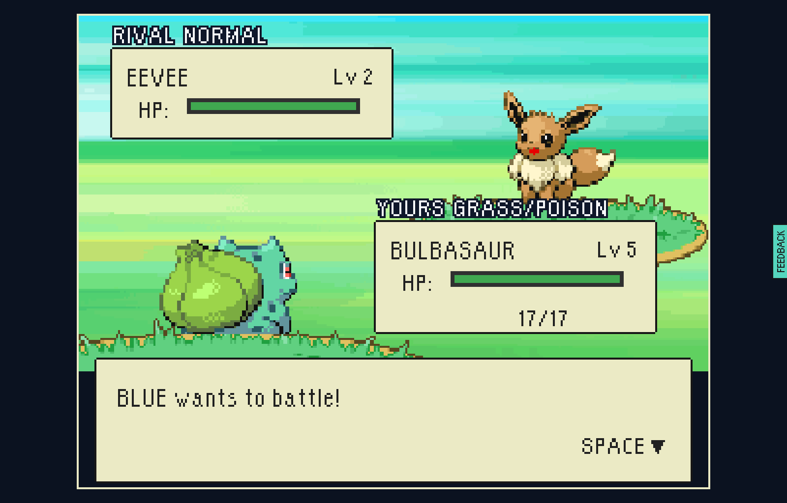
</p>

### 5. Get out (or don't)

Make it to an exit and everything you carried is banked for good. Go down instead and the pack is
gone, along with every Pokémon you brought that wasn't tucked into the secure container. The
result screen is very polite about it either way.

<p align="center">
  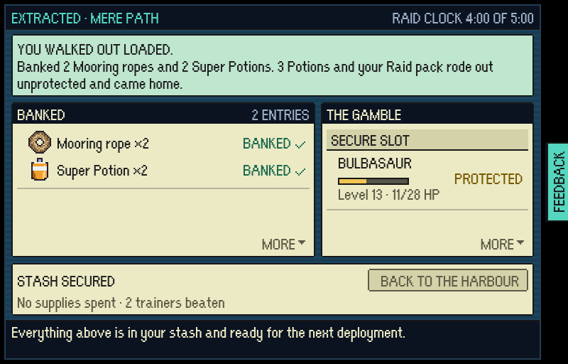
  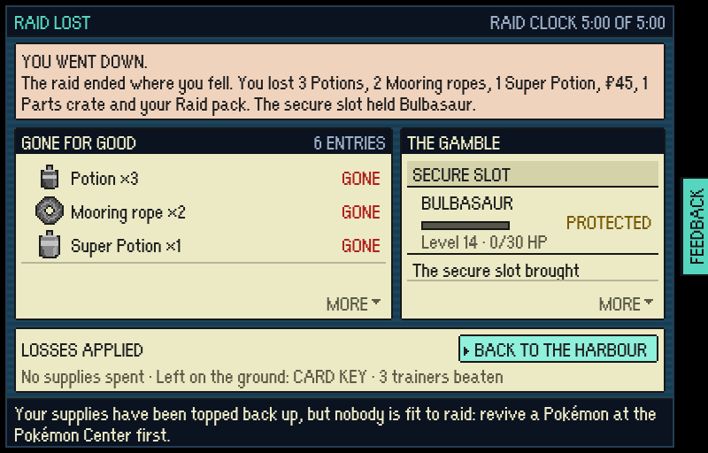
</p>

<p align="center"><sub>You'll never be left with nothing, mind. Lose everything and the base quietly tops you back up to a kit you can deploy with.</sub></p>

## Your pack is a puzzle

Every item takes a different number of squares, so a good raid is the one where the pack runs
out before the map does. Lay it out however you like: pick a piece up, carry it, turn it with
<kbd>R</kbd>, put it down, and it stays where you put it, raid after raid. There are four packs,
from a twelve-square Satchel to a thirty-square Hauler frame, and the one you're wearing is lost,
with everything in it, if you don't make it home.

And then there's the Bicycle: FireRed's own, rarer than anything else you'll find out there, and
twice as fast as walking anywhere that isn't indoors. It's also six squares of your pack, wider
than the secure container you start with, so every raid you ride it is a raid you could lose it.

<p align="center">
  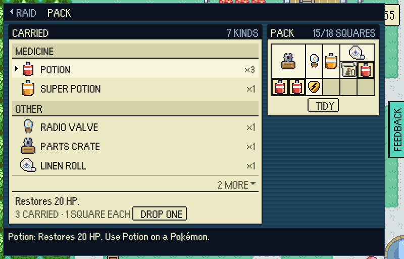
</p>

## Home sweet Harbour

Between raids you're at The Harbour, your own little base, and it's a place you walk around rather
than a menu. It's everybody's harbour, too: everyone playing Pallet Town walks the same one, live,
with the name on their front door over their head, and they see yours. Press **K** in your house or on its step to knock on somebody else's door; if they're in
and say yes, you're let in to have a nose round. Five buildings, four of them kept by people you'll recognise, and each one is a thing you can do:

- **The Raid Arena**, a Gym on its own stone forecourt at the west end, by the jetty, is where every
  raid starts: walk in and you're kitting up.
- **Professor Oak's Lab** keeps the contract board, and a wall map that lights up wherever you've
  walked.
- **Nurse Joy's Pokémon Center** looks after the team. She heals in full, and she charges in
  time: what she spends comes off your next raid's clock.
- **Brock's Workshop** builds permanent upgrades, paid for in the materials you haul home, and
  every one of them turns up on the map: a radio mast, a beacon, cellar doors in the quay wall.
- **Bill's cottage**, down on the quay, is where Pokédollars go, and where gear, evolution stones,
  HMs, fishing rods and, once he really trusts you, a Bicycle are bartered for things you found. Everything you trade him ends up on his
  shelves.

At the end of the row, behind the window boxes, is a fifth: **The Bolthole**, which is yours.
When you start a game it asks, as FireRed does, **YOUR NAME?** - and it's one each: nobody else
in Pallet Town can have yours. After that it's your name on the door, over your head in the
harbour and on every board.
It's the player's house from FireRed, downstairs and up, and it fills up with what you've done:
a badge case with a slot for every keeper in Kanto, lit as you beat them; a pennant on your
bedroom wall for every place you've come home from; a telly whose Kanto Tonight tells you which
rival is hunting you next; a raid log on your PC; a rug the colour of your starter; and, under
the telly, a games console. It plays **Pallet Blocks**, a falling-blocks game of its own, full
screen, and every game you finish goes up on a Pallet Town leaderboard under that name,
so you can see who in town is better at it than you. It keeps
your hours, too: the window goes orange at dusk and dark at night, there's a pumpkin by the door
all October and a tree in the corner all December. Nobody hunts you there.

And it's yours to arrange. Press **H** in the house and it's a Habbo room: pick things up, carry
them about, turn them round and put them down, a tile at a time. Shove the table across the room,
move the pot plants, then fill the place with a doll of every kind of Pokémon you've ever brought
back alive. Dolls go on the table. Nothing goes on the door mat.

And you never walk it alone. The starter you picked trots one step behind you, in your own
footsteps, through every door and into every room, drawn in HeartGold and SoulSilver's own
following-Pokémon art. Turn round, press Space, and it'll tell you how it's doing. It's that
Pokémon and nobody else, so lose it in a raid and the Harbour gets very quiet.

<p align="center">
  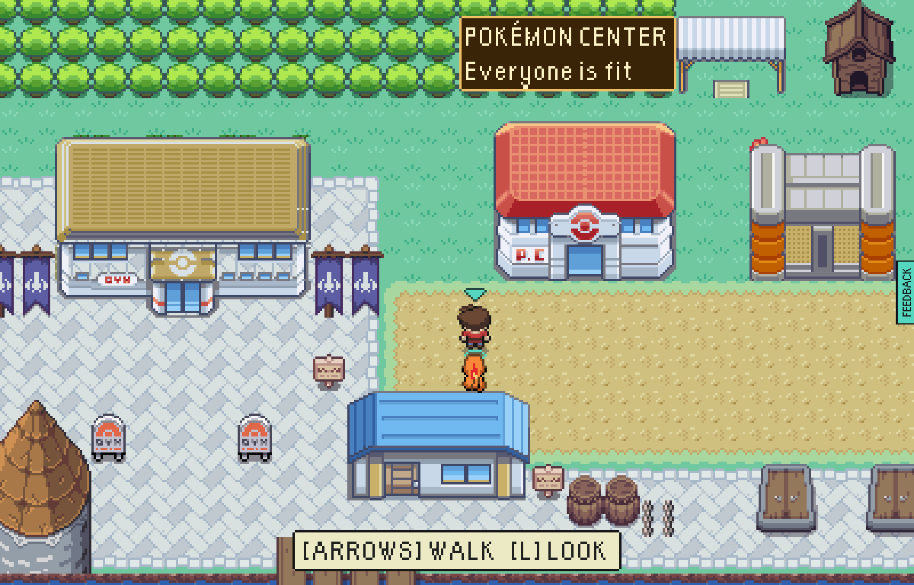
</p>

<p align="center">
  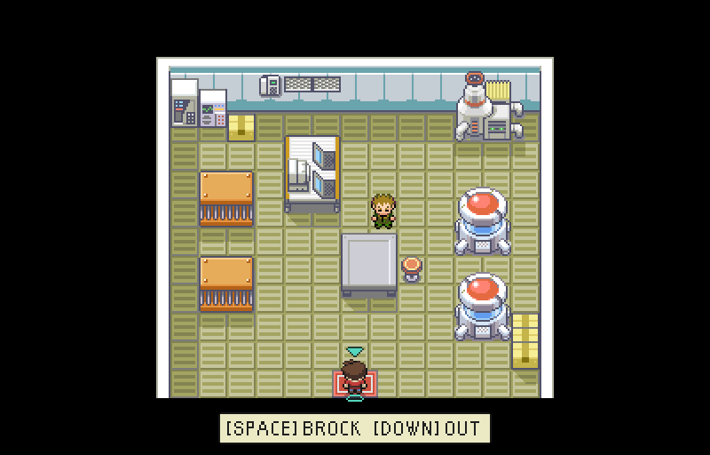
</p>

## The cast

<p align="center">
  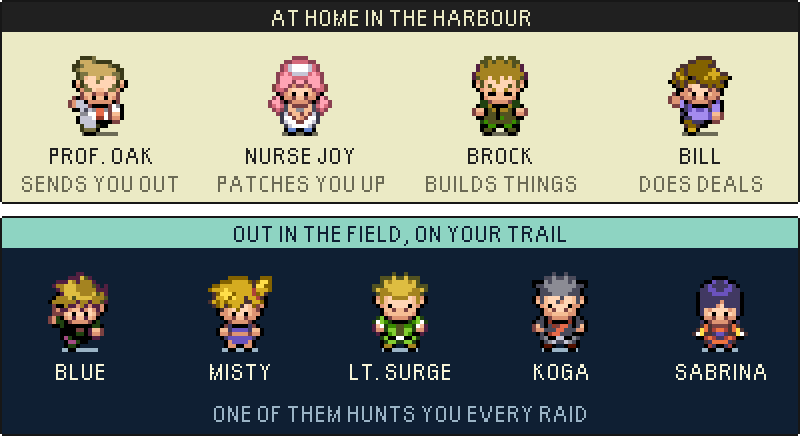
</p>

The five rivals take turns, one per raid, and each has their own voice for arriving, catching you,
losing you and losing to you. None of them is subtle about it.

## The world

For now the world is one map, **Greystone Vale**: 384 tiles square, bigger than every map that came
before it put together, and drawn district by district around a mill town. Eleven ways in, and
twenty-eight ways out to find.

| Part of it | What it is |
|---|---|
| **Millbrook** | The mill town every road in the vale starts from, round Mill Square and its fountain. |
| **High Moor** and **Greystone Peaks** | A drove road over the moor past the Grey Stones, and the quarry under the peaks where the Greystone Caves open. |
| **The Crossing**, **Reedmere** and **Safari Marsh** | The river, its stone bridge and stepping stones, a mere with a duck hide, and a marsh behind the Safari Zone gate. |
| **Pine Hollow** and **Tanglewood** | Thick woods with clearings that are hard to find on purpose, and a ruined shrine. |
| **Orchard Terraces** and **The Power Station** | Terraced orchards down to the sea, and a dam, a turbine hall and a switchyard gone to grass. |
| **Gull Strand**, **The Wreck** and **The Sunken Quarter** | A beach and a jetty, a salvage camp under a wreck on the reef, and a drowned port held by Boatswain Cragg. |
| **The far places** | Stormcrown, the Moor Chapel, the Lost Garden, Frostreef and Ember Isle, each hard to reach in its own way: from the deepest cave, only at night, through a boulder puzzle, or only by boat on the tide. |

A few things worth knowing before you go:

- **The vale has a boss, and the boss holds two doors.** Win, and they stay open for good.
- **Some ways need a move, not a fight.** Teach a Pokémon Strength and the boulders in your way start to shift.
- **Prizes gleam.** A few places in the vale hold something only they have, and on a raid where one turns up you can see it shining from a long way off. Is it worth the detour with forty seconds on the clock? Yes. No. Maybe.
- **The drop-in map is dark where you haven't been.** Walk it, come home, and watch the dark pull back.
- **Contracts change how a raid goes:** survey three stakes, carry a sealed case out through one particular exit, or spend your own supplies resupplying an outpost.

## Draw your own map

Choose **MAKE A MAP** on the title screen and you get the game's own map maker: paint ground, plant
buildings, place people, signs, trainers, exits and drop-in points, then press **WALK IT** or
**RAID IT** to play it for real, clock and all. A checklist tells you whether it works before anyone else
has to find out. Send in a map you're proud of, and once it's approved it goes into the game for
everybody, under **PLAYER MAPS**, with your name on it.

<p align="center">
  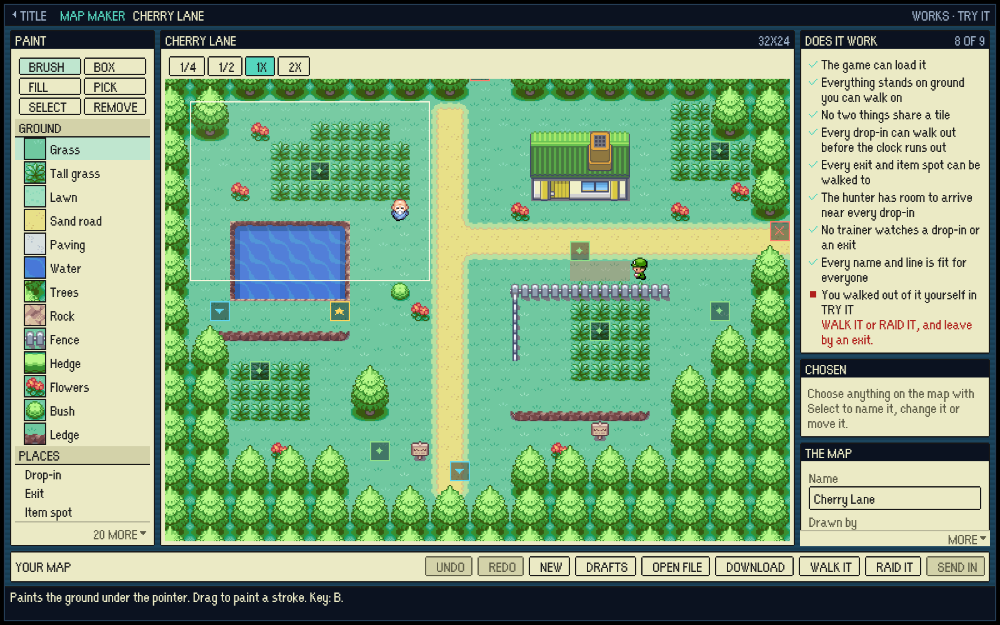
</p>

Right next to it on the title: **PLAYTEST**, an explorer's run where nobody can knock you out, every door
is open and holding <kbd>Shift</kbd> walks three times faster. For sightseeing. Purely for
sightseeing.

## Also in the box

- Pokémon that learn moves as they level, and ask before forgetting one.
- Evolution by level and by five evolution stones.
- Ten TMs and HMs to teach, the HMs bartered from Bill, and boulders only Strength will shift.
- Rain on the high tops, and it changes how the fight goes.
- Trainers who watch a stretch of road. Step into it and you're paying a toll.
- Every sound effect synthesised in the browser, except the Pokémon themselves: each one cries its own FireRed cry as it comes out, faints and gets caught.

## Controls

| Key | In a raid | At home |
|---|---|---|
| <kbd>←</kbd> <kbd>↑</kbd> <kbd>→</kbd> <kbd>↓</kbd> or <kbd>W</kbd> <kbd>A</kbd> <kbd>S</kbd> <kbd>D</kbd> | Walk | Walk |
| <kbd>Space</kbd> / <kbd>Enter</kbd> | Talk, read, work a landmark, choose | On a door mat: open that keeper's counter |
| <kbd>B</kbd> | Open the pack | |
| <kbd>P</kbd> | Open the party | |
| <kbd>O</kbd> | Open the field guide | |
| <kbd>L</kbd> (hold) | Look: every caption on screen speaks | Look |
| <kbd>K</kbd> | | In your house or on its step: knock on somebody else's door |
| <kbd>Esc</kbd> | Close a screen | Back out of a screen |

Every menu works with the mouse as well. The map maker is the other way round: you draw with a mouse or
a trackpad, and the keys just pick your tool.

## Run it on your own machine

The quickest way to play is the [live build](https://ollysalanson.github.io/escape-from-pallet-town-web/),
which updates every time `main` does. To run it yourself you need [Node.js](https://nodejs.org/):

```bash
npm install
npm run dev
```

Then open the address Vite prints. Your save lives in the browser, so it's yours alone.

## For developers

It's TypeScript, [Phaser 3](https://phaser.io/) and [Vite](https://vite.dev/), with no game server: everything runs in the page.

| Command | What it does |
|---|---|
| `npm run lint` | ESLint |
| `npm run typecheck` | TypeScript (`tsc --noEmit`) |
| `npm run test` | Vitest |
| `npm run build` | The production bundle |

Run all four (`npm run lint && npm run typecheck && npm run test && npm run build`) before opening
a pull request; GitHub runs them again on `main` after every merge. The test suite runs on four
workers so several checkouts can share one machine, and `VITEST_MAX_WORKERS=12 npm run test`
gives it the whole box.

`?testmode=1` on the dev server runs the game on the Canvas renderer at ten frames a second and
adds `pauseLoop()`, `stepFrames(n)` and `resumeLoop()` to `window.__escapeFromPalletTownGame__`,
for automated checks that drive the game in a headless browser; `?testmode=pixels` keeps WebGL for
screenshots. Neither changes a rule of the game, and a production build ignores both.

Where to read more:

- [Pitching in](CONTRIBUTING.md): bugs, ideas, maps and code, and how each one finds its way into the game.
- [AGENTS.md](AGENTS.md): how the game is put together and why, subsystem by subsystem.
- [Product direction](docs/product-direction.md): the game's promise and the player research behind it.
- [Deployment](docs/deployment.md): how GitHub Pages publishing works and how to check a deploy.
- [Driving the game in a headless browser](tools/playtest/README.md): the playtest tools, test mode and what each costs.
- [Tilesets](docs/tilesets/README.md): seeing a sheet or a map rather than imagining it.
- [The roster](docs/pokemon/roster.md): the 151, and what the import could not bring in.
- [Screens](docs/screens/): before-and-after screenshots for most of the changes the game has had.
- [docs/readme](docs/readme/README.md): how the pictures on this page are made, so they can be made again.

## The small print

This is a free fan project, made for fun. It is **not affiliated with, endorsed by or sponsored by
Nintendo, Game Freak, Creatures Inc. or The Pokémon Company**. Pokémon and every name, character and
design belonging to it are trademarks of their respective owners.

**What gets counted.** So we know whether anyone actually plays, the published game counts a few
moments: opening the game, picking a starter, starting a raid and how it ended, minutes played, maps
sent in, Pallet Blocks games and walks into the harbour. Your browser gets a random id, and that's
the only thing about you that leaves it: no cookies, no account, no name, the game keeps no IP address, and all
it stores is daily totals and which days each id turned up. Nothing is sent until you press a key or click, and a
browser a program is driving sends nothing, so bots don't count as players; anyone helping test can open the game once with
`?tester` on the address to be counted apart. Turn on Do Not Track or Global Privacy Control and nothing is sent at all.
