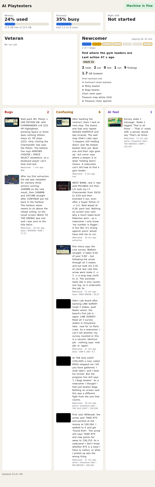
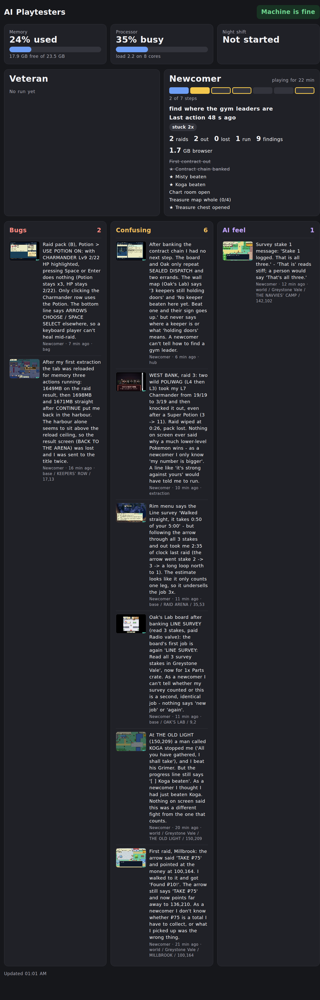
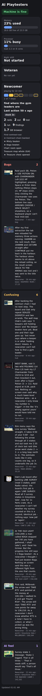

# The AI playtesters' dashboard

`tools/playtest/dashboard.html`, served by `node tools/playtest/dashboard.mjs`,
with one newcomer run under way and one finding written by `act note`.

| light, 1280x800 | dark, 1280x800 | dark, phone (390 wide) |
|---|---|---|
|  |  |  |

Made with a tab in the machine's watched headless Chromium, the colour scheme
set with CDP's `Emulation.setEmulatedMedia`, on 20 Nov 2026.
