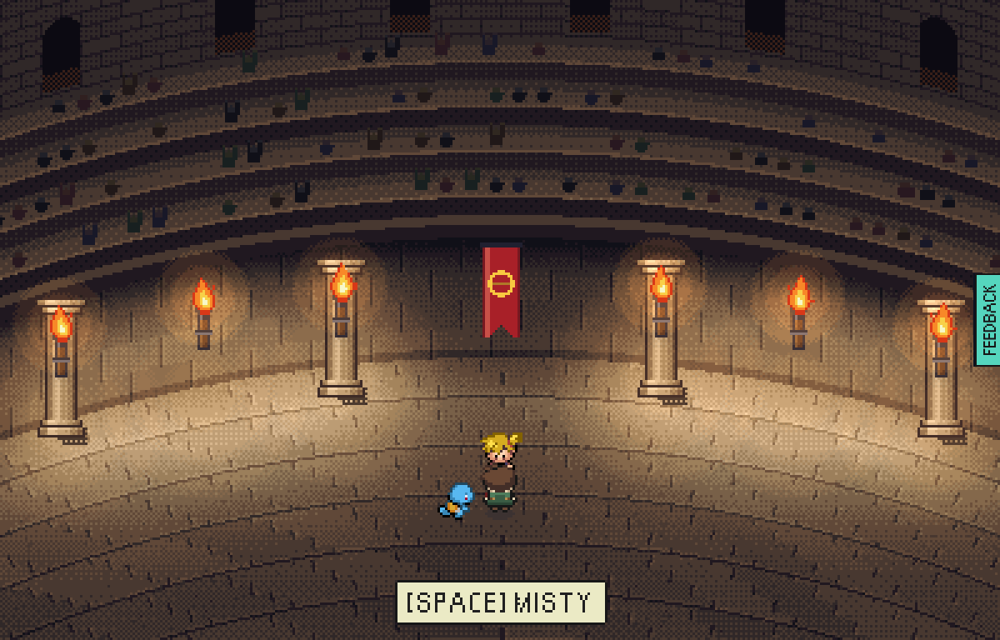
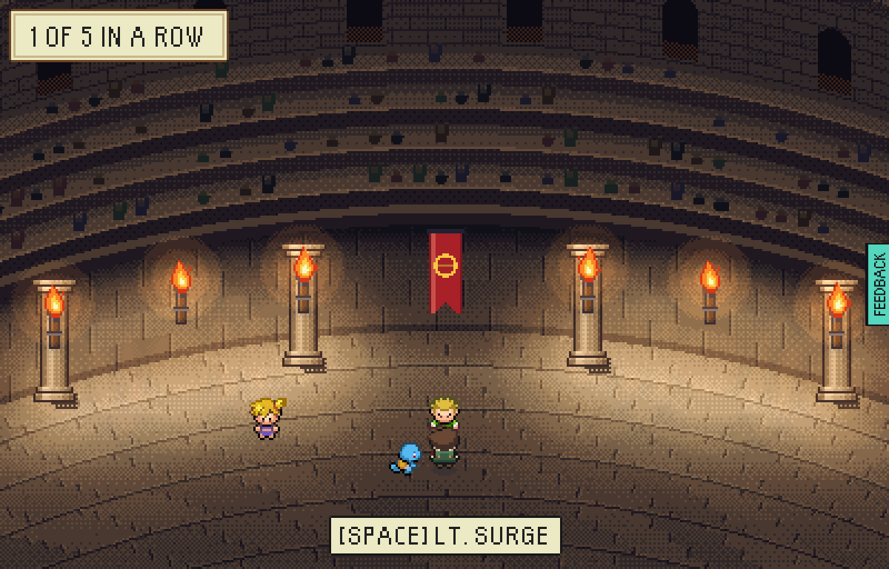
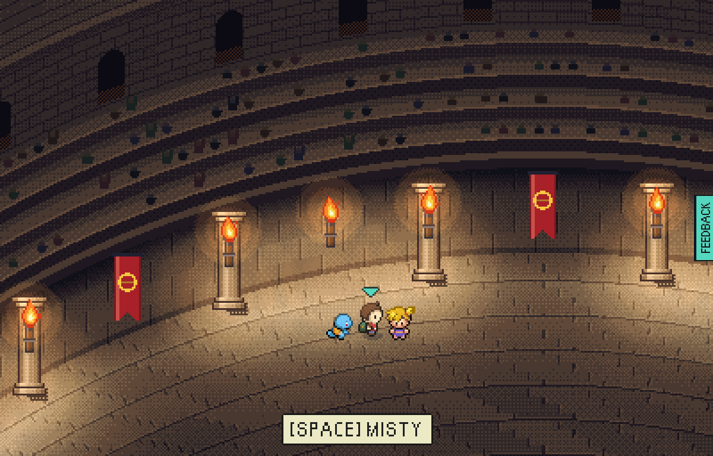
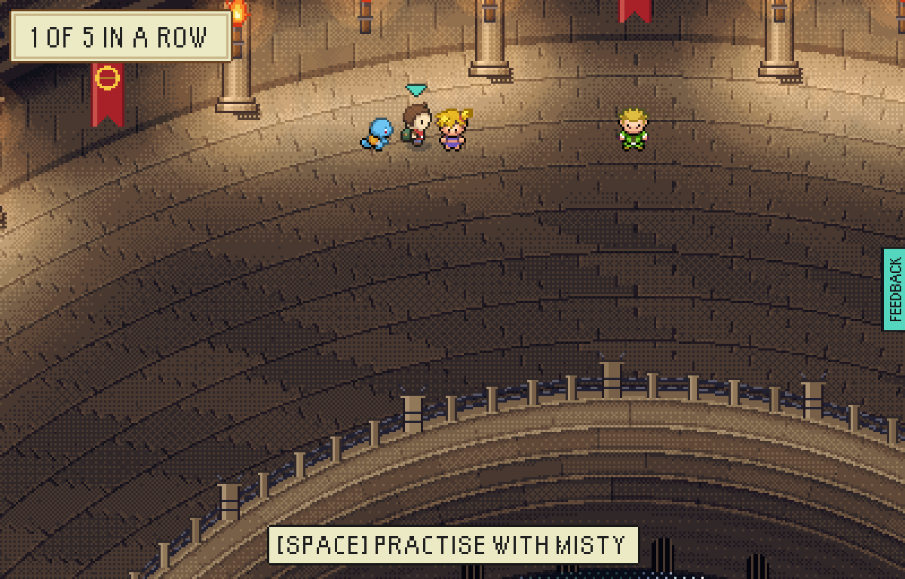

# Nobody changes places on the far floor

The owner's playtest, 12 Nov 2026: "I was in the raid arena and I went around to
the back and I fought Misty. And then when I came out of the battle, Misty and
the green NPC had swapped places."

A gym leader the player had met stood on the rival's tile (35,6) on the day they
were the rival, and on their own tile (30,6) every other day. Beating Misty in a
bout moved the ladder on, so she walked back to her own tile and Lt. Surge, up
next, took the one she had stood on. Now a leader met stands on their own tile
every day and offers the bout from there; only a rival with no gym met stands
under the hall's banner. The player also comes home from a bout or a practice
still facing whoever they fought, so the partner lands beside them rather than
peeking over their head.

Made on a test-mode build (`README.md` in `tools/playtest/`, 'Memory'), one
browser at `PIXEL_WINDOW`:

```
node tools/playtest/hallPlaces.mjs <build url> <out dir> 1 rival --pixels
```

| | Misty up for a bout | after the bout, the ladder moved on |
|---|---|---|
| before |  |  |
| after |  |  |

Before: Misty stands under the banner, and after the bout Lt. Surge is there and
Misty is five tiles west. After: Misty is on her own tile throughout, and Lt.
Surge steps up under the banner.
