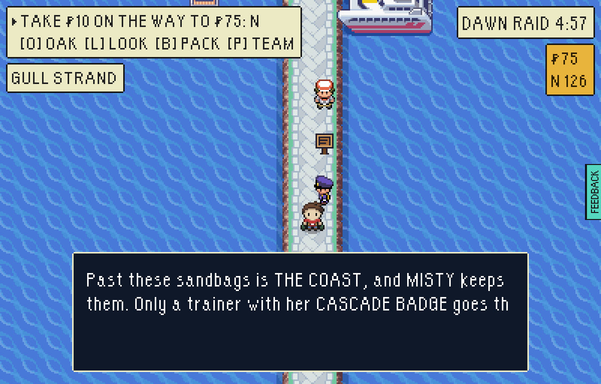
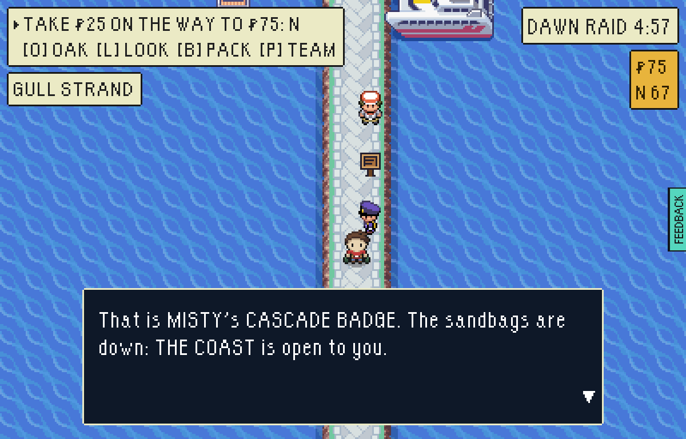

# The Coast Guards let a holder of Misty's badge through, in words too

A save that has beaten MISTY, spoken to by the Coast Guard at the sandbags on Gull Strand
(173,254). Before, he still said `Only a trainer with her CASCADE BADGE goes through`.
After, he says `That is MISTY's CASCADE BADGE. The sandbags are down: THE COAST is open
to you.` The reed trail's guard says the same. Cerulean Gym's guide also stops sending a
holder of both badges to KOGA (`kogaAfterMisty.test.ts`).

| before | after |
|---|---|
|  |  |

Made on 22 Nov 2026 against the dev server in `?testmode=pixels`, deployed with
`tools/playtest/deploy.mjs` (`beaten: ['vale-gym-misty']`, `level: 30`). The walk there
crosses the coast's trainers, who wiped a level-30 Bulbasaur on the way, so the player is
stood on the open tile beside him and the scene's own `tryInteract` is pressed (which is
why the player is drawn a little off the guard).
