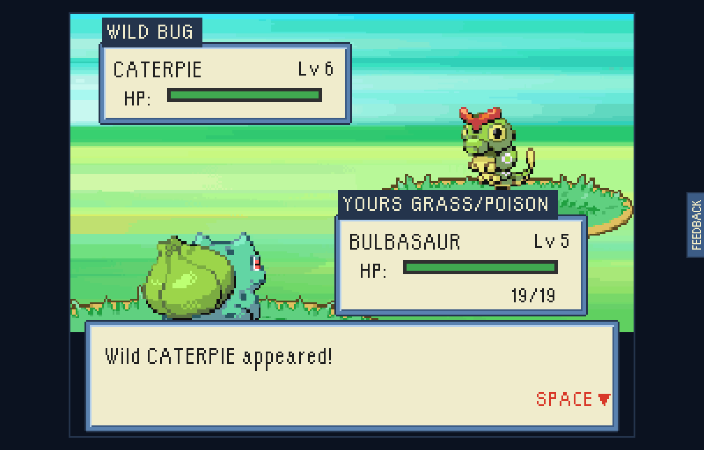
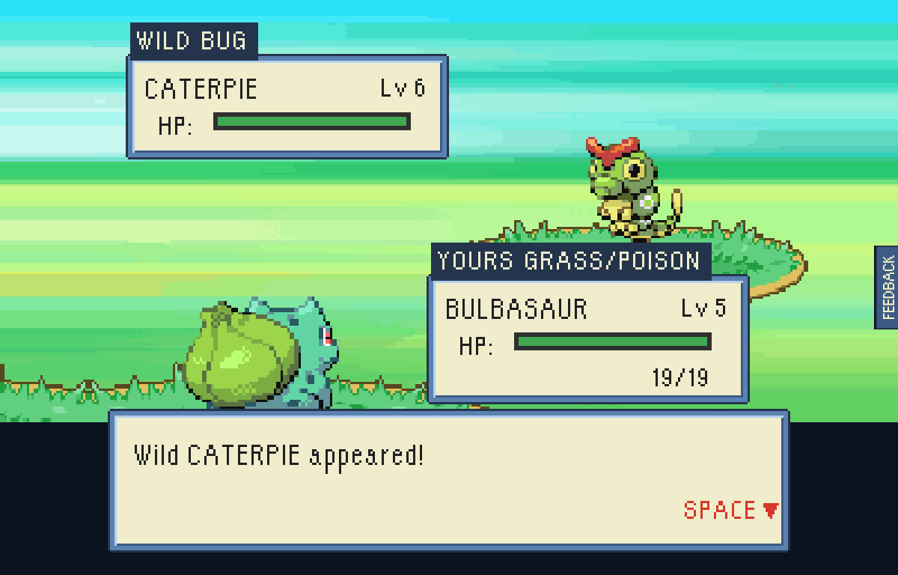
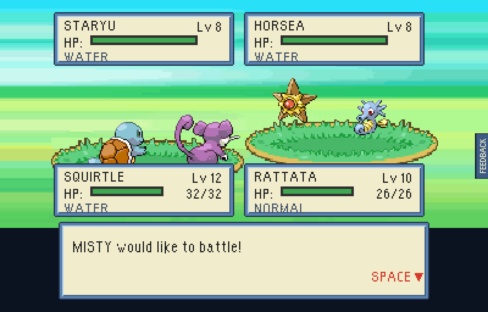
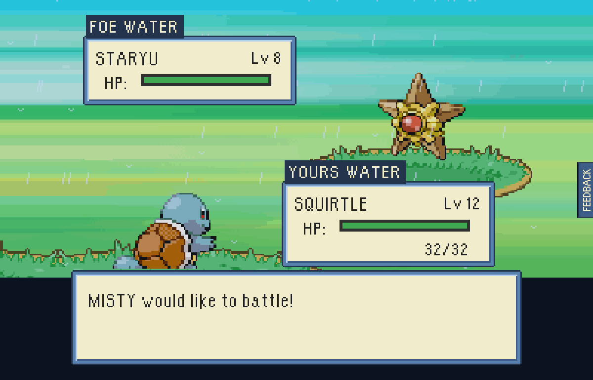

# The battle fills the screen

The battle is composed 320x240 and the screen is up to 400x256, so on a wide
window or a phone the fight sat in a navy frame with dark bars round it: a box
in a box. Now the grass art is carried on past its own edges
(`widenedBackdrop` in `src/game/scenes/battleBackdrop.ts`): every row of field
carries on as its own colour, the sky above the art is its top row's blue, and the player's
ground runs off the left edge in mirror, grass and rim, as FireRed's runs off
its screen. Nothing is stretched, and the composition is drawn exactly where it
was. The Pokemon slide in from off the widest screen, and rain falls over the
whole field.

| before | after |
|---|---|
|  |  |

| a double battle | in the rain |
|---|---|
|  |  |

Made on 25 Nov 2026 at 1200x768 (`PIXEL_WINDOW`) in `?testmode=pixels`. The
single wild fight is `tools/playtest/battleGap.mjs <build url> --shot=...`
against test-mode builds of `main` and of this branch; the double battle and the
rain are a two-Pokemon trainer started from the title on the dev server, the way
`tools/playtest/doubleItem.mjs` starts one, with `unitCount: 2` and
`weather: 'rain'`.
