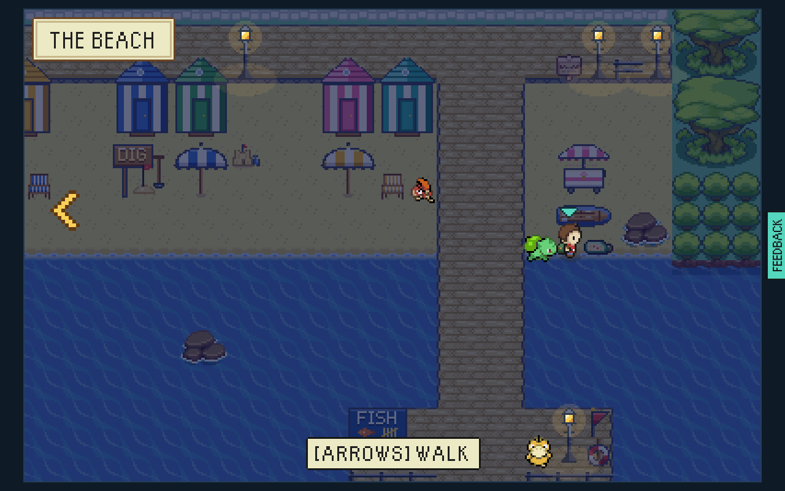
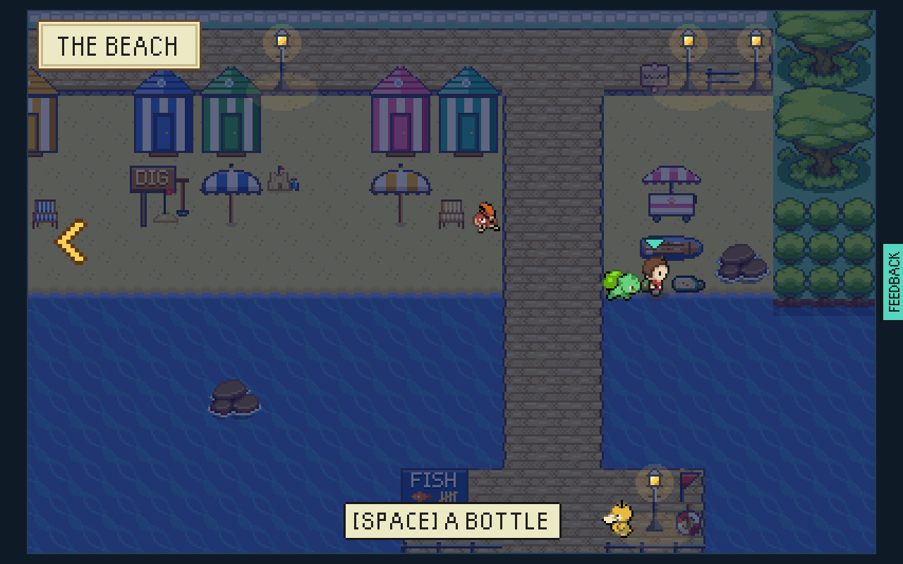

# Facing the bottle on THE BEACH says so

A new save's harbour, stood beside the bottle on THE BEACH (84,22) after walking
up to it from the west. Before, the hint line said only the yard's key line
(`[ARROWS] WALK`). After, it says `[SPACE] A BOTTLE`.

| before | after |
|---|---|
|  |  |

Made on 22 Nov 2026 against the dev server in `?testmode=pixels`, with a driver
that walks the yard's collision to 82,22 and steps right once.
