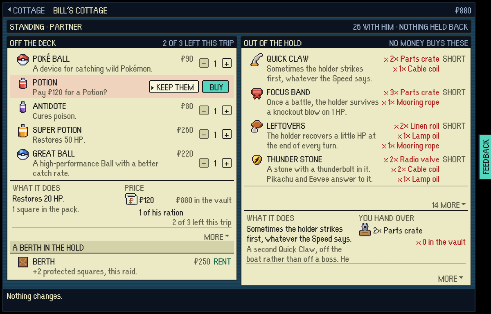
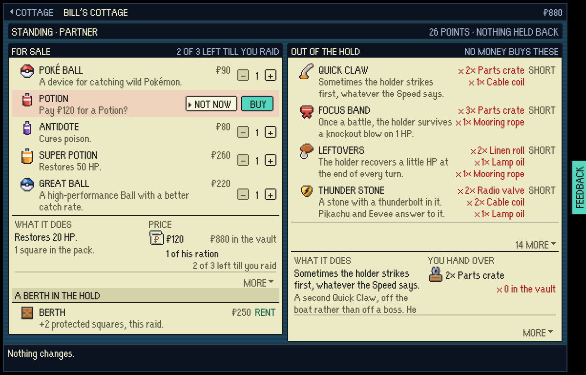
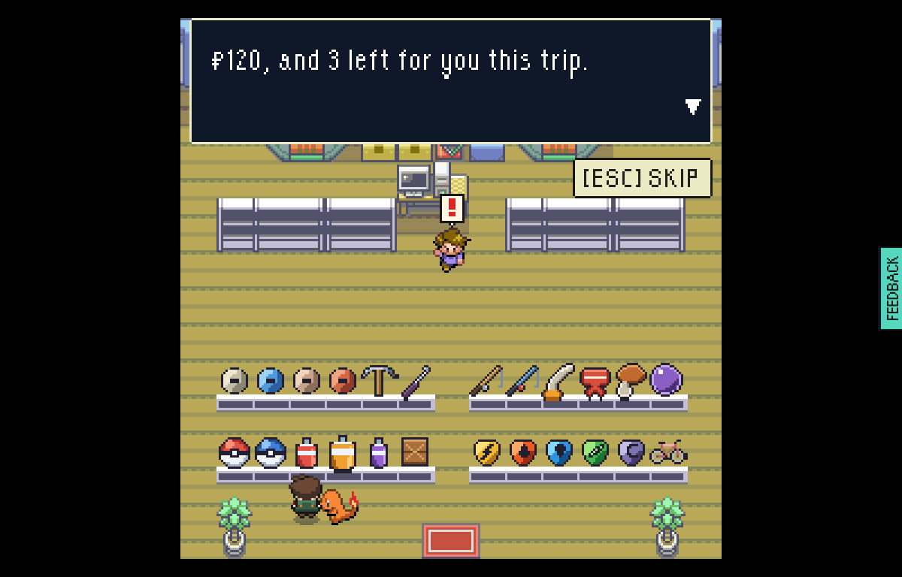
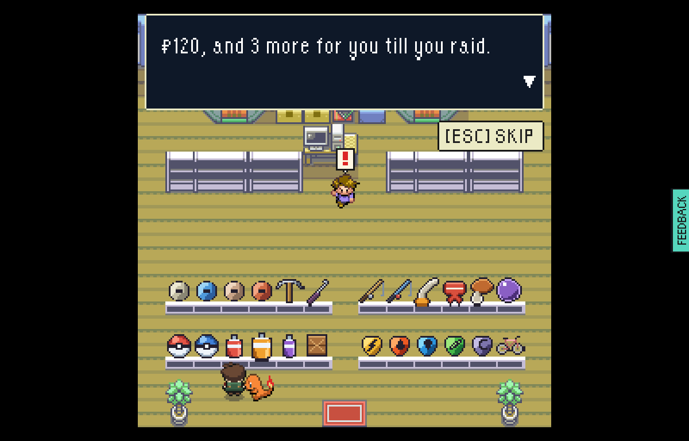

# Bill says what he sells in plain words

Ten findings of the 22 Nov AI playtest could not parse Bill: 'One thing off
the deck a trip', '1 of 1 left off the deck this trip', a `KEEP THEM` button
(keep what?), a Poké Ball marked `SPENT` that was never bought, and a standing
of `0 WITH HIM · 6 MORE` beside his 'bank 3 jobs'. Now:

- his ration is said in raids: `I'll sell you one thing a raid`, `2 of 3 left
  till you raid`, `₽120, and 3 more for you till you raid.`;
- the shelf is headed `For sale`, and a row his ration has run out on says
  `Next raid` rather than `Spent`;
- an asked deal (his, and the prize window's) is `NOT NOW` / `BUY`;
- standing is counted in `points`, beside the line that prices them (a job is
  +2, so 6 points is his 3 jobs);
- and his lines take contractions ('I don't know you').

| before (main) | after |
|---|---|
|  |  |
|  |  |

From `tools/playtest/billShelf.mjs` against a test-mode build (main's own copy
of the driver for the before), 22 Nov 2026.
