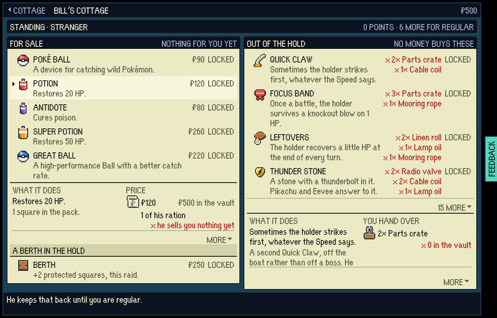
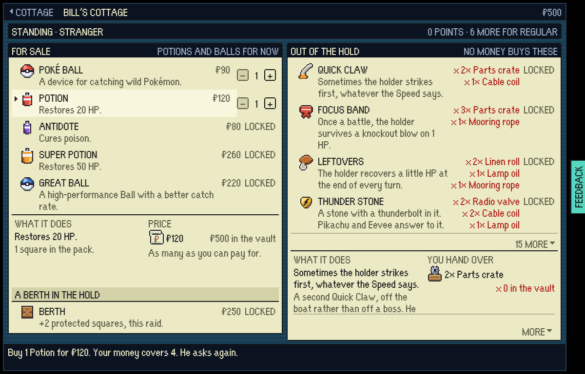
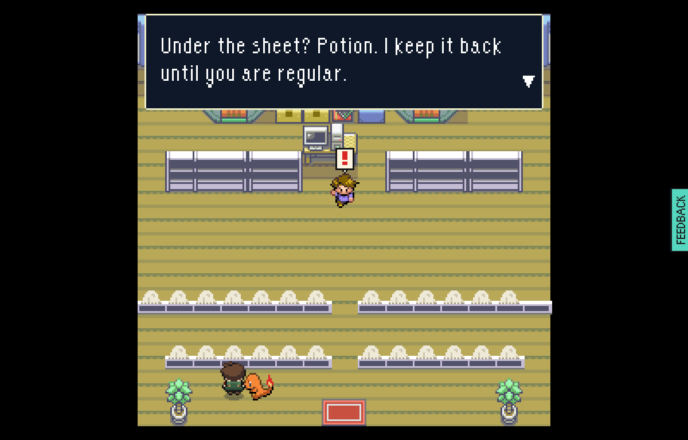
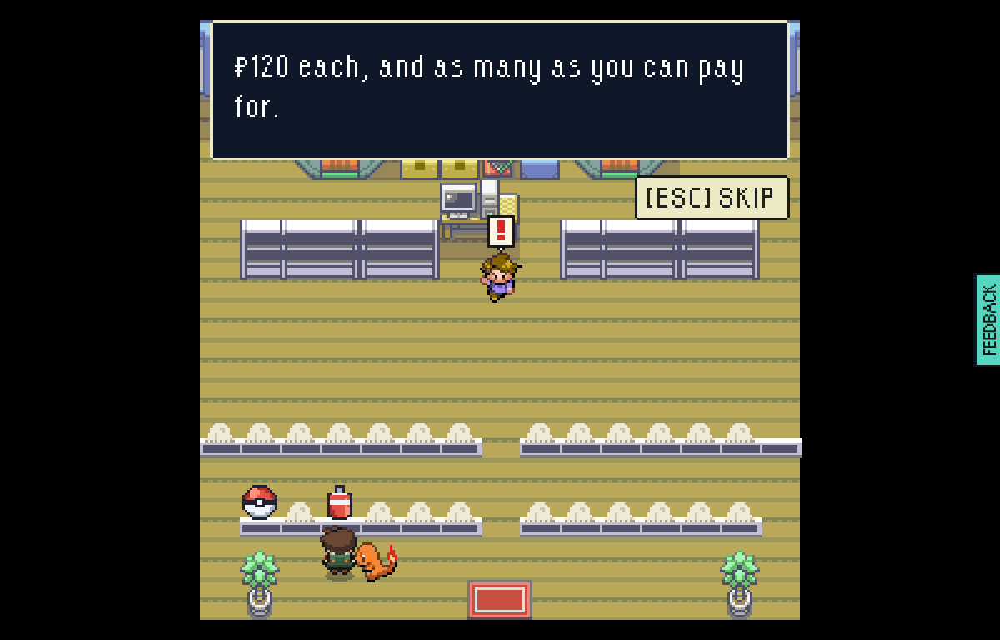

# Bill sells anybody Potions and Poké Balls

A fresh save (a stranger to Bill, ₽500 in the vault), standing at the Potion on his cottage shelves and then on his whole list.

| | before | after |
|---|---|---|
| His list |  |  |
| The Potion on his shelf |  |  |

Before, a stranger was sold nothing at any price: Potions and Poké Balls waited for REGULAR (three jobs banked), and after that he sold one thing a raid. Now both are on the shelf for anybody, as many as the money covers, and they never spend the raid's ration. The Antidote, Super Potion and Great Ball are still kept back by standing and rationed. The Antidote opens at REGULAR, so a regular's one thing a raid still has something to buy.

Made against a test-mode build (`VITE_EPTW_TEST_MODE=1 npx vite build`, served under its Pages subpath) at `?testmode=pixels`, by a one-off copy of `tools/playtest/billShelf.mjs` that seeds a stranger with ₽500 instead of a partner.
