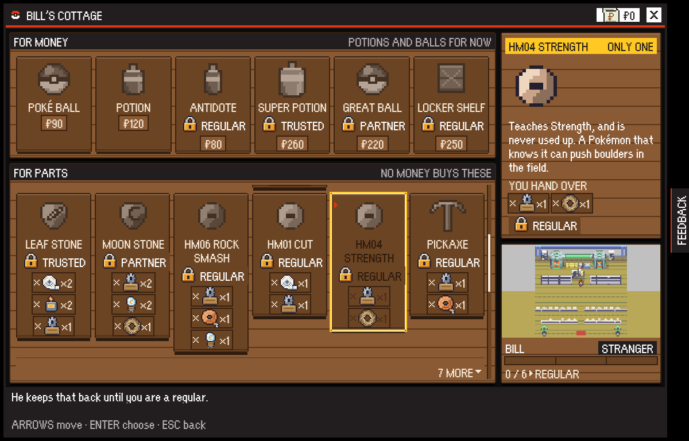
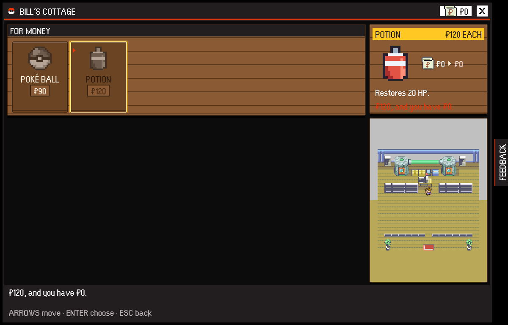
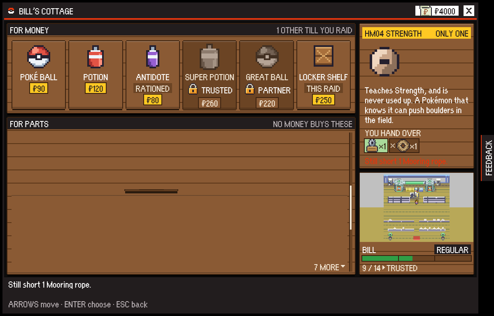
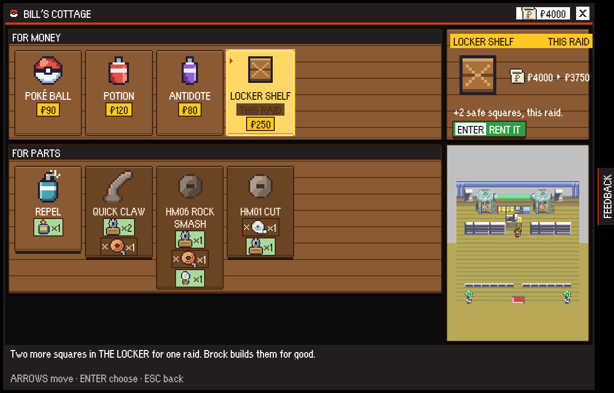

# Bill keeps a small counter

Bill's list is a small shop now (`src/game/base/billGoods.ts`): at most eight
things, only what he sells this player and the trades they hold a part for, in
the order they stand on his shelf row by the door. Nothing he keeps back is
shown, so there are no padlocks, no rank words, no ration note and no
standing bar; the trades only appear once something he wants has come home.

Chosen 28 Nov 2026 as contest bill-shop-1's C (both judges and the blind new
player picked it too).

| | before (main) | after |
|---|---|---|
| Sam, home from the first raid |  25 cards, 23 padlocks |  2 cards |
| Midgame, money and parts |  25 cards, 13 padlocks |  8 cards |

`before-clip.webm` and `after-clip.webm` play both visits end to end: the room
from the mat, a word with Bill, YES to his list, and the cursor walked along it.

Made at 1200x768 with

    node tools/playtest/billShopClip.mjs <cdp port> <pixels build url> save-after-first-raid.json <out dir>
    node tools/playtest/billShopClip.mjs <cdp port> <pixels build url> save-midgame-rich.json <out dir>
    node tools/playtest/encodeClip.mjs after-clip <out dir 1> <out dir 2>

against `VITE_EPTW_TEST_MODE=pixels` builds of `main` (c6e0bbbd) and this
branch, served under `/escape-from-pallet-town-web/`. Each picture is the last
frame of its visit; the card and padlock counts are from `visit.json`.
