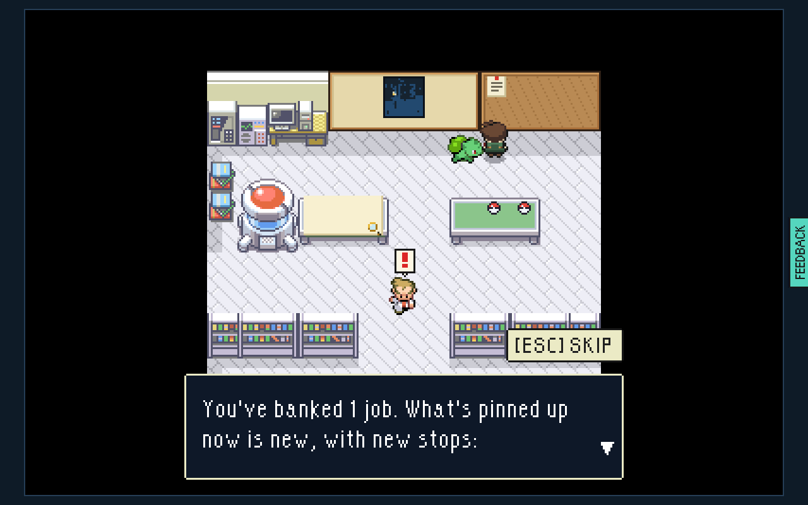

# Oak's board says the job after a banked one is new

Oak's Lab on a save that has banked one job. The board deals LINE SURVEY again, with
its stakes in new places. Before, it read word for word as the job just banked.
After, its first line says how many jobs are banked and that what is pinned up now is new.

| before | after |
|---|---|
|  |  |

Made on 22 Nov 2026 against the dev server in `?testmode=pixels`: a save with
`standingContractsBanked: 1` and three raids behind it, walked to THE BOARD and read with SPACE.
