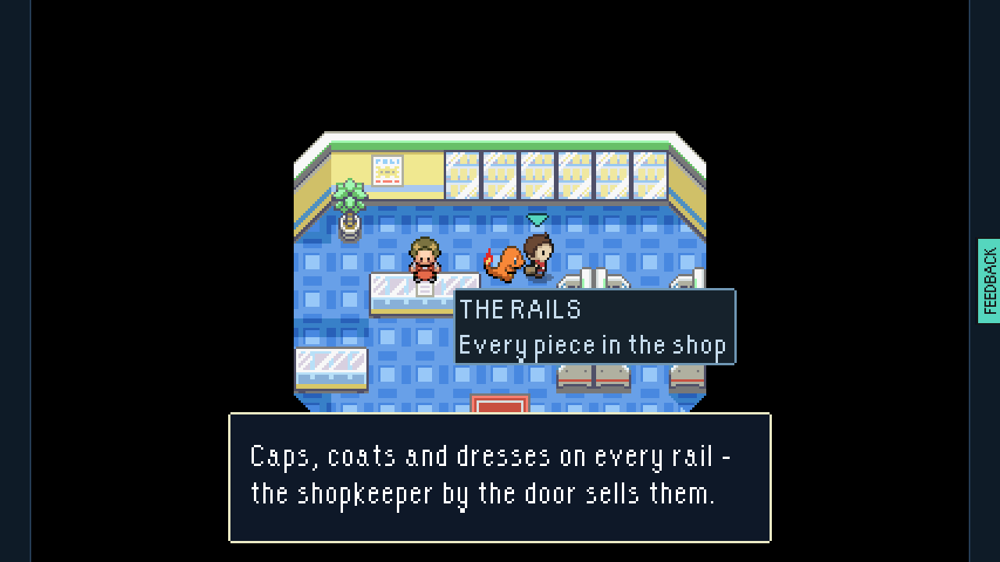
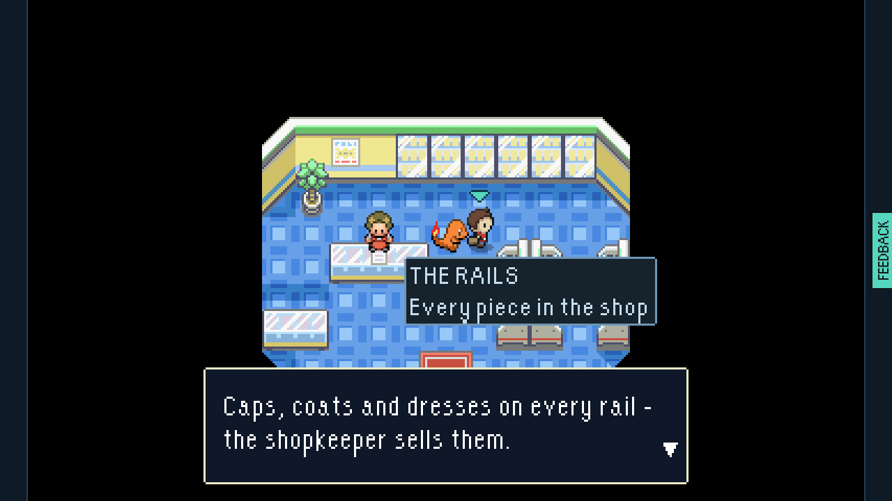

# THE RAILS no longer send you to the door

THE HARBOUR BOUTIQUE's rails said "the shopkeeper by the door sells them", but the shopkeeper stands behind the counter on the left, four rows up from the door mat. The line now says "the shopkeeper sells them", which fits one box (the first try, "at the counter", spilled half a line into a second box).

| Before | After |
|---|---|
|  |  |

Made on a test-mode build (`VITE_EPTW_TEST_MODE=1 npx vite build`), 1280x720, standing at THE RAILS (tile 6,3 of the boutique, facing right) and pressing SPACE.
