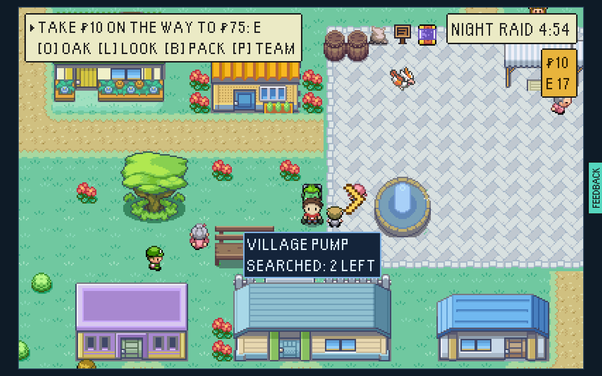
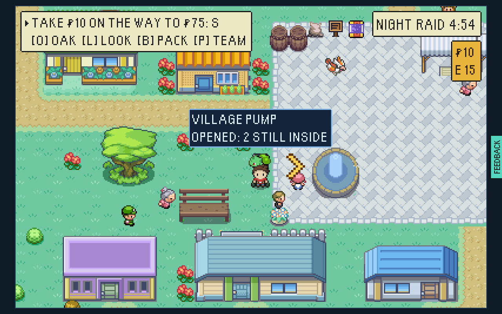

# An opened cache says what is still inside it

A new save's first raid. The player walks onto the VILLAGE PUMP cache at Mill Square,
which opens its search, and steps straight off with nothing taken. Before, the
caption read `SEARCHED: 2 LEFT`, which players read as "already emptied". After,
it reads `OPENED: 2 STILL INSIDE`.

| before | after |
|---|---|
|  |  |

Made on 22 Nov 2026 against the dev server in `?testmode=pixels`, with a driver
that deploys through `tools/playtest/deploy.mjs`, walks to the nearest cache with
`tools/playtest/route.mjs` and reads the caption from `describe()`.
