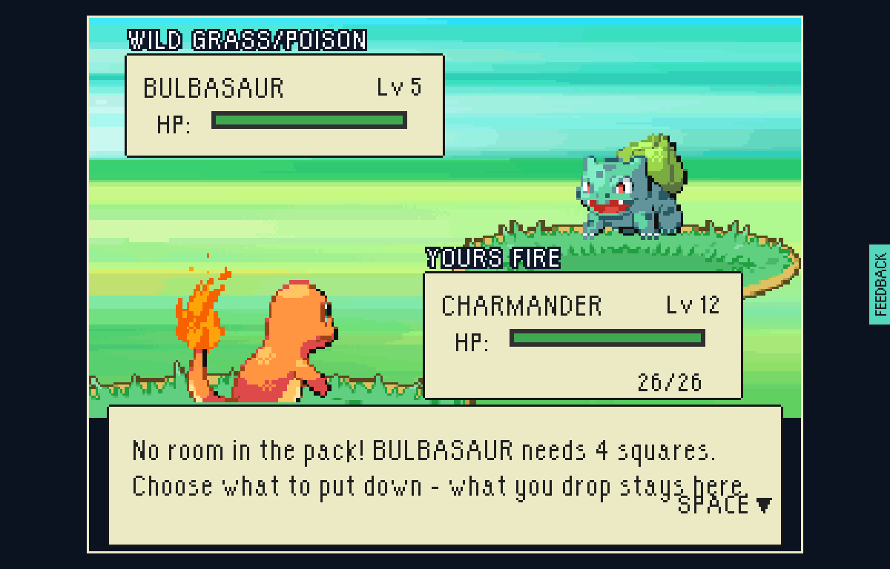
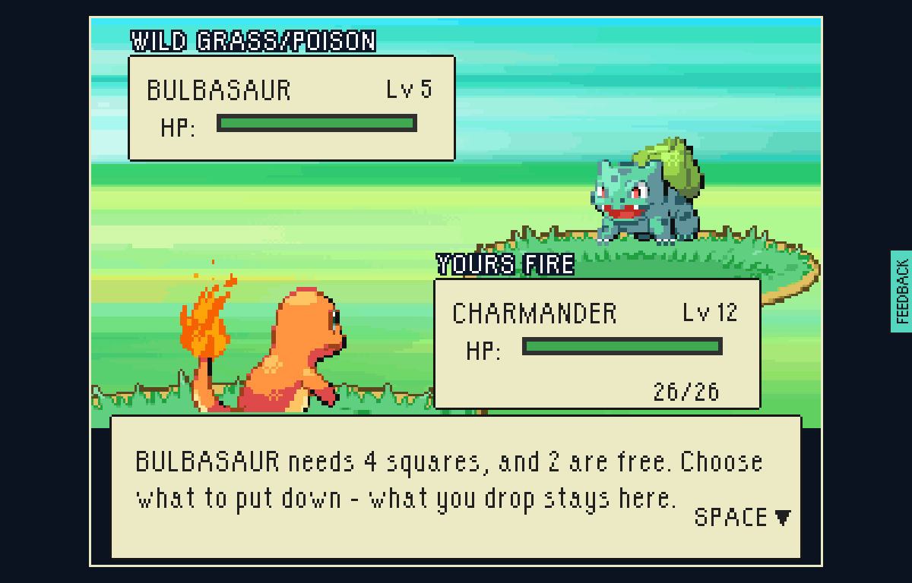

# A catch with no room says how many squares are free

A wild fight with the raid pack at 16 of 18 squares (15 Potions, 1 Poké Ball), and a
ball thrown at a Bulbasaur, which needs 4. Before, it said `No room in the pack!
BULBASAUR needs 4 squares.` and nothing about what was free. After, it says `...needs 4
squares, and 2 are free.`. When enough squares are free but not in the Pokémon's shape,
it says `..., and 4 are free, but not in its shape.`

| before | after (its second box) |
|---|---|
|  |  |

Made on 22 Nov 2026 against the dev server in `?testmode=pixels`: deployed with
`tools/playtest/deploy.mjs` and a full pack, a wild fight started through
`WorldScene.transitionToBattle`, and the ball thrown through `BattleScene.throwBall`.
(`tools/playtest/packFull.mjs` no longer reaches a wild fight: the hunter comes first
and the BALL row has moved, so a later change could bring it up to date.)
