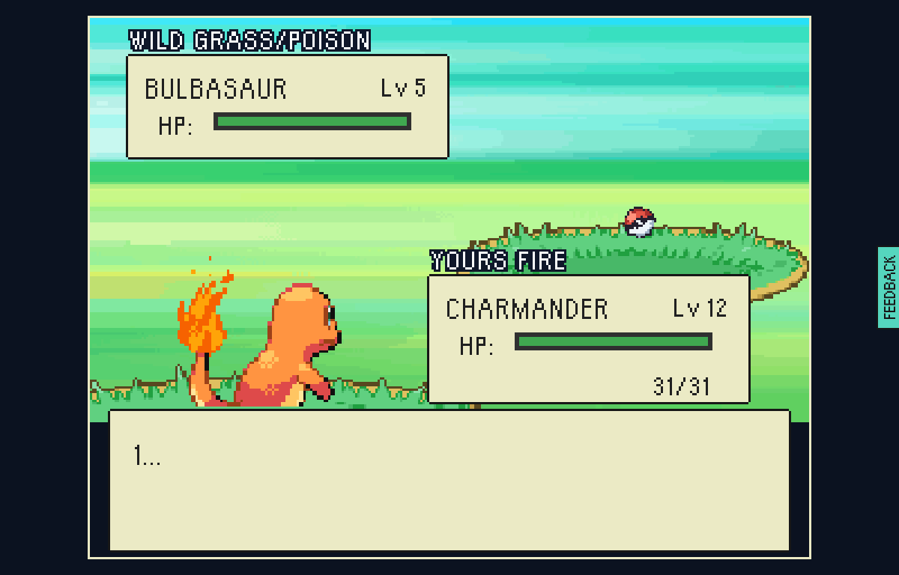
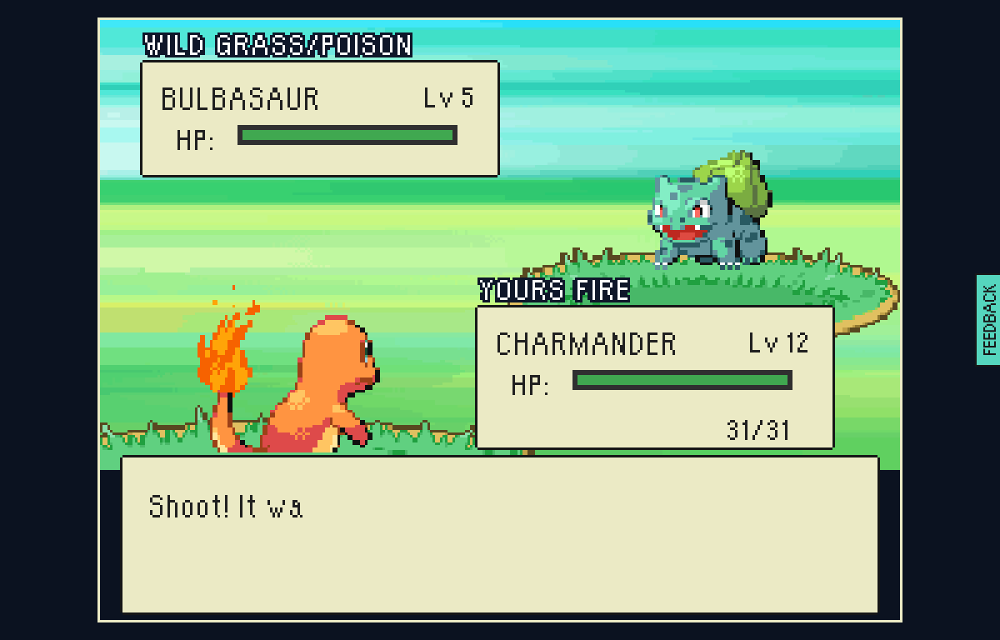

# A catch's shakes move on by themselves

A ball thrown at a wild Bulbasaur, SPACE pressed once past "Threw a POKé BALL at
BULBASAUR!", and then no key at all for six seconds of game time, read every half second.

- Before: `1...` for all twelve readings. The ball had wobbled, and the box waited for a key.
- After: `2...`, `2...`, `3...`, then `Shoot! It was so close, too!`, which waits for a key
  as every result line does.

| before (two seconds in) | after (two seconds in) |
|---|---|
|  |  |

Made on 22 Nov 2026 against the dev server in `?testmode=pixels`: deployed with
`tools/playtest/deploy.mjs`, a wild fight started through `WorldScene.transitionToBattle`,
and the ball thrown through `BattleScene.throwBall`, on stepped frames.
