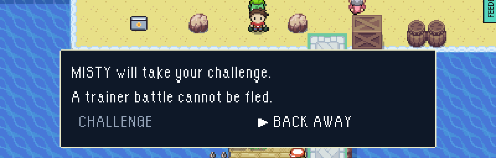
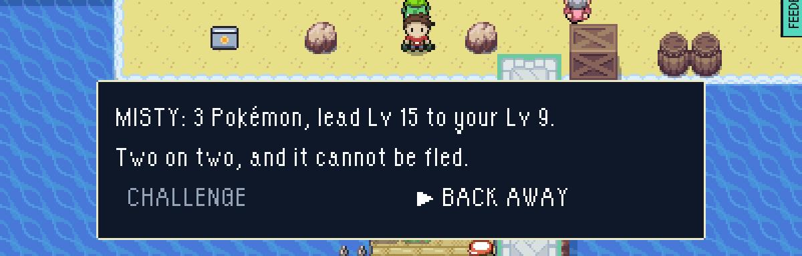
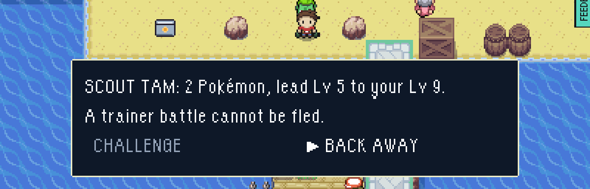
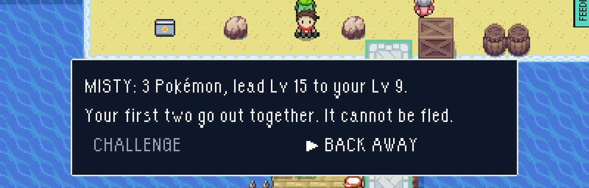

# A trainer's challenge says what is in the fight

Speaking to a trainer asks CHALLENGE or BACK AWAY. It used to name the trainer
and say the fight could not be fled, and nothing else, so the 22 Nov AI
playtesters' newcomers took their first fight against a trainer two levels up
with two Pokémon, and walked into MISTY's two-on-two at level 9 against her
level 15s, a dozen packs lost between them. It now says how many Pokémon the
trainer has and their lead's level against yours, in the rim's own words for a
hunter, and says 'Two on two' when the engine would make it a double battle.

| before (main) | after |
|---|---|
|  |  |

After, a single battle: 

Made with a test-mode build at `PIXEL_WINDOW`, deployed to THE STRAND at level 9
(a Bulbasaur, plus a level 9 Slowpoke for the double), with the prompt opened on
the trainer's encounter through `WorldScene.askForTrainerChallenge`, 22 Nov 2026.

Later the same day the double battle's line became `Your first two go out
together. It cannot be fled.`: 'Two on two' still left a level-2 catch walked
out beside the starter and knocked out on turn one, and the answer, a team of
one, is the player's to take:

