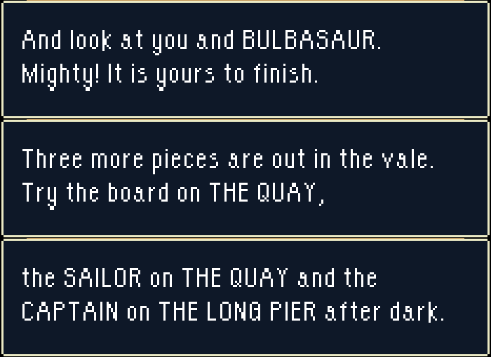

# MARLOW and Oak say who knows of a missing chart piece

Once the bottle's piece was pinned, MARLOW said the other three 'turn up in
GREYSTONE VALE, under the right sky. Ask round the harbour.', and Oak's chart
table 'The board, the sailors and BILL hear things.' The 22 Nov AI playtesters
asked Bill (who knows nothing about charts), could not find a sailor, read 'the
right sky' as weather, and the trail went cold (eight findings, one gave up).

Now both name the people whose rumours lead to each piece still out, and
where they stand (`chartLeads` in `src/game/treasure/chartTable.ts`, read off
`world/rumours.ts`, so it shrinks as pieces go up): `Try the board on THE QUAY,
the SAILOR on THE QUAY and the CAPTAIN on THE LONG PIER after dark.` MARLOW says
'at the right hour' (dusk, night, a Sunday), and Oak adds that each has a word
a day.

MARLOW as the first piece goes up, from `tools/playtest/treasureHunt.mjs`
against a test-mode build, 22 Nov 2026.
