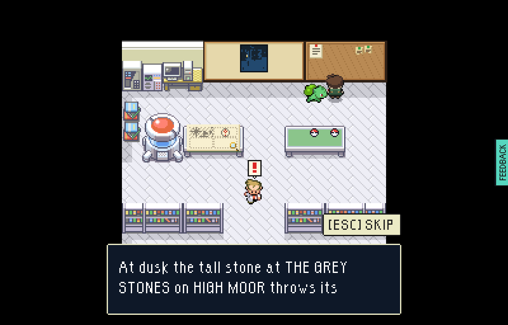
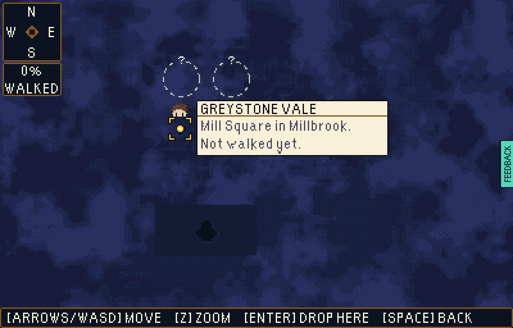
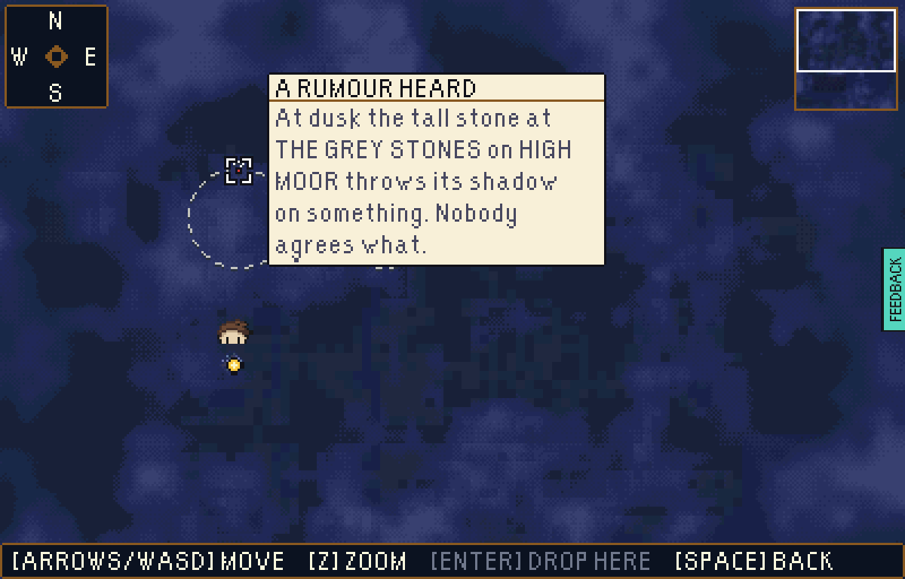
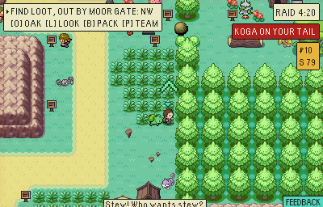
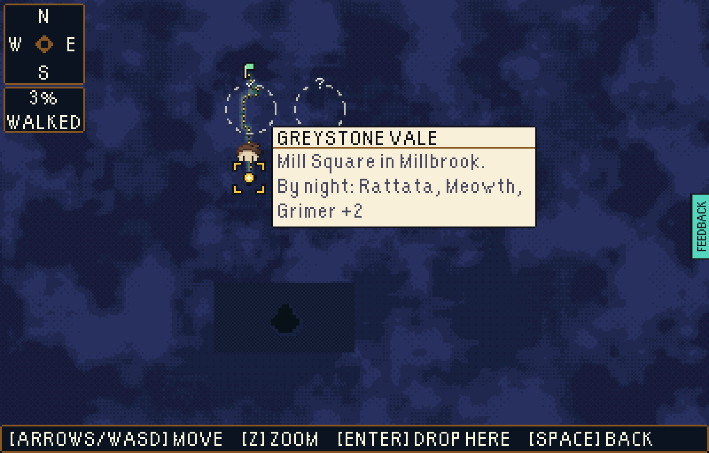
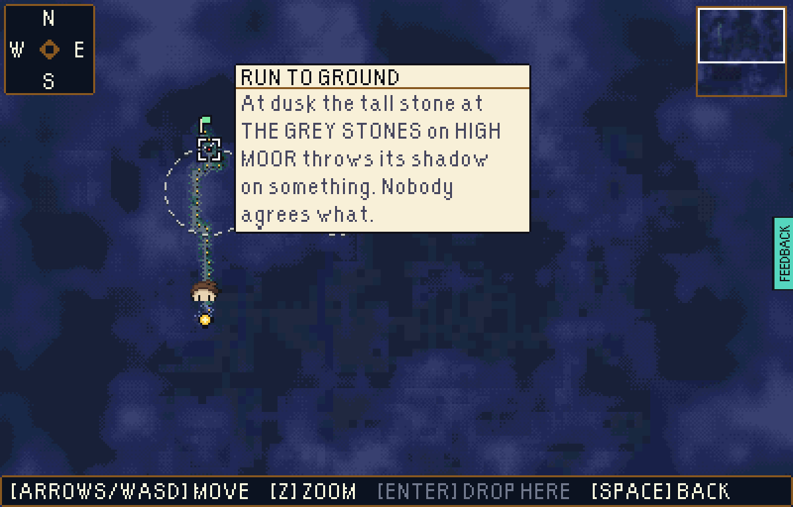
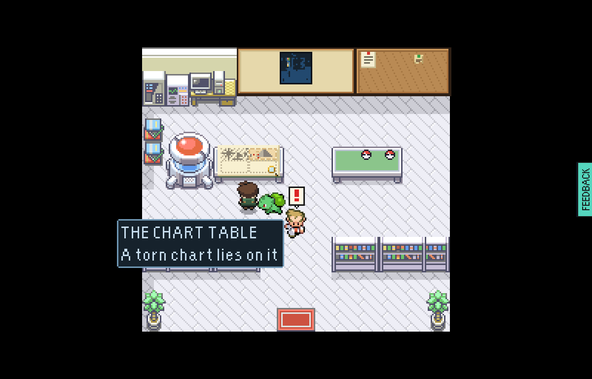
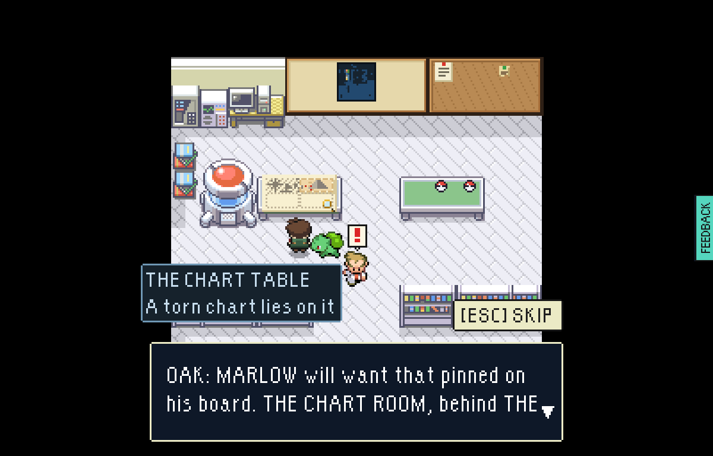
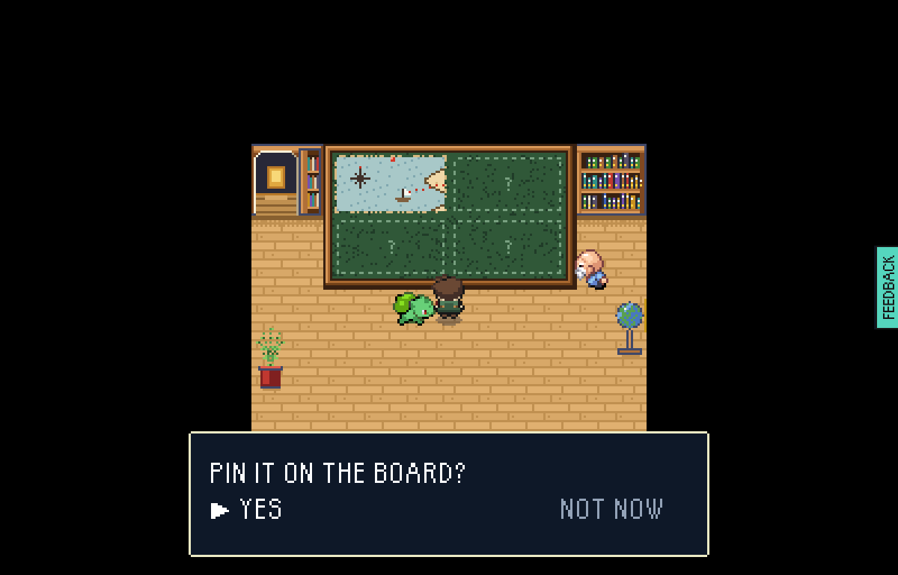
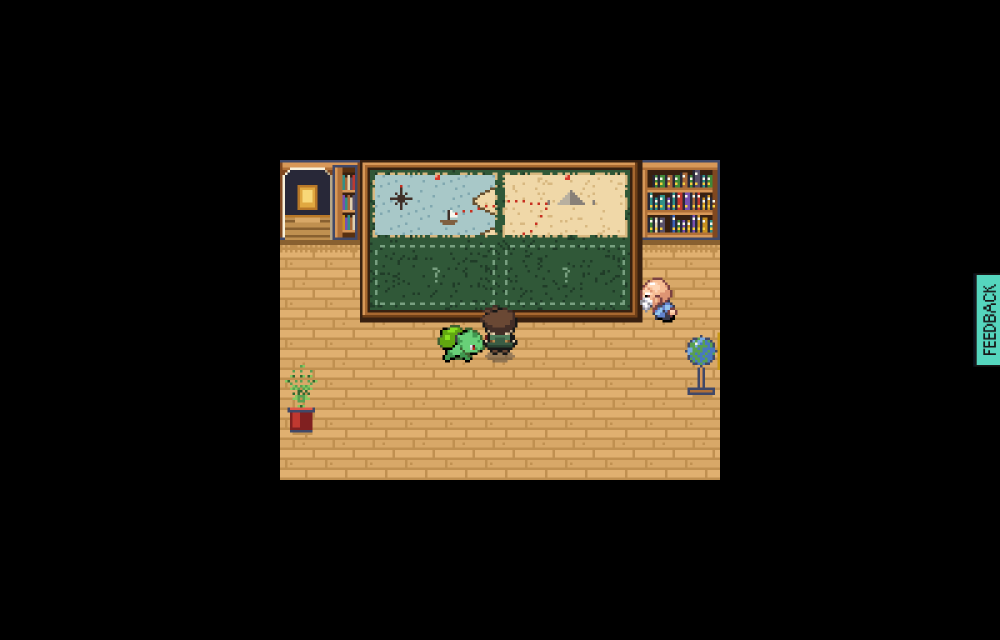

# The chart table and the telescope's rumour rings

Step S2 of the harbour arenas plan: Oak's CHART TABLE, rumour scraps on his cork
board, and chalk rings on THE RAID ARENA's telescope. Played end to end in a
test-mode build by `tools/playtest/chartTable.mjs` (before and after a raid) and
`tools/playtest/raid.mjs --clock=dusk --hunt=shore --heard=board-long-shadow,angler-red-one --grab=chart-piece-1`
(the raid between), on a save that has pinned the bottled chart at MARLOW's and
heard two rumours.

The chart table is one story with THE CHART ROOM, not a second chart: MARLOW
keeps the torn chart on his board, and Oak follows the hunt from the lab a raid
sets out from. A piece MARLOW has pinned is a pencil tracing on Oak's table; a
piece home and not yet pinned lies on it in its own colours, and Oak sends it on
to MARLOW; a gap a heard rumour placed is pencilled with the same ring the
telescope chalks.

## Before the raid

| | |
| --- | --- |
|  | The new table across the aisle from the starters' table: the shore traced from MARLOW's board, a pencilled ring and "?" where THE GREY STONES rumour says the moor piece goes, two blank slots. |
|  | The cork board: the job on its slip, the two rumours on green-pinned scraps in their own corner, read out after a line saying they are rumours. |
|  | Through the telescope: a chalk ring and "?" over HIGH MOOR and GREYSTONE PEAKS. The cloud is untouched. |
|  | Closer, the cursor on the moor ring's "?": the card says only the rumour's words. |

## The raid

| | |
| --- | --- |
|  | Deployed at dusk, THE LONG SHADOW is open; the torn chart is dug up and carried out by MOOR GATE. |

## Home

| | |
| --- | --- |
|  | The moor ring's "?" is chalked over with a tick, on the glass above the raid's own trail and flag; the peaks ring is still a question. |
|  | Its card says RUN TO GROUND. |
|  | The moor piece lies on Oak's table in its own colours, in its place on the chart. |
|  | Oak sends it on to MARLOW. |
|  | At MARLOW's board the piece is named first and the question fits one line. Before this change the question wrapped onto its own YES. |
|  | Pinned on MARLOW's board. |
|  | Back in the lab, the moor is a pencil tracing too: two of four. |

The table close up, before, home and traced: `table-before.png`, `table-after.png`, `table-traced.png`.
