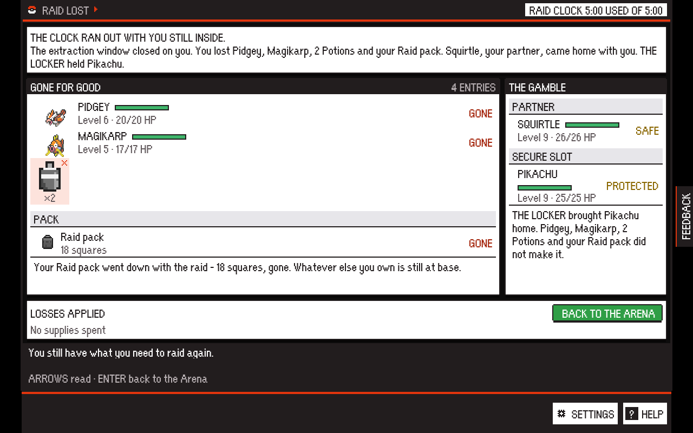
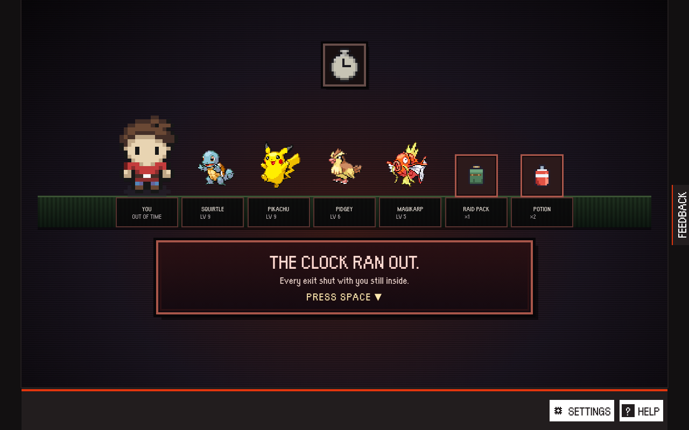
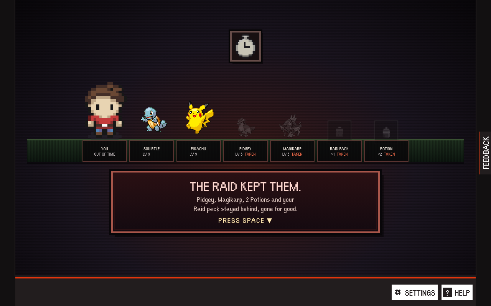
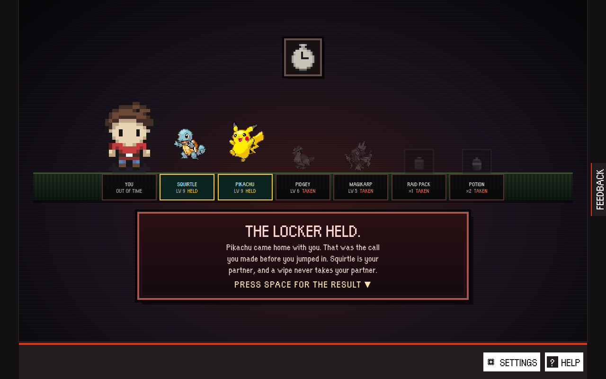

# A raid lost to the clock shows who it took

Olly, 25 Nov 2026: "I swear I'd caught a level 6 Pidgey and it's disappeared." A raid the clock ran out on took his Pidgey and Magikarp. The result screen named them in its ledger, and he came home sure he still had them.

A raid lost in a fight already opened on a line-up of the party falling. A raid lost to the clock went straight to the ledger. Now it opens on the same line-up, in three beats:

| Before | After: the clock rings out | After: what the raid kept | After: what the locker held |
| --- | --- | --- | --- |
|  |  |  |  |

- **The clock** pops in over the line-up and rings, with a red flash. Nobody falls: the clock is nobody's fight.
- **TAKEN**: everything the raid kept greys out and sinks where it stood, and its plate is stamped.
- **HELD**: the partner and whatever the locker held hop up in full colour.

The line-up stays at the same height through every beat. The caption's room is now kept for its longest beat, so a beat with more words no longer lifts the line-up up the screen. That jump happened in a fight's line-up too. `clockLossShots.mjs` prints the line-up's top edge at each beat: 185px at 1280x800, and 140px at 900x600, every beat.

## How they were made

On a test-mode build, served under the Pages subpath (`tools/playtest/README.md`, "Idle costs the machine"). The report is the game's own, built by `buildExtractionReport` for a save shaped like Olly's: Squirtle the partner, Pikachu in the locker, and a Pidgey and a Magikarp the clock took. The "before" report is the same report without its line-up, which is what every clock-out was before this change.

```sh
npx vite-node tools/playtest/clockLossReport.ts "$SCRATCH/after.json" "$SCRATCH/before.json"
node tools/playtest/clockLossShots.mjs "http://localhost:$PORT/escape-from-pallet-town-web/" "$SCRATCH/after.json" "$SCRATCH/shots"
node tools/playtest/clockLossShots.mjs "http://localhost:$PORT/escape-from-pallet-town-web/" "$SCRATCH/before.json" "$SCRATCH/shots"
```
