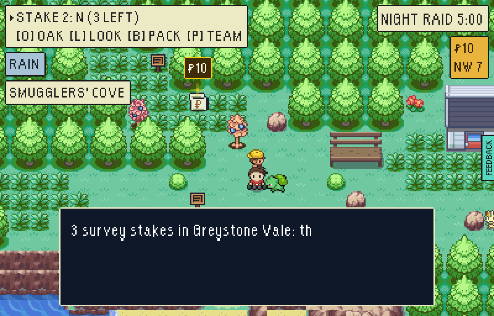
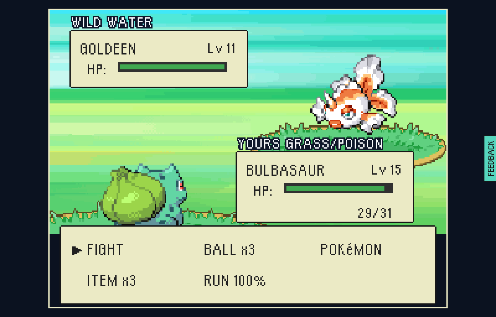
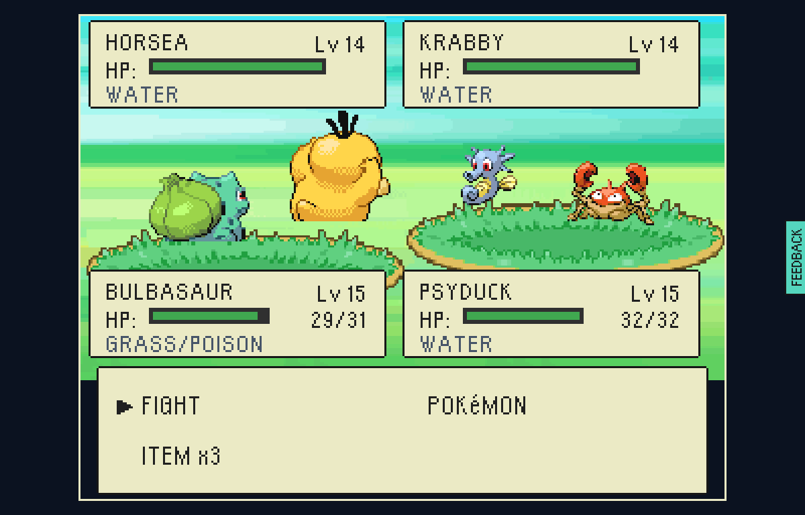
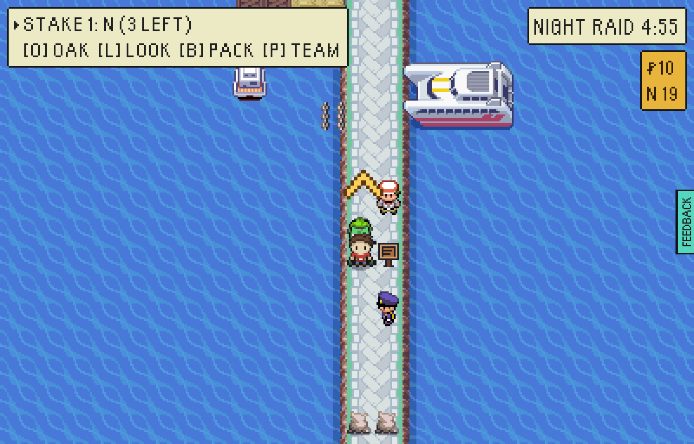
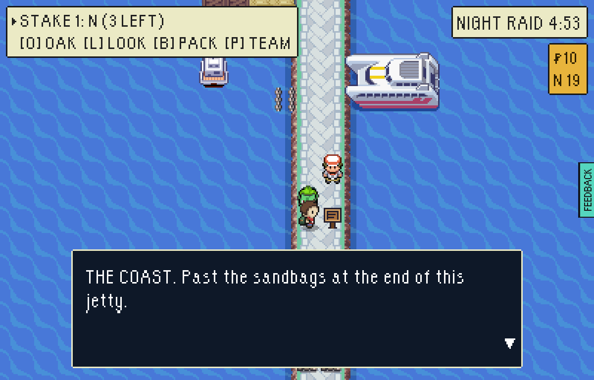
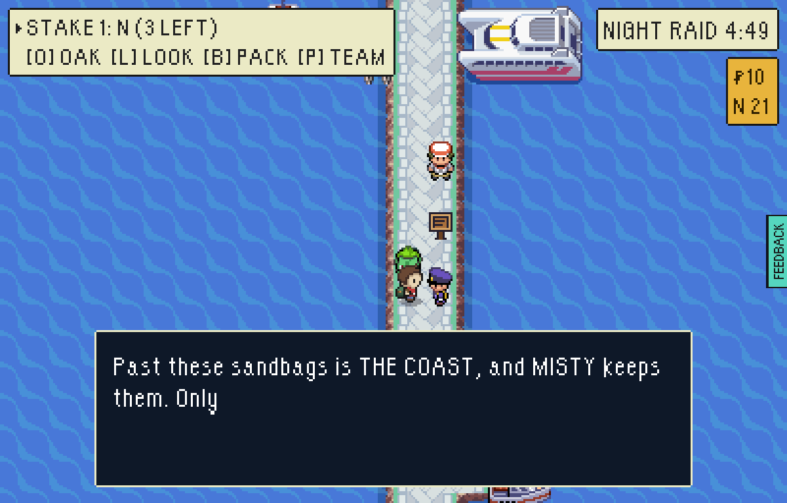

# The Coast fights like Misty

Step 3 of firstmate's gyms-and-loadouts plan (`eptw-gyms-loadouts-plan`, section
5): the quarter Misty's gym holds is wet and fast everywhere, not only in her
hall.

- **Rain on every place of THE COAST.** The Sunken Quarter, Smugglers' Cove and
  every named place inside them (`tools/mapcraft/worlds/greystoneVale/plan.ts`,
  the two district programs; the stitched file rewritten by `world.mts
  --write=`). The HUD's weather chip says so on arrival, and every fight there,
  wild, trainer, keeper or hunter, is fought in it.
- **The Coast's own wildlife** (`COAST_WILDLIFE` in `pokemon/encounters.ts`, the
  `coast` habitat): Tentacool, Horsea, Goldeen, Staryu and Poliwag at 11-13, a
  little under Misty, and Poliwhirl at 25 as the rare roll, the level a Poliwag
  becomes one.
- **Two trainers past her doors who fight her way** (`trainers.ts`, `ai: 'gym'`,
  two on two, spoken to and off the roads): Fisherman Hal at the west end of the
  Old Quay (Tentacool's Supersonic, then a Goldeen swimming first) and Swimmer
  Nell at the end of the cove's landing stage (a Horsea's Smokescreen, then a
  Krabby behind it).
- **The guard and the notice board** at each of Misty's two doors, on the open
  side: a Coast Guard who names the CASCADE BADGE, as FireRed's Route 23 keeps
  its badge gates, and a notice that says the threat before it costs anything.
- **Boatswain Cragg re-measured to sit above Misty**: two on two, level 16, the
  gym AI, in the Coast's rain.

## Measured

`quarterPuzzle.test.ts`, three Potions packed, parties at Misty's lead's level
(15), in the rain where the fight is:

| party | Misty | Cragg | Hal | Nell |
|---|---:|---:|---:|---:|
| Psyduck, Pikachu, Bellsprout, Poliwag | 100% | 72% | 100% | 100% |
| Bulbasaur, Pikachu, Psyduck | 100% | 71% | 96% | 100% |
| Charmander, Pikachu, Psyduck | 66% | 52% | 95% | 92% |
| Squirtle, Pikachu, Bellsprout | 100% | 60% | 92% | 100% |
| Charmeleon, Sandshrew, Geodude, three up | 36% | 58% | 100% | 96% |
| the same, eight up | 100% | 96% | 100% | 100% |

The Coast's wildlife, a level-15 starter alone in the rain
(`coastHabitat.test.ts`): Bulbasaur 93%, Charmander 52%, Squirtle 74%. It is the
Fire starter's hard ground, as the rain says it should be.

## Played

Played in a test-mode build through `tools/playtest/raid.mjs` (stepped, `--attach`
to an already running browser): landed at the Cove Steps with Misty beaten, a
Bulbasaur, a Pikachu and a Psyduck at 15, walked the cliff-top heather into a
wild fight, then spoke to Swimmer Nell on the landing stage and fought her.

```
node tools/playtest/raid.mjs <build url> --pixels --stepped --window=pixel --seed=7 \
  --insertion=greystone-vale-cove-steps --beaten=vale-gym-misty --starter=Bulbasaur --level=15 \
  "--moves=Vine Whip|Leech Seed|Tackle|Growl" \
  "--team=psyduck:15:Scratch|Tail Whip,pikachu:15:Thunder Shock|Thunder Wave|Quick Attack|Growl" \
  --shot=out/coast.png --shot-battles --said \
  "--steps=shot:landing,walk:104:274,walk:109:275,walk:104:276,walk:82:277,walk:87:276,challenge:87:289:left"
```

`--shot-battles` is new with this change: every fight photographed at its first
command menus. Four wild fights in the heather, every one of them "It is
raining.": Tentacool, Goldeen, Tentacool, Goldeen.

The cove in the rain, the chip saying so under the objective:



A Coast Goldeen in the heather above the cove:



Swimmer Nell on the landing stage, two on two. As the game said it: *SWIMMER
NELL sent out HORSEA and KRABBY! / It is raining. / Foe HORSEA used SMOKESCREEN!
/ Your PSYDUCK's accuracy fell! / ... Your PSYDUCK's CLOUD NINE is holding the
weather off!*



The jetty to the Coast with Misty unbeaten: the notice and the guard on the
open side, Old Ness further up, the sandbags at its end.






