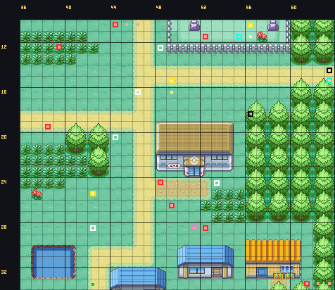
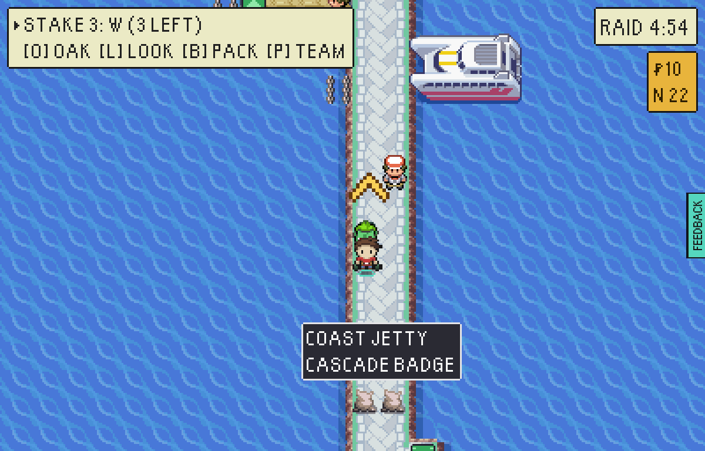
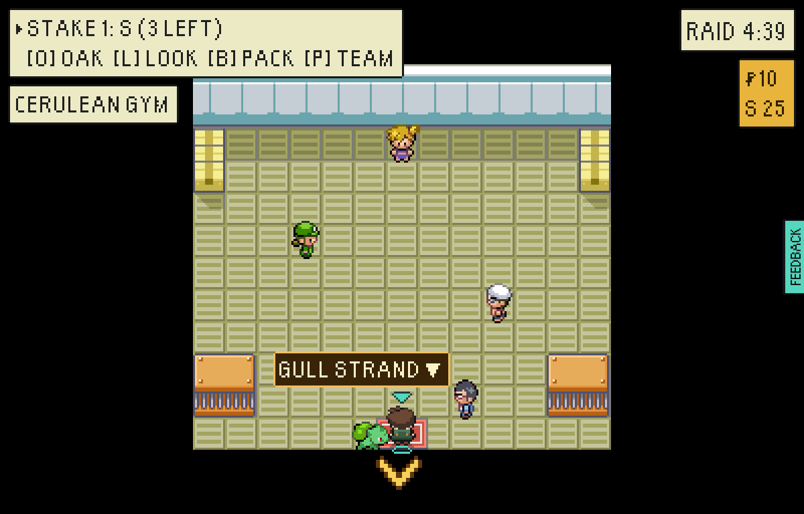
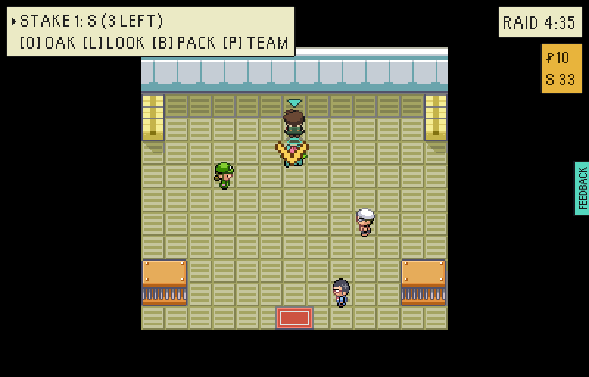
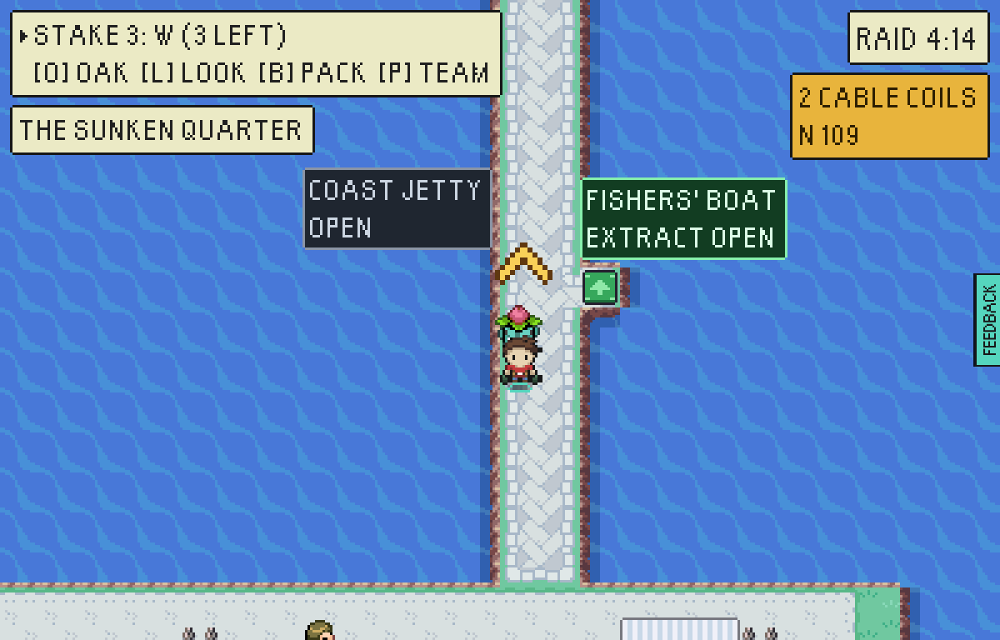
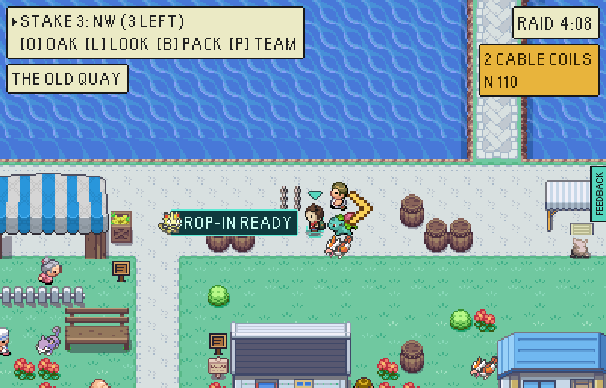
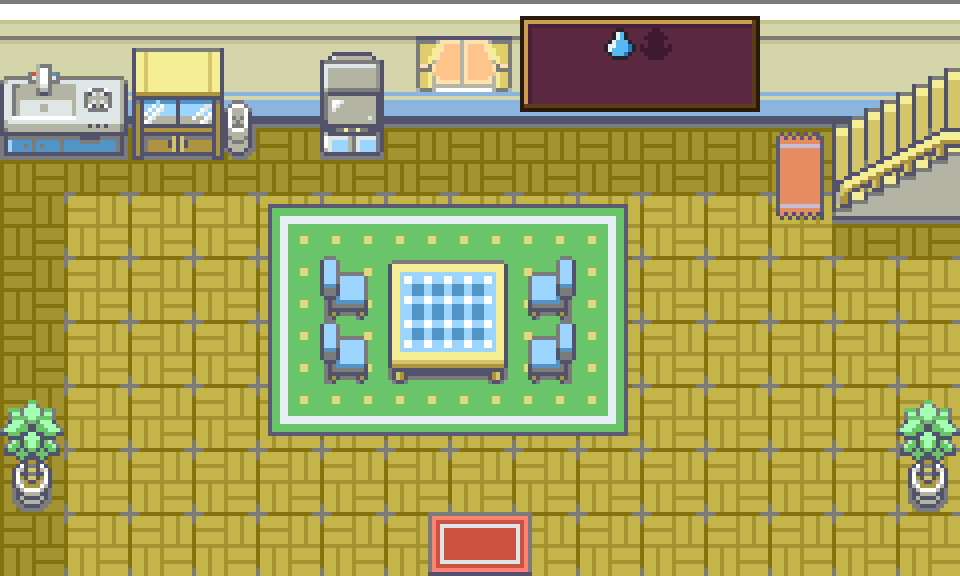

# Misty holds the Coast

The captain, 5 November 2026: gyms as access levels into different quarters of
the vale, each quarter with a best team to bring. This is the first step of
firstmate's plan (`eptw-gyms-loadouts-plan`): one gym gating one quarter with one
designed puzzle. `src/game/world/valeQuarters.ts` is the quarter as data.

Played as a player through a test-mode build (`tools/playtest/raid.mjs`, stepped):
land at The Strand with a Bulbasaur, a Psyduck and a Pikachu at 15, walk into
Cerulean Gym, beat Misty two on two, walk out over the jetty into the Sunken
Quarter, reach the Old Quay and leave by the Fishers' Boat.

```
node tools/playtest/raid.mjs <build url> --pixels --stepped --window=pixel --seed=7 \
  --insertion=greystone-vale-the-strand --starter=Bulbasaur --level=15 \
  "--moves=Vine Whip|Leech Seed|Tackle|Growl" \
  "--team=psyduck:15:Scratch|Tail Whip,pikachu:15:Thunder Shock|Thunder Wave|Quick Attack|Growl" \
  --fight "--steps=walk:172:253,into:179:216:up,challenge:448:71:up,into:448:79:down,walk:172:262,walk:165:270,walk:174:260" --said
```

The gym, on the heath beside the road down to the strand:



The jetty to the Coast, sandbagged, and its caption asking for the badge rather
than naming a keeper:



The hall: Misty at its head, Picnicker Diana and Swimmer Luis off the walk up
the middle (spoken to, not watching), the Gym Guide by the mat:



The fight, as the game said it: Misty sent out Staryu and Horsea; Staryu used
Rain Dance on turn one, Horsea Smokescreen; the Psyduck's Cloud Nine held the
weather off; Vine Whip and Scratch did the rest, Bulbasaur evolving into Ivysaur
on the last knockout; "Here is the CASCADE BADGE. The jetty and the reed trail
are open." A beaten keeper leaves, as every keeper does today:



The jetty open, and the Fishers' Boat beside it inside the Coast:



The Old Quay, reached on foot - the landing is offered again now:



The badge case in THE BOLTHOLE, from the same beaten list
(`npx vite-node tools/base/renderBase.mts -- out.png 4 --room=bolthole --beaten=vale-gym-misty`):



## The puzzle, measured

`quarterPuzzle.test.ts`, three Potions packed, Misty on FireRed's own trainer AI,
against parties at her lead's level (15):

| party | wins |
|---|---:|
| Psyduck, Pikachu (opens Thunder Wave), Bellsprout, Poliwag | 100% |
| Charmeleon 19, Sandshrew 18, Geodude 18 (three up) | 36% |
| Charmeleon 24, Sandshrew 23, Geodude 23 (eight up) | 100% |
| Bulbasaur, Pikachu, Psyduck | 100% |
| Charmander, Pikachu, Psyduck | 66% |
| Squirtle, Pikachu, Bellsprout | 100% |

Played at random, as every other trainer is, the Fire-and-Rock team wins most
fights three levels up: the AI is what makes the gym.
