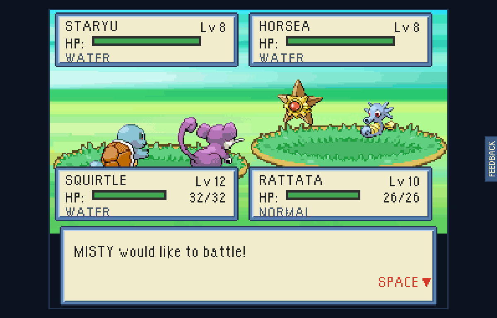
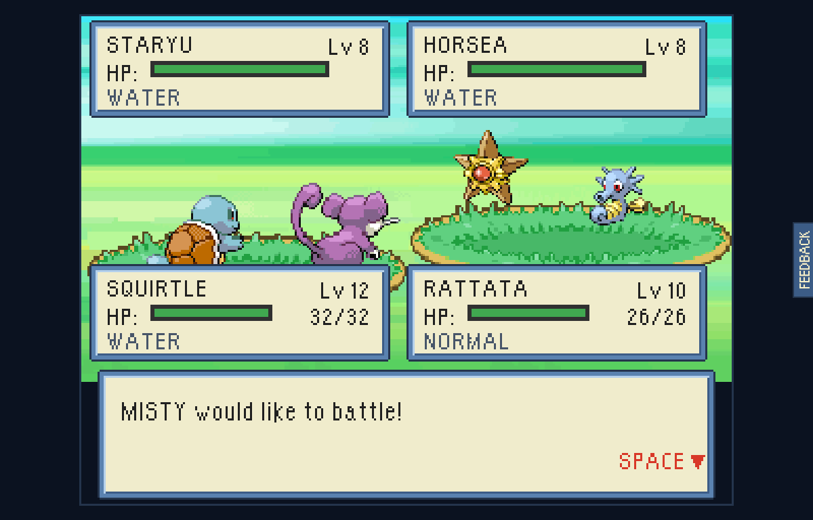

# A double battle's plates show their typing whole

A double battle's plates were 44 pixels deep, sized when a panel's frame was
one pixel. Since every panel took FireRed's four-pixel frame (#799), the third
row - the typing, which is what a player reads to pick a move - was drawn half
under the frame: WATER read as a row of stumps. The plates are four pixels
deeper (48), each row a pixel lower, and the player's band stands four pixels
over the panel as it did (`statusPlateLayout` in
`src/game/scenes/battlePresentation.ts`; `battlePresentation.test.ts` holds
every row inside the frame).

| before | after |
|---|---|
|  |  |

Made on 25 Nov 2026 at 1200x768 (`PIXEL_WINDOW`) in `?testmode=pixels` on the
dev server, against `main` and this branch: a two-Pokemon trainer started from
the title with `unitCount: 2`, the way `tools/playtest/doubleItem.mjs` starts
one.
