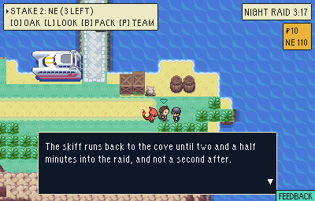
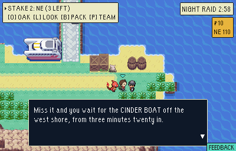

# EMBER ISLE's lookout says when the skiff stops, counted from the raid's start

The lookout by SMUGGLERS' LANDING said "The skiff runs back to the cove till our boat sails. Half past two, and not a minute after. Miss it and you are here till the burners go." On a night raid ("NIGHT RAID" in the corner) "half past two" reads as a time of day. As a clock reading it would only be right for a full 5:00 raid: sailings run by time since the raid began, and a raid shortened by a heal never shows 2:30 at that moment. "Our boat" and "the burners" left the way off the island unnamed.

Now: "The skiff runs back to the cove until two and a half minutes into the raid, and not a second after." and "Miss it and you wait for the CINDER BOAT off the west shore, from three minutes twenty in." (The skiff sails until 150 s; the Cinder Boat exit opens after 200 s.)

| Before | After |
|---|---|
|  |   |

Made on a test-mode build (`?testmode=1`, 400x256) with `tools/playtest/ai-player/act`, using a save with Misty beaten. Land at COVE STEPS, walk down to the smugglers' jetty (86,297), step down at a minute in and SAIL, then talk to the lookout at 57,345.
