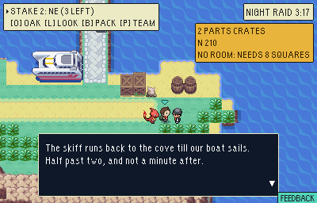

# EMBER ISLE's lookout says when the skiff stops, on the raid clock

The lookout by SMUGGLERS' LANDING said "The skiff runs back to the cove till our boat sails. Half past two, and not a minute after. Miss it and you are here till the burners go." On a night raid ("NIGHT RAID" in the corner) "half past two" reads as a time of day, and "our boat" and "the burners" left the way off the island unnamed.

Now: "The skiff runs back to the cove until your clock reads 2:30, and not a second after." and "Miss it and you wait for the CINDER BOAT off the west shore, from when your clock reads 1:40." The readings hold in a raid shortened by a heal as well: a sailing is timed against the clock as drawn (`WorldScene.tideMs`), and a timed exit is moved by the same shortfall (`authoredTimeIn`). In a 4:00 raid the skiff was already sailing on arrival at the jetty, as it is from 4:00 on in a full one.

| Before | After |
|---|---|
|  |   |

Made on a test-mode build (`?testmode=1`, 400x256) with `tools/playtest/ai-player/act`, using a save with Misty beaten. Land at COVE STEPS, walk down to the smugglers' jetty (86,297), step down at a minute in and SAIL, then talk to the lookout at 57,345.
