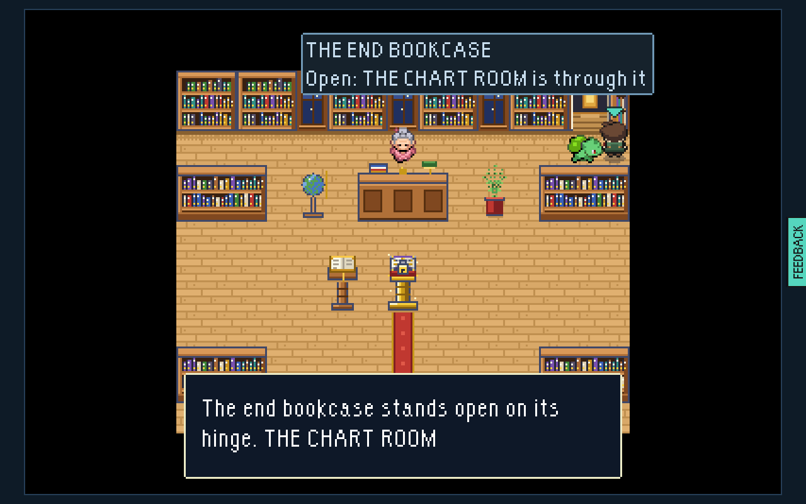
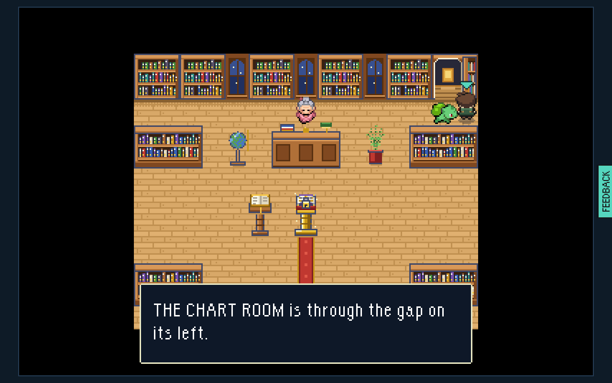

# THE END BOOKCASE says where its way through is

THE GREAT LIBRARY with THE CHART ROOM open. The player stands under the swung-open
door at 14,2 and presses SPACE. The door is solid; the way through is the gap on its
left (13,1). Before, the box said `THE CHART ROOM is through it`, and players pushed at
the door. After, it says `THE CHART ROOM is through the gap on its left.`, and so does
the caption.

| before | after (its second box) |
|---|---|
|  |  |

Made on 22 Nov 2026 against the dev server in `?testmode=pixels`, with a save that has
the room open, walked to 14,2 over the room's own collision.
