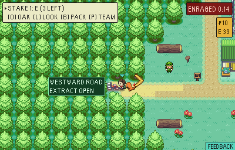
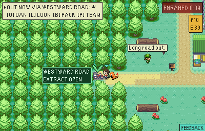

# At 0:00 the gold arrow points out

When the raid clock reaches 0:00 the hunters turn ENRAGED and there are 15 seconds to get out. The gold arrow and its chip kept pointing at the job: one step beside WESTWARD ROAD, with "ENRAGED 0:14" counting down in red, the chip said "STAKE 1: E (3 LEFT)" and the arrow pointed east, away from the exit. Now, once ENRAGED, both point at the nearest way out: "OUT NOW VIA WESTWARD ROAD: W".

| Before | After |
|---|---|
|  |  |

Made on a test-mode build (`?testmode=1`, 400x256) with `tools/playtest/ai-player/act`. Land at MILL SQUARE with the Line survey job, walk to 65,158 beside WESTWARD ROAD, and `act wait` until the clock reads 0:00.
