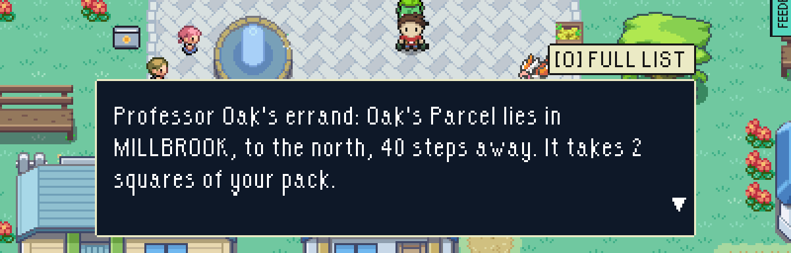

# Oak's radio says which way a favour lies

A favour's thing is laid somewhere in its district each raid, and the only
place that gave its bearing was the full field notes (O twice). The radio (O)
said the job and the way out, and the gold arrow follows the job, so nineteen
findings in the 22 Nov AI playtest are a favour taken on and never found
('somewhere in MILLBROOK', 'O only talks about the stakes'). The radio now
says each favour still lying on this map, by its bearing and its walk, after
the way out and before the next gym; once picked up it is not said again. The
next gym's line (#612) gives its walk too.

| the favour | the next gym |
|---|---|
|  |  |

(Before, on main, the radio ended at the way out.) A test-mode build at
`PIXEL_WINDOW`, deployed to Millbrook with Oak's parcel in hand, pressing O
and reading on, 22 Nov 2026.
