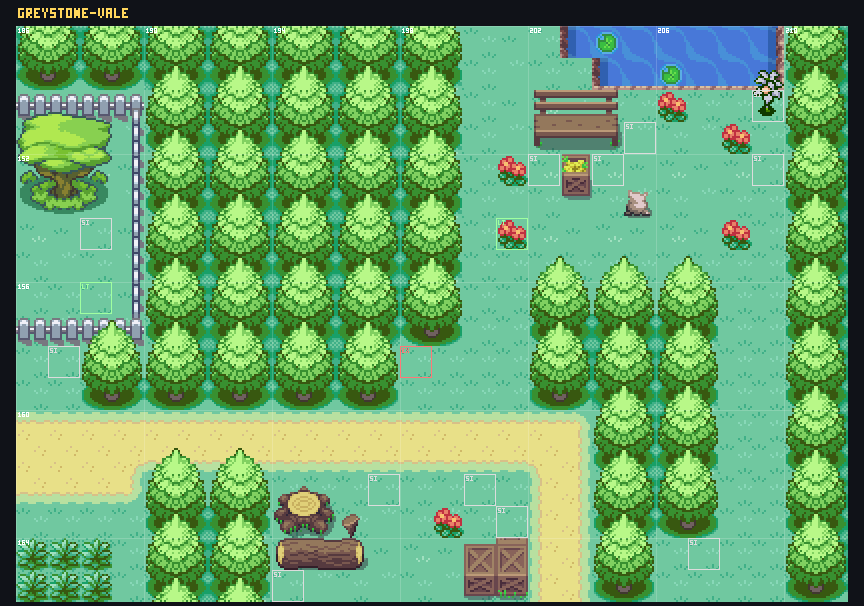
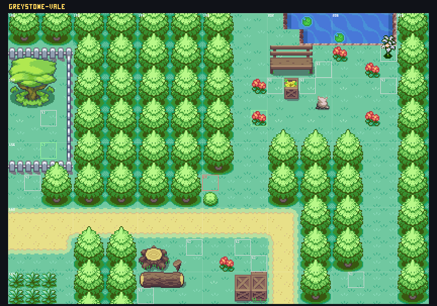
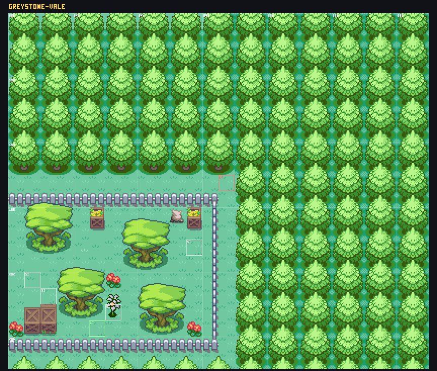
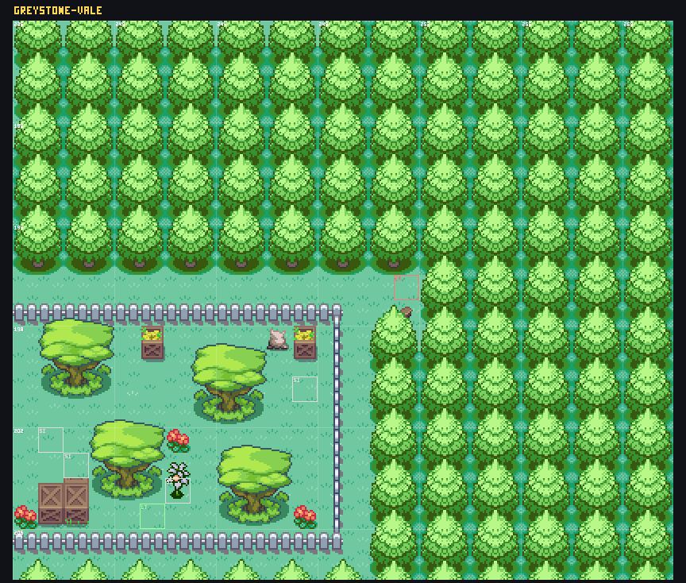
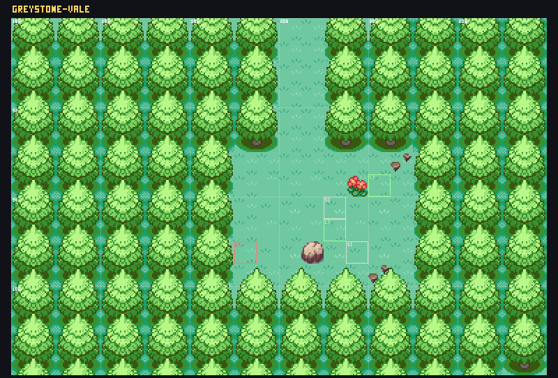

# Three ways out moved off the roads

DEER GAP (Tanglewood), PICKERS' PATH (Orchard Terraces) and CHARCOAL TRACK
(Pine Hollow) each stood where a walk to somewhere else could cross them, and an
exit takes whoever steps on it, with no question. The 20 Nov AI playtest walked
off the map on them eight times. Each now stands at the back of a pocket with
one way in:

- DEER GAP: a bush below it, so the way up the lane from the road goes past.
- PICKERS' PATH: moved from the corner where the lane past the north orchard
  turns west, into a gap cut into the wood off that corner, a stump in its mouth.
- CHARCOAL TRACK: a dead stump either side, at the nook's west edge.

| before | after |
|---|---|
|  |  |
|  |  |
|  |  |

Drawn with the real layer builder, exits marked in red:

    npx vite-node tools/tileset/renderMap.mts -- greystone-vale deer.png 2 --content --grid --crop=186,148,26,18
    npx vite-node tools/tileset/renderMap.mts -- greystone-vale pickers.png 2 --content --grid --crop=236,186,26,22
    npx vite-node tools/tileset/renderMap.mts -- greystone-vale charcoal.png 2 --content --grid --crop=188,88,24,16
