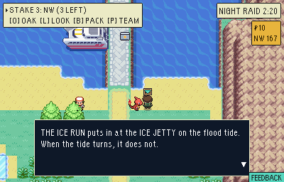
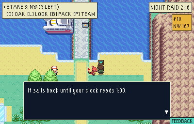

# FROSTREEF's sign names THE ICE RUN

The sign at the ICE JETTY on FROSTREEF said "The launch puts in on the flood tide." The pier sign on the mainland is careful never to call THE ICE RUN "the launch", because the SALVAGE LAUNCH at the pier's end is a different boat that only goes home. A player who had just read that sign, and then this one, was told the wrong boat comes for them. The sign also did not say when the last sailing back is, which is the one thing a player standing on the island needs to know.

| Before | After |
|---|---|
|  |   |

Made on a test-mode build (`VITE_EPTW_TEST_MODE=1`, `?testmode=1`, 400x256) with `tools/playtest/ai-player/act`, using a save with Misty and Koga beaten. Land at SALVAGE CAMP, wait on the pier until the clock reads 3:00, step down off tile 312,233 and SAIL, then read the sign at 353,336.
