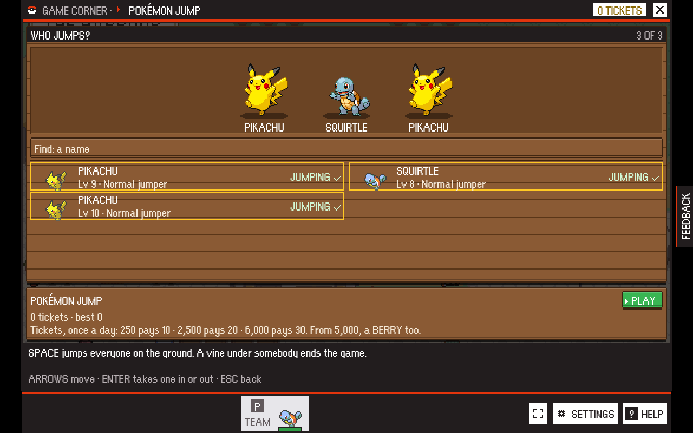
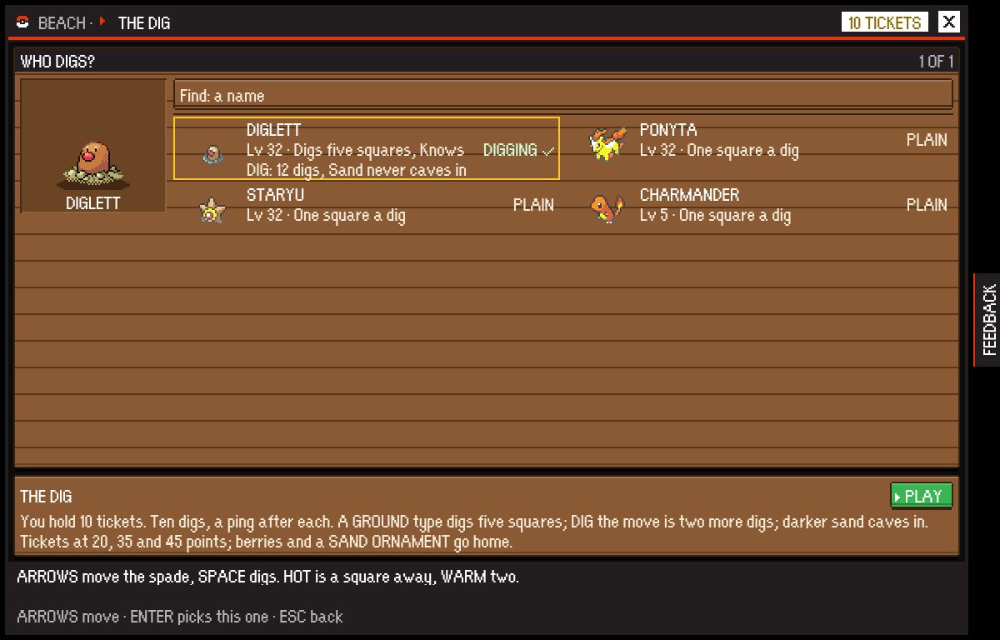
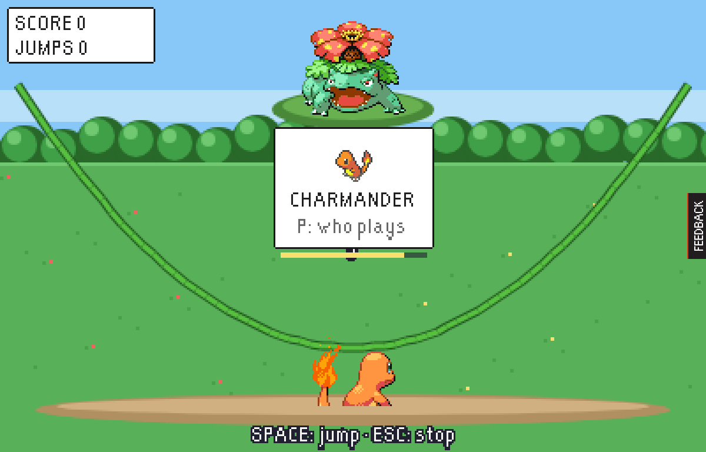
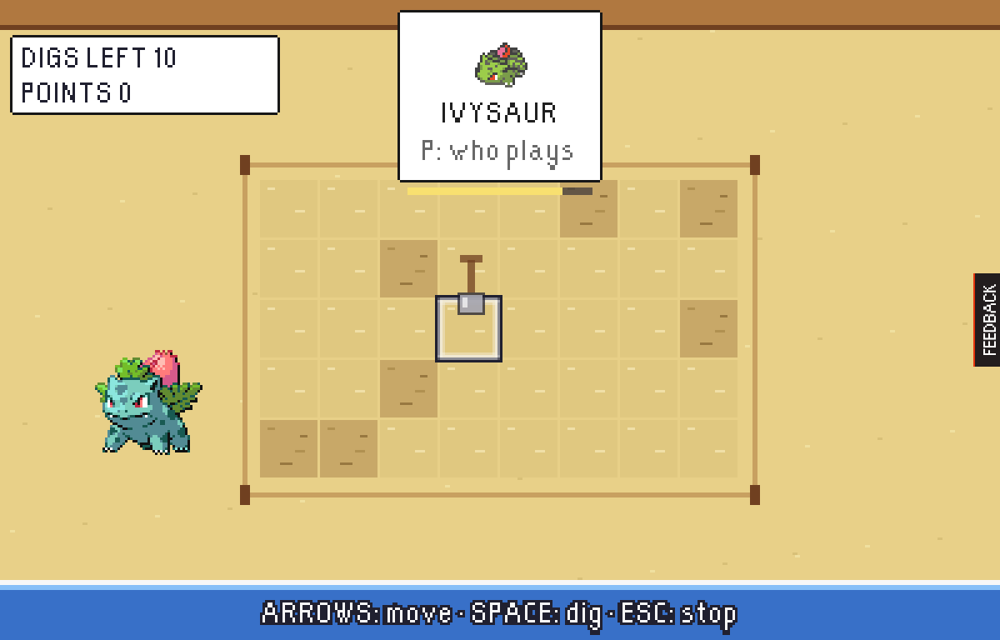
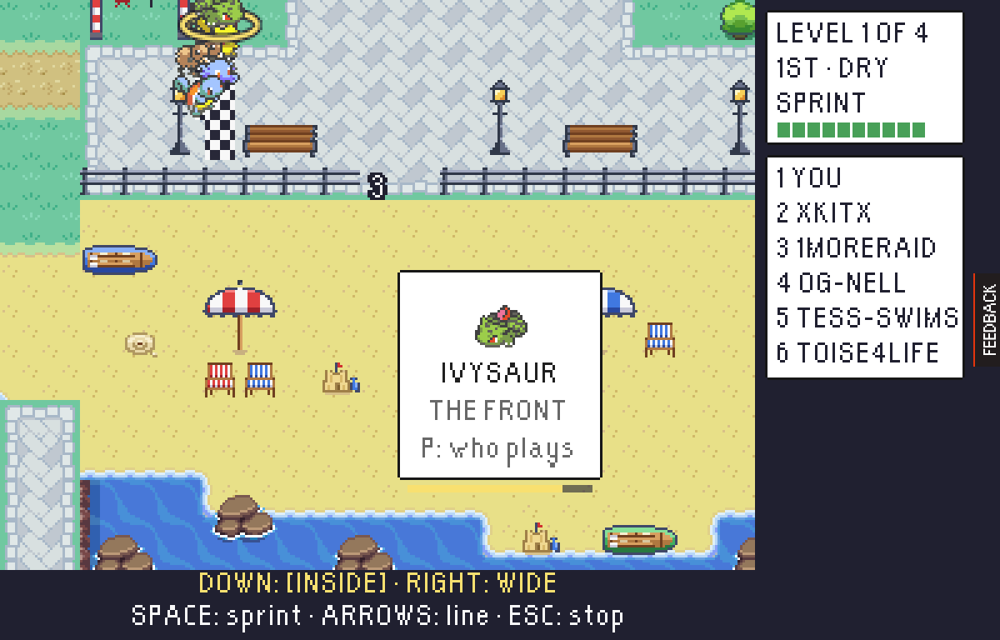
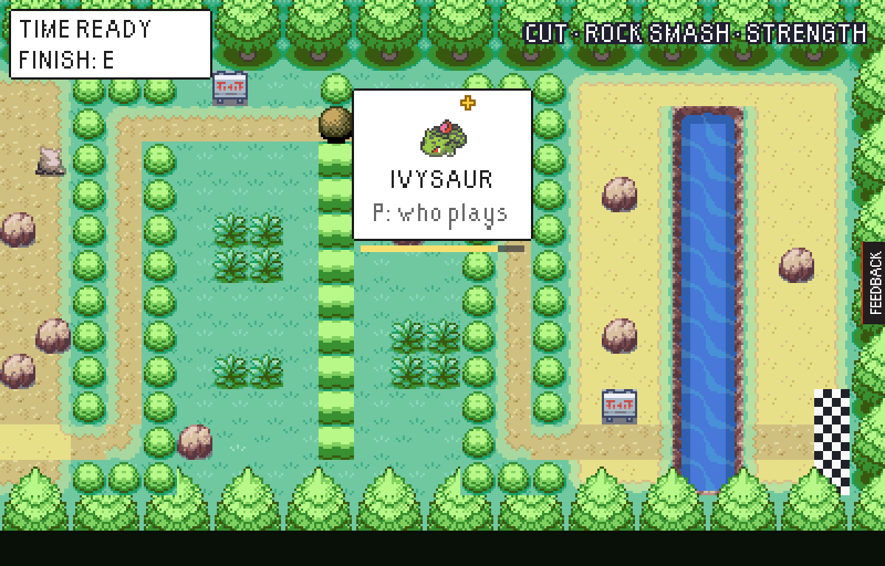
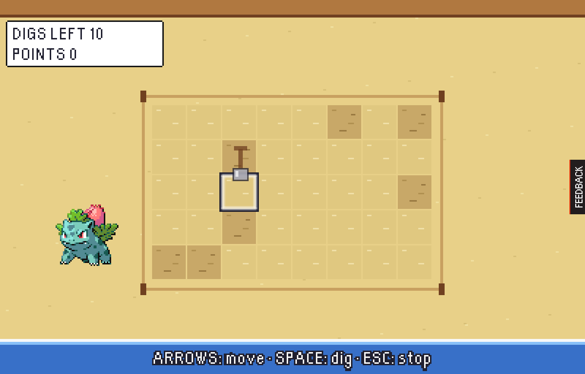
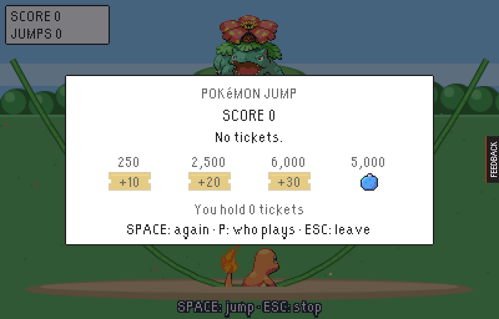
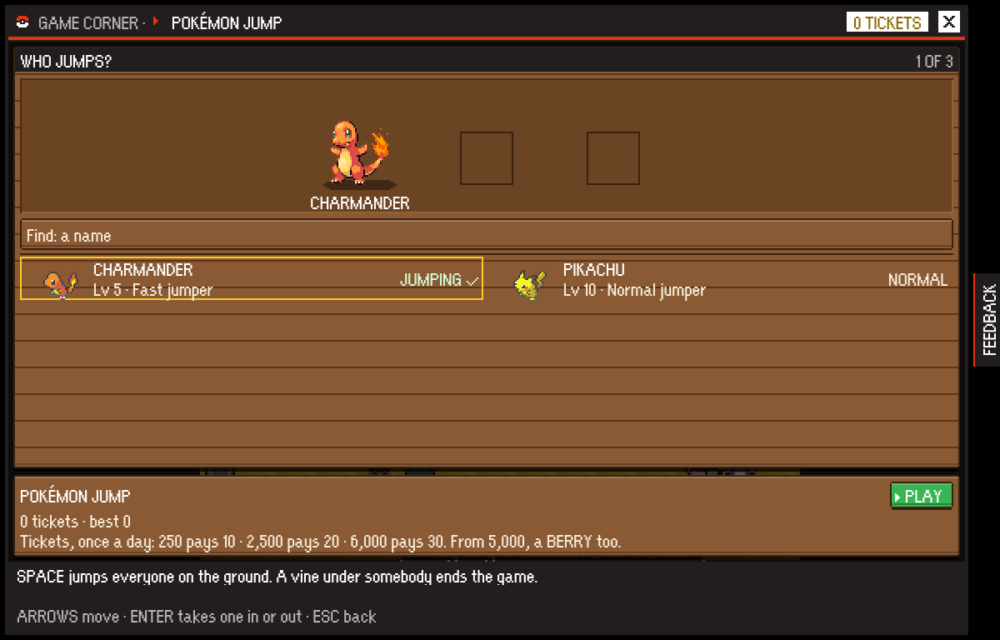
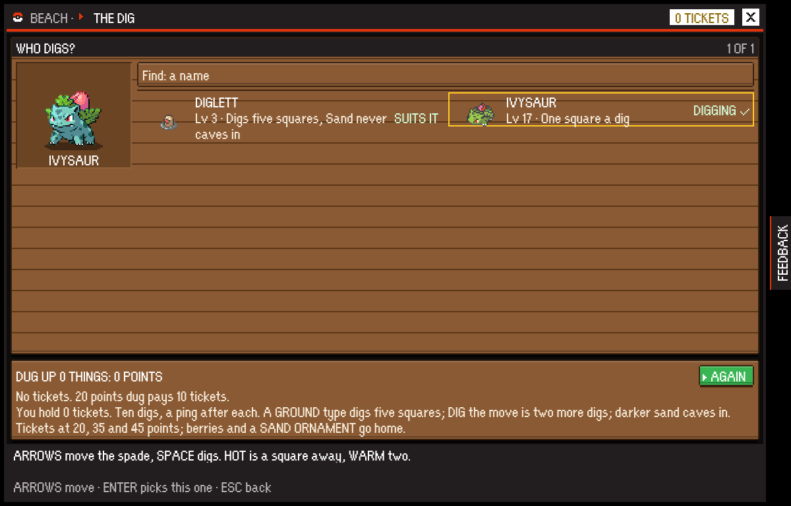

# A harbour minigame starts on the press that opens it

The harbour audit of 27 Nov 2026 (fault 3): SPACE at a GAME CORNER cabinet, a promenade
board, THE DIG's spot or the course gate opened a form - who plays, a find field, the rules
and a pay table - and not a game. The games contest put three designs side by side; both
judges and the blind new player ranked **A, straight in** first, and the captain took it
on 28 Nov ("do all of your suggestions for everything").

One change from the design as it was judged. Its ready beat stepped through who plays with
LEFT and RIGHT. But the menu redesign had just restyled each game's list of who plays
(#1016), and the captain's rule is that a menu redesign wins any clash with the harbour
work. So firstmate ruled on 28 Nov: the list stays exactly as it looks, behind **P**, and
the LEFT and RIGHT step goes. That also cured the one fault the blind player found in A:
at THE DIG, LEFT in the ready beat swapped the Pokémon instead of moving the spade. Now the
first arrow there starts the dig and moves the spade.

## Before: SPACE at the cabinet

| POKéMON JUMP | THE DIG |
|---|---|
|  |  |

## After: SPACE at the cabinet

The game, standing ready with the partner (or the house loan when nobody can play) for
2.4 seconds under a plate, then playing by itself or on SPACE. The plate names `P: who
plays` only when there is somebody else to choose.

| POKéMON JUMP | THE DIG |
|---|---|
|  |  |
| **THE DERBY** (the count is the ready beat) | **THE FIELD-MOVE COURSE** |
|  |  |

THE DIG's first arrow starts the dig and moves the spade:

The pay ladder is on the result card, once, and the card names P as well:

## P: the list of who plays, exactly as the menu redesign drew it

PLAY there stands the chosen one ready in the game; ESC is back to the game standing ready.

| POKéMON JUMP | THE DIG |
|---|---|
|  |  |

## How these were made

The before pictures are #1016's own after pictures (`docs/screens/wood-floor/after/`),
which are what `main` shows on that press. The after pictures were made by
`tools/playtest/gamesStraightIn.mjs` against a test-mode build
(`VITE_EPTW_TEST_MODE=1 npx vite build`) at `PIXEL_WINDOW`: Sam's save, just home from
the first raid, at POKéMON JUMP (`--room=game-corner --opens=pokemon-jump`) and BERRY
PICKING; Jo's save, ten raids in, at THE DIG (`--at=69:19 --facing=right`), THE DERBY
(`--at=62:12 --facing=up`), THE FISHING DERBY (`--at=86:29 --facing=left`) and THE
FIELD-MOVE COURSE (`--at=118:8 --facing=up`). Every check it makes passed on all six.
