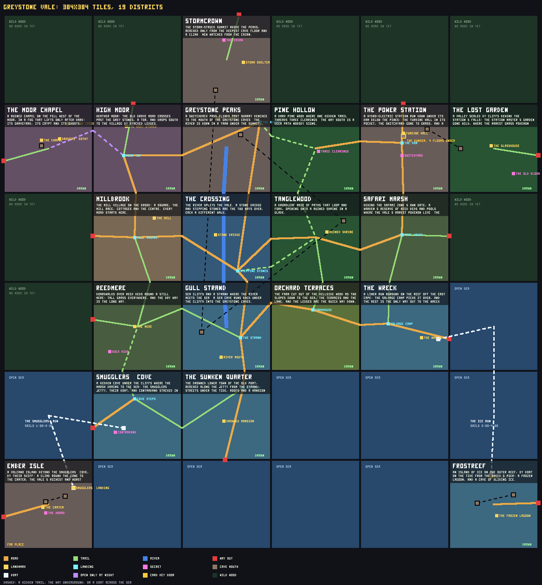
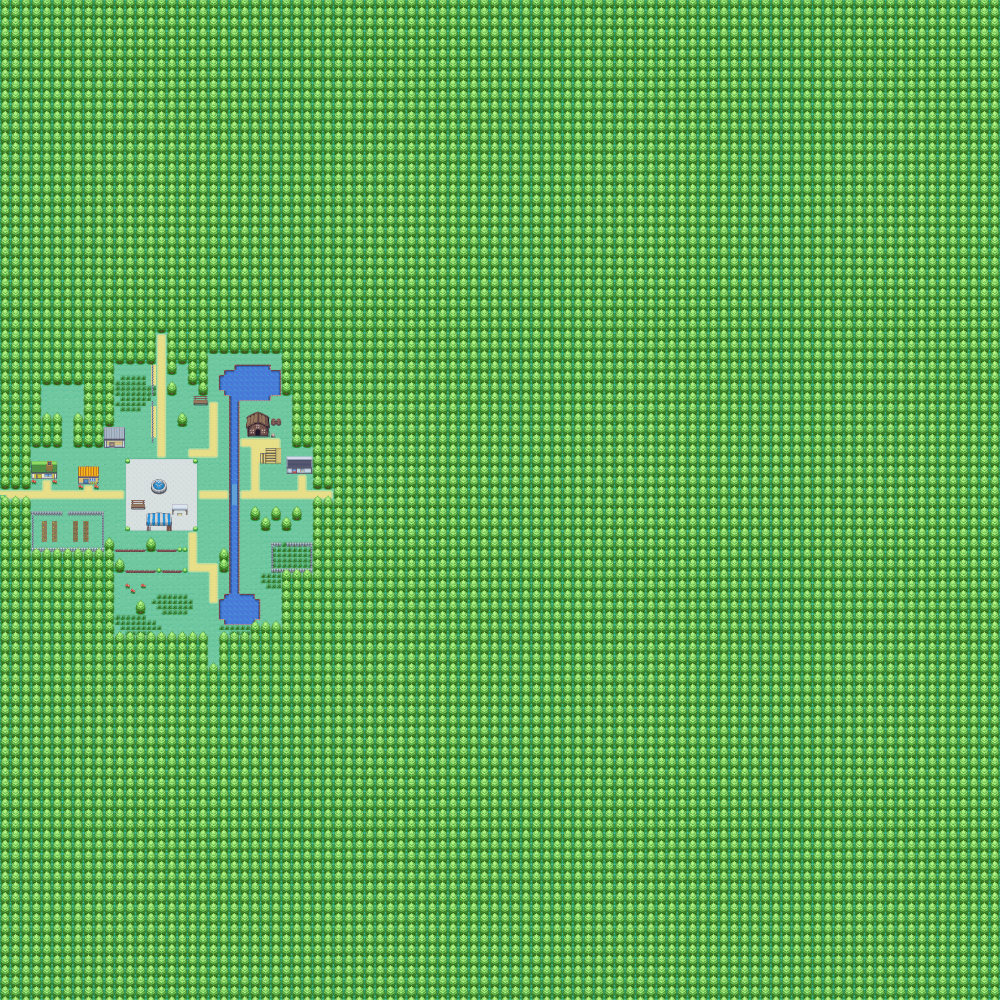
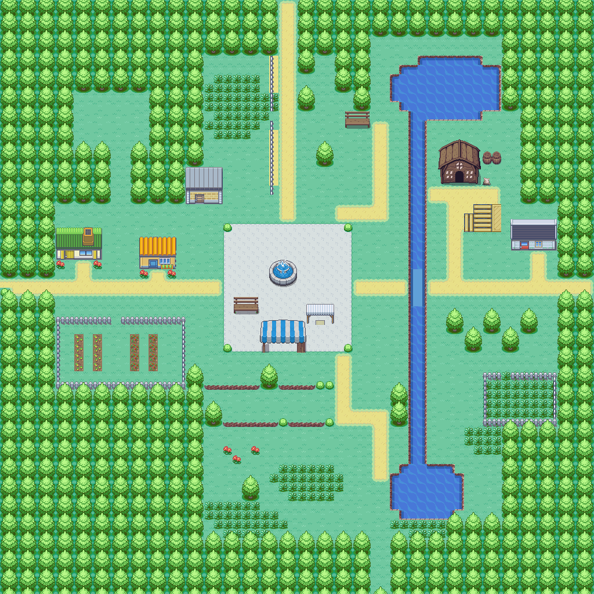

# Greystone Vale

A new raid map, planned coarse and drawn one district at a time with
`tools/mapcraft` (its source is `tools/mapcraft/worlds/greystoneVale/`). This
is the plan, before any district was drawn:

And the vale with its first district, Millbrook, drawn: every district still to
draw is wood, and each road into one runs into the trees at a way out.

Redraw them, and write the map the game ships, with

    npx vite-node tools/mapcraft/world.mts -- tools/mapcraft/worlds/greystoneVale/index.ts out/greystone-vale --write=src/game/world/maps/greystoneVale.json

## Millbrook

The mill village and the vale's front door: every road starts at Mill Square.
You land under the fountain among the market stalls. The Westward Road runs in
from the west past two cottages and the allotments, the drove road comes down
from the moor past the north field, the east road fords the brook by the mill
on its way to The Crossing, and the lane runs south along the brook to the
marsh. South of the square the ground falls away in two short terraces to a
quiet meadow - two hops down, and the lane is the way back up. The mill stands
on its race under the mill pond; the brook pools at the foot of the village.

## The vale

Nine districts of 64x64 tiles make a 192x192 map, with room left to grow a
column east and a row south inside a map file's 256x256. Each district has one
idea, which its program is written to:

| District | Terrain | The one idea |
|---|---|---|
| Millbrook | town | The mill village on the brook: a square, the mill race, cottages and the Centre. Every road starts here. |
| High Moor | moor | The old drove road crosses between standing stones and drops south to the village by stacked ledges. |
| Greystone Peaks | mountain | A switchback pass climbs past quarry benches to the mouth of the Greystone Caves; the river is born in a tarn. |
| Pine Hollow | forest | A dark pine wood where one hidden trail threads three clearings; the way south is a deer path nobody signs. |
| The Crossing | river | The river splits the vale; a stone bridge, a ford and stepping stones are three different walks over it. |
| Tanglewood | forest | A broadleaf maze of paths that loop and fork, opening onto a ruined shrine in a glade. |
| Reedmere | marsh | Boardwalks over reed beds round a still mere: tall grass everywhere, and the dry way is the long way. |
| Gull Strand | coast | Sea cliffs where the river meets the sea; a sea cave runs back under the cliffs into the Greystone Caves. |
| Orchard Terraces | farmland | Orchards and pastures step down to the sea; the ledges on the farm road are the quick way home. |

- **Barriers.** The river runs the length of the middle column, so east and west
  meet only at The Crossing's three ways over. The peaks and the sea close the
  north and south.
- **Main routes.** The road from the Westward Road through Millbrook, over the
  river and on into Tanglewood; the drove road down from the moor; and the coast
  road along the strand to the orchards.
- **Hidden forest routes** (dashed): a col from the peaks into Pine Hollow, a deer
  path from Pine Hollow down into Tanglewood, and a wood-edge path from The
  Crossing into Tanglewood.
- **The Greystone Caves**: five floors, with mouths in the peaks, in Tanglewood
  and in the sea cliffs, so a group can go underground at one end of the vale and
  come out at another.
- **Seven ways out** (red), **five landings** (Mill Square is the front door) and
  two secrets to find.
- **Crossings are fixed in the plan**, so each district can be drawn on its own
  and still meet its neighbours, and a district added later at the plan's edge
  joins at a way out that becomes a crossing.

## Judged blind

Two 48x40 views of Millbrook were judged blind beside five FireRed towns
redrawn in the same tiles (Viridian, Pewter, Cerulean, Fuchsia and a Celadon
window), by two judges, each scoring every picture 1-10 and naming its biggest
fault:

| | Judge 1 | Judge 2 |
|---|---|---|
| FireRed towns | 3-7, mean 5.4 | 5-7, mean 6.4 |
| Millbrook | 4 and 3 | 4 and 4 |
| Millbrook taken for real | 8% | 5% |

**Millbrook does not pass yet**: it scores at or below the bottom of the band
the real towns sit in. Both judges named the same faults, which are the brief
for its redraw before the vale opens:

- props from another art set: the square's fountain and stalls and the mill are
  the CC0 sheet's, and read as a slab pasted onto FireRed ground;
- paths that stop in grass, and a road that seems to stop at the brook (the
  ford does not read as a crossing);
- the terrace ledges stacked in open grass, with path stubs ending at nothing;
- an east side that trails off into open grass.

This batch had no deliberately broken real town in it, so neither judge was
checked against one.

## How it ships

As the game's own map, beside the shipped five (`greystone-vale`, built from the
stitched file `src/game/world/maps/greystoneVale.json` through the same path a
player's map is built by). While its districts are being drawn it is on
`MAPS_IN_PROGRESS` (`src/game/worldMap.ts`):

- **Only the explorer run reaches it** (PLAYTEST on the title, then Oak's Lab):
  no save is offered its landing, no contract or board names it, and
  `greystoneVale.test.ts` holds that against every contract banked.
- **Every structure and safety rule holds it now** - every way out reachable in
  the clock, a sealed edge, the hunter's fair arrival and flee, no crown over a
  walked tile - through `mapStructure.greystoneVale.test.ts` and the rest of
  the suite.
- **What a finished map pays and guards waits for its districts**: its boss and
  two doors, its key exit and key, its locked crate, its loot (money,
  materials, packs and prizes), an exit a landmark opens, wildlife that differs
  from place to place, and a place in the drop-in frame's size. Each test that
  asks one of those names `MAPS_IN_PROGRESS` where it excuses the vale. It
  opens to saves with all of them once the vale is drawn.
- **No other map's raid changes**: like a player's map, it is in a raid's
  content only when the raid is on it, so every seeded roll on the shipped five
  is what it was.
