# Greystone Vale

A new raid map, planned coarse and drawn one district at a time with
`tools/mapcraft` (its source is `tools/mapcraft/worlds/greystoneVale/`). This
is the plan, each district that is drawn marked DRAWN and each far place still
to draw marked FAR PLACE:


And the vale as it ships now, 384 tiles square: the nine districts it was
planned as, all drawn - Millbrook, High Moor, Greystone Peaks, Pine Hollow,
The Crossing, Tanglewood, Reedmere, Gull Strand and Orchard Terraces - and the
five it grew into, all drawn too: The Power Station, Safari Marsh, The Wreck,
The Sunken Quarter and Smugglers' Cove. Round them is the ring it has grown
into since ([The far places](#the-far-places)): open sea in the south, and wood
in the north where the far places are being drawn. Five are drawn:
[Stormcrown](#stormcrown), the summit above the peaks,
[The Lost Garden](#the-lost-garden), east of the Power Station,
[Frostreef](#frostreef), an island of ice out on the reef,
[Ember Isle](#ember-isle), a volcano beyond the smugglers' cove, and
[The Moor Chapel](#the-moor-chapel), on the fell west of the moor.


Redraw them, and write the map the game ships, with

    npx vite-node tools/mapcraft/world.mts -- tools/mapcraft/worlds/greystoneVale/index.ts out/greystone-vale --shrink=3 --write=src/game/world/maps/greystoneVale.json

## Millbrook

The mill village and the vale's front door: every road starts at Mill Square,
and the village is drawn the way a FireRed town is.

- **The square:** you land under the fountain, with planters on either side and
  the market stall below.
- **The Pokémon Center** faces the square's east street.
- **Streets:** a loop runs north-west past the cottages, the allotments and the
  tool shed, and another north-east past the miller's house to the mill, a
  thatched house on the bank of its pond. The south street leaves the square
  and ends at the purple house one way and the Mart's forecourt the other.
- **The foot of the village:** the brook's pool, with reeds round it, and the
  lane south to the marsh runs past it.
- **The frame:** a deep conifer wood closes every side, open only where the
  plan's four roads leave.

It is drawn in FireRed's pieces only: Kanto's buildings, the town pieces cut
from pret, and the FireRed sheet's fountain, stall, planters and signs.

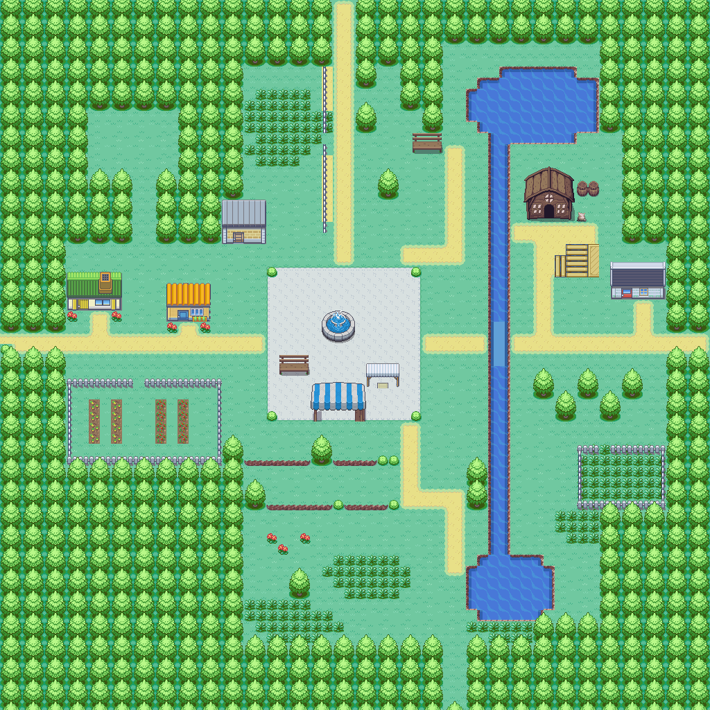

That is the first draw, which did not pass (below).

## High Moor

The moor above Millbrook, drawn as FireRed draws a route: a corridor twenty
tiles wide between the west wood and the rock of the peaks. The drove road is
three tiles wide, and the land shapes it, so it winds between the big things
the moor holds, one side and then the other:

- the old toll house at the Moor Gate, the way off the map;
- the Grey Stones, a tor;
- the drovers' heather;
- Moor Top, a knoll and a landing, where a rock-walled trail forks east to
  Greystone Peaks past a spring;
- a tarn ringed with reeds;
- a row of ledges at the corridor's foot, the quick way down to the village.

A gap in the west wood opens on the shepherd's cottage and its tarn.

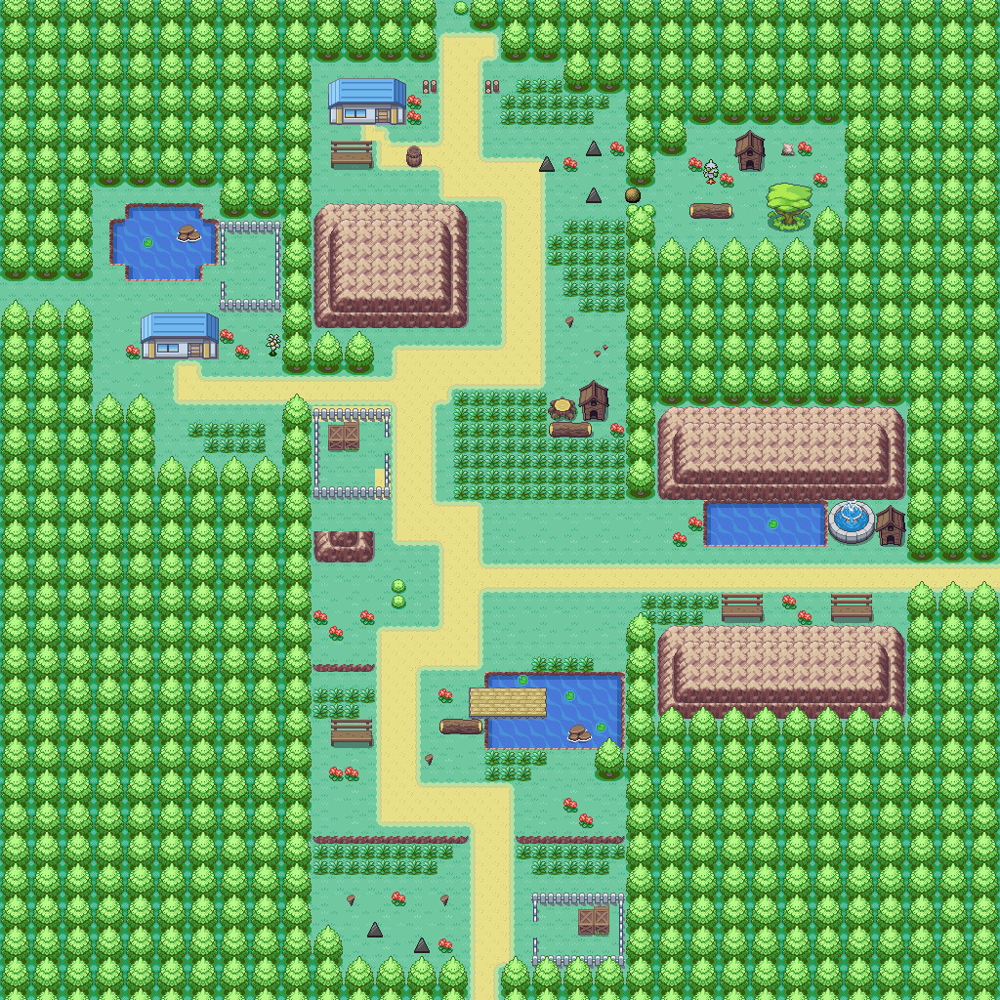

It took eight blind rounds, below. This was the first draw, an open moor sixty
tiles wide, which the judges read as empty lawn with props dropped on it:

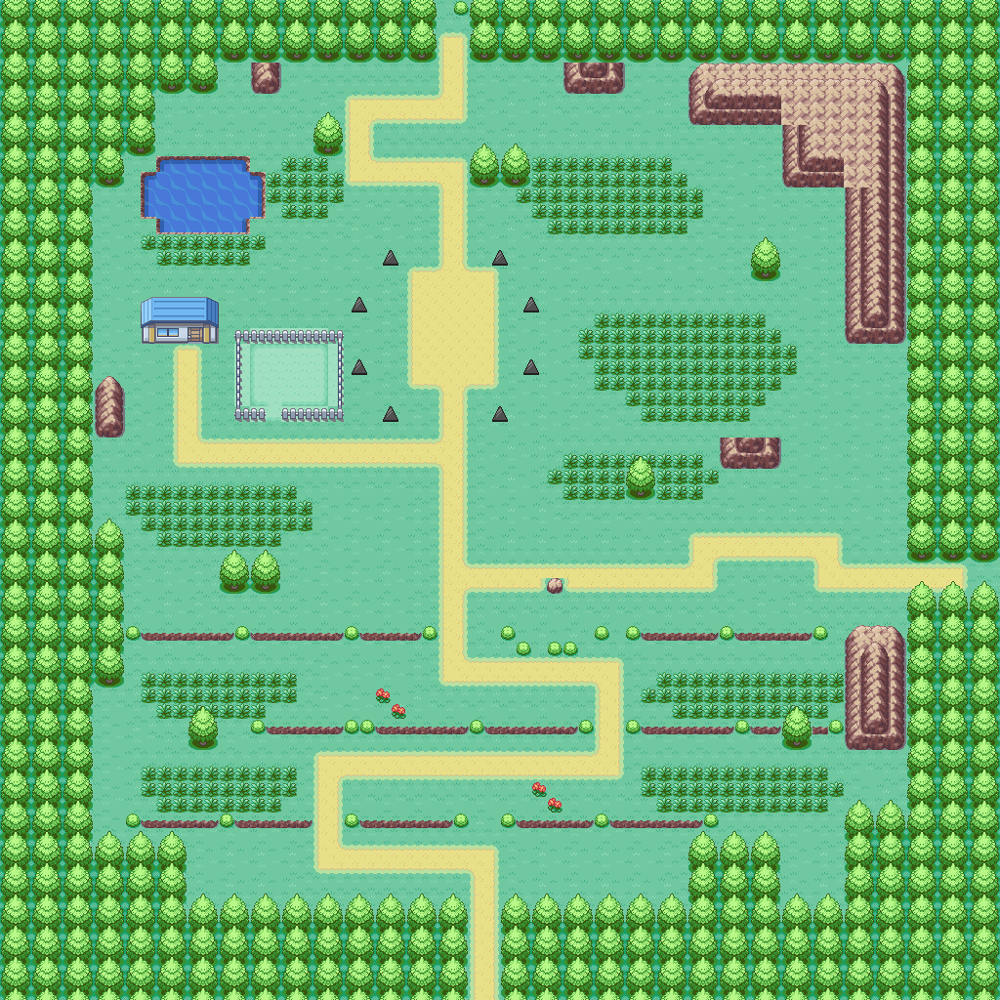

## Greystone Peaks

The high ground above The Crossing, drawn as a mountain pass. A pass climbs
from High Moor, through a cutting in a band of rock, past the tarn where the
river is born and round its head. It comes down the far side, squeezed
between the gorge and the cliff the Greystone Caves open in.

- **The two ways:** the climb and the descent are each a corridor about
  eighteen tiles wide, framed by the summit's cliff and the wood on the
  outside and by the gorge between them.
- **The gorge:** the river leaves the tarn and runs south between walls of
  rock to The Crossing.
- **The cave cliff:** one mass with the crag over the quarry. The Greystone
  Caves open at its foot, onto their top floor.
- **The quarry:** an upper bench cut back into the hill, with Breaker Finn,
  the quarry hut and a crate store, and the vale's third landing. A ledge off
  the bench is the quick way back down.
- **Ways on and out:** the pass carries on south to The Crossing, a path
  nobody signs leaves the quarry east into Pine Hollow, and the Goat Track, a
  way out in a nook at the foot of the climb, keeps the west side within the
  hunter's blind window of an exit (`hunterFlee.test.ts`).

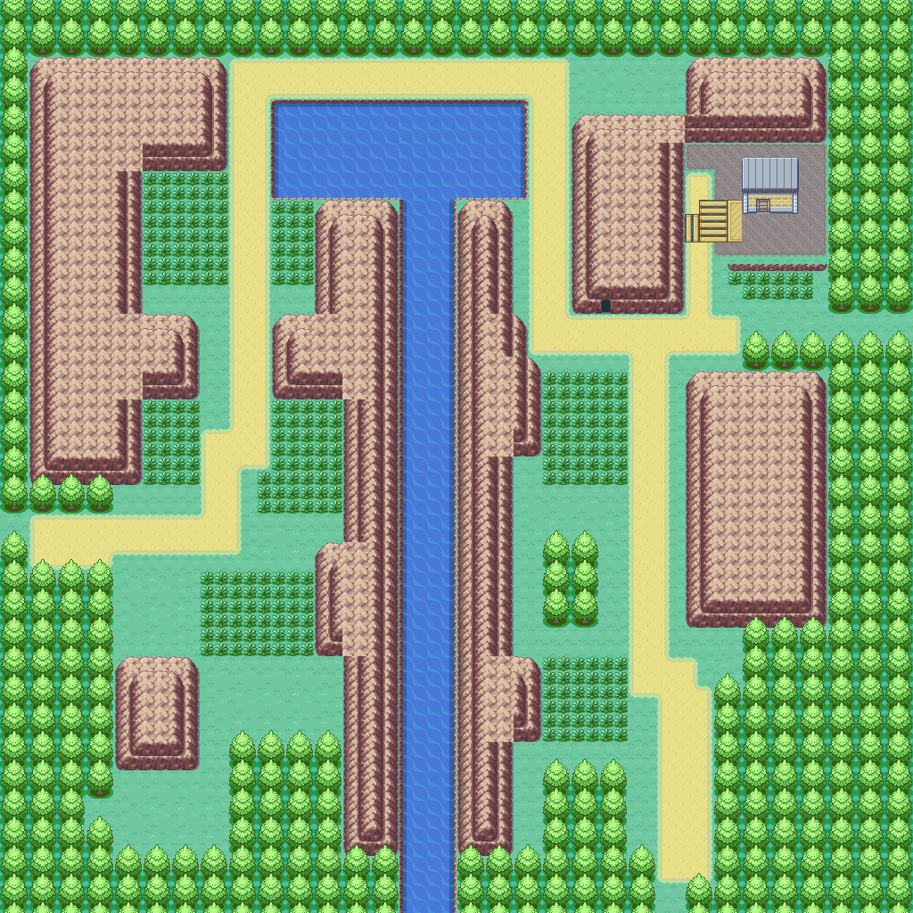

Its first judged draw had the river running across open grass between rock
blocks, which both judges called "an arrangement of parts on a lawn":

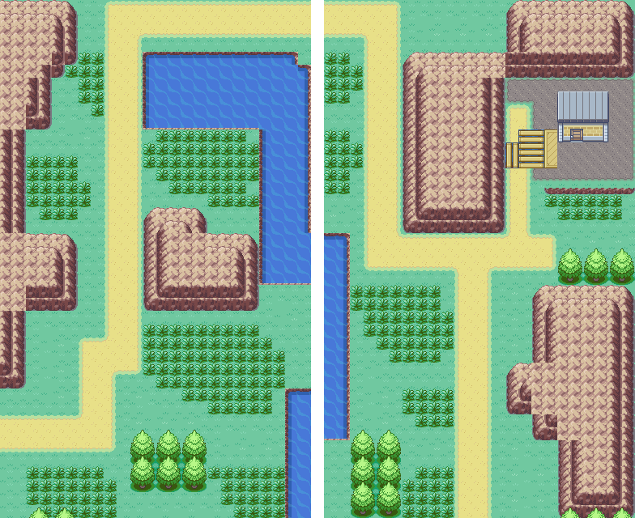

## The Crossing

The middle of the vale, where the river is crossed. It is drawn as a valley
about twenty tiles wide between walls of wood, with the river and the road
winding down it:

- **The river** comes down from the peaks under a cliff, with a column of tall
  grass between the cliff and the water, bends once, and opens below the
  bridge into the Wide Water before it carries on south to the strand.
- **The stone bridge** carries the road from Millbrook over the river, past
  the bridge-keeper's cottage, on to Tanglewood. Netter Bryn stands at its east
  end.
- **The trail from the peaks** comes down the east bank, turned by the wood
  where it meets it.
- **The Wide Water:** the Angler fishes it from the west bank.
- **The stepping stones** at the foot of the valley are the second way over:
  a lane through the west wood comes down to them, and past the heron hide on
  the far side a path nobody signs goes on east into Tanglewood. The nook by
  the hide is the vale's fourth landing.

The plan named a ford as a third way over. FireRed has no ford, and its shallow
water drawn into a river read to every judge as a pale square drawn by
mistake, so there is none.

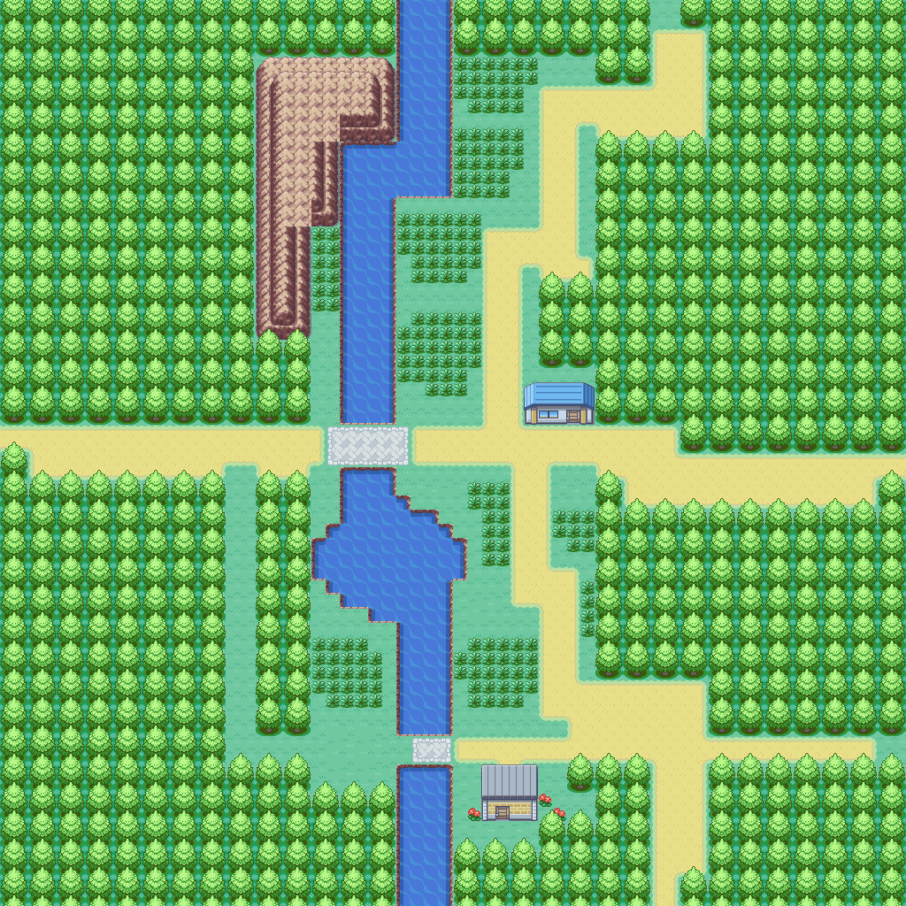

Its first judged draw, a wide valley:

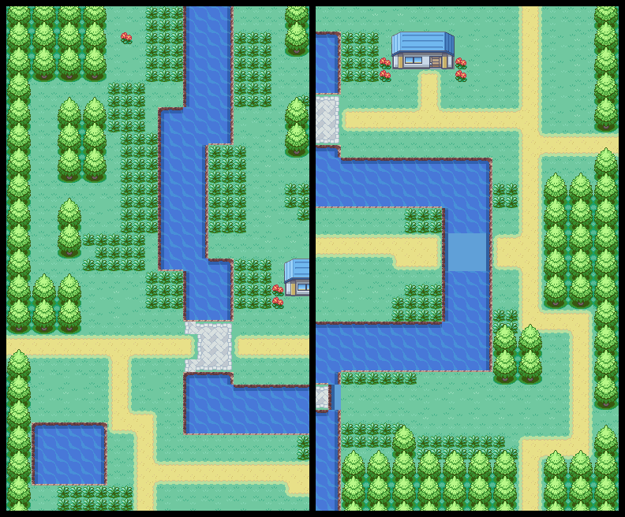

## The vale

Fourteen districts of 64x64 tiles, drawn, in the middle of a 384x384 map. The
vale was planned as nine, 192 square; once they were drawn it grew a column
east and a coast south into the 256 a map file held, and then a ring all round
for its six far places ([below](#the-far-places)). Each district has one idea,
which its program is written to:

| District | Terrain | The one idea |
|---|---|---|
| Millbrook | town | The mill village on the brook: a square, the mill race, cottages and the Centre. Every road starts here. |
| High Moor | moor | The old drove road crosses past the Grey Stones, a tor, and drops south to the village by stacked ledges. |
| Greystone Peaks | mountain | A switchback pass climbs past quarry benches to the mouth of the Greystone Caves; the river is born in a tarn. |
| Pine Hollow | forest | A dark pine wood where one hidden trail threads three clearings; the way south is a deer path nobody signs. |
| The Crossing | river | The river splits the vale; a stone bridge and stepping stones are two different walks over it. |
| Tanglewood | forest | A broadleaf maze of paths that loop and fork, opening onto a ruined shrine in a glade. |
| Reedmere | marsh | Boardwalks over reed beds round a still mere: tall grass everywhere, and the dry way is the long way. |
| Gull Strand | coast | Sea cliffs where the river meets the sea; a sea cave runs back under the cliffs into the Greystone Caves. |
| Orchard Terraces | farmland | The farm cut out of the hillside wood as two slopes down to the sea, the terraces and the lane, and the ledges are the quick way down. |
| The Power Station | mountain | A hydro-electric station run down under its dam below the pines: the turbine hall in its pocket, the switchyard gone to grass, and a service gate only the Card Key opens. |
| Safari Marsh | marsh | Behind the Safari Zone's own gate, a warden's reserve of reed beds and pools where the vale's rarest Pokemon live. |
| The Wreck | coast | A liner aground on the reef off the east cape: the salvage camp picks it over, and the reef is the only way out to it. |
| The Sunken Quarter | coast | The drowned lower town of the old port, reached along the jetty from the strand: streets under the tide. |
| Smugglers' Cove | coast | A hidden cove under the cliffs where the marsh drains to the sea: the smugglers' jetty, their boat, and contraband. |

- **Barriers.** The river runs the length of the old middle column, so east
  and west meet only at The Crossing's two ways over. The peaks, the sea and the
  wood close the edges. South of the orchards and the cape, and on round the
  coast, cells of the plan are open sea rather than districts (`seas`), so the
  coast faces water to the map's edge rather than a wood where no district is.
- **Main routes.** The road from the Westward Road through Millbrook, over the
  river, into Tanglewood and on into the Safari Marsh; the drove road down from
  the moor; the coast road along the strand to the orchards and out to the
  wreck; and the jetty from the strand to the drowned quarter.
- **Hidden routes** (dashed): a col from the peaks into Pine Hollow, a deer path
  from Pine Hollow down into Tanglewood, a wood-edge path from The Crossing into
  Tanglewood, and a way down through the reeds from Reedmere to the cove.
- **The Greystone Caves**: five floors, with mouths in the peaks, in Tanglewood
  and in the sea cliffs, so a group can go underground at one end of the vale and
  come out at another. The plan gives them a sixth, B5F, as Stormcrown's way in.
- **Ways out** (red): the Westward Road, the Moor Gate and the Mere Path from the
  first nine, and from the new five the Pylon Road, the Ranger's Track and three
  that open a while into a raid - the salvage launch, the low-water stair and the
  smugglers' boat. A district far from all of them has a hidden way out of its
  own.
- **The Card Key.** The station's Service Gate is a way out that opens only to
  FireRed's Card Key, and the card lies in Pine Hollow's oak clearing one raid
  in five. The plan names the pair (`cardKey`), so each district walked alone
  is given a stand-in for the other's half and the stitcher drops both.
- **Crossings are fixed in the plan**, so each district can be drawn on its own
  and still meet its neighbours. The four old ways out east and south - the Pine
  Trail, the Eastern Track, Orchard Lane and Fisher's Jetty - became the
  crossings the new districts join at.
- **What it may hold.** The vale is the game's own map, so its file is held to
  `BUILT_IN_MAP_FILE_LIMITS` rather than a player's: fourteen districts need
  more than eight landings and twelve ways out, and the ring needs 384 tiles
  square where a player's map stops at 256 ([the size check](#growing-to-384-the-size-check)).

## Judged blind

Each round, two 48x40 views of Millbrook were judged blind beside FireRed
towns redrawn in the same tiles: Viridian, Pewter, Cerulean, Fuchsia and a
Celadon window. Every round used two fresh judges, and each judge scored every
picture 1-10 and named its biggest fault.

From round 2 on, two deliberately broken real towns rode in every batch as
controls: Cerulean with four blocks swapped, and Pewter with every block
shuffled. A judge only counts if it rates both below every real town.

Millbrook passes when, for each judge, both its views score at least that
judge's lowest real town and their mean is within a point of the real towns'
mean.

| Round | FireRed towns (mean) | Broken controls | Millbrook | Millbrook taken for real |
|---|---|---|---|---|
| 1, first draw | 5.4, 6.4 | none in the batch | 4 and 3, 4 and 4 (3.75) | 5-8% |
| 2, redrawn in FireRed pieces | 6.0, 6.0 | 1-3 | 5 and 5, 5 and 4 (4.75) | 8-10% |
| 3, after the faults of round 2 | 5.2, 5.6 | 1-2 | 7 and 5, 6 and 5 (5.75) | 20-25% |

**It passes on round 3**: both views sit inside the band the real towns score
(2-8), the mean is above theirs, and the judges took it for real as often as
Fuchsia and Celadon.

What each round fixed was what both judges named:

- **Round 1:**
  - props from another art set (the CC0 fountain, stalls and mill);
  - paths that stopped at the brook;
  - terrace ledges floating in grass;
  - an open east side.
- **Round 2:**
  - a ruled street grid;
  - copy-pasted fenced gardens;
  - a ruled ledge line;
  - stamped grass beds in an empty meadow.

Round 3's remaining faults, for the next pass:
- a mix of building styles;
- the forest-heavy foot of the village;
- the pool's shape.

### High Moor

High Moor was judged as two 24x40 views beside five FireRed routes cut to the
same size (Routes 1, 2, 6, 10 and 24), with two of them broken on purpose as
controls. Every judge in every round ranked both broken routes at or below
every real one.

| Round | What changed | FireRed routes (mean) | High Moor |
|---|---|---|---|
| 1 | an open moor | 7.4 | 4, 4, 4, 3 |
| 2 | a framed corridor, ledges on trees | 6.4 | 3, 5, 4, 4 |
| 3 | the stones as rock pillars | 5.8 | 3, 5, 2, 4 |
| 4 | heather everywhere, one gap a ledge row | 6.2 | 3, 4, 3, 4 |
| 5 | places along the road | 7.0 | 4, 4, 4, 5 |
| 6 | the stones as one tor, a wider road | 6.2 | 5, 4, 4, 5 |
| 7 | the land shapes the road | 6.4 | 5, 5, 5, 6 |
| 8 | no isolated pieces | 6.2 | **6, 6, 6, 6** |

**It passes on round 8**: both judges, both views, at or above each judge's
lowest real route and within a point of the mean.

Four lessons, each paid for by at least one round:
- **The shape:** an open field of any size reads as empty lawn, and FireRed's
  routes are framed corridors.
- **The stones:** a ring of stones in this art reads as placeholder markers,
  however it is arranged, because FireRed draws rock in masses.
- **Places, not patterns:** the judges' recurring word was "an arrangement,
  not a place".
- **The road:** a straight road with things set beside it is "a checklist of
  features"; the road has to wind round what stands in its way.

### Greystone Peaks

Greystone Peaks was judged the same way as High Moor: two 24x40 views beside
the same five FireRed routes and the same two broken controls, every round
with two fresh judges.

| Round | What changed | FireRed routes (mean) | Greystone Peaks |
|---|---|---|---|
| 1 | the river across open grass, rock in blocks | 6.2, 6.4 | 4 and 5, 4 and 5 |
| 2 | cliffs as the frame, the river in a gorge, every rock mass on a wall | 6.4, 6.4 | **6 and 6, 6 and 5** |

**It passes on round 2.** Both judges rated both broken controls below every
real route.

Round 1 was drawn with everything High Moor had taught, and still failed on
the frame: both judges said nothing framed the views. The lesson is
**a cliff is a wall only when it is the frame**. A mass of rock standing on
lawn reads as a block, however big; the same rock running out of the picture
along a corridor's side reads as a cliff, which is how FireRed's Route 24 draws
it.

What round 2 still named, for a later pass:
- the rock masses are similar rounded rectangles;
- the quarry's gravel bench looks pasted in;
- the climb has nothing to find along it but tall grass.

### The Crossing

The Crossing was judged the same way, beside the same five FireRed routes and
two broken controls, every round with two fresh judges. Round 4's draw was
replaced before it was judged.

| Round | What changed | FireRed routes (mean) | The Crossing |
|---|---|---|---|
| 1 | a wide valley, a river in jogs, a pale ford | 7.2, 6.4 | 5 and 6, 6 and 6 |
| 2 | the first redraw | 6.8, 6.6 | 4 and 4, 4 and 4 |
| 3 | a corridor with a straight river | 6.8, 6.8 | 4 and 3, 4 and 4 |
| 5 | a wide valley again, big square bends, no ford | 6.8, 6.6 | 4 and 4, 3 and 3 |
| 6 | a framed corridor, the river in short jogs | 6.8, 6.4 | 5 and 5, 5 and 4 |
| 7 | a straight river under a cliff, as Route 24 has it | 6.6, 6.6 | 5 and 5, 5 and 5 |
| 8 | ragged beds, a pool of two ponds, the heron hide | 6.2, 6.4 | 5 and 5, 5 and 5 |
| 9 | one big bend, the cottage door on the road | 6.2, 7.0 | 6 and 6 (pass), 5 and 5 |
| 10 | a pool with a natural edge, the wood turning the road | 6.4, 6.8 | 6 and 5 (pass), 5 and 6 |
| 11 | the bend made whole | 5.8, 6.0 | **6 and 6, 7 and 6** |

**It passes on round 11**: both judges, both views. Every judge rated both
broken controls below every real route.

What the rounds taught about water, which is most of what this district is:
- **Straight is fine; stepping is not.** FireRed draws a river as a straight
  channel and a pool as a plain shape, and the judges took both from it
  without complaint beside a cliff or a road. What read as generated was a
  river stepping sideways in two-tile jogs ("a staircase of rectangles"), a
  pool built of stacked rectangles, and a pale square of shallow water.
- **Draw the river after anything that could cut it.** In round 10 a tall
  grass bed drawn after the river cut through its bend, and a judge saw "two
  reaches that touch only at a corner". Nothing in the hard checks can see it.
- **A crossing goes somewhere at both ends.** The stepping stones were marked
  down while they led from grass to grass, and passed once a lane came down to
  them and the heron hide stood at the far end.

What round 11 still named, for a later pass: the road's long staircase
diagonal, and the stone slabs standing in for bridges, since no bridge on the
FireRed sheet spans a river from west to east.

## Pine Hollow, Tanglewood and the Greystone Caves

The two woods in the east of the vale, the deer path between them, and the
caves under them. They are drawn and pass, and joined the vale the game ships
with Greystone Peaks and The Crossing: the road from Millbrook over the bridge
runs on into Tanglewood, and the hidden trail from the peaks crosses the col
into Pine Hollow. `forests.test.ts` also holds each to every hard check on its
own. Both woods are FireRed's own forest conifer, the tree
Viridian Forest is drawn in. FireRed's broadleaf stands alone, and planted
shoulder to shoulder it reads as an orchard, so each wood has one broadleaf
standing in a clearing.

- **Pine Hollow**, the dark pine wood: one unsigned trail threads three
  clearings.
  - **The spring:** the trail comes in over the col from the peaks and skirts
    a pool.
  - **The hollow:** a sand floor worn bare in the middle of the wood, with a
    berry tree in it.
  - **The oak:** the one broadleaf among the pines, with Collier Bram burning
    charcoal under it.
  - The trail leaves east as the Pine Trail, into The Power Station, and the
    station's lost Card Key lies in the oak's clearing one raid in five. The
    nook south of the climb has a way out of its own, the Fox Run, since the
    Pine Trail stopped being one.
  - The deer path south is tall grass between the trunks, and nothing signs
    it.
- **Tanglewood**, the labyrinth on the road east. Its lanes loop and fork
  through thick wood, so a raid that leaves the road can lose it.
  - **The shrine:** a statue on bare ground in a glade the wood closes round,
    its ring of stones fallen, with one broadleaf leaning over it.
  - **The way underground:** a worn path runs from the shrine to the mouth of
    the Greystone Caves in the rock outcrop.
  - **A pool** where three lanes meet in the north-west, with a berry tree
    beside it.
- **Two hidden ways out**, one in each wood: the Charcoal Track at the back of
  the nook south of Pine Hollow's col, and the Deer Gap in a pocket by
  Tanglewood's road. Each wood's planned way out is at its far east end, and
  without these the hunter's blind window would not cover the walk out
  (`hunterFlee.test.ts`).
- **The Greystone Caves** (`greystoneCaves.ts`), five floors:
  - **Each mouth opens onto a floor of its own:** the peaks onto the top
    floor, the wood one floor down, the sea at the bottom. The only way
    between them is down and up again.
  - **The two middle floors are sealed:** each is two halves joined only
    through the floors above and below.
  - **Every third dead end hides something.**
  - **Mouths in districts drawn later:** the floors and ladders ride in
    Tanglewood's file, and Greystone Peaks and Gull Strand plant their mouths
    with `caveMouthLink`. A district with a mouth carries the floors and the
    ladders as well, so it passes its checks on its own; the stitcher takes a
    floor or a ladder two districts carry alike once (one carried differently
    is two places, and a problem). All three mouths are in: the peaks', the
    wood's and the sea cave in Gull Strand's cliffs.

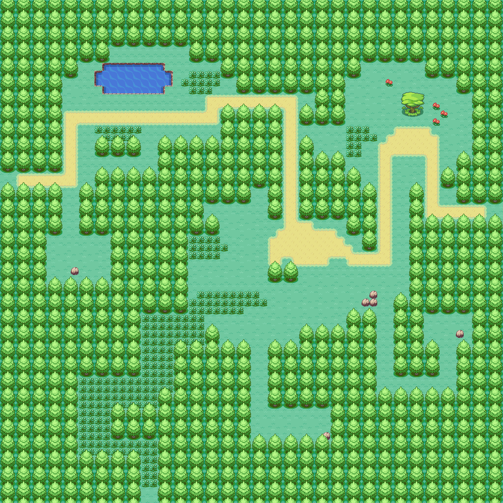

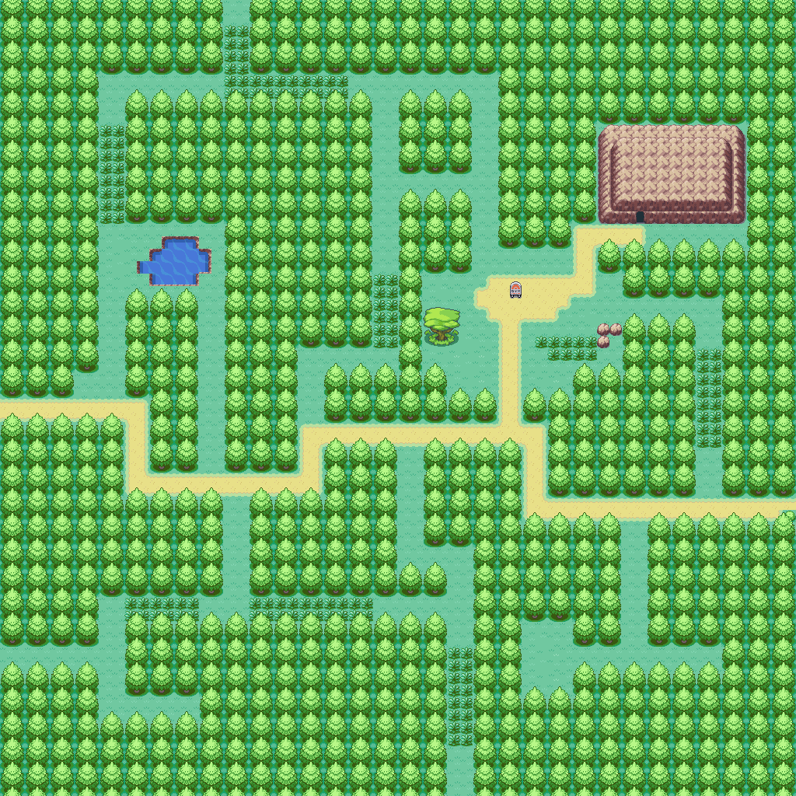

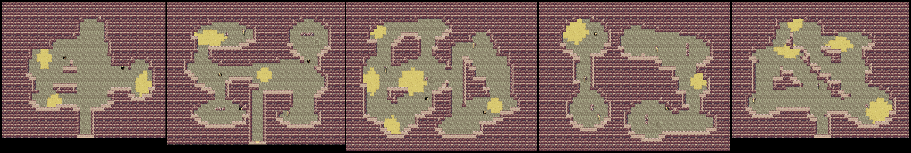

### Judged blind

Each round, two 24x40 views of each district were judged blind beside five
FireRed windows redrawn in the same tiles: three of Viridian Forest and two of
Route 2. Every round used two fresh judges. Two broken real windows rode in
every batch as controls (four blocks swapped, every block shuffled). A judge
only counts if it rates both below every real map. The bar is Millbrook's: for
each judge that counts, both views score at least that judge's lowest real
map, and their mean is within a point of the real mean.

| Round | Real mean | Pine Hollow | Tanglewood |
|---|---|---|---|
| 1 | 6.4, 6.2 | 5 and 4, 5 and 4 | |
| 2 | 6.0 | 5 and 4 | |
| 3 | 6.2 | 5 and 4 | |
| 4 | 6.0, 7.0 | 5 and 5 (pass), 4 and 4 | |
| 5 | 6.8 | 6 and 4 | |
| T1 | 6.4 | | 4 and 3 |
| 6 / T2 | 6.2, 6.0 | **6 and 6, 5 and 5: passes** | 5 and 5, 4 and 6 (pass) |
| T3 | 6.0 | | **6 and 6: passes** |

Rows show only the judges that counted. Pine Hollow round 6 and Tanglewood
round 2 shared one batch.

What each round fixed was what the judges named:

- **Pine Hollow:**
  - a trail of grass that read as no path at all, so a sand path wears down
    it;
  - switchbacks that nothing forced, so the trail now bends only where the
    wood turns it;
  - single-file tree columns, a monolith block, and a ledge with nothing at
    its ends (the ledge went: it was not part of the one idea);
  - a pond like a plus sign, and paths that started and stopped in open
    grass, until the path led into the hollow's worn floor and out again.
- **Tanglewood:**
  - first drawn as islands of trees in open grass, which both judges called a
    stamped checkerboard with no walls, so it was redrawn as a labyrinth of
    lanes through thick wood;
  - a shrine pad the road's spur did not reach;
  - a north-west with nothing to find;
  - a cave mouth no path went to.

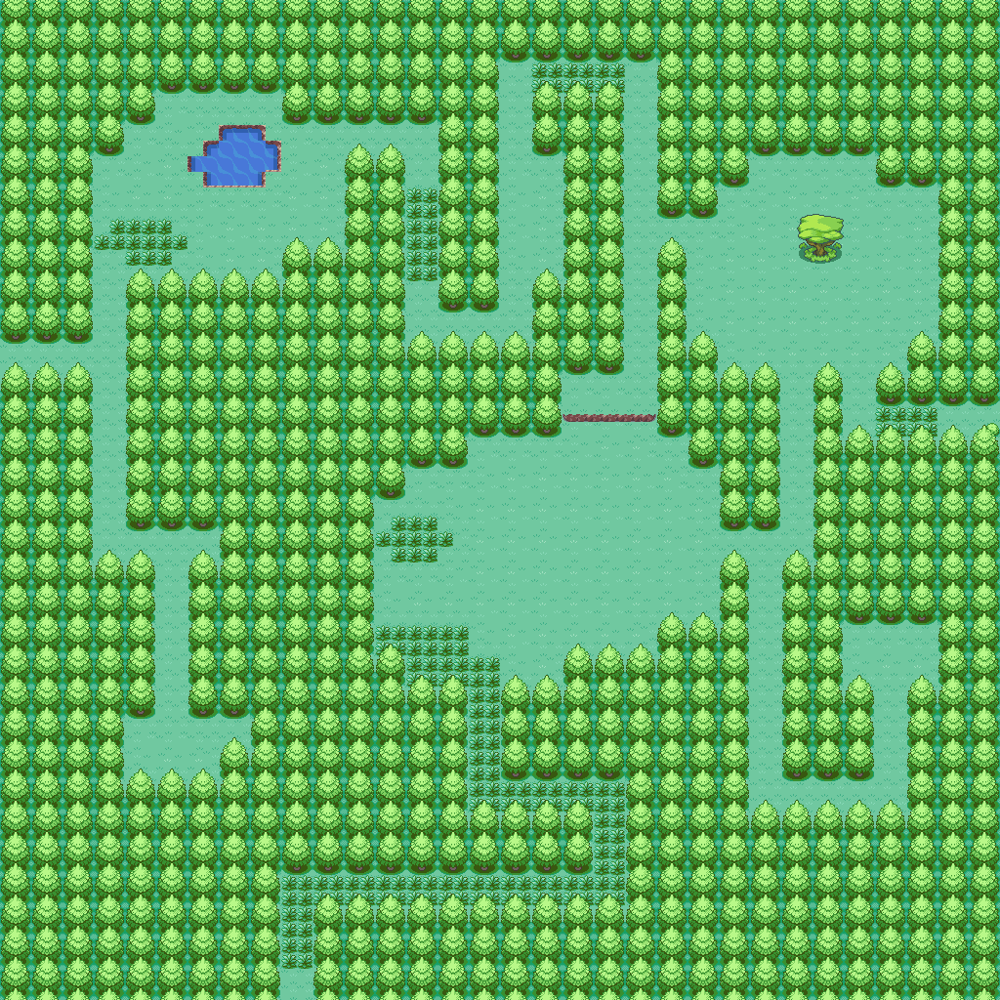

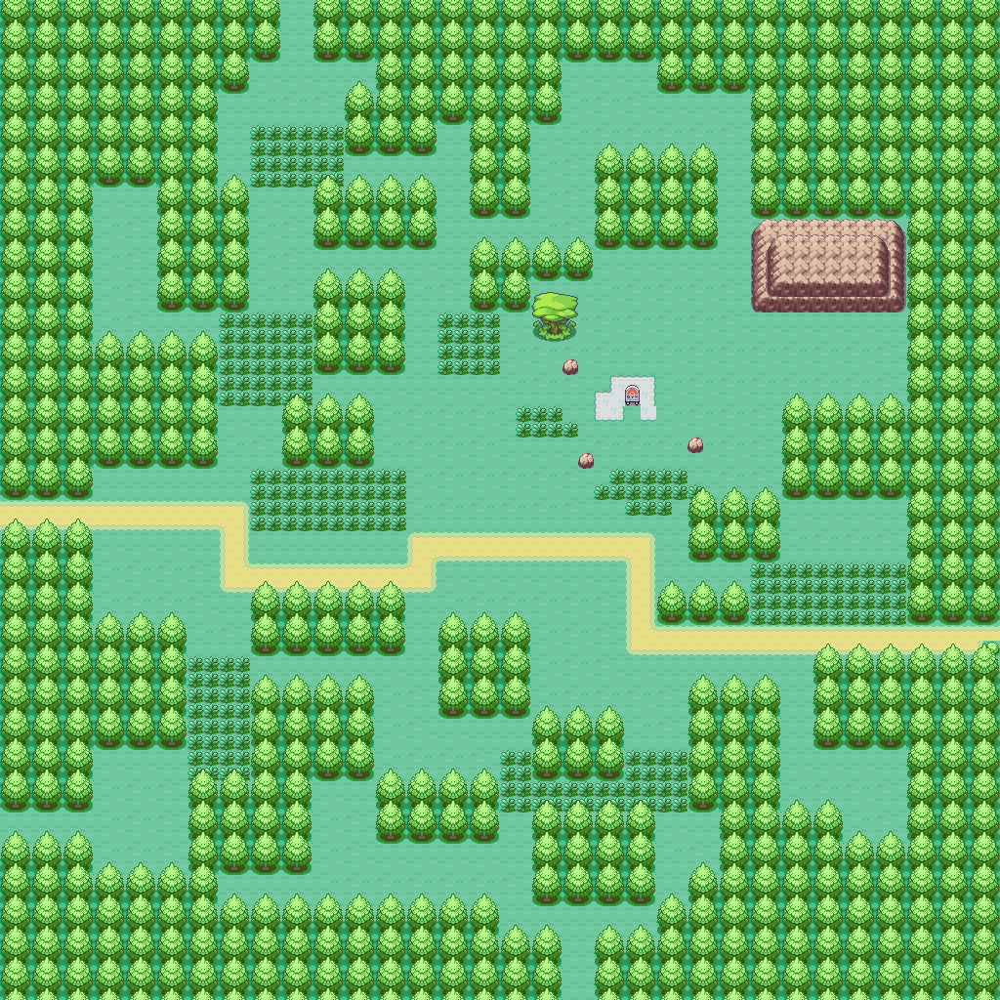

The caves were judged the same way, two floors beside five FireRed cave floors
(three of Mt. Moon, two of Rock Tunnel) with two broken ones as controls.

| Round | Real mean | Greystone Caves |
|---|---|---|
| 1 | 5.6, 4.6 | **6 and 5, 5 and 7: passes** (one judge took B2F for real) |

What is left for the next pass:

- **Pine Hollow:** the lower half of the spring's screen is still a dense
  block.
- **Tanglewood:** its north-west lanes are plain grass.
- **The caves:** both judges named the sand drifts as noisy blobs that do not
  belong.

## Reedmere

The marsh in the south-west, down the lane from Millbrook. **The dry way is
the long way:** an earth boardwalk goes round the mere, east to the trail for
Gull Strand and south and west to the Mere Path, while anyone in a hurry wades
straight through the reeds and pays for it in fights. The sign at the lane
says so: "The boardwalk goes round. The reeds go through."

- **The mere:** wide and still, with a grassed north bank and a jetty out over
  it. Netter Fen fishes from the jetty.
- **The reeds:** tall grass is the marsh's floor. Trodden lanes part it into
  beds, a dry hummock with a berry tree is left open in the north-west, and
  copses of trees give the beds their edges.
- **The Duck Hide:** at the end of a boardwalk spur in the south-west, with
  Birder Tess keeping watch.
- **One pond** in the north-east reeds, where the trail for the strand turns
  off.

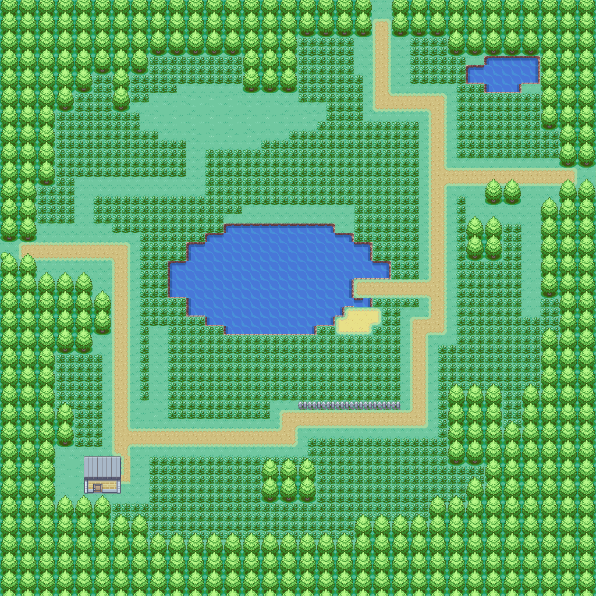

Judged blind the same way as the woods, beside FireRed's watery, grassy
routes: two windows of Route 12, and one each of Route 14, Route 24 and
Route 6.

| Round | Real mean | Reedmere |
|---|---|---|
| 1 | 6.2, 5.6 | 4 and 4, 5 and 5 |
| 2 | 6.2 | 5 and 5 |
| 3 | 6.2 | **6 and 6: passes** |

The table shows only the judges that counted. In rounds 2 and 3 the discarded
judge also scored Reedmere within the band (5 and 6, then 6 and 5), and in
round 2 it took a view for a real map.

What each round fixed was what the judges named:

- **Round 1:**
  - a shapeless sea of tall grass;
  - water broken into stamped rectangular pieces (channels and four pools);
  - a staircase lake shore;
  - an empty lawn.
- **Round 2:**
  - fiddly slivers of grass at the beds' edges;
  - lone tree pairs dotted about.

Round 3's remaining fault, for the next pass: there is little to find beyond
the grass.

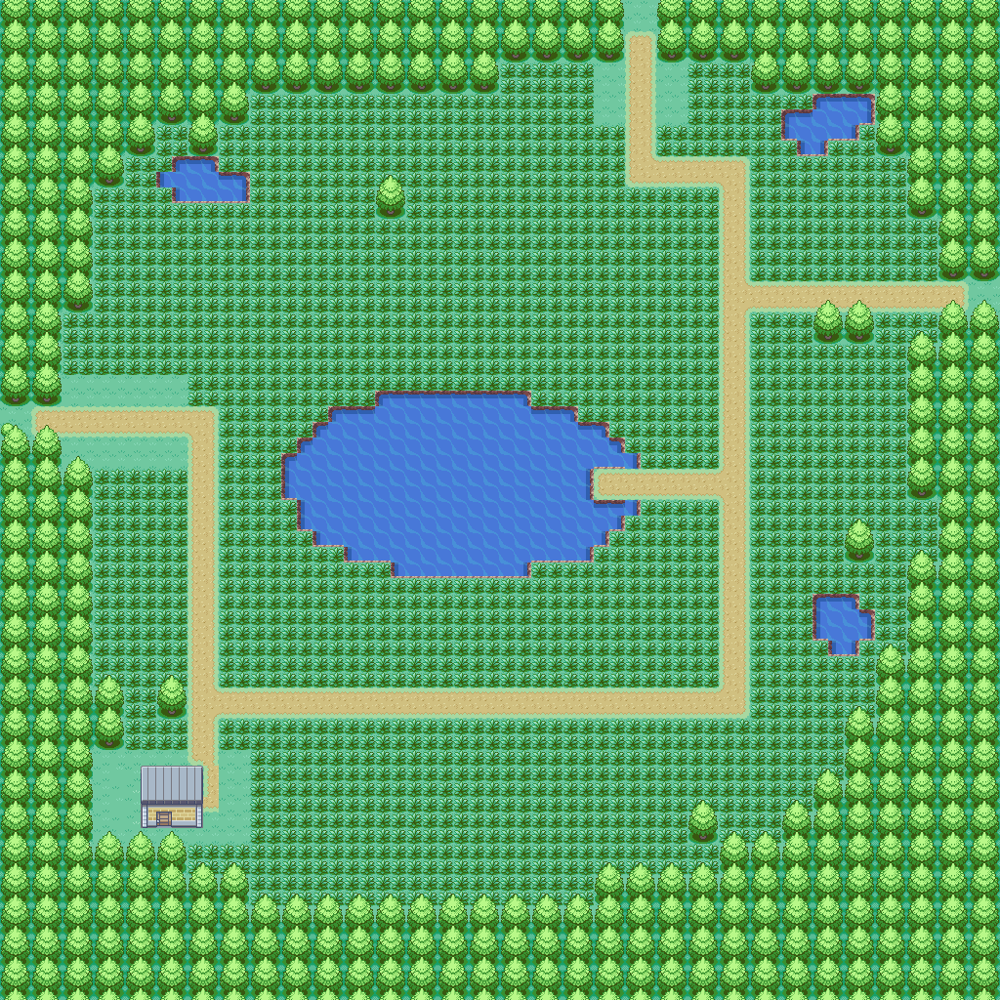

## Gull Strand

The coast in the south, where the river meets the sea, judged on the sea
cliffs and the strand.

- **The heath:** the river comes down from The Crossing across it. The road
  comes down beside the river to the strand and branches east to the
  orchards. The trail from Reedmere crosses the river on a stone bridge.
- **The cliffs:** a band of rock with a cove under it. The sea comes in behind
  a sand bar to make a lagoon, there is a tide pool in the rocks, and stone
  steps lead down from the cliff-top path.
- **The sea cave:** the Greystone Caves' lowest mouth, cut into the cliff foot
  over the cove and opening straight onto the beach. It leads to the caves'
  bottom floor, so a raid can go in from the shore and come up in Tanglewood
  or the peaks. Old Ness on the jetty says it is there: "There is a cave under
  the cliffs. The tide hides it."
- **The Smugglers' Path:** a way out in a nook of the west wood above the
  heath. It was added when The Crossing was drawn: its stand-in ways out had
  kept the heath's far corner within the hunter's blind window.
- **The strand:** the landing, among rocks drawn up on the sand. A net loft
  stands on the heath above it with a fenced garden, and stepping stones cross
  the river mouth at low tide.
- **Fisher's Jetty:** the way off the map, a stone jetty out over the sea with
  FireRed's ferry moored at it.

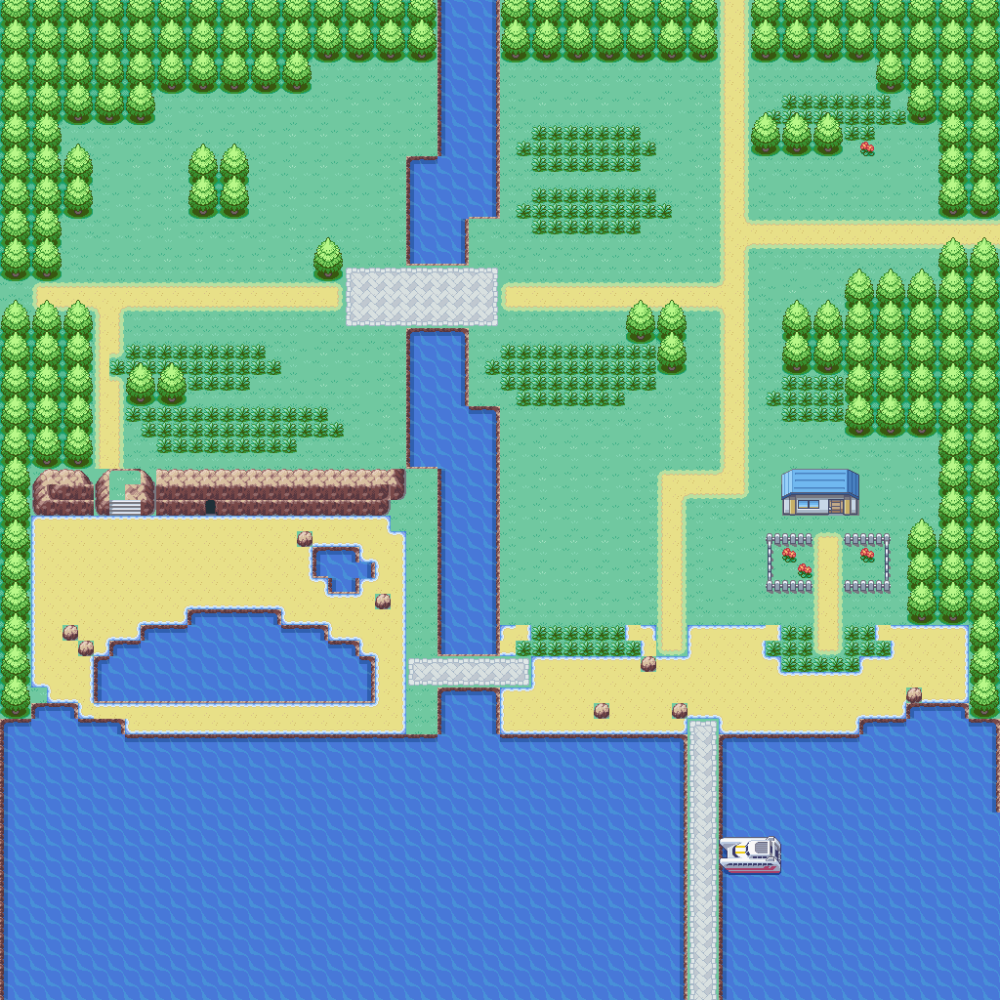

Judged blind beside FireRed's coast: two windows of Vermilion City's harbour,
and one each of Route 19, Route 12 and Route 24. Round 1 was void: a broken
Route 19 window is mostly water, so swapping its blocks hardly broke it, and
both judges scored it as well as a real map. A broken Route 12 replaced it.

| Round | Real mean | Gull Strand |
|---|---|---|
| 1 (void) | 6.2, 5.8 | 5 and 3, 3 and 5 |
| 2 | 6.0, 5.6 | **5 and 5, 6 and 5: passes** (one judge took the cliffs for real) |

What round 2 fixed was what round 1's judges named:

- the west half's featureless slab of rock with no path, which became the
  cliff band, the cove and the steps;
- an empty lawn with features dotted about, so the wood came in down the
  heath's east side and the grass beds grew.

After round 2, three rocks were added round the landing, because holding any
direction from a landing has to meet something within four steps
(`mapStructure.testkit.ts`).

Round 2's remaining faults, for the next pass: the lagoon's stepped bank, the
straight line of the cliff, and the empty grass on the heath.

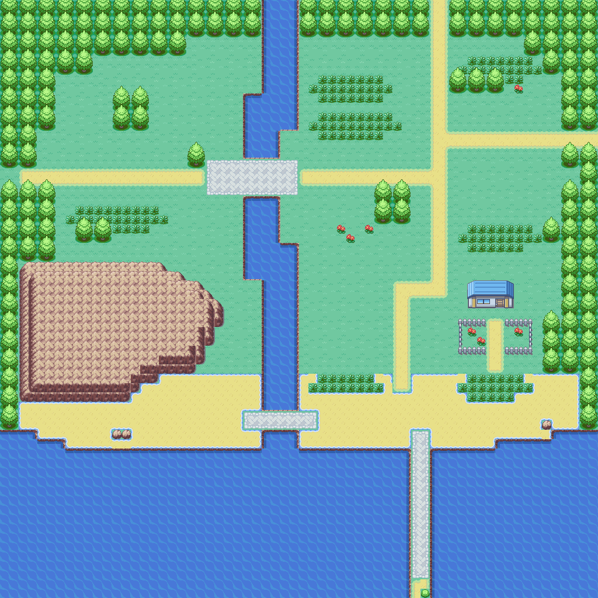

The sea cave, before and after: the cliff band over the cove, and the mouth cut
into its foot.

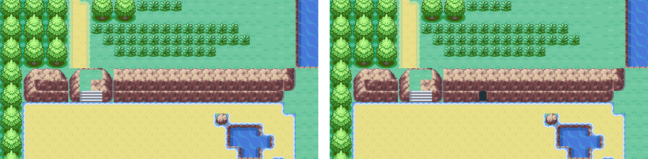

## Orchard Terraces

The farm in the south-east. **It passes the blind check**, on a fresh attempt
with a new idea after the first never did.

- **The farmyard:** the farmhouse, the apple store, a kitchen garden with a
  berry bush, and the landing. The north orchard stands beside it, where the
  trail from Tanglewood comes in.
- **Two slopes down to the sea**, cut out of the hillside wood:
  - **the terraces**, four shelves down to the sands, with the farm road
    zig-zagging past the cowman's cottage and the cornfield;
  - **the lane**, down past the lower orchard and the cider press, turning
    east for The Wreck.
- **The ledges:** each terrace edge runs from a step in the wood to the road,
  and the lane ends in one that is the quick way down to the pasture and its
  dew pond. A hop is the quick way down, never back up.
- **Two ways out of its own:** the Cockle Path up from the west end of the
  sands, and Pickers' Path at the corner of the north orchard. They were
  added when The Wreck took the lane's way on east, so that no corner of the
  farm is further from a way out than the hunter's blind window covers.


In the game, at the Farmhouse landing in the explorer run:

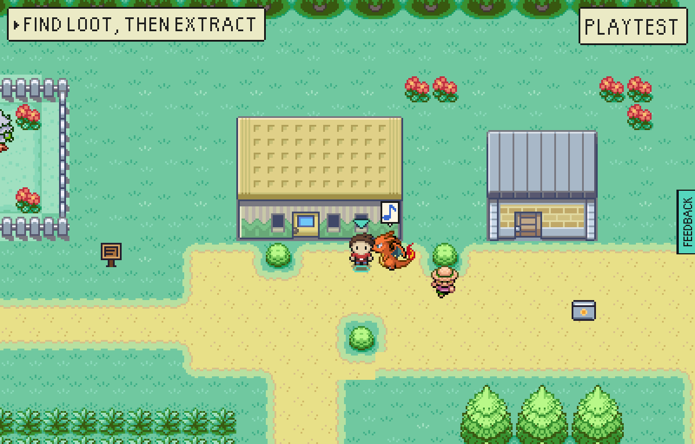

It was judged as two 24x40 views beside FireRed's Route 1, Route 2, Route 6,
Route 10 and Route 24 (two broken real routes as controls): the terraces, and
the lane down to the pasture. Fresh judges every round.

| Round | Real mean | Orchard Terraces | What was tried |
|---|---|---|---|
| 1 | 5.4, 7.0 | 8 and 6, 5 and 5 | two framed slopes; terrace edges of ledge wall to wall |
| 2 | 6.4, 6.0 | 4 and 4, 5 and 5 | each edge drawn differently, a lone tree in one; ragged grass |
| 3 | 6.4, 5.4 | 5 and 4, 5 and 5 | grass in whole beds; the orchard's gate on the lane |
| 4 | 6.8, 6.2 | 6 and 5, 6 and 5 | the cottage and a pond for the road to bend round; a cider press |
| 5 | 6.4, 6.2 | 5 and 4, 6 and 5 | a three-wide road; a framed pasture with a track to its pond |
| 6 | 6.8, 5.4 | **8 and 6, 7 and 5** (passes, ships) | the wood steps in and out, and each ledge runs from a step |

Rounds 1 to 5 each passed with one judge. What the other kept naming was the
same thing in different words, and round 6 is the answer to it:

- **What is laid on the ground reads as a pattern:** ruled rows of ledge,
  pairs of trees at even spacing, beds of the same size, flowers dotted.
- **The frame was ruled too:** straight walls of wood the whole height of
  the slope. Once the wood stepped in and out and the ledges ran from those
  steps, both judges passed it.

### The first attempt

The farm was first drawn as one open hillside, three shelves wide. It shipped
explorer-only as the best of eight rounds and never passed: the orchards read
as stamped grids, there was too much lawn, and every ledge read as floating.

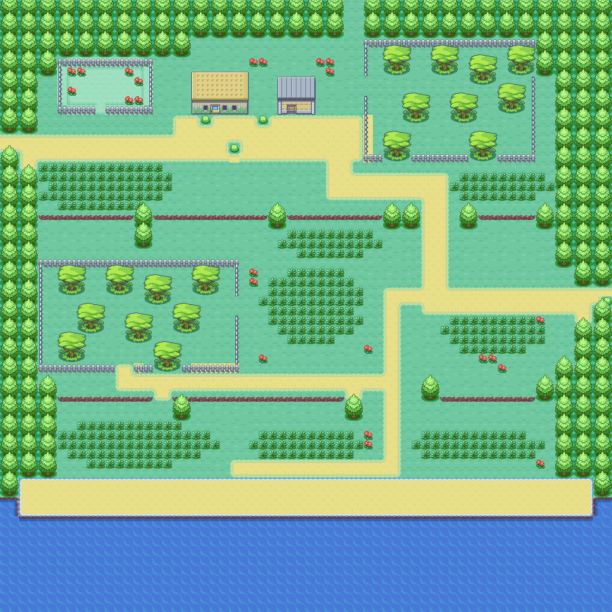

| Round | Real mean | Orchard Terraces | What was tried |
|---|---|---|---|
| 1 | 7.2, 6.2 | 2 and 2, 3 and 4 | open slope, orchard pens, ruled ledges |
| 2 | 7.0, 6.8 | 5 and 3, 3 and 4 | wooded shelves, a ledge cut through each band |
| 3 | 7.4, 7.6 | 6 and 5, 4 and 4 | denser: a sand yard, fields, wide road |
| 4 | 7.0, 7.0 | 5 and 4, 4 and 5 | ragged bands, rocks at the ledges' ends |
| 5 | 7.6, 7.0 | 4 and 5, 4 and 5 | the shelf edges are the ledges |
| 6 | 6.2, 7.2 | 5 and 5, 5 and 5 (shipped) | irregular orchards, paths across the shelves |
| 7 | 7.0, 7.2 | 4 and 4, 4 and 4 | thicker wood at the sides |
| 8 | 7.4, 7.0 | 4 and 4, 4 and 4 | fields in hedgerows of trees |

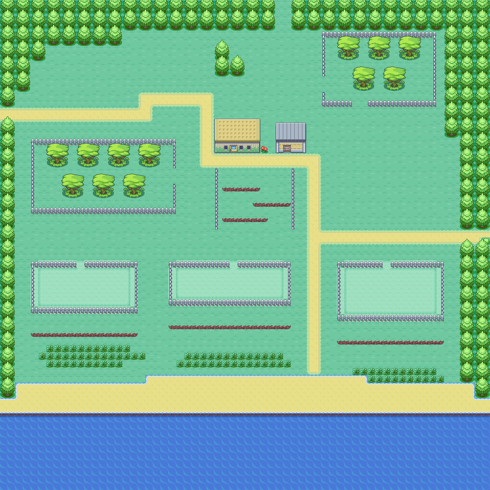

## The Power Station

The station east of Pine Hollow, at the head of the vale's new east column. The
Pine Trail that used to leave the vale there is the way in from the pines now,
and the south road leads on to Safari Marsh.

- **The dam:** a cliff band across the head of the valley with the reservoir
  behind it. The Pylon Road climbs round its west end and runs along the
  reservoir's north shore out of the vale; the relay mast stands on the far
  shore.
- **The station:** FireRed's own Power Plant, cut off Route 10 with its chimney
  caps standing in the dam's bottom row, as Route 10's stand against its cliff.
  It sits in a pocket of wood under the dam, with a sand forecourt where you
  land (The Dam).
- **The roads, a ring:** in from the pines, along the forecourt, over the
  tailrace on a stone bridge, down the east bank past the damkeeper, and
  through the wood to the south road, which goes on to Safari Marsh and back up
  past the hamlet.
- **The switchyard:** fenced and gone to grass, its gravel showing through. It
  is where the station's Electric wildlife lives: Voltorb, Magnemite and
  Pikachu, now and then an Electabuzz. Its Service Gate at the back is locked
  to the Card Key.
- **The workers' row:** two houses on a lane, their garden across it, and a
  path out of the garden's back gate through the trees to the tailrace's
  settling pond.

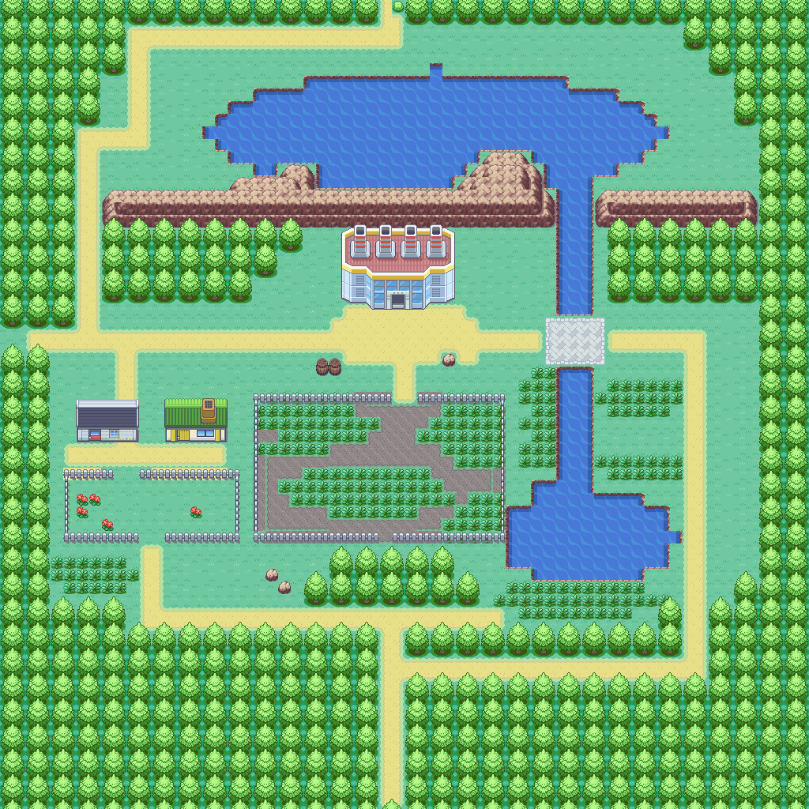

Judged blind beside FireRed's Route 10 (both halves, the south one with its
Power Plant), Route 12, Route 24 and Route 6, with two broken real routes as
controls.

| Round | Real mean | The Power Station | |
|---|---|---|---|
| 1 | 6.4, 6.0 | 6 and 4, 5 and 5 | one judge 0.4 short |
| 2 (void) | 5.6, 6.8 | 5 and 7, 6 and 6 | both judges rated a broken route above a real one |
| 3 | 6.4, 6.6 | **6 and 7, 7 and 7: passes** | |
| 4 | 6.2, 6.4 | 7 and 4, 6 and 6 | redrawn to the grown plan; one view under a judge's lowest real |
| 5 | 5.8, 5.8 | **5 and 5, 7 and 6: passes** (ships; one judge took the hamlet for real) | |

Round 1's notes were the open-field fault High Moor taught: "things set beside
paths in open grass", "the plant floats with no framing walls". What fixed it
was drawing the valley as wood and cutting the places out of it - the
station's pocket under the dam, the hamlet's clearing on the road, the path to
the pond through the trees - with the forecourt in sand and the workers' houses
facing a lane. Round 2's swapped Route 24 was hardly broken, as Gull Strand's
round 1 control was; round 3 shuffled both controls.

The plan then grew (#320): the Pylon Road leaves north, not east, and a road
goes south to Safari Marsh. The station was redrawn to it - the road along the
reservoir's north shore, a ring of roads round the valley - and judged again.
Round 4 named what the redraw and the landing rule had added: a ruled cliff
band, tree columns standing either side of the station like pillars, and two
boulders flanking the path like gateposts. The dam now steps up into crags
where it meets the water, the pocket opens onto the tailrace's reeds, and the
landing's stops are the station's stores and a boulder further off.

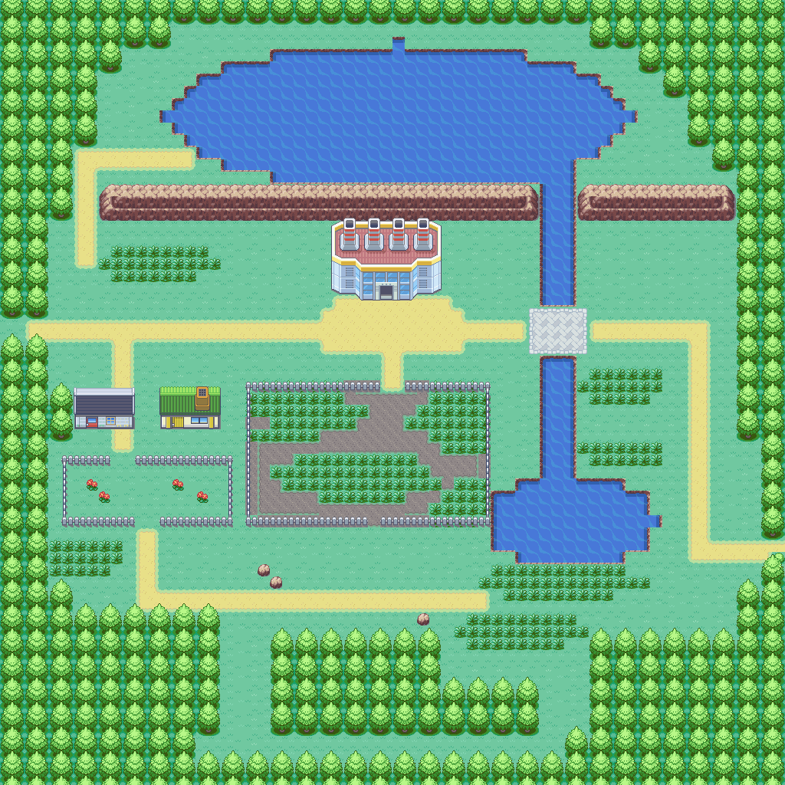

## The Wreck

The east cape, where the vale meets the open sea: the first of the five new
districts drawn.

- **The cliff top:** a corridor between the wood and the cliff, where the
  road comes in from the orchards and runs past the salvage master's house.
- **The cliff:** three masses of rock. The camp road goes down the cleft
  between the last two.
- **The beach:** a band between the cliff and the sea, with the salvage camp
  at the foot of the cleft (the Salvage Camp landing) and the camp's pier. The
  Salvage Launch puts in at the pier two minutes into a raid.
- **The reef:** a bar of sand out to the liner aground on it, the only way out
  to the wreck, with what the sea has thrown up along it.
- **A trail** comes down through the wood from the Safari Marsh.

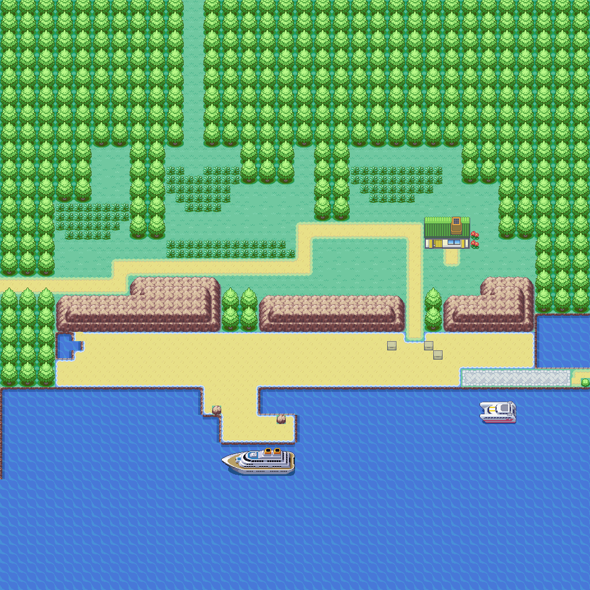

In the game, at the Salvage Camp landing in the explorer run:

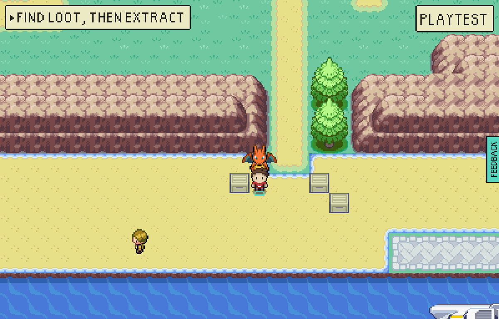

It was judged as two 24x40 views of the cliff top and beach beside FireRed's
Route 1, Route 2, Route 6, Route 10 and Route 24, with two broken real routes as
controls.

| Round | Real mean | The Wreck | What was tried |
|---|---|---|---|
| 1 | 6.0, 7.4 | 3 and 4, 3 and 4 | a cliff the width of the map; another game's barrels, logs and huts on the beach |
| 2 | 5.8, 6.6 | 5 and 6, 5 and 4 | FireRed's crates, pier, ferry and liner; the cliff in masses |
| 3 | 6.0, 4.4 | **4 and 7, 5 and 7** (passes, ships) | the sea frees the rim; a bar of sand out to the wreck |
| 4 | 5.6, 6.2 | 5 and 8, 4 and 5 | the west gap opened; a fenced salvage yard |
| 5 | 6.2, 5.4 | 4 and 5, 5 and 5 | roads down the west gap and down from the Safari Marsh |

Rounds 4 and 5 answered round 3's faults and each passed with one judge only,
so it ships as round 3 drew it. Its landing was then moved onto the camp's
crates, where every way you set off meets something within four steps.

What the judges kept naming:

- **A sand road laid on the beach** draws a seam down each side of it, so
  every road ends where the beach begins.
- **The gap in the cliff** reads as a way down plugged with trees. Opened, it
  read as a hole; given a road, as one more ruled line.
- **The beach and the cliff-top lawn** are wide bands. A fenced yard put in
  the lawn read as "a pen of evenly spaced stones".

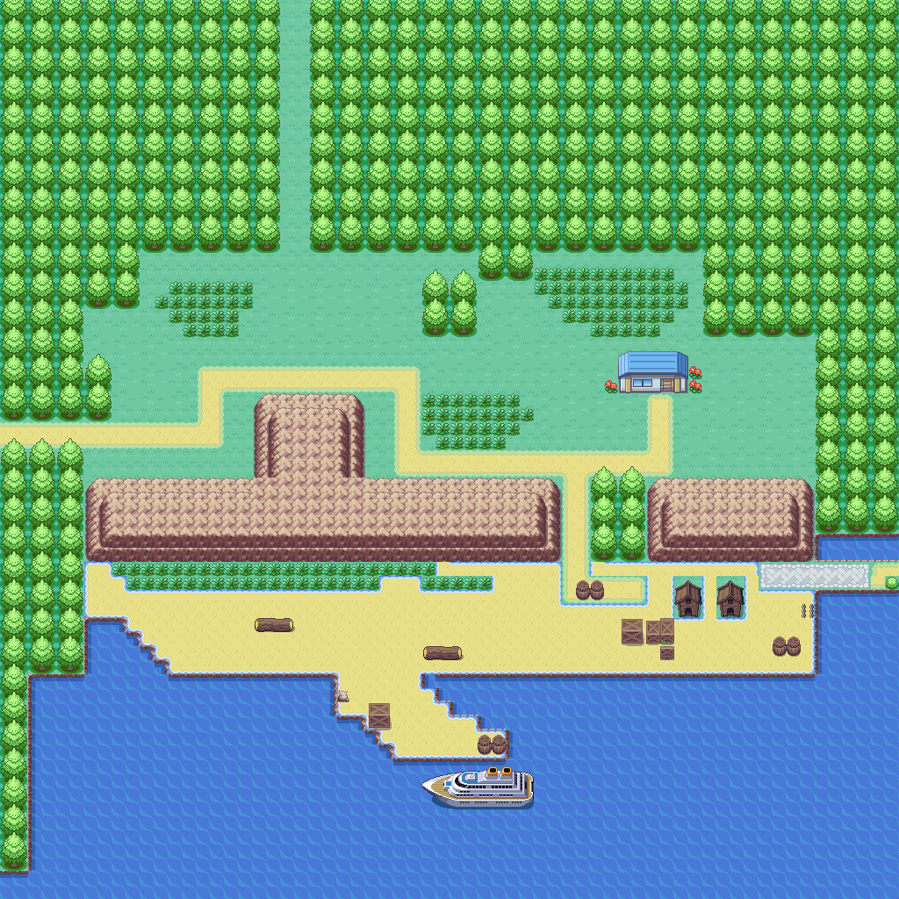

## The Sunken Quarter

The drowned lower town of the old port, south of Gull Strand. It is drawn as a
town first and then flooded, so the sea covers the streets and leaves the town's
plan standing.

- **The jetty and the Old Quay:** the jetty from the strand runs on across the
  water to the quay, the one stretch of the port still dry. The quay is the
  landing. The fishers' boat, a hidden way out, puts in from a step off the
  jetty. Without it, the cove under Gull Strand's cliffs is past the hunter's
  blind window (`hunterFlee.test.ts`).
- **One change in The Power Station:** a bush now stands outside its service
  gate. Without it, once the marsh was drawn, the gate became the short way
  from the dam to the south road, and an exit takes whoever steps on it. With
  the bush, the gate is a pocket stepped into from the switchyard.
- **The upper town:** the quay, the upper street with the harbour office and
  its houses, and the high street down to the water. The Harbourmaster stands
  at the office.
- **The tide:** below the upper street the sea has come in. The streets carry on
  under it as stone just awash, and the roofs of the houses along them stand in
  the water. The boatyard is the one dry corner of the lower town.
- **The Drowned Mansion:** FireRed's burnt mansion on its walled terrace in the
  middle of the water. The high street runs in at its north gate and out at its
  south gate, past the paved forecourt. Its garden has gone to grass.
- **Ways on and out:** the low street runs west to the shingle under the cliff,
  where the trail from Smugglers' Cove comes round. The high street runs south,
  past Diver Coral, to a landing at the Low Water Stair. That is the way off the
  map, and it opens once the tide is out, 90 seconds into a raid.
- **The frame:** a cliff runs the length of the west side and off the map at
  each end. East is the open sea The Wreck lies in, and the sea closes the north
  and the south. (It was judged with a second cliff down the east side; that
  came out when the sea east of it was drawn.)

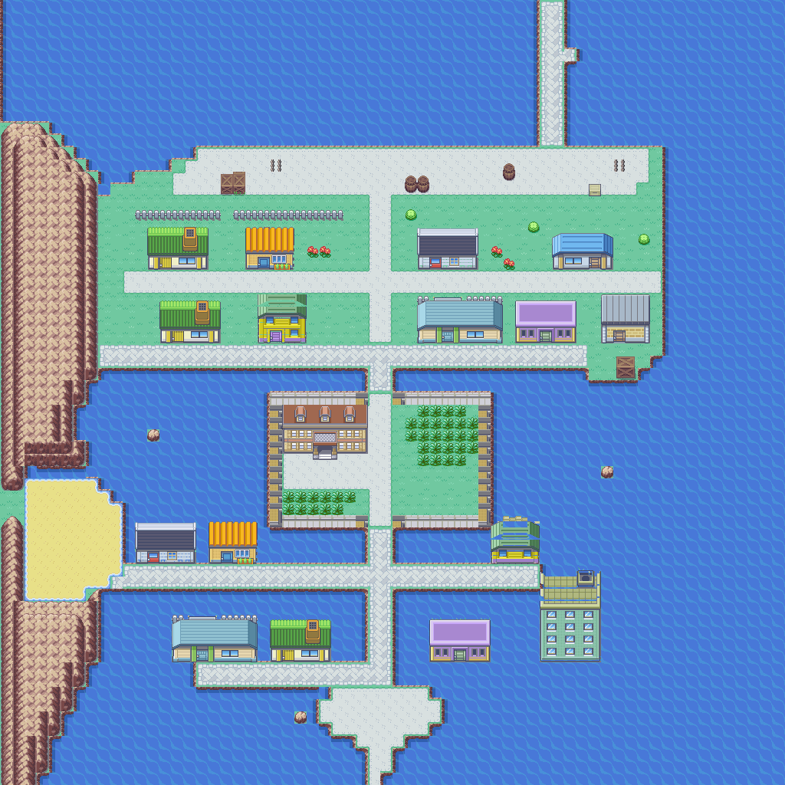

As judged in round 1, before the mansion's garden was grassed:

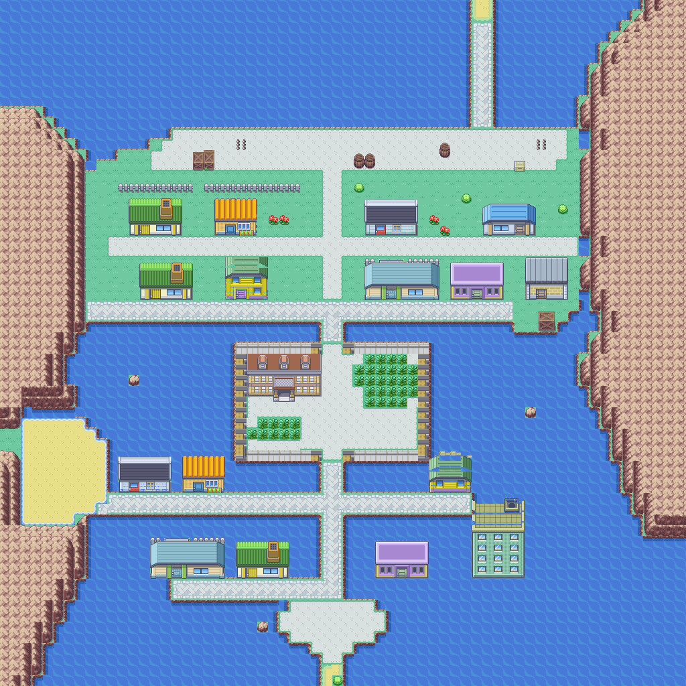

### Judged blind

It was judged in one batch with Smugglers' Cove, which lands on its own,
beside FireRed's coast, the set Gull Strand was held to: two windows of Vermilion City's harbour, and one each of Route 19,
Route 12 and Route 24. The two broken controls were Vermilion with every block
shuffled and Route 12 with four blocks swapped. Every round used two fresh
judges, and each district was judged as two 24x40 views.

| Round | Real mean | The Sunken Quarter | Smugglers' Cove |
|---|---|---|---|
| 1 | 5.8 | **6 and 5: passes** | 7 and 6 |
| 2 | 5.6 | **6 and 5: passes** | 6 and 6 |

The table shows only the judges that counted. In each round one judge scored a
broken control level with its lowest real map (3 and 3), so it does not count.
It scored the Sunken Quarter 5 and 6 in round 1, and 6 and 5 in round 2.

What round 1's judges named, and round 2 fixed: tall grass growing on paving
inside the mansion's walls. The garden is grass now, with paving only on the
street and the forecourt.

What is left for a later pass:

- the upper town's streets are ruled straight;
- the house styles are mixed;
- a building standing in open water reads to both judges as pasted, though
  the drowned roofs are the idea.

## Smugglers' Cove

A cove under the cliffs south of Reedmere that nobody is meant to find.

- **The way in nobody signs:** the deer path from Reedmere comes down through
  the wood beside the brook, where the marsh drains into a reed-fringed pool.
  The Eel Gap, a hidden way out, is a gap in the wood west of the pool, because
  the marsh end is past the hunter's blind window from every other way out.
- **The cliff top and the Cove Steps:** heather and rock above the drop. The
  landing is here, and a cut runs down through the cliff to the beach.
- **The cove:** a beach in the arms of the cliffs, with a spur of rock running
  down onto the sand and marram grass at its back. The brook falls through a
  cleft into the sea.
- **The smugglers' jetty:** stone across the cove to their boat, the way off the
  map. The boat sails when the tide turns, 150 seconds into a raid. Old Rook
  waits on the jetty and says so.
- **The contraband:** crates, barrels and a hidden find in a nook of the rocks
  under the jetty, with a grunt on guard.
- **The cleft east:** a cut through the high ground, the shore path round to
  the Sunken Quarter.

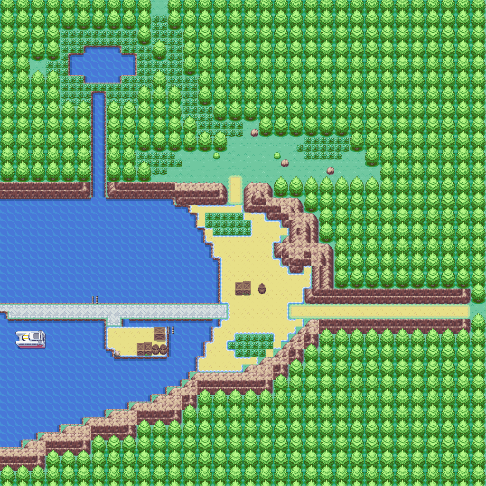

### Judged blind

Judged in the same batch as The Sunken Quarter, against the same five real
windows and two broken controls.

| Round | Real mean | Smugglers' Cove |
|---|---|---|
| 1 | 5.8 | **7 and 6: passes** |
| 2 | 5.6 | **6 and 6: passes** |

The table shows only the judges that counted. The judge left out of each round
scored it 6 and 4, then 7 and 7.

What round 1's judges named, and round 2 fixed: a big, empty beach with single
rocks sprinkled on it. A spur of the cliff now runs down onto the sand, marram
grass holds the back of the beach, and the smugglers' gear waits at the head of
the jetty.

What is left for a later pass:

- the brook runs ruler-straight through the wood;
- the beach is still wide and open.

## Safari Marsh

A warden's reserve east of Tanglewood, behind FireRed's own Safari Zone gate,
where the vale's rarest Pokemon live.

- **The gate:** the road from Tanglewood comes in past the Safari Zone gate,
  with the Warden at the roadside and the reserve's sign.
- **The paths:** sand paths with mown verges wind through the reed beds,
  between copses and round two pools, to the rest house in the middle.
- **The rest house:** the Rest House landing, with a bench in its yard. It is
  the dry ground a raid stops at.
- **Ways on and out:** the paths go north to the power station, south through
  the reeds to the wreck, and east past Ranger Moss to the Ranger's Track, the
  way off the map. A second hut stands by the pond in the north-east.
- **The Wardens' Stile:** a hidden way out in the reeds beside the north road.
  Once the marsh is drawn, the Power Station's road south is no longer a stand-in
  way out, and without the stile that station's far side is past the hunter's
  blind window (`hunterFlee.test.ts`).
- **The wildlife:** the reeds roll a habitat of their own, `safari`
  (`SAFARI_ZONE_WILDLIFE`). These are FireRed's own Safari Zone species, brought
  down from its levels 22-33 to a route's: Nidoran, Exeggcute, Venonat, Paras
  and Rhyhorn, and the Chansey, Kangaskhan, Scyther, Pinsir and Tauros that live
  nowhere else in the game. Every species is one of the 151 already in the game,
  with its own stats. Doduo is left out, because by night its slot would go to a
  Golbat far below the level a Zubat evolves at. A level-8 starter of each kind
  wins at least 54% of what it meets there (`safariHabitat.test.ts` holds 45%).
  The map maker offers the habitat as "Safari Zone".

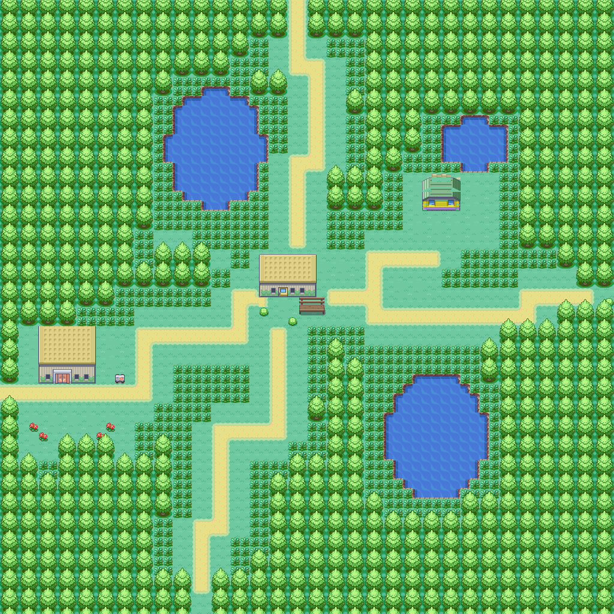

### Judged blind

Judged beside FireRed's marshy, grassy routes: two windows of Route 12, and one
each of Route 14, Route 24 and Route 2. The two broken controls were Route 14
with every block shuffled and Route 12 with four blocks swapped. Every round
used two fresh judges.

| Round | Real mean | Safari Marsh |
|---|---|---|
| 1 | 4.8, 5.2 | 6 and 3, 5 and 3 |
| 2 | 5.6, 5.6 | **6 and 4, 7 and 4: passes** |

Every judge counted in both rounds. Round 2 passes for both judges: each view
is at or above that judge's weakest real route (4), and each mean is within a
point of the real mean.

What round 1's judges named, and round 2 fixed: the middle of the reserve read
as a sea of tall grass with path pieces in it. Every path now has a mown verge,
and copses break up the reeds.

What is left for a later pass: the middle view is the weak one (4 from both).
Its paths leave the view in pieces, and it reads as open country rather than a
corridor. The west view, with the gate, scored 6 and 7.

## Played through

With all fourteen districts in, the whole vale was played in the real game as a
player would play it: the explorer run (PLAYTEST on the title), a stepped
headless browser, and key presses through `tools/playtest/raid.mjs`, one raid at
a time.

- **Every landing:** each of the eleven was dropped in at, and each raid left
  by a way out.
- **Every crossing between districts:** all 21 that are not river, hidden ones
  included, were walked across in three raids from Mill Square, Stepping Stones
  and the Farmhouse.
- **Every way out:** all nineteen were left by, among them the three that open
  late (Salvage Launch, Low Water Stair, Smugglers' Boat) and the Card Key's
  Service Gate.
- **Every cave mouth:** the peaks', Tanglewood's and the sea cave each lead to
  their own floor and back out (`--through=x:y:dir`).
- **The Safari Zone gate:** walked past on the road into the marsh.

Two faults showed on screen, and both are fixed:

- **Gull Strand's rocks stood in squares of lawn on the beach**, because a rock's
  lot defaults to grass. They stand on the sand now (top before, bottom after):

  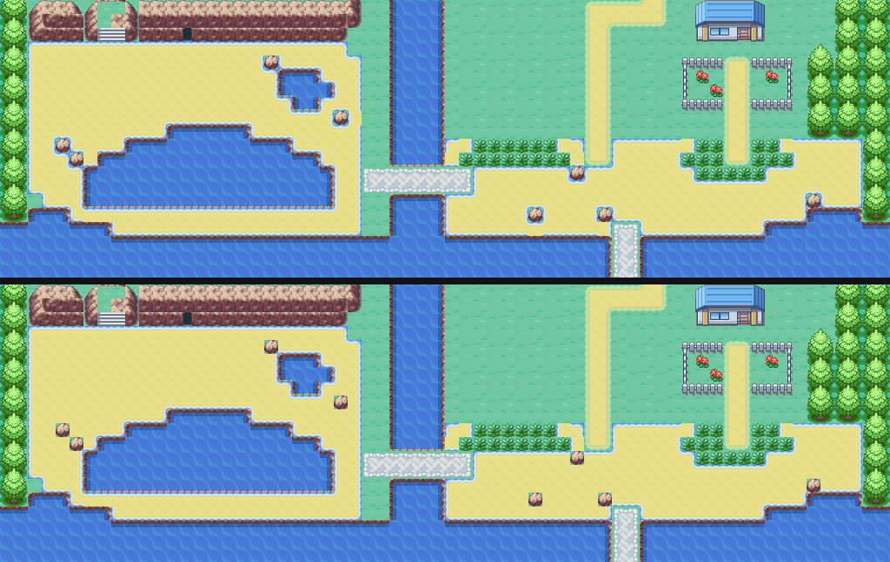

- **The jetty from the strand to the Old Quay had a patch of sand halfway
  along it**, where Gull Strand's opening laid the plan's road letter. It is
  stone to the edge now (left before, right after):

  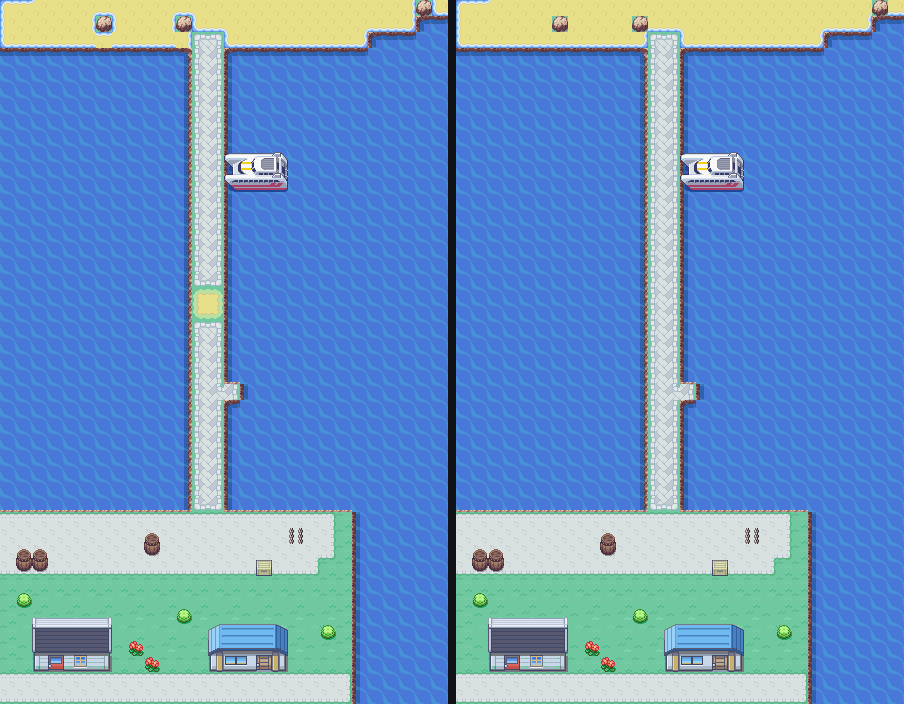

The sea cave, as the game draws it on the way in:

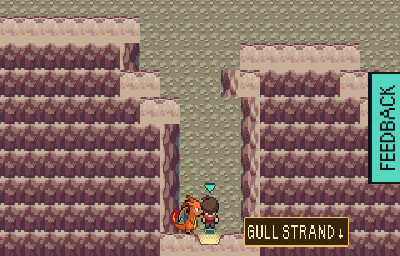

Two things the explorer run cannot show:

- **The Card Key gate is open to everyone there**, because every way out is
  open in an explorer run. The lock itself is held by the map-file tests
  (`maker/cardKey.test.ts`).
- **Trainers and the hunter were fought or fled** as the driver meets them,
  which says nothing about difficulty.

## Growing to 384: the size check

The vale grew from 256 to 384 tiles square only after a 384 map was measured
against the 256 one (13 October 2026). Both were the same fourteen drawn
districts, stitched once as they were and once in the middle of a 6x6 ring of
undrawn wood and sea. Node figures are from `getWorldMap` and its parts; browser
figures are a production build in one headless Chromium on this machine, the
explorer run dropped at Mill Square at the 3x window, then walking a loop of
held arrows, each size twice in a fresh browser.

| | 256x256 | 384x384 |
|---|---|---|
| The map file | 110 KB | 193 KB (limit 1 MB) |
| The file gzipped | 11.5 KB | 12.5 KB |
| The game's main script | 2,916 KB, 782 KB gzipped | 2,998 KB, 783 KB gzipped |
| The grid it is played on, caves beside it | 313x256 | 441x384 |
| Building the map, first lookup (node) | 0.21-0.25 s | 0.42-0.43 s |
| What the built map holds (node) | 16 MB | 34 MB |
| A whole-map search from the front door | 6 ms | 8 ms |
| Title to standing in the raid (browser) | 4.1-4.4 s | 4.4-4.7 s |
| JavaScript heap in the raid | 105-106 MB | 191-192 MB |
| Browser memory (PSS) in the raid | 833-855 MB | 923-955 MB |
| Frame rate walking (3x window) | 57-59 fps | 56-59 fps |
| The explorer save (every map surveyed) | 26 KB | 41 KB |
| The vale's four structure files and `hunterFlee.test.ts`, one worker | 801 s | 830 s |

**It holds.** A player downloads 1.3 KB more, a raid on the vale starts a third
of a second later and walks just as smoothly. The test suite's sweeps take about
as long as before, because they search from walkable tiles and the ring added
none. What it costs is memory: about 86
MB more JavaScript heap while a raid is on the vale. That cost grows with the
grid's tiles, and it counts the wood and sea that nobody walks as well as the
land. That is fine for a desktop browser, which is what this game needs.
Two things to keep in mind:

- **Keep it built lazily.** While the vale is on `MAPS_IN_PROGRESS` it is built
  only when something asks for it. A finished map is built at boot in
  `WORLD_MAPS`, so when the vale leaves the list it should stay lazy, or every
  player pays the 0.4 seconds and the memory on the title screen.
- **If it ever grows again**, or has to fit a phone, the place to save is Phaser's
  tile layers. They are made the full size of the grid, wood and sea included.

`BUILT_IN_MAP_FILE_LIMITS` now holds a built-in map to 384 square, with 32 ways
out and 32 trainers for the far places. A player's map stays at 256, and a room
or a cave in either is the same size (`mapFile.test.ts`).

## The far places

The ring round the vale is six places, each hard to get to in a way of its own.
Each one teaches a different thing about the vale:

- **Stormcrown**: the deepest way, through the caves.
- **The Moor Chapel**: the clock on your wall.
- **The Lost Garden**: a puzzle.
- **The Bunker**: a key and a machine.
- **Frostreef and Ember Isle**: the sea and the tide.

None of them has a landing, because the getting there is the raid. Each has a
way out of its own, so a raid that got there need not go all the way back, and
so the hunter's blind window holds there (`hunterFlee.test.ts`).

The rest of the ring is open sea between the islands in the south. In the
north, beyond the moor and the pines, it is wild wood that no road goes into
yet. The stitcher lays an undrawn district as wood and an undrawn island as sea,
so the map plays end to end while the far places are drawn.

Everything a drawing worker needs is fixed in `plan.ts` before either side is
drawn:

- every crossing, boat, cave mouth and lock;
- each place's `reach`: how a raid gets in, why that is hard, what is only
  there, and what the game has to learn to build it.

`plan.test.ts` holds the shape: for example, the islands are reached only by
boat, Stormcrown only from the deepest floor, and nothing at all is out of reach
(`districtsOutOfReach`).

| Place | Where | The way in | Why it is hard | Only there |
|---|---|---|---|---|
| [Stormcrown](#stormcrown) (drawn) | above the peaks | the Greystone Caves' new B5F, by a hole in B4F's far corner, to the Chimney; then a climb round three bands of crag | the bottom of a five-floor maze, with no landing near; ledges only take you down; the storm's rain in every fight | Mew at level 50 by the cairn, the vale's legendary boss |
| The Moor Chapel | west of High Moor | a sheep track nobody signs, west out of the shepherd's clearing into the fog | only on a night raid (9 pm to 5 am on the player's clock, fixed when the raid deploys); by day the fog turns it back | ghost Pokemon (Gastly, Haunter, Cubone), the crypt, the Spell Tag |
| The Lost Garden | east of the Power Station | the Falls Cave, a mouth hidden behind the water at the foot of the dam | Strength boulders onto floor switches open its rock barrier (Victory Road's rule), so HM04 and the order to push them in | the rarest grass Pokemon (Tangela, Exeggcute), berry trees, the Miracle Seed |
| [The Bunker](#the-bunker) (drawn) | under the Power Station | the station's door into the turbine hall, then a steel door only the Card Key opens | the card is one raid in five in Pine Hollow, and it is also the Service Gate's key; B3F and B4F are lift-only, and the lift is dead until the generator on B2F is back on, across a spinner floor | the war room's strongroom (the vale's locked crate), an escape hatch |
| Frostreef | out on the reef, south-east | The Ice Run, the salvage launch from the Wreck's pier, across two cells of sea | it sails only from 2:00 until 4:00; then Berg Cave is FireRed's sliding ice | ice Pokemon (Seel, Dewgong, Shellder, Jynx), a Lapras on the lagoon, the NeverMeltIce |
| [Ember Isle](#ember-isle) (drawn) | out beyond the cove, south-west | The Smugglers' Run, their skiff off the cove's jetty, across a cell of sea | only from the hidden cove, only from 1:00 until the smugglers sail at 2:30; the crater only through the Lava Tube, rolling on every step | the smugglers' hoard (the richest ground in the vale), fire Pokemon (Ponyta, Rapidash, Magmar), Charcoal |

The plan gives Stormcrown **Mew**, not Zapdos. The storm bird would fit the
storm, but Zapdos already stands on Route 1's Overlook. A legend stands until
its kind is owned (`world/legends.ts`), so a second Zapdos would leave the
summit empty for anyone who had caught the first. Mew is the one Pokemon of the
151 that no map has.

### What the game has to learn

The plan names what each place needs and does not have yet, in its `reach`;
`world.mts` prints them with the plan. Shared needs:

- **Sailing** (Frostreef and Ember Isle) - **built with Frostreef**. A boat
  boarded at a jetty carries the player tile by tile along the plan's route
  across the open sea and lands at the far jetty. It runs only inside its
  window, and the clock is charged as walking is. The hunter cannot follow over
  water. The plan holds each route a cell at a time over sea cells
  (`sailings`); the stitcher turns each into a boat link in the shipped file
  once both its jetties are drawn ([Frostreef](#frostreef) says how). Ember
  Isle's Smugglers' Run needs nothing more than its own jetty drawn.
- **A switch** (the Lost Garden's boulder plates, the Bunker's generator). A
  plate a boulder rests on, or a lever, that opens a barrier for the rest of the
  raid. **Built with the Lost Garden** ([below](#the-lost-garden)): an area's
  `switches` and `barriers` (`world/switches.ts`). The Bunker's generator is a
  lever, and a switch may also be a `key`: the lock in a door the Card Key
  opens ([below](#the-bunker)).
- **A floor that carries you on** (Frostreef's ice, the Bunker's spinner
  tiles) - **built with Frostreef**, as ice. A step continues the same way
  until something stops it. `carriedOn` in `world/slidingFloor.ts` is the one
  question the scene asks, so a spinner is another answer to it: a tile that
  names its own way rather than keeping the one you came in on. **The
  spinners were built with the Bunker** ([below](#the-bunker)).
- **A gear row each** for the Spell Tag, the Miracle Seed, the NeverMeltIce and
  Charcoal, and **a habitat each** for the summit, the garden, the haunted fell,
  the ice and the volcano, measured as every table is. The NeverMeltIce and the
  ice are in, and so are Charcoal and the volcano. The gear is the Miracle
  Seed's own `type-power` row, one rule for every type-boosting piece, and a far
  place's only-here find is a row of `BUILT_IN_FILE_PRIZES`
  (`world/filePrizes.ts`).

One per place:

- **Stormcrown** (built - [Stormcrown](#stormcrown)): B5F as a maze of its
  own seed, so the five floors that ship do not move; and a legendary on a map
  file.
- **The Moor Chapel** (built - [The Moor Chapel](#the-moor-chapel)): a night
  door, shut by day and open on a night raid, built per state as a field-move
  door is; and FireRed's Pokemon Tower as a room style.
- **The Lost Garden**: Strength boulders in a cave floor. Built: they stand
  in the Falls Cave.
- **The Bunker** (built - [The Bunker](#the-bunker)): an inside for the Power Plant; a door the Card Key opens; a
  lift that offers its floors; and FireRed's Rocket Hideout as a room style.
- **Ember Isle** (built - [Ember Isle](#ember-isle)): outdoor ground that rolls
  on every step, as a cave floor does.

Order them like this:

- **The sea.** Frostreef and Ember Isle share sailing, so the first one drawn
  builds it.
- **The Power Station.** The Lost Garden and the Bunker both edit its program
  (the falls mouth, the turbine hall) and share the switch, so draw them one
  after the other.
- **The rest.** Stormcrown edits the Greystone Caves, which ride in Tanglewood's
  file. The Moor Chapel needs nothing else drawn: High Moor's track to it is
  cut already.

The track used to end at a way out that opened 90 seconds into a raid, standing
in for the chapel until it was drawn. It is drawn now ([The Moor Chapel](#the-moor-chapel)).

## Stormcrown

The first far place: the storm-struck summit above Greystone Peaks, which no
road reaches. A raid gets there only from the bottom of the Greystone Caves and
a climb (`stormcrown.ts`, `greystoneCaves.ts`).

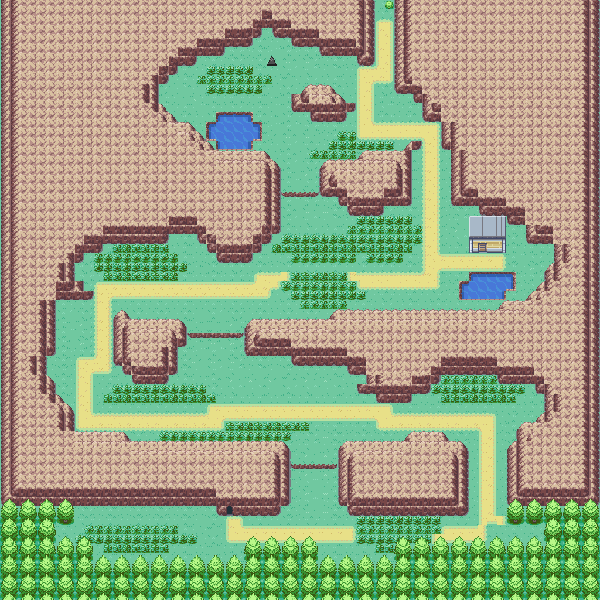

### How a player gets there

1. **Into the caves.** The way in is the sea cave in Gull Strand's cliffs, onto
   the caves' fifth floor, B4F. (From the peaks' or the wood's mouth it is
   down through the floors above first.)
2. **Down the hole.** In the corner of B4F furthest from the sea cave there is
   a hole. It drops to B5F, the sixth and deepest floor.
3. **Across B5F.** The hole lands at the far end of the floor from its only
   other way out, so the whole floor is crossed. It is a maze of its own: wider
   and deeper than any floor above, with fewer loops, and a find in every other
   dead end, because nobody comes down here.
4. **Out of the Chimney.** B5F's way out is the Chimney, a cave mouth in the
   first crag on Stormcrown's lower shoulder.
5. **The climb.** Three bands of crag run across the mountain out of the
   picture on both sides, with one gap in each, on alternate ends. The path
   switches back across the face: east along the shoulder, up the east gap,
   west along the first shelf, up the west gap, east along the second shelf
   past the Storm Shelter, and up the east gap onto the summit. That is about
   180 steps from the Chimney to the cairn.
6. **Mew.** By the cairn on the very top - FireRed's strange stone - Mew
   stands on a nub of rock behind it, at level 50. It fights as the four
   shipped legends do: no ball while it can fight, then one throw once it is
   beaten. Its catch rate is FireRed's own 45, so that throw lands about one
   time in five in a Poke Ball. A Mew caught and banked never stands again on
   that save; one lost with the pack stands again next raid.
7. **Out.** The Cloud Stair goes on over the top and down the far side, off
   the map. A way down the near side, the Scree Gully, is a pocket in the
   treeline at the foot of the first gap.

### Why it is hard

- **It is the bottom of the maze.** No landing is near it: the nearest is The
  Strand, and from there it is the sea cave, the whole of B4F and the whole of
  B5F before the climb starts.
- **The climb only goes one way.** Three ledges, one through each crag, are
  the quick way back down (the summit to the Chimney is under half the walk by
  them) and never a way up.
- **The storm.** Every fight up here is in the rain, on a summit table of its
  own: FireRed's climb to the Indigo Plateau (Route 23's Spearow and Mankey,
  Victory Road's Geodude, Machop and Onix) brought down to the vale's levels.
  A level-8 Bulbasaur wins 58% of it, Charmander 91% and Squirtle 75% in the
  clear; the rain takes Charmander to 57%, and to 43% by night.

### What the game learned for it

- **B5F**, a sixth Greystone Caves floor built on a seed of its own
  (`greystoneDeep`), so the five floors that ship did not move; it joins them
  by one hole, which is a link and leaves B4F's ground as every other district
  carries it.
- **A legend on a map file**: a placed Pokemon marked `legendary`, one of
  Kanto's legends or Mew (`LEGENDARY_KINDS`), on a map the game draws only
  (`maxLegends` is 0 for a player's map). Whether it stands is read off the
  figure and the Pokedex (`legendCaught`), so it is caught exactly as the four
  are.
- **A summit habitat** (`summit`, `SUMMIT_WILDLIFE`), measured as every table
  is, and rain carried by a plan district (`rain`).
- **mapcraft's reachability check walks through doors and caves**, because
  Stormcrown is the first outdoor ground no road reaches.

### Judged blind

Stormcrown was judged as two 24x40 views beside five FireRed routes (1, 2, 6,
10 and 24) and two broken controls (four blocks swapped, every block
shuffled), each picture one at a time under a code, every round with two fresh
judges. The FireRed routes were redrawn in the game's own tiles from pret's
block data (`pokefirered` at 037335f), as the earlier districts' were. A judge
counts only if it rates both controls below every real route.

| Round | What changed | Judges that counted | FireRed routes (mean) | Stormcrown |
|---|---|---|---|---|
| 1 | first draw, beside converted mountain routes | none | - | 8 and 7, 7 and 7 |
| 2 | the five routes the other districts were judged by; the path to the shelter's door | one | 4.0 | **7 and 5: passes** |
| 3 | the path from the Chimney, fuller heather, a jog in the switchbacks | one | 4.2 | **7 and 7: passes** |
| 4 | a less regular summit edge, the pool's shape | one | 5.4 | **8 and 8: passes** |

**It passes on every judge that counted.** The judges that did not count (each
rated a control level with or above a converted route) also put Stormcrown at
or above every real route. The first draw was ruled rock rectangles on a lawn
and was redrawn before it was judged.

What the judges named, and what was done:

- **The path read as a ruled rectangle round a rock.** It jogs at the gaps
  now, and starts at the Chimney instead of beside it.
- **The path stopped short of the shelter**, and **the pool beside it read as
  a cross, then as a box.** A spur runs to the shelter's door, and the pool
  has an uneven edge.
- **Heather in thin one-tile strips.** The beds sit whole beside the path.

Left for a later pass:

- the bottom crag is a heavy slab across the view;
- the switchbacks still turn in right angles.

### Walked in the game

`tools/playtest/stormcrown.mjs` plays it on the explorer run against a
test-mode build: dropped at The Strand, into the sea cave, across B4F, down the
hole, across B5F, out of the Chimney, up the crags, a fight with Mew by the
cairn and its one throw, and out over the top by the Cloud Stair. The walk is
planned over the scene's own collision and links after every step, so a hole
or a door is pressed into as a player presses into it, and a hunter standing
in the one lane is walked into and fled, as a player gets past one.

    node tools/playtest/stormcrown.mjs <url of a test-mode build> <out dir> [--port=<CDP port>]

| | |
|---|---|
| 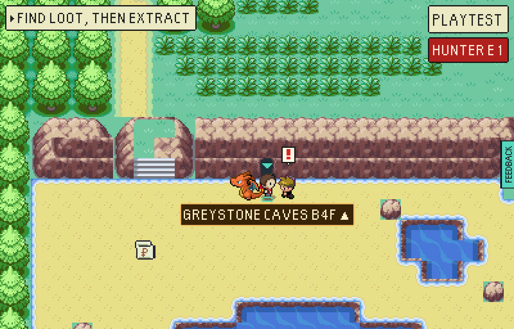 | 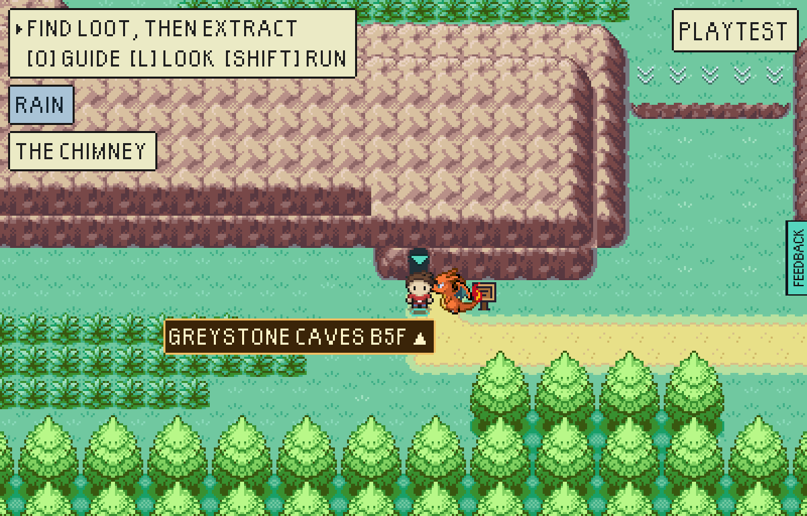 |
| 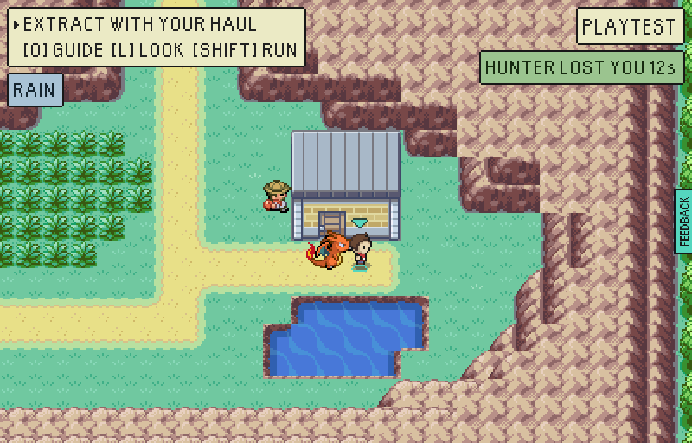 | 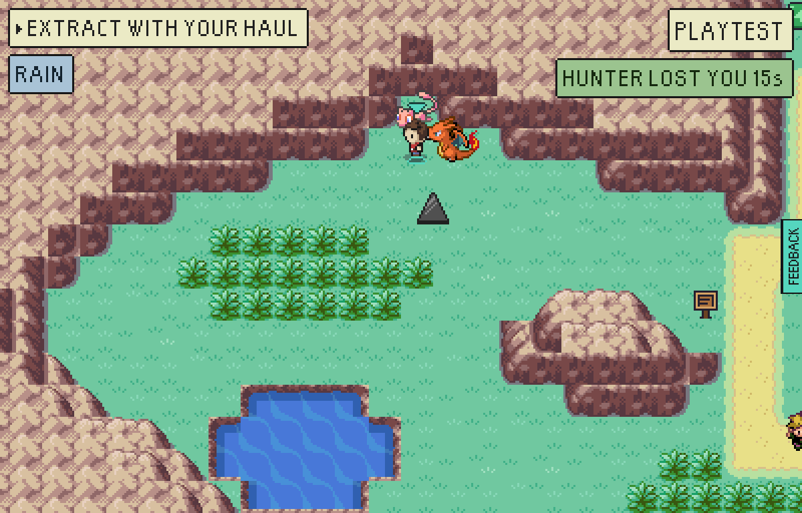 |
| 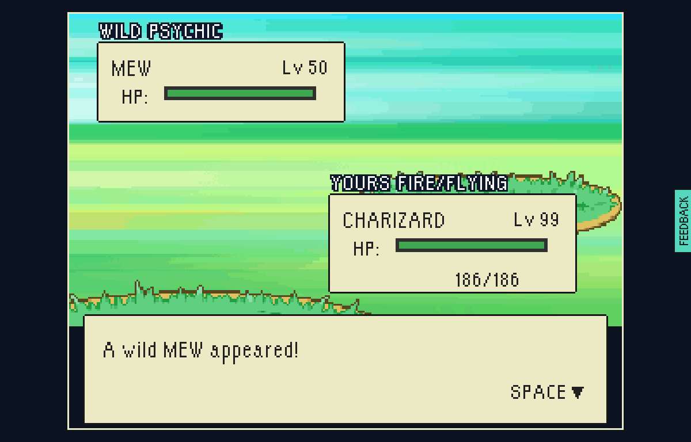 | 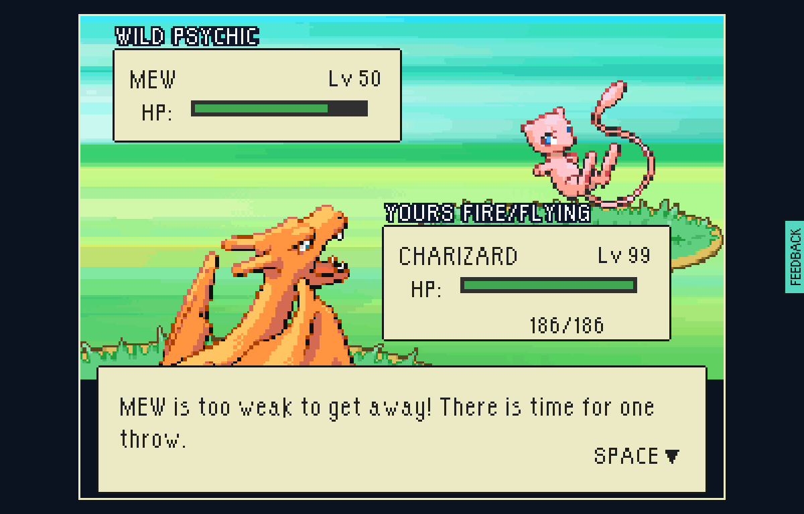 |

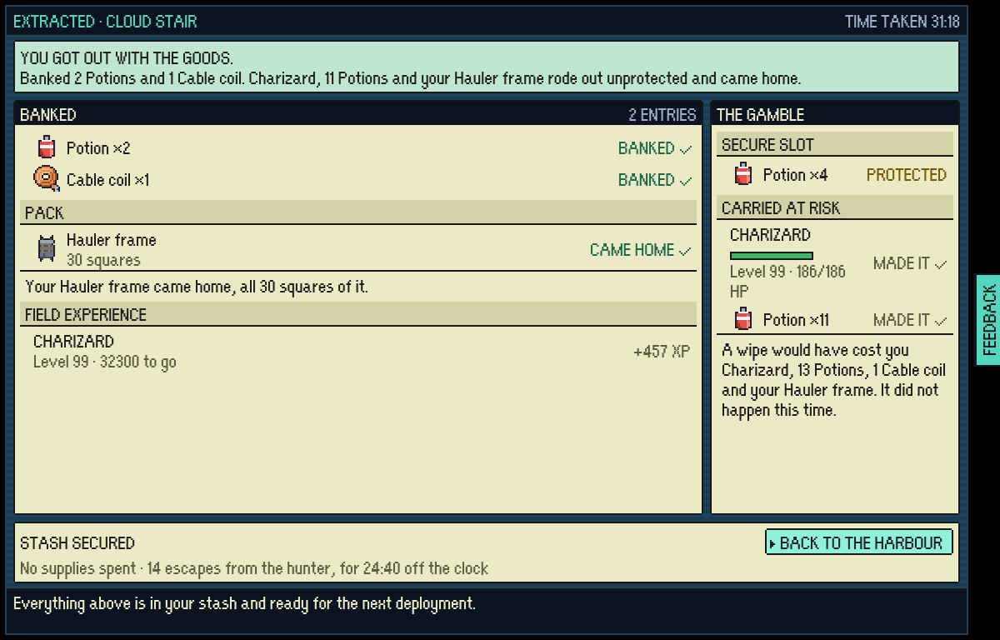

The structure sweeps found one fault the mapcraft checks did not: the bottom
crag had two ledges one above the other, and the ground between them could be
reached only by hopping, which the game's one-connected-place rule (asked on
collision alone) reads as an island. Each crag has one ledge now.

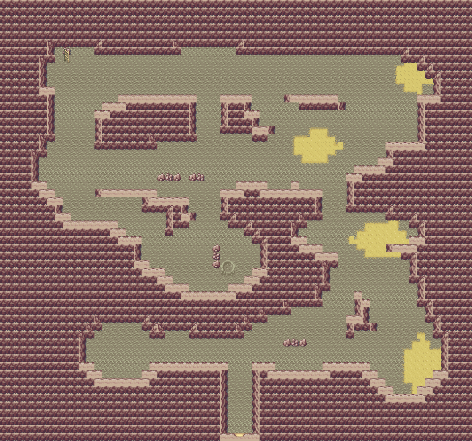

## The Lost Garden

The second far place drawn. It is the station master's garden, gone wild in a
valley that the cliffs closed off east of the Power Station. Nothing on the
map points to it.

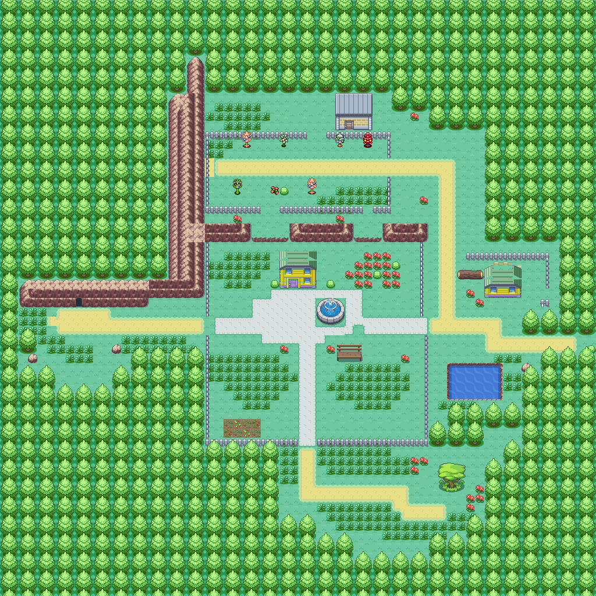

**How a player gets there.**

1. At The Power Station, the tailrace spills through the dam beside the
   station. A strip of reeds runs up its east bank, under the cliff. At the top
   is a cave mouth that nobody signs, behind the water. That is the Falls Cave.
2. The Falls Cave is one floor under the hill, with FireRed's Victory Road
   rule in it. A rock barrier closes the way east until both floor switches
   have a Strength boulder on them. So the raid needs a Pokémon that knows
   Strength: HM04, Bill's barter.
3. The cave is two halls joined by a neck one tile wide, and a boulder
   stands in the neck.
   - The west hall's boulder goes down onto the west hall's switch, round a
     corner.
   - The boulder in the neck has to be pushed through it into the east hall
     before anyone can follow.
   - The east hall's boulder goes down onto the east hall's switch, unless
     the neck's boulder was pushed too far and stands in its road.
   - A boulder that falls onto its switch stays there, as Victory Road's does.
     The barrier lifts with FireRed's crack once both are down, and stays open
     for the rest of the raid.
4. A floor pushed wrong is not a lost raid. Walking out of the cave puts every
   boulder that is not on a switch back where it started, as FireRed puts them
   back when a map is loaded again. It costs clock and nothing else.
5. The cave comes out under the garden's west cliff, on the old garden walk.

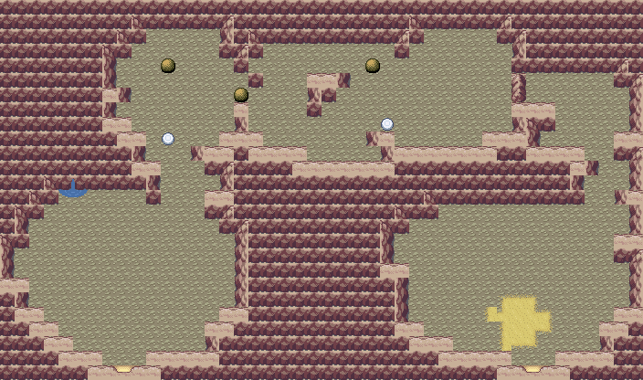

**What is only there.**

- **The garden's wildlife**, the `garden` habitat (`LOST_GARDEN_WILDLIFE`).
  Oddish and Bellsprout, Paras and Venonat eating the beds, Exeggcute, and
  Tangela, which lives nowhere else in the game.
  - **A wild Bulbasaur**, one encounter in 105: the captain's call. It is the
    one place in the game a starter grows wild.
  - It is a Water starter's hard ground, as the plan meant. Measured by
    `tools/encounters/report.mts`, a level-8 Squirtle wins 49% of what it
    meets, against 73% for Bulbasaur and 100% for Charmander
    (`gardenHabitat.test.ts` holds the vale's 45%).
- **The station master's berry trees**: seven, in two rows in his fenced
  orchard above the garden.
- **The Miracle Seed**, FireRed's Grass-type booster (`type-power` gear:
  Grass moves hit 10% harder). It lies under the Old Bloom one raid in four
  that gets there. It is a prize spot (`MapFileItemSpot.prize`), seated like the
  Card Key and out of the item spots' rotation.

**The garden**, along the walk from the cave's step:

- the fenced garden, with a cracked court in front of the glasshouse and a
  fountain to one side of it;
- beds that are none of them alike: tall grass where the big bed was, a rose
  bed, the kitchen garden in its rows, and a bench;
- the orchard on the terrace above, with two short drops back down into the
  garden;
- the lane up the east side, and the gardener's lodge with its pond, where
  Gardener Rowan takes a toll;
- the Gardener's Gate in the east wall: the garden's own way out, and never a
  way in;
- south, through the long beds nobody has cut, the Old Bloom: one old tree in
  flower in a glade.

### Judged blind

Two 24x40 views of the garden were judged blind beside FireRed routes redrawn
in the same tiles: in round 2 Route 1, Route 2, Route 6, Route 14 and Route 24
(round 1 had Route 12's causeways and a second window each of Route 2 and
Route 14 in place of Routes 1 and 6). Two broken real windows rode as controls: Route 14 with every
block shuffled, and Route 2 with eight 8x8 blocks swapped. Every round used two
fresh judges. The bar is Millbrook's.

| Round | Real mean | Controls | The Lost Garden |
|---|---|---|---|
| 1 | 4.7, 4.7 | 2 and 5, 2 and 5 (neither judge counts) | 4 and 3, 6 and 3 |
| 2 | 5.8, 6.0 | 2 and 2, 3 and 2 | **6 and 5, 6 and 5: passes** |

Round 1 did not count: its swapped control had four 6x6 blocks traded, too few
to break a route, so both judges scored it above a real one. Its notes still
found the faults that round 2 fixed:

- the east of the garden was an open field with props sprinkled on it;
- the court was ruled symmetrical, ringed by four beds stamped alike;
- the berry trees stood loose on a lawn;
- the ponds were stacked rectangles.

The orchard is now fenced, the beds differ, the court is lopsided, and wood
frames the lodge, the pond and the glade.

What is left for a later pass: both judges called tall grass in a formal garden
a contradiction. That is the idea of the place, a garden gone wild, so it
stays.

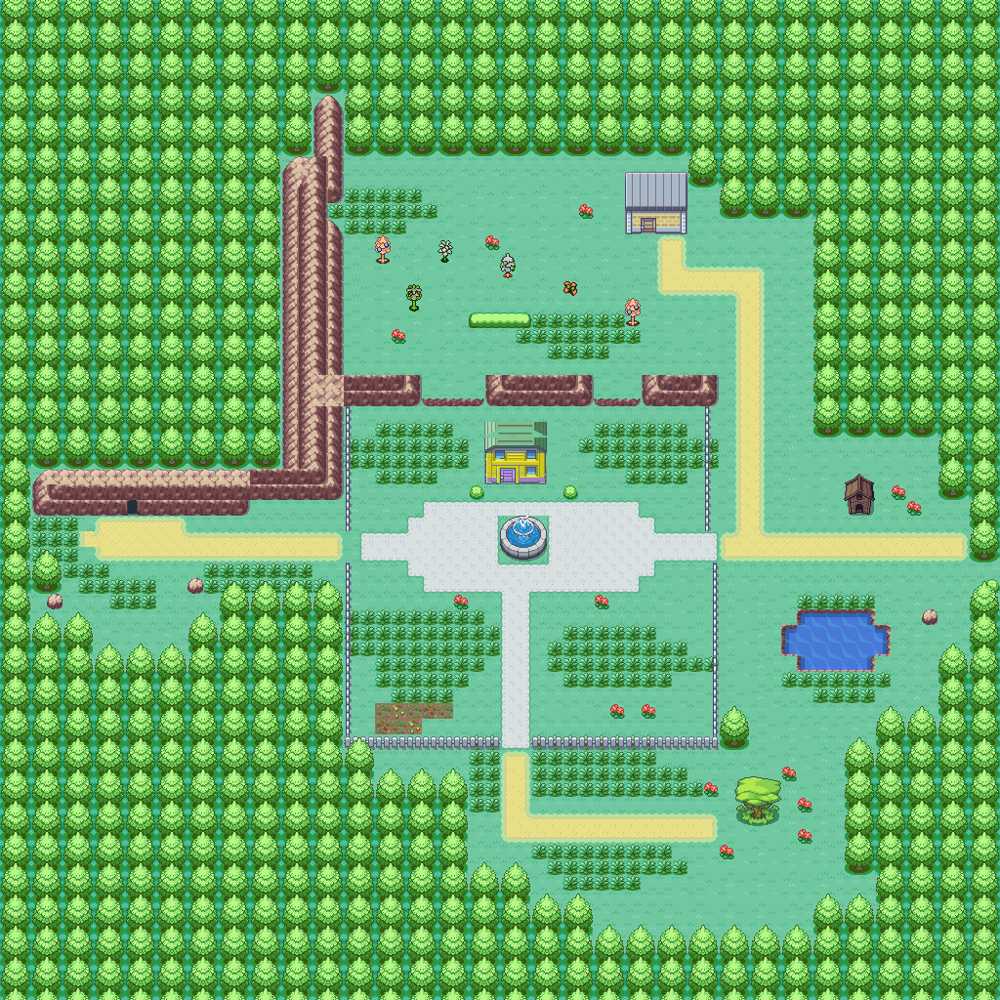

### Played through

Walked in the real game on the explorer run (a test-mode build, stepped, 3x
window) with `tools/playtest/raid.mjs --steps=` from The Dam:
1. HM04 read to the Charizard in the raid's own bag.
2. Up the reeds to the mouth behind the falls.
3. Every boulder onto its switch.
4. Out under the garden's cliff.
5. The Miracle Seed from under the Old Bloom.
6. Out by the Gardener's Gate, with the seed banked: 1:43 of raid clock.

The same route on another seed found the Old Bloom bare, as three raids in four will.

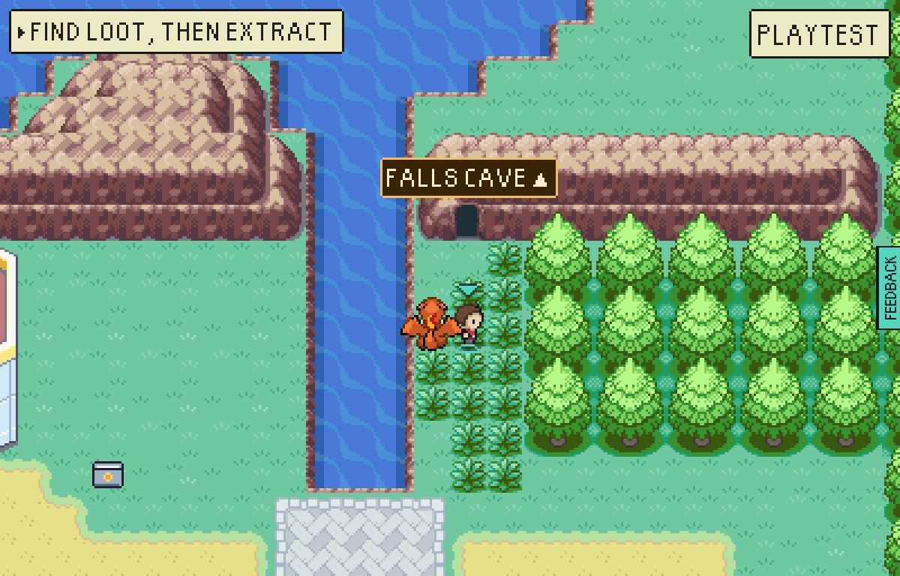
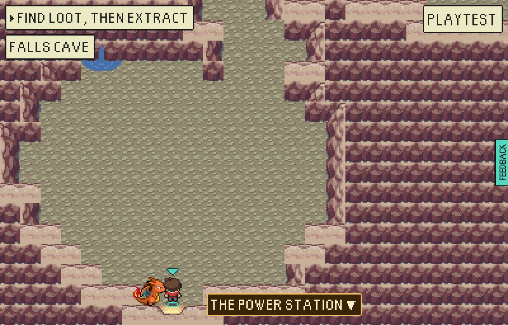
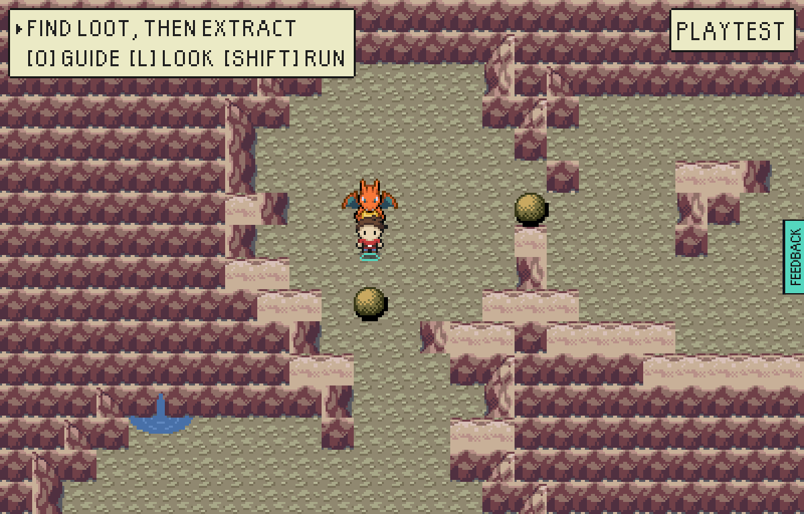
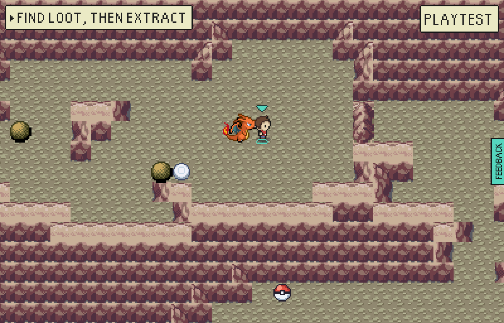
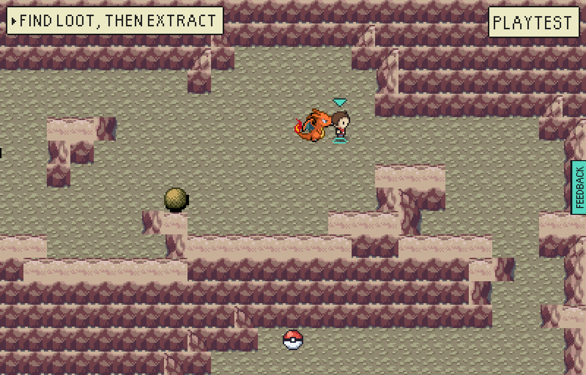
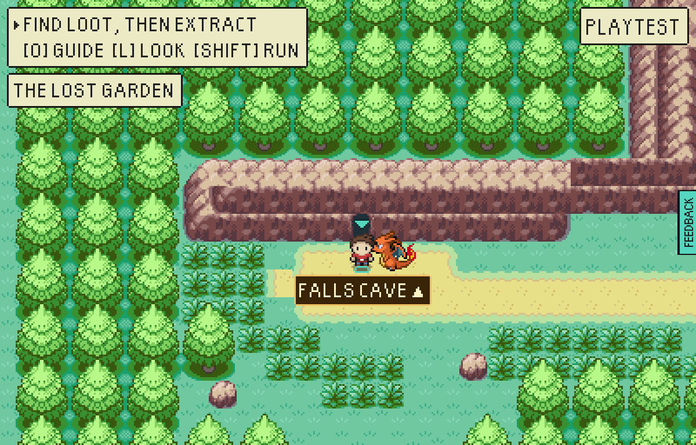


## Frostreef

The third far place drawn: an island of ice on the outer reef, south-east of
the Wreck, that nobody walks to. It built the two mechanics the ring shares,
the boat and the ice.

- **The way in: The Ice Run.** The salvage launch puts in at the Wreck's pier
  on the flood tide, from 2:00 until 4:00 of a raid, and nowhere else and at no
  other time. Pressing out to sea from the end of the pier asks first, in
  FireRed's sailor's words ("Ahoy, there!"), and then carries the player tile
  by tile east along the coast and south across two cells of open sea to the
  Ice Jetty: 134 tiles, about twenty seconds of the raid clock, charged as
  walking that far would be. The hunter cannot follow across the water, so
  the island is the one place in the vale a raid can put the sea between
  itself and the hunter - at the price of the tide.
- **The north shore.** The jetty lands on a beach and a meadow under the berg.
  The Old Whaler there says what the island is, and a frozen pool in the
  meadow teaches the ice where getting it wrong costs nothing: a step onto ice
  carries on until something stops it.
- **Berg Cave.** Two floors of FireRed's Icefall Cave under the berg, the only
  way to the far side of the ridge. Each is a sheet of ice round crags of rock,
  and the way on is reached only by stopping against the right snowy boulder;
  every boulder on the ice is a stop some way across needs. A hidden find waits
  in a pocket of each that only a slide reaches.
- **The Frozen Lagoon.** The island's best ground, walled off by the ridge: a
  lagoon frozen solid, Lapras waiting on the snow-bank in the middle of it at
  level 10, and the NeverMeltIce, FireRed's Ice-type gear, found nowhere else in
  the game (a prize, so three raids in ten).
- **The way out: the Whaler's Boat.** The whalers put in at the lagoon's
  channel at 3:40. Miss the tide back on the launch and it is the only other way
  off the island, and the lagoon is on the far side of the cave.

What is only here: Seel, Shellder and Jynx, on every step of Berg Cave's floor
(FireRed's Seafoam Islands and Icefall Cave, brought to a route's levels and
measured with a level-8 starter of each kind at 73% to 90%); Lapras; and the
NeverMeltIce. Dewgong is the one of Seafoam's own left out: it evolves at 34,
and nothing in the game is fielded below the level it evolves at.

### How it is built

- **A boat is a link.** A map file's boat is a link whose two ends are `boat`
  jetties outdoors, with a `sails` field: its name, its window in seconds and
  the turns of its course (`MapFileSailing`). It is not a new top-level key, so
  `submit_map` needs no migration, and a player's map can carry one. The game
  lays it out as a boat (`world/sailing.ts`), never as a way through: every
  search that asks where a player can get to - the checks, run generation, the
  structure rules - adds its two ways across (`playerLinks`), and nothing the
  hunter asks does. The stitcher writes one for each planned sailing once both
  its jetties are drawn, with the fewest straight legs of deep water that stay
  inside the cells the plan routes it through (`sailingLink` in `stitch.ts`).
- **Ice is a material.** `ice` is the seventeenth (letter `i`), walkable and
  `slides`; Berg Cave is a cave in the new `ice` style, drawn from FireRed's
  Icefall Cave by `scripts/cut-frlg-ice.mjs` (`frlg-ice.png`), and the frozen
  lagoon and pool out of doors are the same sheet of ice on the player-map
  catalogue, with Icefall Cave's snowy boulders to stop against. A map maker
  can paint it in an ice cave.
- **Fair by construction.** `frostreef.test.ts` slides the whole island the
  way a player has to, through the cave's ladders, with Lapras standing and
  without: from the jetty everything is reached - every find, Lapras, the
  whalers' boat - and nowhere a slide can leave you is somewhere the jetty and
  the boat are both out of reach.


Berg Cave 1F and B1F:


### Played through

`tools/playtest/frostreef.mjs` plays it in the real game on a test-mode build:
the explorer run dropped in at the Salvage Camp, the walk to the pier, the
boarding question, the crossing, the shore, both floors of Berg Cave solved a
slide at a time (planned the way the player has to, by sliding), Lapras
spoken to and fought, and away by the Whaler's Boat. The crossing cost 20.5
seconds of raid clock for its 134 tiles, exactly what walking that far does.


### Judged blind

Judged against FireRed's own island places, redrawn in this game's tiles by
`tools/mapcraft/fromPret.mts` (Four Island, Birth Island, One Island's
Treasure Beach and Two Island's Cape Brink), the island as two 48x40 views,
two fresh judges a round. Berg Cave was judged against FireRed's own Icefall
Cave and Seafoam Islands floors, drawn from pret in their own tiles, which are
the tiles Berg Cave is cut from. Each round had two broken controls (a
place's blocks shuffled); a judge who scored one level with or above a real
place does not count.

| Round | What changed | Island | Real mean | Berg Cave | Real mean |
|---|---|---|---|---|---|
| 1 | first draw | 4 and 4, 4 and 4 | judges did not count | 3 and 3, 3 and 3 | 7.0, 5.25 |
| 2 | organic lagoon, rock drawn solid, boulders only where a way needs one | 6 and 6, 5 and 5 | judges did not count | **7 and 6, 6 and 5: passes** | 4.75, 5.5 |
| 3 | meadow, track, pool at the headland | 5 and 6 | 7.5 | | |
| 4 | ridge stepping in and out, sand round the pool | 6 and 5, 6 and 6 | 7.25, 6.75 | | |
| 5 | reef and sandbar in the lagoon, south edge broken up | **6 and 6, 6 and 6** | 7.0, 7.5 | | |

In round 5 both judges counted, and both scored the island above the weakest
real place in the batch (4 and 5) and within one and a half points of the real
mean. What both still named, for a later pass: the track is one ruled L, the
tall-grass beds and the pool's rim are blocky, the two knolls in the lagoon
read as pasted, and the berg is a very square block.

## Ember Isle

The fourth far place drawn: a volcano out in the open sea beyond the
smugglers' cove, the vale's richest ground and its worst
(`worlds/greystoneVale/emberIsle.ts`, `lavaTube.ts`).


### How a player gets there

1. **Find the cove.** Smugglers' Cove is reached by the deer path nobody
   signs, down through Reedmere's reeds, or along the shore from the Sunken
   Quarter. The Cove Steps landing is on its cliff top.
2. **Catch the skiff.** Walk out along the smugglers' jetty and press out to
   sea from its end. The smugglers' skiff runs only from 1:00 until their own
   boat sails at 2:30, and it asks first, in FireRed's sailor's words. It
   carries the player west round the cove's headland and south across a cell
   of open sea - The Smugglers' Run - to the Smugglers' Landing on the island's
   north-east beach. The hunter cannot follow across the water.
3. **Round the cone.** From the landing the road runs west through the tall
   grass of the cone's north foot and down its west side to the charcoal
   burners' camp in the west cove: their hut, their kiln and their pier.
4. **The climb.** Steps cut through the rock lead from the black beach under
   the cone up onto the lower terrace of its south face, and more steps at its
   east end onto the upper terrace. The Lava Tube is in the face under the
   rim. Two ledges are the quick way back down, and never a way up.
5. **The Lava Tube.** One floor of FireRed's Mt. Ember (the Ruby Path), in
   its own art: chambers joined by necks, up into a hall under the rim and down
   again into the crater's pocket. Off the hall are a hot spring and a dead end
   with something hidden in it. Every step of its floor rolls for a wild
   Pokemon, as a cave floor does.
6. **The crater.** Ash, with nothing growing on it, and every step of it rolls
   for a wild Pokemon all the same. Rapidash stands on its own shelf of the
   floor at level 40, its FireRed level. In the crater's south-east corner,
   behind a spur of rock, two of the smugglers' best guard their hoard, one
   on each way in.
7. **Away.** The charcoal burners' Cinder Boat puts out from the west cove at
   3:20. Before then, the only way off is the skiff, if it is still running.

The Lava Tube, in FireRed's own Mt. Ember art (in from the flank bottom
right, out into the crater bottom left):


### Why it is hard

- **The way in is hidden and timed.** The cove is a way nobody signs, and the
  skiff sails only between 1:00 and 2:30. A raid that dawdles in the vale
  misses it.
- **The crater has one door.** The Lava Tube is the only way in, at the top of
  the climb.
- **The crater is the worst ground in the vale.** Every step rolls, on a table
  a level above the summit's, and the hoard is behind two trainers.
- **Getting off is timed too.** The skiff stops at 2:30 and the Cinder Boat
  only opens at 3:20, so a raid that went into the crater waits for the boat
  with the clock running, or leaves without the hoard.

### What is only there

- **The volcano's wildlife**, the `volcano` habitat (`VOLCANO_WILDLIFE`):
  FireRed and LeafGreen's Mt. Ember at the vale's levels, 9 to 11 - Ponyta,
  the Spearow of its slopes, the Geodude and Machop of its crags, and Magmar
  as the rare roll. Ponyta and Magmar live nowhere else in the game.
  - Measured with a level-8 starter of each kind
    (`volcanoHabitat.test.ts`): Bulbasaur 59%, Charmander 62%, Squirtle 82%.
  - By night the Spearow give their slots to Rattata. The night's own rule
    would have given Ponyta's slots to Poliwhirl, which is Crystal's Route 28,
    so the volcano's night table is written out (`MAP_FILE_NIGHT_HABITATS`).
- **Rapidash**, standing in the crater at level 40. FireRed's Rapidash is met at
  39 to 42, and nothing in a table may be fielded below the level it evolves at,
  so it stands rather than rolls.
- **The smugglers' hoard**, the richest ground in the vale: eight item spots in
  the hoard's nook, more than any other place. They hold money and the rarest
  of Brock's materials (radio valves, cable and lamp oil) rather than the
  rotation every other spot is dealt from (`BUILT_IN_FILE_HOARDS`). Its money
  is held so that the whole vale stays under one berth (`trader.test.ts`).
- **Charcoal**, FireRed's Fire-type booster (`type-power` gear: Fire moves hit
  10% harder), somewhere on the crater floor three raids in ten.

### What the game learned for it

- **Ground out of doors that rolls on every step**: a map file's named place
  may say `floorRolls` (`MapFileDistrict`), and `stepRolls`
  (`world/localEncounters.ts`) asks it after tall grass, a roofed floor and a
  cave. It is a field of the place, not a new top-level key, so `submit_map`
  needed no migration.
- **A volcano cave**: the `ember` cave style, FireRed's Mt. Ember cut from
  pret by `scripts/cut-frlg-ember.mjs` onto `frlg-ember.png` (16000), with its
  boulders, rocks and hot spring as furniture a map maker can place
  (`Volcano cave`). A cave dressed as a volcano rolls the volcano habitat
  (`CAVE_STYLE_HABITATS`).
- **A hoard**: a place whose item spots hold what it is
  (`BUILT_IN_FILE_HOARDS`, `hoardOf` in `world/filePrizes.ts`).
- **Charcoal**, the NeverMeltIce's rule for Fire.
- **Sailing** needed nothing new. The Smugglers' Run is the plan's second
  sailing, stitched once its jetty was drawn. The cove's mooring post moved
  off the water the skiff moors on.

### Played through

`tools/playtest/emberIsle.mjs` plays it in the real game on a test-mode build:
- the explorer run dropped in at the Cove Steps;
- down to the smugglers' jetty, and the skiff's question;
- the crossing: 80 tiles of sea, 12.4 seconds of raid clock, as walking that
  far costs;
- round the cone to the burners' camp, and up the steps to the Lava Tube;
- through the tube onto the crater floor, where a step on bare ash started a
  wild fight;
- the hoard, and back out through the tube;
- away on the Cinder Boat.

Every press is planned over the scene's own collision and doorways. A hunter
standing in the one way back to the tube is walked into and fled, as a player
gets past one. The run ended in 4:14 of raid clock, with a share of the hoard
banked.

    node tools/playtest/emberIsle.mjs <url of a test-mode build> <out dir> [--port=N]

| | |
|---|---|
|  |  |
|  |  |
|  |  |
|  |  |
|  |  |


The structure sweeps found one fault the mapcraft checks did not. Once the
steps were cut, the far end of the upper terrace was 88 steps from a way out,
past the hunter's 86-step blind window (`hunterFlee.test.ts`). The upper steps
moved three tiles west, which brings everything on the island under 85.

### Judged blind

Judged against FireRed's own Sevii Islands places, redrawn in this game's tiles
by `tools/mapcraft/fromPret.mts`:

- Four Island and Six Island's Ruin Valley, whole;
- Mt. Ember's slopes, cropped to 48x40;
- a stretch of Kindle Road;
- Treasure Beach in round 1, Cape Brink in round 2.

The island was judged as two 48x40 views. Two broken controls rode in each
round: Mt. Ember and Four Island, each with every block shuffled. There were
two fresh judges a round, and each wrote a picture's notes under its code
before opening the next. A judge who scored a control level with or above a
real place does not count.

| Round | What changed | Ember Isle | Real places | Controls |
|---|---|---|---|---|
| 1 | first draw | 7 and 6; 6 and 5 | 3 to 7; 2 to 8 | 2 and 2; 1 and 2 (second judge did not count) |
| 2 | one straight road round the cone, terraces staggered, chunkier crater and coast, the tube as chambers | **6 and 6; 7 and 7: passes** | 2 to 6; 2 to 5 | 1 and 1; 1 and 1 |

What round 1 named, and what was done:

- **The terraces south of the crater were ruled parallel bands** across the
  whole width. Now the two terraces are offset, one rock mass between them,
  each band a different length, with the steps at alternate ends.
- **The tall grass was tidy strips along the rim.** It is now beds of unequal
  size.
- **The west road stepped diagonally.** It is two straight legs and one turn.
- **The pool on the crater floor was stacked rectangles.** It is gone.

Round 1's two views, before:


After round 2 the climb's steps became FireRed's own stone steps through the
rock (cut from the General tileset), where the judged drawing had pale squares
of stone.

Both round-2 judges still named, for a later pass: the road's legs are dead
straight with square corners, the tall-grass beds are still rectangles, and the
ash floor is wide with little on it.

## The Moor Chapel

The fifth far place drawn: a ruined chapel on the fell west of High Moor, reached
only on a night raid. Its program is `tools/mapcraft/worlds/greystoneVale/moorChapel.ts`.


**How a player gets there.** Drop in at Moor Top on High Moor, walk west into the
shepherd's clearing by the tarn, and take the sheep track west through the wood.
Nothing signs it, but the shepherd says it is there. On a raid deployed between
nine at night and five in the morning, by the player's own clock (the same clock
THE BOLTHOLE's window reads, `world/nightRaids.ts`), the track runs on through the
wood and out at the Lantern Cross, at the head of the fell. On a day raid it stops
in the trees, and pressing at them says why: the fog has the track. The raid is a
night raid or a day raid from the moment it deploys, so nothing changes under a
player's feet.

**The one idea, and what stands along it.** Everything is on one road, the corpse
road the drovers carried their dead along:

- **The Lantern Cross:** the Pokemon Tower's statue, in the corner where the crags
  meet the wood, where the sheep track comes out of the trees.
- **Under the crags:** the corridor runs west with the crags as its north wall, a
  wide bed of heather below them and the tarn in their west corner.
- **The chapel in its churchyard:** the road turns south past the chapel's door.
  The chapel is FireRed's own Pokemon Tower, standing in a churchyard fenced with
  post and rail, with graves in broken rows and the grass come up between them.
  The two gold graves are nearest the door.
- **Out of the vale:** the road leaves west as the Corpse Road.
- **The drove track:** from the cross a second, narrower track runs south through
  the wood. It passes the drovers' bothy at its bend and goes on to the Drovers'
  Gap. That is the fell's second way out, so a raid at the cross need not go round
  by the corpse road.

**What is only there.**

- **Ghosts.** The churchyard's grass and every step of the crypt roll the new
  `haunted` habitat: FireRed's Pokemon Tower, Gastly, Cubone and a Haunter, in the
  tower's own proportions (90, 9 and 1), at a far place's levels. Nothing is
  fielded below the level it evolves at, so the one Haunter in a hundred is at 25.
  A level-8 starter of each kind wins 59 to 67% of what it meets
  (`hauntedHabitat.test.ts`).
- **The crypt.** The chapel's door opens on its nave, a floor of FireRed's
  Pokemon Tower, quiet like the tower's ground floor. A Channeler and a mourner
  are there in FireRed's own words, with pews of graves either side of the aisle.
  Its stairs down on the west lead to the crypt. The crypt's graves stand where
  FireRed's third floor stands them, cell for cell. Beside its inner block of
  gold graves are the grave goods, a cache of lamp oil and linen.
- **The Spell Tag.** It lies where FireRed's third floor leaves its item, one raid
  in four, as a prize. It is a piece of gear the Miracle Seed's kind: Ghost moves
  hit a tenth harder, as FireRed's do.

 

**Played through** on the explorer run, stepped, with `tools/playtest/raid.mjs`.

By day, from Moor Top, the track ends in the wood. Pressing at the trees gives
the fog's two lines, and the raid leaves by the Moor Gate:

```sh
node tools/playtest/raid.mjs <url> --stepped --explorer --insertion=greystone-vale-moor-top \
  --clock=day --open="night track" --exit="Moor Gate"
```

By night the same walk goes on through the wood to the Lantern Cross, along
the corpse road, in at the chapel's door and down the nave's stairs into the
crypt, then back up and out by the Corpse Road:

```sh
node tools/playtest/raid.mjs <url> --stepped --explorer --insertion=greystone-vale-moor-top \
  --clock=night --via=70:82,58:82,50:82,44:82 \
  --through=27:94:up,moor-chapel-nave@4:10:left --deep --exit="Corpse Road"
```


The night track is twelve tiles of wood, two deep. Drawn as one tree, it showed
the fell through the gap beside it by day.

### What the game learned for it

- **A night track** (`NightGate` in `world/gates.ts`, a map file's `doors` kind
  `night`). It is a stand of wood by day and a way through on a night raid. Nobody
  opens it and nothing about it is saved: its key is the one word every night
  track shares, in the opened list only while `RunPlan.night` holds. It is built
  per gate state as a field-move door is, so the hunter, the checks and the
  picture all read it as a door. The map maker offers it beside Surf water.
- **A tower floor** (area kind `tower`, style `tower`). It is Lavender Town's
  round room, laid cell for cell from FireRed's own metatiles as the Underground
  Path is (`AREA_WEAVES`, `AREA_WEAVE_GROUND`), at the size every floor of the
  tower is. It has its stairs up on the east and down on the west, its mat, and
  its grey and gold graves and statues. It keeps the Bicycle out, as FireRed does.
  It rolls for wildlife on every step only where a place on it names what lives
  there. The map maker's Pokemon Tower opens onto one.
- **FireRed's graves outdoors** (`grave`, `gold-grave`, `grave-statue`). These are
  the tower's own, cut from the top layer of its floors. Until now the only graves
  were the CC0 sheet's.
- **A game map's prizes.** An item spot on the game's own map may name a prize
  (`MAP_FILE_PRIZES`): gear found in one place and nowhere else, on its own odds
  and in its own place, as the Card Key is. No player's map may.
- **A haunted habitat, the grave goods landmark and the Spell Tag.**

### Judged blind

The chapel was judged as two 24x40 views beside five FireRed routes (Routes 1, 2,
6, 10 and 24), with two of them broken on purpose as controls, every round with
two fresh judges. This time the FireRed routes were drawn straight from pret's
own layouts and tilesets (FireRed's art, which this game's tiles are cut from),
without the earlier rounds' redrawing.

| Round | What changed | Judges that counted: real mean, chapel |
|---|---|---|
| 1 | an open fell with the chapel, crags and graveyard set on it | 7.8: 4 and 3; 7.4: 4 and 4 |
| 2 | one road from the cross to the way out, crags as the frame | 7.0: 7 and 4; 7.0: 7 and 4 |
| 3 | a loop of road round a square pond in the south-east | 7.8: 5 and 4; 7.2: 5 and 4 |
| 4 | a framed corridor, the tarn under the crags | 7.6: 7 and 6 |
| 5 | the drove track straight down to a fold | 7.0: 5 and 5; 7.4: 5 and 5 |
| 6 | the churchyard round the chapel, the cross in its corner | 7.6: 5 and 4; 6.8: 6 and 5 |
| 7 | the road two wide where a fence had narrowed it | 6.8: **6 and 6** |
| 8 | the corpse road three wide, the graves in rows | 7.8: 5 and 4; 7.4: **7 and 6** |
| 9 | the fold replaced by the drovers' bothy at the track's bend | 6.6: **6 and 6** |

**It passes on round 9.** A judge counts only if it rates both broken controls
below every real route. In round 9 the judge that counted passed both views. The
other judge rated a broken control above a real route, so it did not count; it
gave both views 7. Three of the last four judges that counted passed it, and
round 8 was split.

What the rounds taught, beyond what High Moor and The Crossing already had:

- **A building in a field is a field.** The Pokemon Tower set on lawn read as "a
  city tower dropped into empty grass" until the churchyard's fence went round
  it.
- **A spur to a box is a dead end.** A track to a fenced pen was named a
  "purposeless pen and a dead-end spur" twice. A track past a cottage at its bend,
  on to a way out, was not.
- **Width is read as weight.** A two-wide road beside fences read as "thin". The
  vale's drove road is three wide for the same reason, and so is the corpse road
  now.

What the judges still named, for a later pass: ragged edges to the heather, grass
growing between the graves, and the crags reading partly as a slab on the lawn.


## The Bunker

The sixth and last far place drawn: a wartime hideout under the Power Station,
reached with a key and a machine (`bunker.ts`, carried in the Power
Station's file). It is FireRed's Rocket Hideout gone dark under FireRed's
Power Plant, and it built the hideout's four mechanics: the room styles, the
spinner floor, the lift and the door the Card Key opens.


### How a player gets there

1. **The Card Key.** It lies in Pine Hollow one raid in five (a prize, as the
   shipped maps' keys are). It is the same card that opens the switchyard's
   Service Gate, which is a way out of the vale, so a raid that carries it
   chooses where to spend the clock: out by the gate, or down.
2. **The turbine hall.** The Power Plant's door opens at last: FireRed's own
   Power Plant inside, four generators silent in a row under a wall of
   machinery, a second wall across the hall with one aisle through it, and
   Voltorb, Magnemite and Pikachu on every step of the floor. The stair down
   is let into the dividing wall: the hideout's own stair, because what goes
   down from here is the hideout.
3. **The shutter.** At the stair's foot on B1F, the Rocket Hideout's shutter
   stands across the only corridor on. Faced without the card it says, in
   FireRed's words, "No! It needs the Card Key!"; with it, "Bingo! The Card
   Key opened the door!", and it stays open for the rest of the raid. The card
   is not used up.
4. **The lift, dead.** B1F's hall has the lift in its back wall, captioned
   ELEVATOR / NO POWER. Pressed, it says "The elevator doesn't work..." -
   the hideout grunt's own line - and that a generator somewhere has stopped.
   The stairs go on down to B2F, and stop there.
5. **The spinner floor.** B2F's generator stands in an alcove at the far end
   of a floor of FireRed's spinner arrows. An arrow spins whoever steps on it
   the way it points, over plain floor, turned by every arrow it crosses,
   until it lands on a stop plate or something is in the way. The arrows join
   the stop plates one way only, so the floor is a maze of one-way lanes: the
   shortest way to the generator is eight spins, and the arrows along the back
   wall carry the last spin into the alcove against the machine.
6. **The generator.** Faced, it roars into life and the lift starts up, on
   every floor at once, for the rest of the raid. A down arrow takes the player
   out of the alcove and back to the lift.
7. **The lift.** FireRed's panel: "Which floor do you want?", every floor
   offered with the cursor on this one. The car shakes, and the doors open on
   the floor chosen. B3F and B4F have no stairs: the lift is the only way.
8. **B3F, the stores.** A smaller spinner run between the lift and the
   stores, with a find hidden on one of its plates, and a one-way run of
   arrows that carries the player back from the stores to the lift.
9. **B4F, the war room.** The table of plans and its cache; below it the
   strongroom, the vale's locked crate, which pays only to a Lockpick; and
   the escape hatch, the Bunker's own way out, at the head of the stair out.

Three grunts keep the floors as tolls, never walls: one in B1F's hall, one in
the stores, one at the war room's door.

### Why it is hard

- **The card is rare, and wanted elsewhere.** One raid in five finds it, and a
  raid that has it can also just leave by the Service Gate.
- **The lift is dead until the generator runs**, and the generator is across
  the spinner floor, where the obvious way is never the way: a lane only goes
  one way, and a spin only stops on a plate.
- **The bottom two floors are lift-only.** Nobody walks down to the war room.
- **The dark is alive.** Every step of every floor rolls the hideout's own
  wildlife (`hideout`, `HIDEOUT_WILDLIFE`): FireRed's Pokemon Mansion's Grimer
  and Koffing and the Power Plant's Voltorb and Magnemite, at a route's levels.
  A level-8 Bulbasaur wins 94% of it, Charmander 99% and Squirtle 67%.

### What the game learned for it

- **FireRed's Rocket Hideout and Power Plant as room styles** (`hideout`,
  `power-plant`), cut by `scripts/cut-frlg-hideout.mjs` onto `frlg-hideout.png`
  from pret at the shared commit (the older `cut-frlg-areas.mjs` is pinned to
  a commit the shared checkout is not at, as Frostreef's ice cutter found). A
  hideout room is drawn as FireRed draws one: the white rule of a room's
  border is on the dark beside it, its foot on the last row of floor, and a
  wall that ends against a corridor turns into the corridor's border - a
  material may now be drawn by a rule of its own (`MaterialTiles.pick`). A
  hideout room may also hold partitions (`F`) and the spinner floor.
- **The spinner floor**: five materials (`spin-up`, `spin-down`, `spin-left`,
  `spin-right`, `spin-stop`), and `carriedOn`'s second answer, read off
  FireRed's `TryUpdatePlayerSpinDirection`. The figure turns as it spins.
- **A lift** (`world/lifts.ts`): a floor's `lift` stop, one door a floor; it
  offers every floor its stops share, runs once every switch naming it is
  thrown, and is ridden only by the player - every search that asks where a
  player can get to rides it (`playerLinks`), the hunter never does.
- **A door the Card Key opens**: a switch of kind `key` standing in a barrier
  drawn as the hideout's shutter.
- **A locked crate on a map file** (`MapFileLandmark.locked`), on the game's
  own maps only, and two landmark kinds, the war room and the strongroom.
- The map maker paints a Rocket Hideout room with its partitions, arrows and
  stop plates, and furnishes it and a Power Plant room with their own pieces.

`bunker.test.ts` holds the spinner floors fair on the Power Station's own
grid, walked as a player must: from the stairs to the generator, from the
generator to the lift, and nowhere a spin can leave a player that they cannot
get back from; and B3F's stores and their hidden find only by spinning.

### Judged blind

The four hideout floors were judged beside FireRed's own Rocket Hideout B1F,
B2F and B3F and Five Island's Rocket Warehouse, drawn from pret in the same
tiles at the same scale, with two broken controls (B2F and B4F with their
blocks shuffled), two fresh judges looking at one picture at a time.

| Round | Real mean | Controls | B1F | B2F | B3F | B4F | Bunker mean |
|---|---|---|---|---|---|---|---|
| 1 | 6.75, 5.75 | 2 and 1, 1 and 1 | 6, 6 | 6, 5 | 7, 6 | 5, 6 | **6.0, 5.75: passes** |
| 2 | 6.5, 6.0 | 1 and 1, 1 and 1 | 7, 5 | 5, 5 | 6, 7 | 6, 5 | **6.0, 5.5: passes** |

All four judges counted, and each put every Bunker floor at or above the
weakest real one (FireRed's own B2F scored 3 to 5). Round 1 named B2F's
lattice of plates as a little mechanical, B1F's hall and B2F's landing room as
empty, and B4F as sparse; round 2 stood crates in some of the lattice's
squares, as the Rocket Warehouse stacks them through its spinner floor, and
furnished the rooms. Round 2 still reads B2F's lattice as stamped, which is
left for a later pass; it also caught a console standing out on the floor
and a stop plate left on plain floor, both fixed.


### Walked in the game

`tools/playtest/bunker.mjs` plays it on the explorer run against a test-mode
build, a press at a time: dropped in at the Dam with the Card Key and a
Lockpick packed, in through the station's door, across the turbine hall and
down the stair, the shutter opened with the card, the lift found dead, down
the stairs to B2F, across the spinner floor to the generator (44 presses,
every spin planned the way the player has to plan it), back to the lift, down
to B4F, past the grunt at the war room's door, the war room's cache, the
strongroom opened with the Lockpick, and out by the escape hatch: 1:37 of the
raid clock at walking pace, with every wild fight on the way left by RUN.

    node tools/playtest/bunker.mjs <url of a test-mode build> <out dir> [--port=<CDP port>]

| | |
|---|---|
|  |  |
|  |  |
|  |  |
|  |  |
|  |  |
|  |  |

## How it ships

As the game's own map, beside the shipped five (`greystone-vale`, built from the
stitched file `src/game/world/maps/greystoneVale.json` through the same path a
player's map is built by).

- **It carries everything a finished map does, and no test excuses it**:
  - **Its keeper and his two doors.** Boatswain Cragg holds the Sunken Quarter:
    he stands at the head of the old high street, where it leaves the quay's
    lower street for the drowned town, behind a barricade of sandbags across
    it, and the drowned street in from the shingle under the west cliff is
    sandbagged too. The mansion and the Low Water Stair are behind them. Beat
    him and both come down, so the cove's shingle is a short way back in.
    The doors are the map file's `boss` door kind, which only the game's own
    maps may hold; he is authored and measured in `src/game/world/trainers.ts`
    like every keeper - Magnemite, Shellder and Machop at 14, the last rung of
    the ladder at 33%, inside the band where Banksman Nye is not.
  - **An exit a landmark opens.** Work the Relay Mast on the reservoir's east
    shore at the Power Station and the Linesmen's Track, a nub off the shore's
    north-east corner, opens as a way out - the map file's `landmark` exit.
  - **Its key exit and locked crate**: the Power Station's Service Gate, locked
    to FireRed's Card Key with the card a prize in Pine Hollow, and the Bunker's
    Strongroom.
  - **A loot pool**: the item spots' money and materials, the hoard, the
    prizes, and two packs rolled like every map's - a Raid pack at the Wreck's
    salvage camp and a Ranger pack in THE DROWNED TOWN, the named place
    behind Cragg's barricades, so only a raid that beat him finds it.
  - **Wildlife place by place**, and a place in the drop-in frame: a screen
    sizes its picture's frame off the maps it shows, so the vale - three
    Floodplains across - sets the frame only for a save that can go there.
- **It is built only when asked for** (`LAZY_MAPS`): never at boot, and in a
  raid's content only when the raid is on it, so no seeded roll on any other map
  moves and nothing else pays its 86 MB.
- **Whether a save may go there is the captain's call** (the playtest of 14
  October, call C6), so it stays on `MAPS_IN_PROGRESS`: only the explorer run
  (PLAYTEST on the title) reaches it, the wall map does not hang it, and the
  pennants and the badge case leave its place out. **Opening it is one line** -
  take `'greystone-vale'` out of `MAPS_IN_PROGRESS` in `src/game/worldMap.ts` -
  and then a save is offered its front door once the authored chain is
  finished, the moment the standing board takes over: the chain teaches the
  four maps round the Floodplain, and the vale is the country past them.
- **It is the thinnest map in the game.** `density.mts` measured 20.6 steps
  from a walkable tile to the nearest authored thing, against 4.5-7.4 on the
  other five, and the caves were the thinnest of it; with the caves peopled
  every district and far place given its own people and Pokémon ([below](#the-greystone-caves-peopled)) it is 8.1. That is places still to add.
- **Every structure and safety rule holds it** - every way out reachable in
  the clock, a sealed edge, the hunter's fair arrival and flee, no crown over a
  walked tile - through `mapStructure.greystoneVale1-8.test.ts` and the rest of
  the suite.
- **Its tiles moved when it grew a ring.** A row north and a column west put
  every tile of the fourteen drawn districts 64 east and 64 south of where it
  was. The landings in `RUN_INSERTIONS` moved with them, and
  `greystoneVale.test.ts` holds them to the file.

## The north half, walked

High Moor, Greystone Peaks, Pine Hollow and The Power Station, toured in the
real game through the explorer run (a test-mode build, stepped, 3x window).
Three faults, all fixed:

- **Three roads broke at a seam.** A crossing the plan calls a `trail` is cut
  as grass, but at three of them both districts drew a sand road up to the
  seam, so the road stopped four tiles short and went on again beyond a strip
  of grass through the trees: High Moor to Greystone Peaks, Pine Hollow to The
  Power Station, and Greystone Peaks to The Crossing. All three are roads in
  the plan now.

  
  

- **The road south out of the peaks narrowed at the seam.** Both districts
  draw it four tiles wide and the opening was two, so a conifer stood half
  in the road there. That crossing is four wide now.

  
  

- **The workers' garden fence stood on the lane's sand.** At The Power
  Station the garden's top fence ran right along the lane, and the sand's
  fringe showed under the rails. A row of grass between them now.

  
  

Four trail crossings in the south half also take a sand road into grass at the
seam (Reedmere to Gull Strand, Millbrook to Reedmere, Smugglers' Cove to the
Sunken Quarter, Safari Marsh to The Wreck). They are left to the south
half's walk, since a road that turns into a trail at a district's edge can be
meant.

## The Greystone Caves, peopled

The six cave floors were rooms and passages and nothing else: every room looked
like the last, and by `density.mts` they were the emptiest ground in the vale -
fifty to seventy steps from a tile to anything authored on every floor, a
hundred at worst on B3F. FireRed's Mt. Moon is what a cave is filled with:
hikers and miners who know the way, the Pokémon that live there standing where
you can meet them, a crater where a stone fell, chalk on the rock.
`worlds/greystoneVale/caveLife.ts` gives each floor's emptiest rooms one thing
each, chosen so the floor reads as a place:

| Floor | What is there now |
|---|---|
| 1F, under the quarry | a quarryman who says every ladder goes down, the miners' Lamp Store, a Geodude in the spoil, the chalk marks |
| B1F, under the wood | THE FALLEN STAR - Clefairy round the crater - Paras in the sand, Hiker Gorse, a camper lost following the bats |
| B2F, the first sealed floor | the Echo Hall's Zubat roost, the Drip Pool, a lost hiker who says the floor is two caves, Collier Wyn |
| B3F, the second | the Sleeper - an Onix asleep in the east sand - the old miner who named it, Collier Dunn |
| B4F, the sea floor | the smugglers' Rope Store and Smuggler Gill, a fisherman by the tide pool and its Shellder, a scratch by the hole down |
| B5F, the deepest | a spelunker mapping it, the Explorers Camp, a Golbat roost, Hiker Rudd, NO WAY BACK BUT UP |

Every Pokémon with a level fights once a raid when spoken to and can be
caught; the ones without stand and say their name. Everything stands in the
open middle of a room, never in a passage, because a figure is a wall to a walk
out. With the caves alone the vale went from 20.6 steps to 13.0, and no cave
floor is above 10.5 now.


The same went round the eight districts a raid walks most, each thing put in
the place `density.mts` measured furthest from anything and chosen for what
the place is:

| District | Before | After | What stands there now |
|---|---|---|---|
| Greystone Peaks | 18.9 | 8.3 | THE HIGH PASTURE, a fenced paddock with Ponyta, a Mankey troop on the gorge, a ranger who points out the Goat Track, a rowan at the head of the pass, a sign at the foot |
| Gull Strand | 16.1 | 7.7 | Krabby in the cove and a beachcomber, Doduo on the heath, a fisherman and a Psyduck up the river, a kite flyer |
| Orchard Terraces | 15.1 | 8.9 | Tauros on the pasture, an apple picker, a shell digger on the far sands, a sign on the lane |
| Tanglewood | 16.1 | 13.7 | a woodcutter in the maze's furthest glade who says the road is always north |
| Reedmere | 13.5 | 8.0 | a Farfetch'd, Poliwag, Venonat, Oddish and Bellsprout in the reeds, a reed cutter |
| The Crossing | 13.4 | 7.2 | a Slowpoke where the river leaves the gorge, a Psyduck on the Wide Water, a peddler, a sign at each road out |
| Pine Hollow | 12.5 | 7.4 | a Beedrill nest, a Pikachu in the east glade, Nidoran on the deer path |
| Millbrook | 11.3 | 6.8 | four more villagers, the village dog and cat, a sign up to the moor |

The whole vale is 10.7 now, and its worst tile 54 steps from anything.


### The far places, peopled

The second round went round the far places, where what stands is the reason to
go: the rarest Pokémon in the vale stand there to be met, once a raid each.

| Place | Before | After | What stands there now |
|---|---|---|---|
| The Lost Garden | 11.4 | 7.2 | a Scyther on the orchard lawn, an Exeggcute under the west wall, a Butterfree over the beds |
| The Old Bloom | 35.0 | 5.9 | a Tangela at the foot of the glade, an Oddish in its flowers |
| Safari Marsh | 12.6 | 8.3 | a Kangaskhan in the middle glade, a Chansey by the south pond, a Pinsir, Nidoran and Nidorino in the reeds |
| Stormcrown | 17.2 | 7.4 | a Machop on the west shelf, an Electabuzz out in the lightning, a Rhyhorn, a cragsman |
| Ember Isle | 15.5 | 7.4 | a Magmar on the black sand, a Vulpix, a Ponyta, a volcanologist, a sign on the sands; in the Lava Tube a Graveler, a Growlithe and the burners' lad |
| The Wreck, the Power Station, the Sunken Quarter, Smugglers' Cove | 10.4-11.8 | 7.0-7.7 | a Fearow and a Staryu on the cape, the salvager's wife; Magnemite and a Voltorb at the station; a flood warden; the smugglers' ship's cat |
| The Bunker and the Turbine Hall | 11.6-21.5 | 8.9-14.3 | a night watchman, a grunt who explains the arrows, a scientist waiting on the lift, a Koffing, a Grimer and a Voltorb |
| Frostreef and Berg Cave | 10.7-40.4 | 6.3-15.8 | a Seel by the landing, a Jynx under the berg, an ice fisher and a Cloyster on the cave's stone floors |
| The Moor Chapel | 9.5 | 7.0 | a Gastly at the fell's edge and the gravedigger |

Nothing stands where an ice slide or a spinner arrow could meet it: on Berg
Cave and the Bunker everything is on stone floor no slide crosses. The vale is
8.4 now, and its worst tile 38 steps from anything.


### Played as a new player

A fresh save played through the drop-in screen and into a first raid turned up
one fault the measures could not: **the standing board could deal a stop the
player had no way to reach.** It measured the walk from the front door through
Strength boulders and rock barriers as if they were floor, so a fresh save was
offered a survey stake on Bunker B2F, behind the Card Key shutter, and stops
in the Falls Cave behind its boulder puzzle. The board now walks a map
empty-handed (`walkedEmptyHanded` in `standingBoard.ts`), and its test asks the
same of every contract on every board it draws.

The places still thinnest after the far places were filled got one more each:
a lost picnicker in a hollow off Tanglewood's long north lane (the furthest the
maze was from anything), a Machop and a Geodude in the Falls Cave's two halls
and a scratch on its wall that says the boulders upstairs move, a Haunter at the
head of the Moor Chapel's crypt and a Cubone among its west graves, and a guard
and the hideout's rats and Koffing on the Bunker's lower floors. Berg Cave and
the Frozen Lagoon are left as they are: they are ice, and anything standing on
it would be a stop in the puzzle. The vale is 8.1, its worst tile 32 steps.


