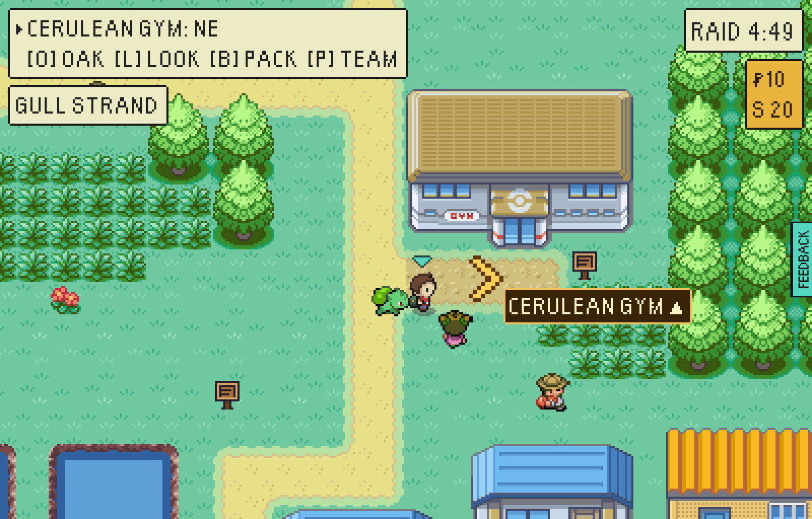

# Near the next gym, the gold arrow leads to its door

Tester 3's report puts this first among the release blockers: seven sessions
hunted for CERULEAN GYM's door, three gave up. Oak's radio named the gym and a
straight-line bearing, which runs into walls on GULL STRAND, and the
`CERULEAN GYM ▲` caption shows along the whole front while only one tile is
the door. Now, within 10 walking steps of the next gym's doorstep, the gold
arrow and the chip turn to it (`CERULEAN GYM: NE`), whatever the job, and lead
along the walk to the doorstep and then into the door. Walk on, and the arrow
goes back to the job.

From a test-mode build, deployed to THE STRAND, walked to (172,217) and then
moved one step at a time in the direction the arrow aims: nine presses took the
player into Cerulean Gym, 22 Nov 2026.
