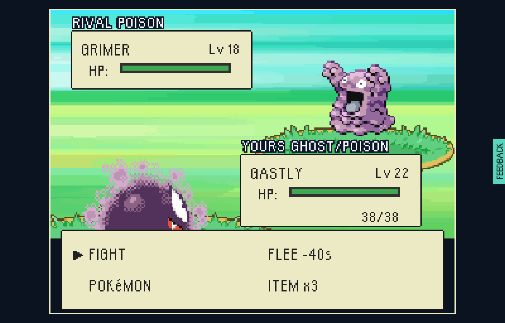

# A gym leader beaten in the raid stops hunting it

The owner's call on the 10 Nov hunt report (option B): beat KOGA at Fuchsia Gym,
step outside, and he should not be waiting on the Safari Road with another team.
A leader beaten at their gym stands down for the rest of that raid, and every
district they kept is hunted by another rival (`rivalsStoodDown` in
`src/game/world/hunters.ts`, `HunterPack.standDown` in
`src/game/world/hunterPack.ts`).

Both pictures are route B from `docs/screens/marsh-gym/README.md`: Misty
beaten, Koga fought and won ("Here is the SOUL BADGE"), out of the gym and
along the Safari Road to 262,168.

**Before** (`main` at `757d3351`, from the hunt report): KOGA catches you
straight after the badge, leading with Grimer.



**After** (this branch): on the same road, the district's hunter is SABRINA,
leading with her own Venonat.


Made against a test-mode build (`VITE_EPTW_TEST_MODE=1 npx vite build`) served
under its Pages subpath, with one attached headless browser:

```
node tools/playtest/raid.mjs <build url> --attach=<port> --pixels --stepped --window=pixel --seed=7 \
  --beaten=vale-gym-misty --insertion=greystone-vale-farmhouse --starter=Charmander --level=22 \
  "--moves=Ember|Scratch|Growl|Smokescreen" \
  "--team=gastly:22:Lick|Hypnosis,ponyta:22:Ember|Tackle|Growl|Tail Whip,pidgeotto:22:Gust|Quick Attack|Tackle|Sand Attack" \
  --skip-contract --said --shot-battles --shot=B.png \
  "--steps=walk:244:167,into:244:167:up,challenge:391:368:up,into:391:376:down,walk:255:168,walk:262:168"
```

The after picture is that run's seventh battle shot (`B-battle-7-1.png`).
