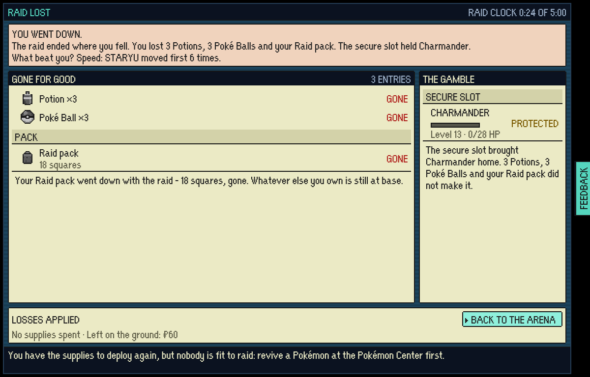
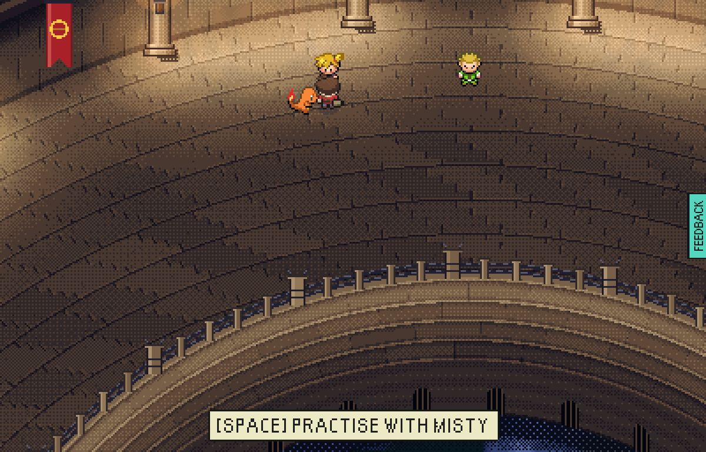
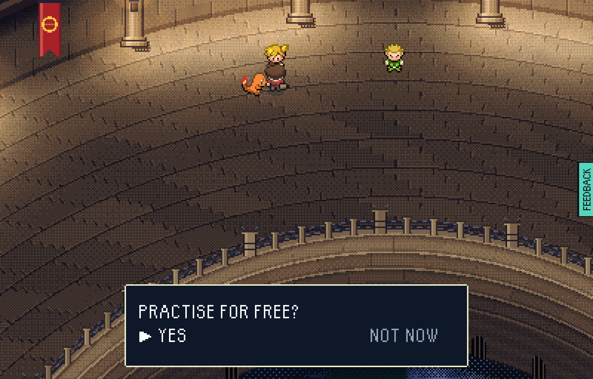
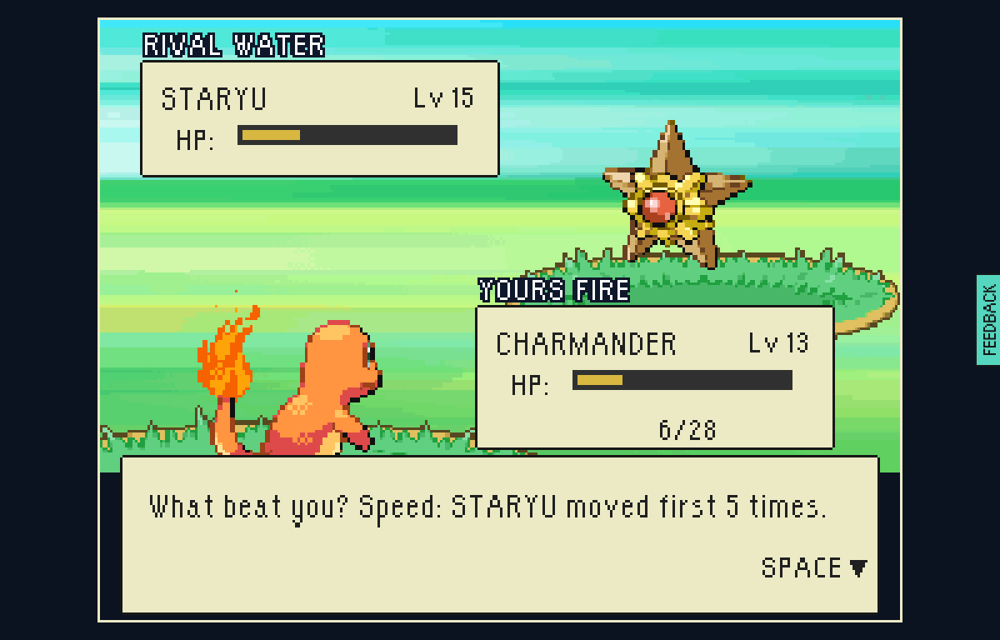
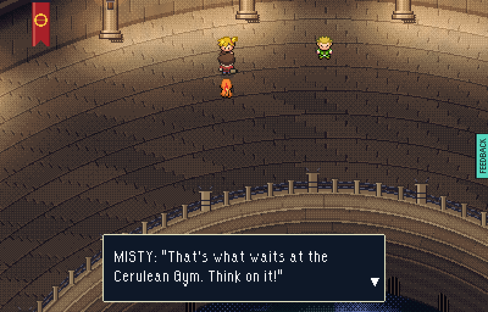
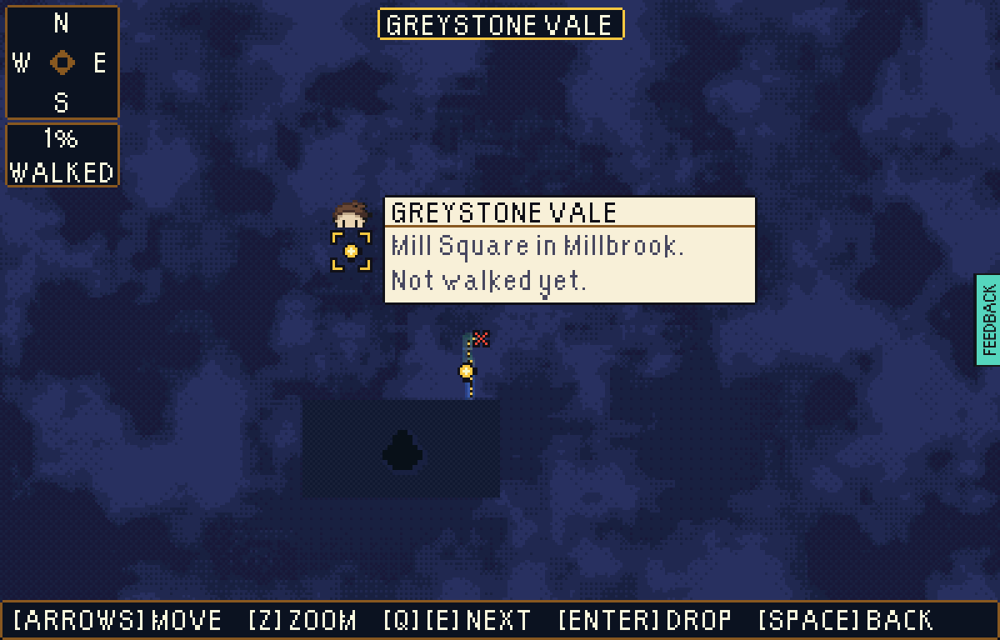
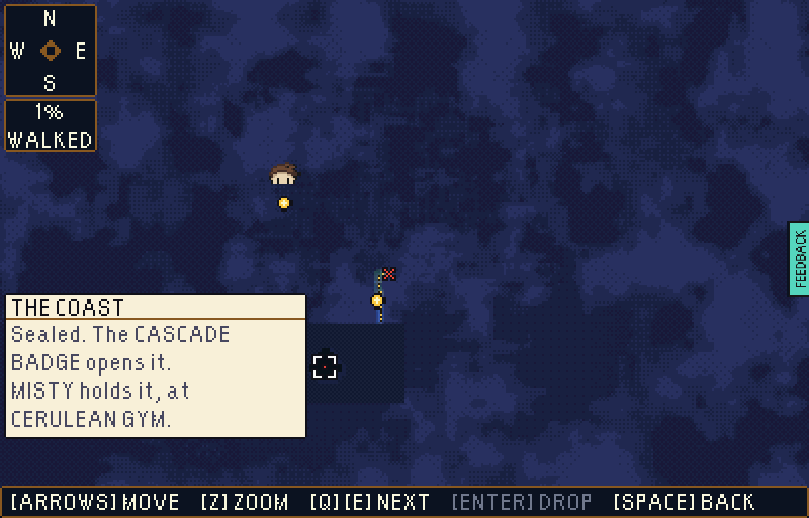
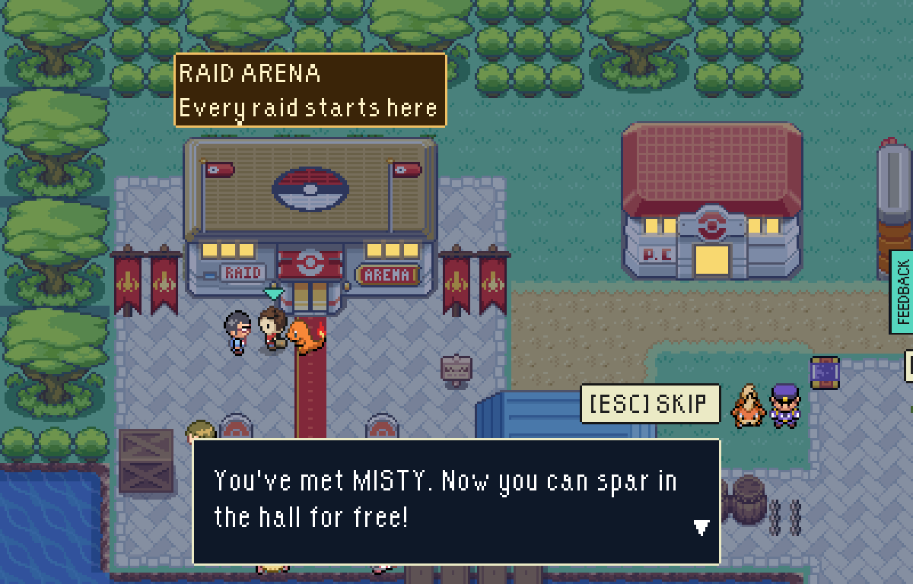

# Learn before you risk it

Step 2 of firstmate's gyms plan (`eptw-gyms-loadouts-plan`): once a gym leader
has been met in a raid, won or lost, they spar in THE RAID ARENA with their real
gym team for nothing; a fight lost says what beat you; the Gym Guide names the
next gym and what does well there; the telescope shows a quarter a gym holds
shut under a heavier cloud with its badge pressed in.

Played as a player on a test-mode build (`--base=/` for `vite preview`), one
small browser:

1. Lose to Misty with a lone Charmander, keeping the save:

   ```
   node tools/playtest/raid.mjs <build url> --pixels --stepped --window=pixel --seed=7 \
     --insertion=greystone-vale-the-strand --starter=Charmander --level=13 --fight \
     "--steps=walk:172:253,into:179:216:up,challenge:448:71:up" \
     --save-out=met-misty.json --shot=lose.png
   ```

2. Home with that save: practise, read the line, check the save is unchanged,
   look through the telescope, hear the Gym Guide:

   ```
   node tools/playtest/gymPractice.mjs <build url> <out dir> met-misty.json
   ```

The raid lost to Misty, and what beat you on the result screen:



Misty waits on the hall's far floor beside the day's rival, and asks:




Her real gym team (Staryu, Horsea, Starmie on the gym AI, two at a time) on the
real battle screen with no raid on it; lost, it says what beat you before it
leaves:




The save is the same byte for byte after the practice.

The telescope: THE COAST under a heavier cloud, the Cascade Badge pressed into
it, and the card over it:




The Gym Guide at the Arena's door:


