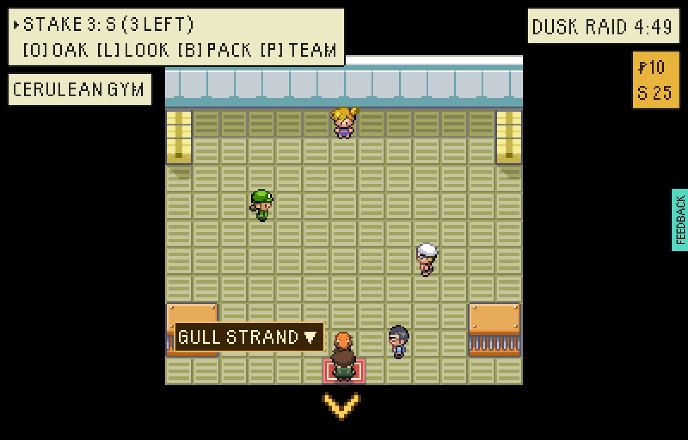
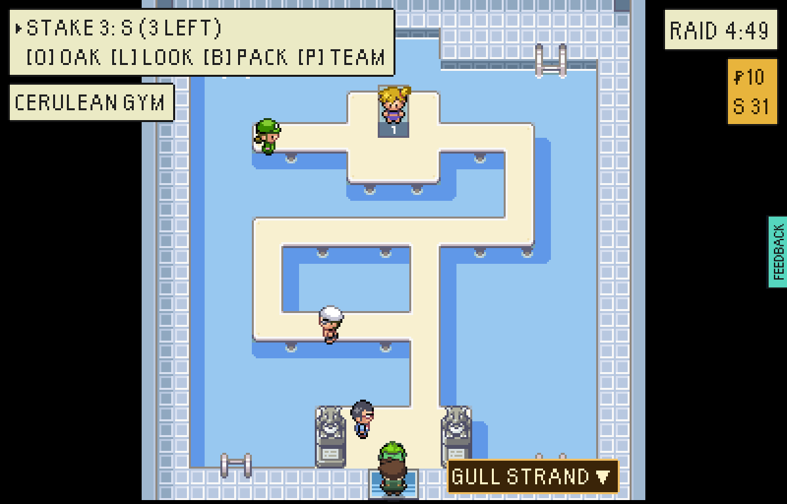
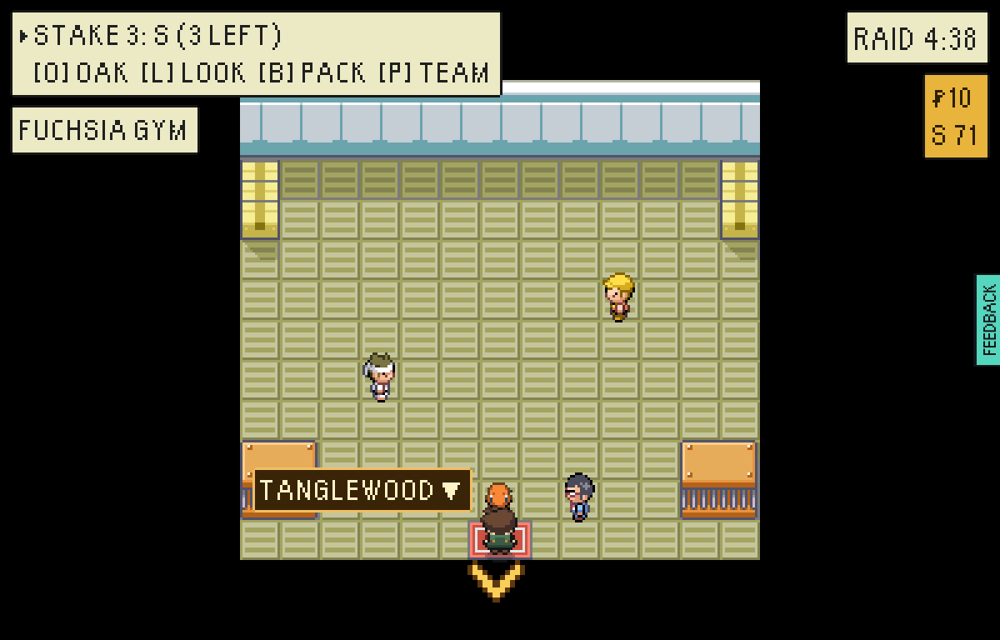
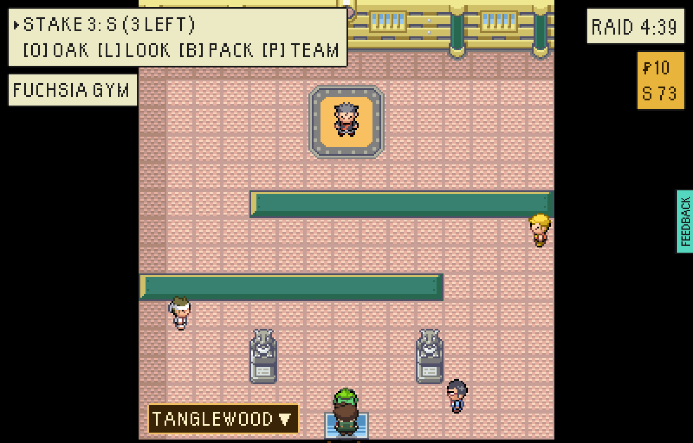
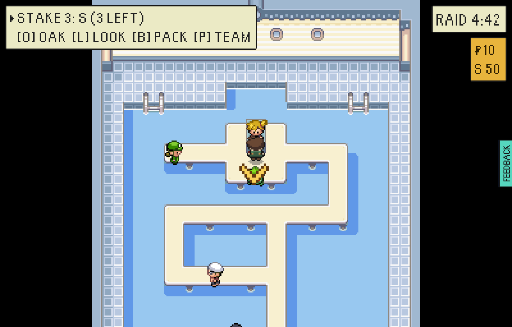
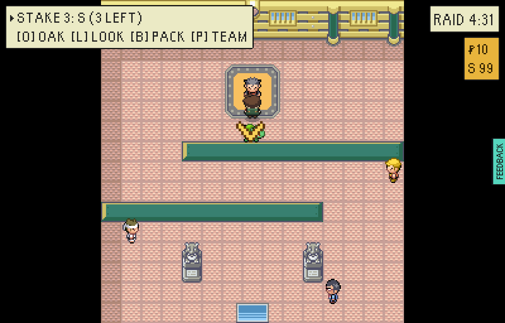
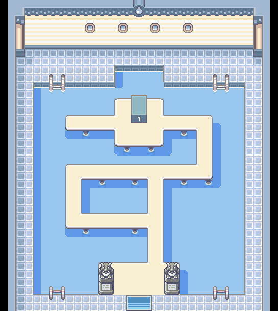
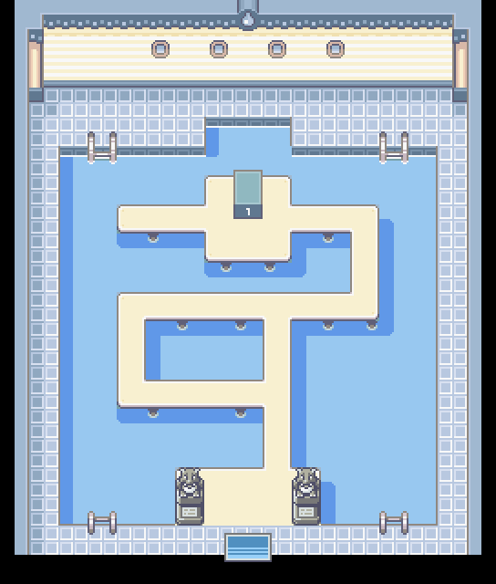
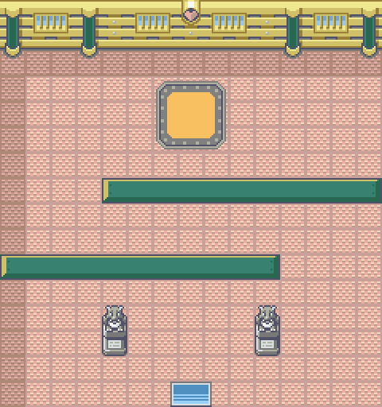

# Cerulean Gym and Fuchsia Gym, each its own room

The gyms playtest of 14 November 2026 (finding 4): "Cerulean Gym and Fuchsia Gym are the same
room." Both were the warehouse hall every gym building opened on: the same pale floor, the same
two pillars, the same two orange benches, and Swimmer Luis standing on a dry mat. Nothing but
the caption said which gym you were in.

Now each is FireRed's own room. **Cerulean Gym is a pool** crossed by walkways, Misty on her dais
across the water. **Fuchsia Gym is a maze** on its pink floor under the gold beams and green
pillars, Koga on his dais at the back.

| Before | After |
|---|---|
|  |  |
|  |  |

Standing in front of each leader:

| Misty | Koga |
|---|---|
|  |  |

The whole of each room, as the map tool draws it (`out/greystone-vale-<room>.png`), beside
FireRed's own Cerulean Gym:

| Cerulean Gym | FireRed's Cerulean Gym | Fuchsia Gym |
|---|---|---|
|  |  |  |

## How it was built

- `scripts/cut-frlg-gyms.mjs` cuts both gyms out of pret's FireRed disassembly onto
  `public/assets/frlg-gyms.png` (`ASSET_PROVENANCE.md` has the source and the one recolour).
- Two new room styles, `cerulean-gym` and `fuchsia-gym` (`world/tileset/insideTileset.ts`). The
  pool's rim, every walkway's corners, ends and junctions, the shadows the walkways throw on the
  water and the posts under them are read off what is round each cell, as FireRed's own pool
  draws them. `gymStyles.test.ts` lays FireRed's own Cerulean Gym and Fuchsia Gym through the
  rules and gets FireRed's tiles back, cell for cell.
- Fuchsia Gym's walls are invisible in FireRed. A room here is judged by somebody who does not
  read, so they are drawn: the Rocket Hideout's maze partitions, in Fuchsia's own green and gold.
  The maze is two of them rather than FireRed's blind one, a gap four wide at alternate ends.
- A Cerulean Gym or Fuchsia Gym building opens on its own room (`templateFor` in
  `maker/areas.ts`), in the vale and in the map maker alike; the maker offers both styles and
  their furniture.
- Everybody moved with the rooms: Misty, Picnicker Diana and Swimmer Luis
  (`MISTY_GYM_SPOTS`), Koga, Juggler Nate and Tamer Phil (`KOGA_GYM_SPOTS`), and each Gym Guide
  (`gullStrand.ts`, `tanglewood.ts`), where FireRed stands its own where the room allows.
- A gym's pool is not the wild: no rod is cast into water under a roof (`isFishingWater`).

## The passes (`docs/agents/area-passes.md`)

| # | Pass | Cerulean Gym | Fuchsia Gym |
|---|---|---|---|
| 1 | Looks | FireRed's own pool, cell for cell, with its side walls, portholes, ladders and statues | FireRed's floor and back wall cell for cell; partitions capped at both ends, the room's edge included |
| 2 | Walkability | The walkways are one plank wide, as FireRed's are: the room does not allow two abreast. The walk in from the door is three wide | Two abreast from the mat to the dais in front of Koga (`gymRooms.test.ts`) |
| 3 | Spacing | Every trainer on a walkway of their own, off the walk up the middle | Each trainer in a corner of their own aisle |
| 4 | Finding your way | The one walkway from the door leads to Misty; the dais and its plaque say where the leader is | Two walls, each a turn, the gaps at alternate ends: the way is seen, not found |
| 5 | Flow | One walk to Misty, a loop round the west of the pool, a branch to Diana past the dais | A zigzag to Koga, nothing to backtrack |
| 6 | Reward | Diana on the branch past the dais, Luis on the loop: fights asked for, never forced | Nate and Phil off the walk, asked for |
| 7 | Life | Misty, two trainers, the Gym Guide at the head of the walk in | Koga, two trainers, the Gym Guide by the door |
| 8 | Danger and pace | Nobody on the walk to the leader; nobody watches (`gymRooms.test.ts`: the same walk whoever stands in the hall) | The same |
| 9 | Character | A pool: Cerulean's and nobody else's | Pink, gold and green, a maze: Koga's |
| 10 | Fit in the window | From the mat, Misty is in the smallest window (20x15) | The whole hall fits the 25x16 window and Koga is in the 20x15 one from the mat |
| 11 | Building placement | n/a: one room | n/a: one room |
| 12 | Density | Ladders, statues, portholes, the badge | Pillars, windows, the badge, the statues |

## How the pictures were made

The befores are the playtest's own (`main` at `b0d13b41`). The afters are a test-mode build of this
branch at `?testmode=pixels`, 1200x768, stepped, played by `tools/playtest/raid.mjs`:

```sh
VITE_EPTW_TEST_MODE=1 npx vite build --outDir "$SCRATCH/dist"   # served under /escape-from-pallet-town-web/
node tools/playtest/raid.mjs "$URL" --stepped --pixels --window=pixel --insertion=greystone-vale-the-strand \
  --skip-contract --level=30 --shot=cer.png --steps=into:179:216:up,shot:mat,walk:450:85,shot:misty
node tools/playtest/raid.mjs "$URL" --stepped --pixels --window=pixel --insertion=greystone-vale-farmhouse \
  --beaten=vale-gym-misty --skip-contract --level=30 --shot=fuc.png \
  --steps=into:244:167:up,shot:mat,walk:392:371,walk:392:370,shot:koga
```

`after-cerulean-gym-real-speed.png` is the same walk on a plain build at real speed, under WebGL.
