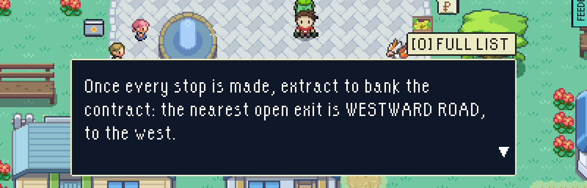
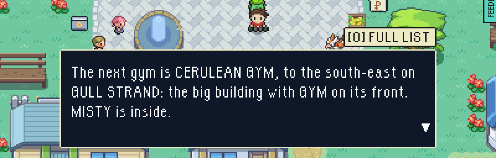
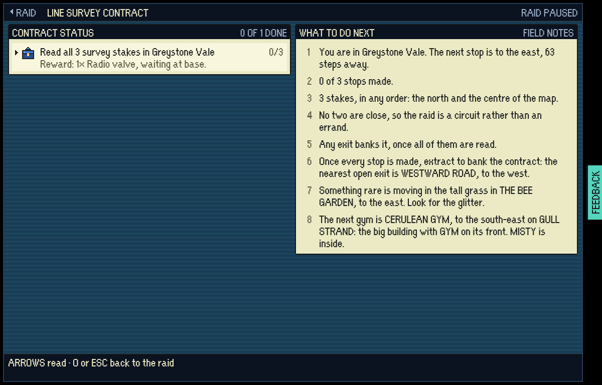

# Oak's radio says which way the next gym is

The wall map in Oak's Lab named the next gym and its district, and nothing in
a raid did: the gold arrow follows the job, and O said the job and the way
out. Seven of the 22 Nov AI playtest's newcomers quit walking GULL STRAND for
it. Oak now says it as his last line on the radio, and the full field notes
list it, by the same bearing every other line uses, and what to look for.

| before (main): the radio's last line | after |
|---|---|
|  |  |

The field notes (O twice): 

Made with a test-mode build at `PIXEL_WINDOW`, deployed to the vale's front
door at Millbrook on a fresh save, pressing O and reading through, 22 Nov 2026.
