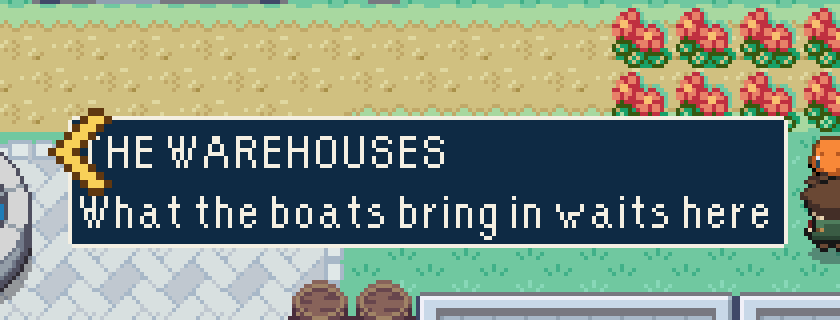
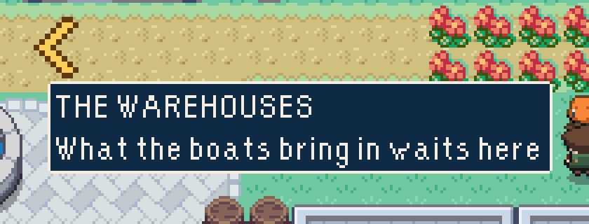

# The harbour's gold chevron stands on no caption

A save that has not been on a raid is shown the way to THE RAID ARENA by a gold
chevron, at the edge of the screen while the door is off it
(`src/game/base/wayMark.ts`). It stood wherever the player's row met the edge,
and so on the first letter of whichever place's caption was seated there: THE
WAREHOUSES read HE WAREHOUSES.

| Before | After |
| --- | --- |
|  |  |

It now slides along the edge off every caption on show, as it already did off
the harbour's signs and as the raid's chevron does. Two things made that hold
on every frame rather than most:

- It is asked whether it is clear over the whole of its bob, from where it
  rests. Asked of where it is this frame, a caption two pixels off it was
  covered on the way in and clear on the way out, and it hopped along the edge
  and back.
- It is placed after the frame's captions are seated. Placed before, it stood
  on a caption for the one frame that caption arrived.

## How to see it

Start a new game, take a Pokémon off Oak's table, and before going on a raid
walk down onto the lawn above THE WAREHOUSES, east of the fountain.

## How these were made

`tools/playtest/harbourChevron.mjs` against a test-mode build of `main`
(`--before`) and of this branch: a new game stood on that lawn, then walked
along it and the path above, the chevron's box asked against every caption on
show on every frame.

| | Frames | Captions met | Frames the chevron stood on one |
| --- | --- | --- | --- |
| `main` | 720 | 6 | 116 |
| This change | 720 | 6 | 0 |

The pictures are the left of its 800x512 screenshot, enlarged.
