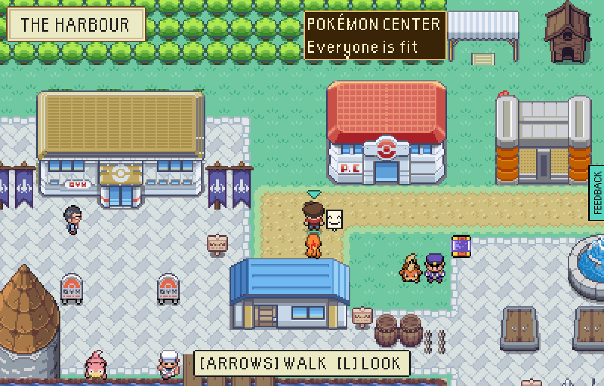
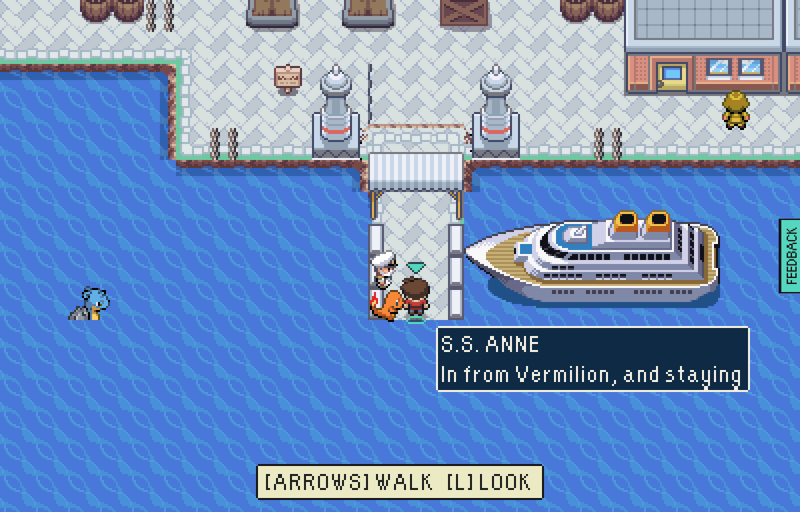
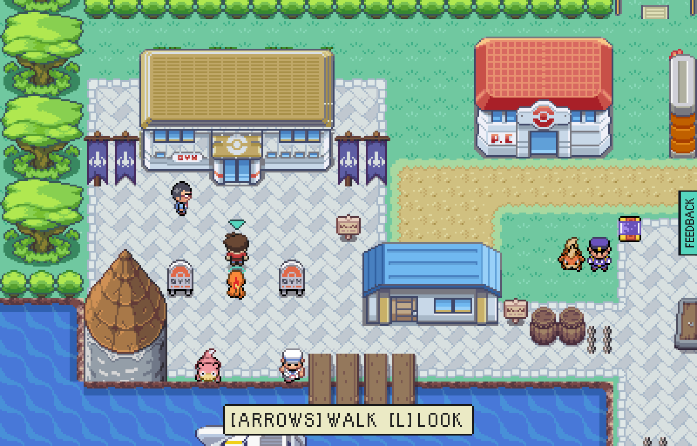
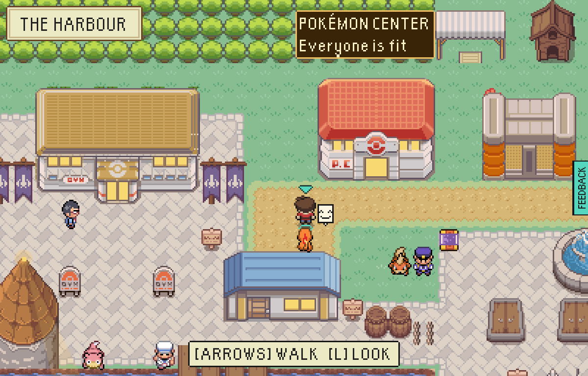
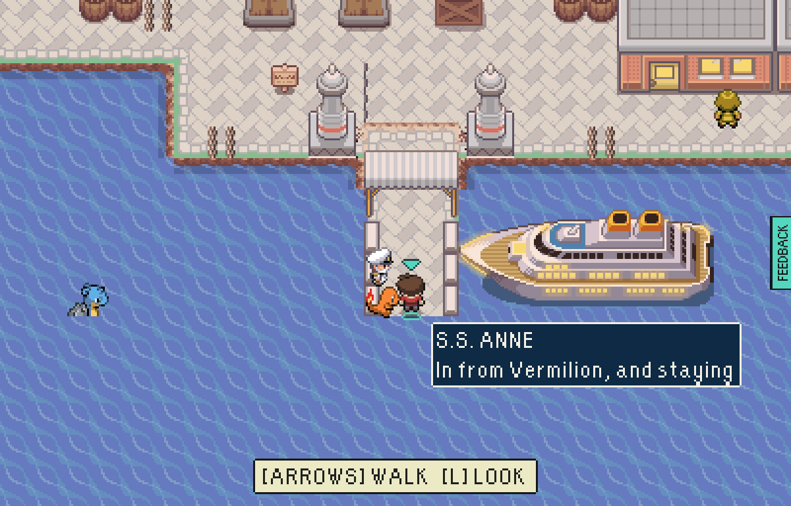
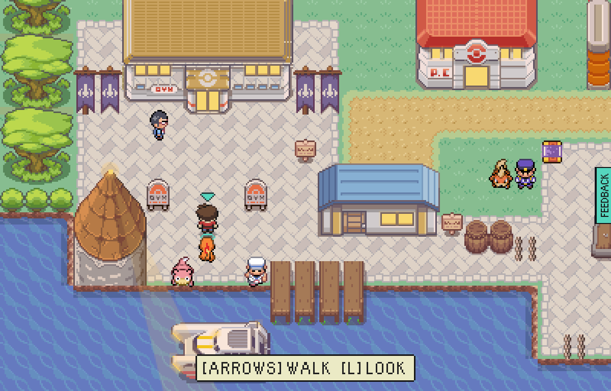
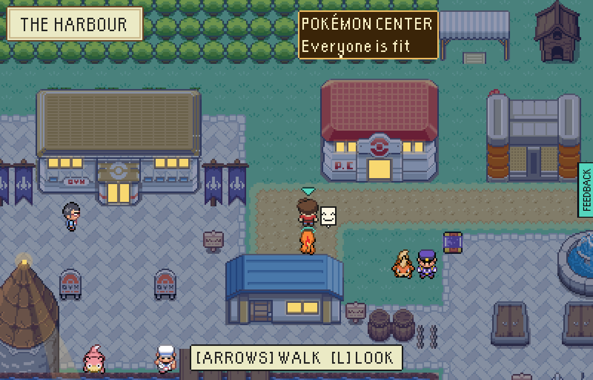
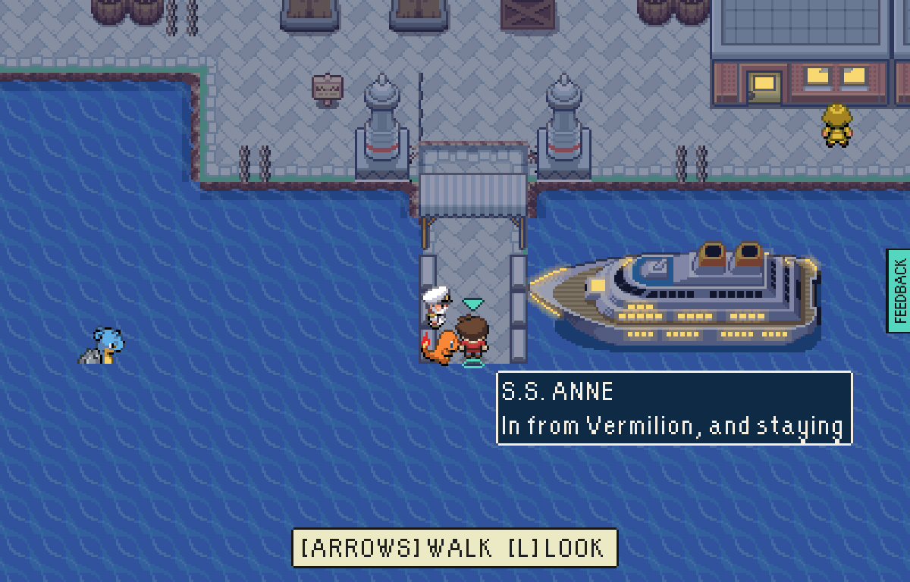
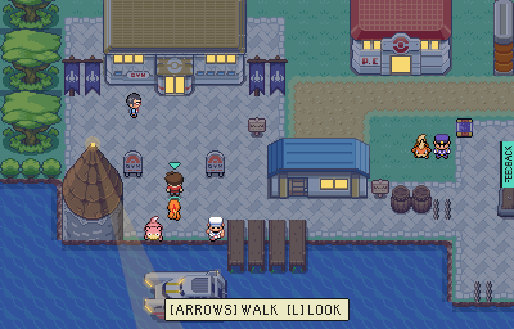

# The harbour keeps your clock

Round 6 of the badass harbour - the owner's pick from three options (always day; dusk and night;
dusk and night with lights): dusk and night, with lights.

| | The yard | The long pier | Arena Square |
|---|---|---|---|
| Day |  |  |  |
| Dusk (18:00-21:00, 05:00-07:00) |  |  |  |
| Night (21:00-05:00) |  |  |  |

## What changed

- By the player's own clock - the same hours THE BOLTHOLE's window already keeps - the harbour
  takes a warm wash at dusk and a deep blue one at night (`src/game/base/harbourLight.ts`).
- **Names and figures stay clear**: the wash is laid under the captions and the figures and over
  everything else, so every name, person and Pokémon is drawn at full brightness.
- **The lights come on** at dusk (`src/game/base/harbourNight.ts`): every window FireRed drew in
  glass glows, found in the art itself (`src/game/base/litWindows.ts`); the S.S. Anne and the
  Seagallop light their portholes, and the lights ride the swell with them; once Brock has built
  the beacon, the harbour light's beam sweeps the bay.
- Nothing is stored and nothing changes but the picture.

## How to use it

Play in the evening or at night. To see it any time, `harbourTour.mjs --clock=dusk|night`.
