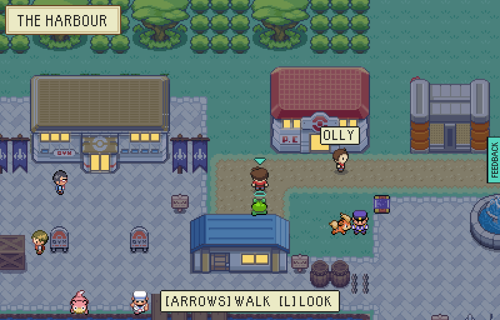
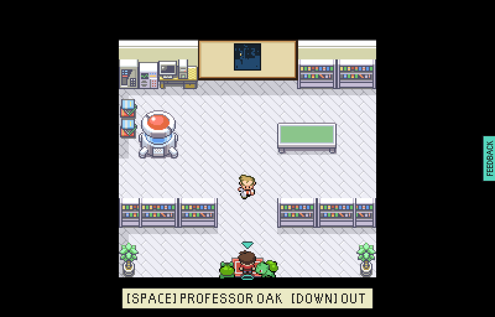

# Partners at everybody's heel

Round 17 of the badass harbour.

| Before | After |
|---|---|
|  |  |

Before, another player walked the shared harbour alone: your own partner trotted at your heel,
but nobody else's did. Now each move a browser sends carries the kind of Pokemon at its player's
heel, and everybody else draws it there - on the tile that player last walked off, stepping in
time with them, through the doors and into the rooms.

Coming into a room together, somebody else's partner arrives where yours could have and never on
top of it: here two players stand on Oak's mat and each Bulbasaur has a side.

## How it is kept safe

A move comes from another player's browser, so the partner in it is believed only as one of the
kinds the game has walking art for; anything else is dropped and the steps are still drawn. It can
only ever choose which of those pictures is shown.

## How to use it

Walk the harbour with a friend and watch their starter follow them about. Swap your partner at the
Pokemon Center and walk out: everybody sees the new one at once.

Pictures from `tools/playtest/sharedHarbour.mjs`, which now also checks that one player sees the
other's partner standing on the tile they last walked off.
