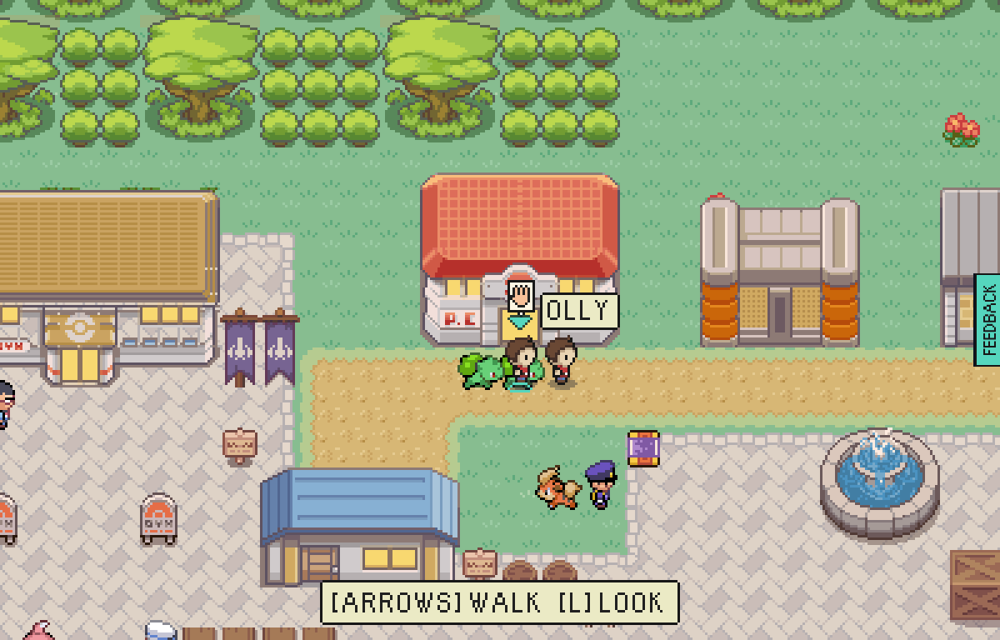
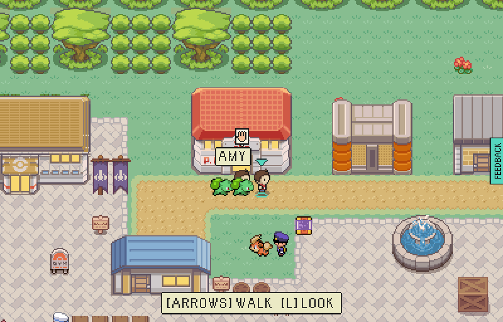

# Waving in the harbour

Round 18 of the badass harbour.

| Before | After |
|---|---|
|  |  |

Before, two players in the shared harbour could see each other and walk past each other, and that
was all. Now, facing somebody and pressing SPACE waves: a hand goes up over you on every screen in
the place, and the one you waved at hears a little "hi!".

The same wave on OLLY's screen: AMY's hand up over her name.

## Fixed on the way

Standing side by side, the other player's name plate is wider than a tile and reached over your
head, where the chevron that marks you sat on its first letter ("OLLY" read "-LLY"). A plate now
slides clear of your own column when its owner stands next to you.

## How it is kept safe

A wave carries who waved, where, and at whom - no words at all - and is read only as that, so all a
false one can do is put a hand up over somebody. It sends nothing while nobody else is there, and
not more than once every second and a half.

## How to use it

Walk up to another player in the harbour, face them, and press SPACE. The harbour board's notices
mention it too.
