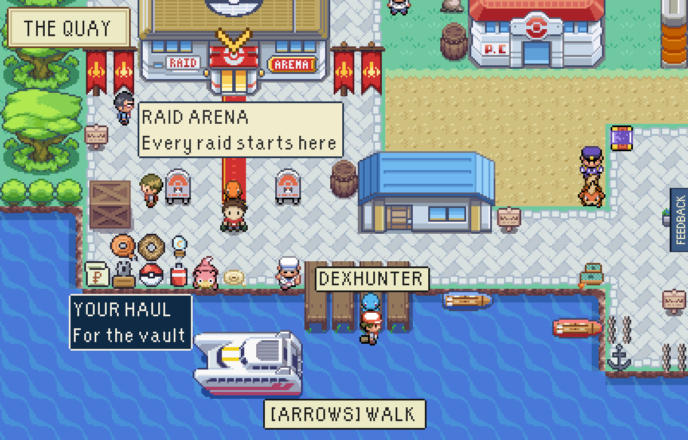
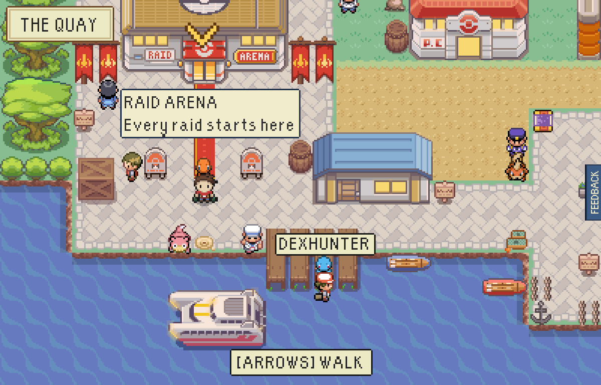
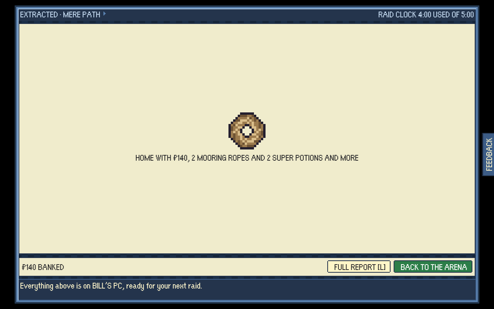
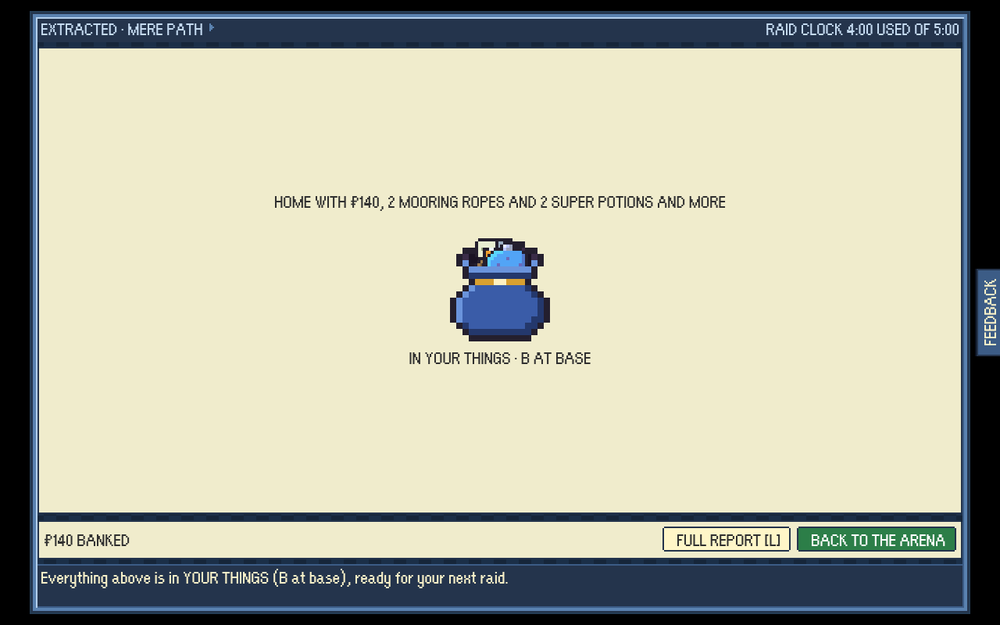
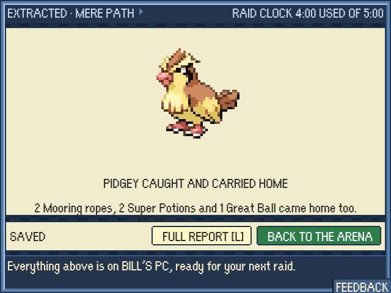
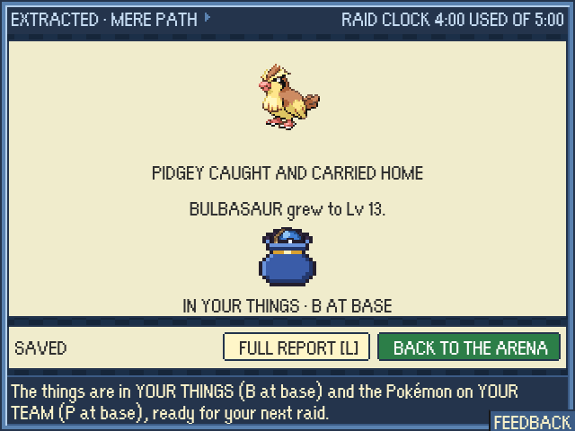
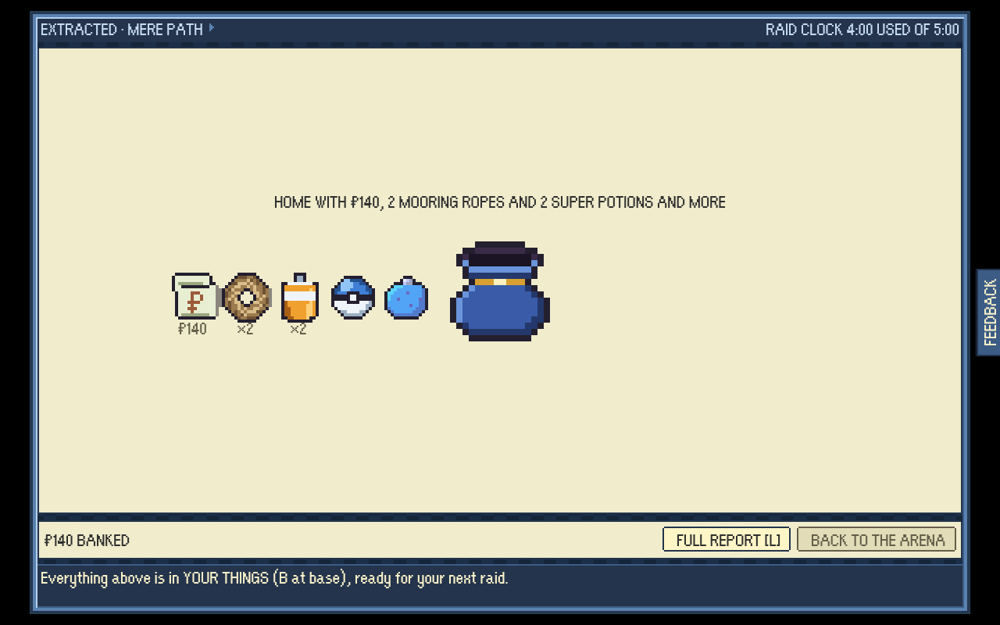
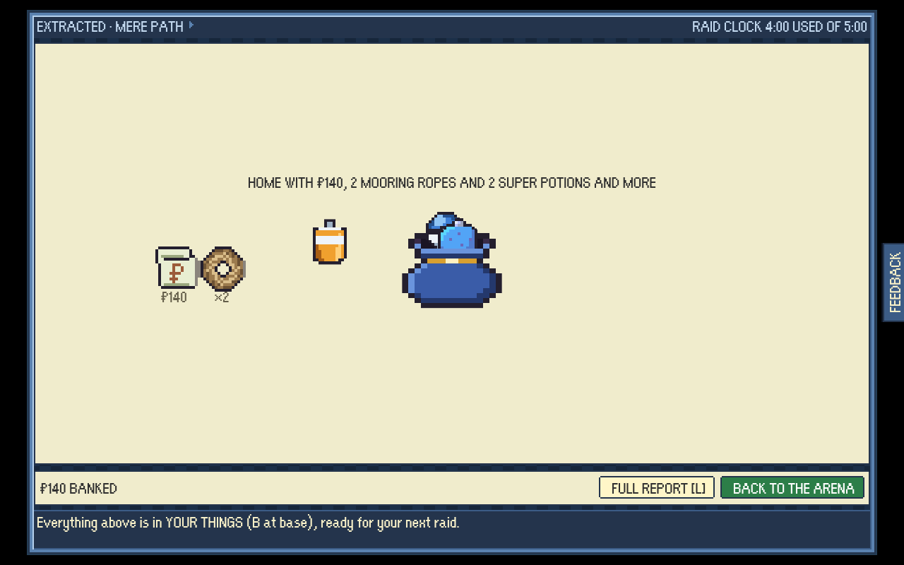
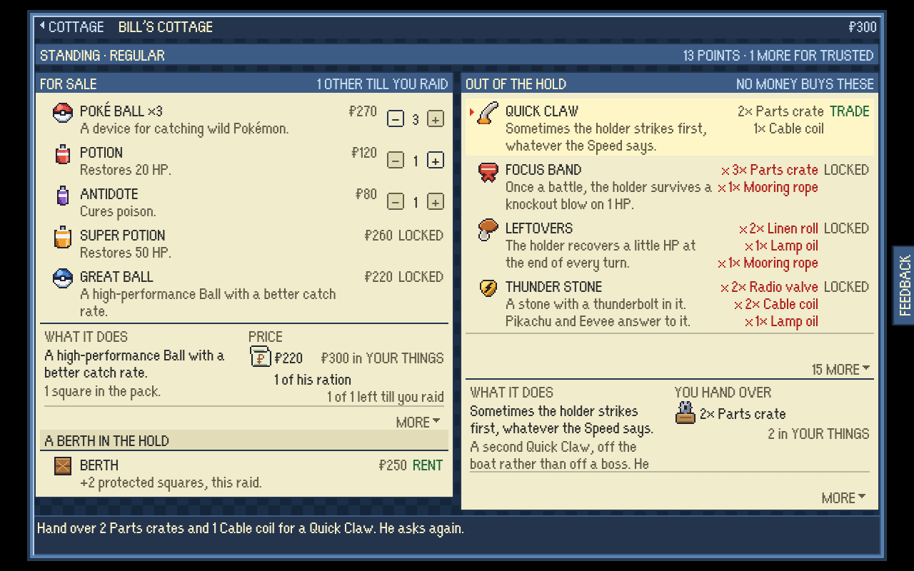

# The haul goes into YOUR THINGS on the result card, not onto the quay

The captain, 25 Nov 2026: after a raid home through the Arena, the haul stood on
the quay as a row of pictures under a sign, YOUR HAUL / For the vault. It looked
like loot and could not be picked up, and "the vault" is no place anybody can
find: the things were in YOUR THINGS (B) all along, put there the moment the raid
ended. He chose all three answers offered: take the pile away, show the haul
going into a bag on the result card with a chime, and call it YOUR THINGS
everywhere.

| | before | after |
|---|---|---|
| The quay, first time out after a raid |  |  |
| The result card, items only |  |  |
| A catch at 640x480 |  |  |

The card's moment, 0.2s, 1.15s and 3s in: the things wait beside an open sack,
hop in one at a time (the nearest first, each with a soft drop and the sack
gulping), and settle poking out of its mouth as the chime sounds and
`IN YOUR THINGS · B AT BASE` is written under it.

  

Bill's counter, priced against YOUR THINGS rather than the vault:

At 640x480 the old card ran its picture off the top and its words off the
bottom; the picture is now drawn at its own size under `data-short`.

## How they were made

A test-mode build (`VITE_EPTW_TEST_MODE=1 npx vite build`, served under the
Pages subpath, `tools/playtest/README.md` "Memory"), one headless Chromium at a
time. The cards were opened straight from the title on made reports, as
`tools/playtest/resultShots.mjs` does, and photographed at fixed times after
the screen appeared; `before-*` is the same against a build of `main` at
f144d062. The quays are `haulQuay.mjs` from `main` (removed here) played
against each build: a raid comes home to the Arena rim, walks out of the door
and looks at the quay. Bill's counter is `tools/playtest/shopScreens.mjs
--window=1280x800`.
