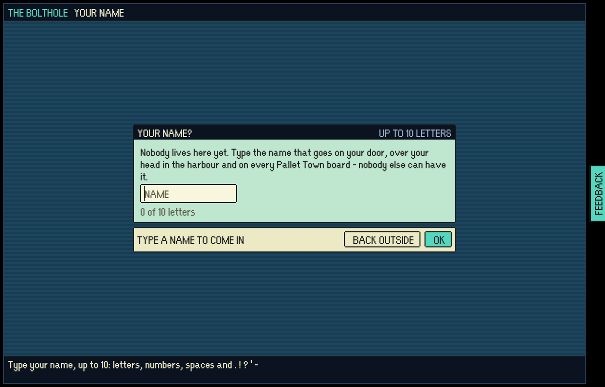
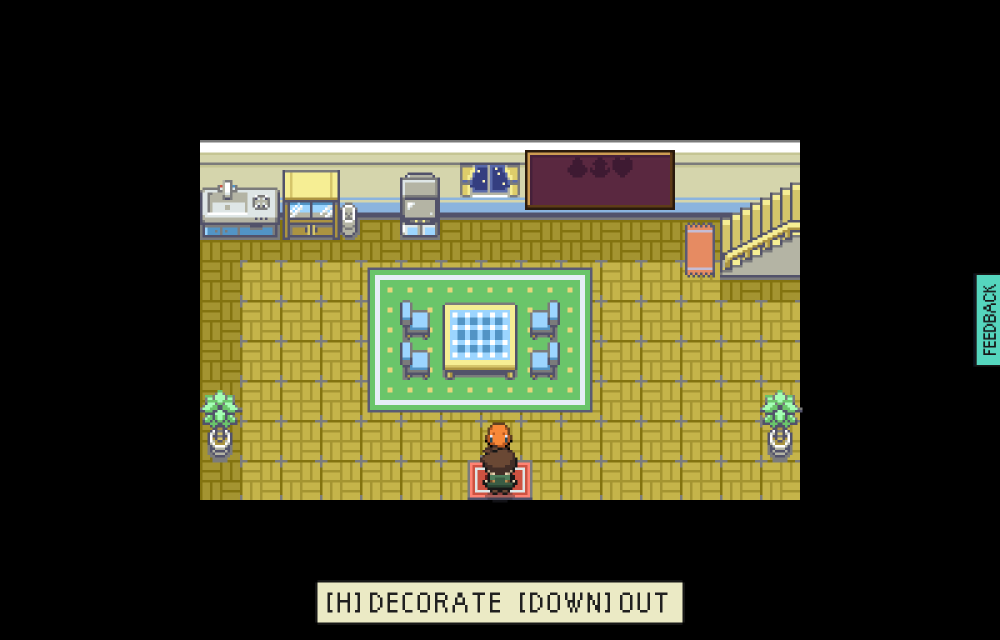
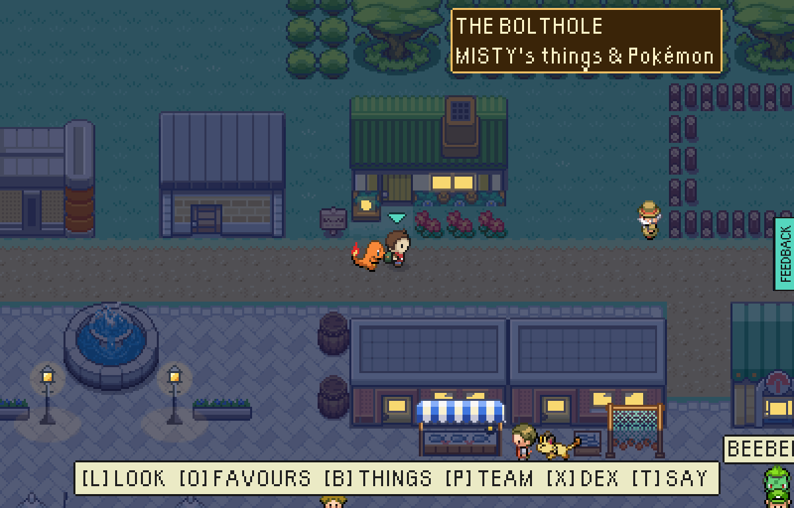
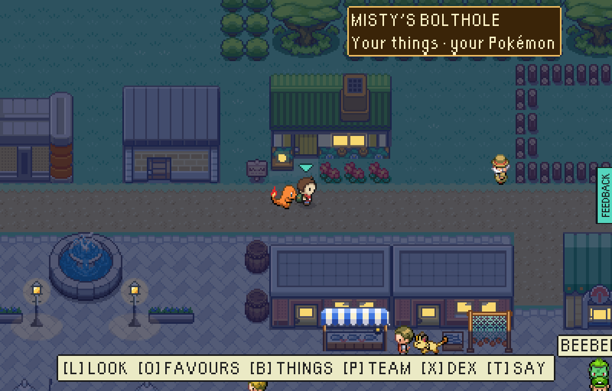
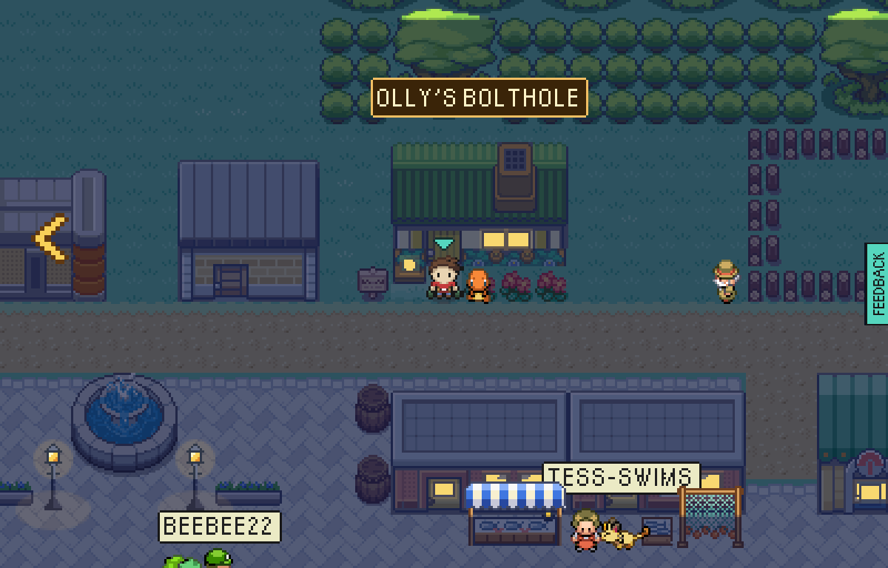

# THE BOLTHOLE carries your name

The captain, 21 Nov 2026: "you shouldn't have to walk in your house first to give
it a name. It should just have your name, right?"

| | Before | After |
|---|---|---|
| A new player walks in |  |  |
| An existing save, named MISTY |  |  |

Once a name is given (in the hall after the first raid, at CONTINUE, or at the
console), the door carries it: 

Made against a test-mode build (`VITE_EPTW_TEST_MODE=1 npx vite build`, served
under `/escape-from-pallet-town-web/`):

    node tools/playtest/houseName.mjs <url> docs/screens/house-name/after
    node tools/playtest/houseName.mjs <main build url> docs/screens/house-name/before --look

`named-later.png` is `outside.png` from `tools/playtest/bolthole.mjs <url> <dir> --starter=charmander`.
