# The rooms' talk

The captain, 30 Oct 2026: a bar along the bottom of a screen feels disengaged, and the harbour was
built to end menu screens. So a keeper talks in their own room's dialogue box, and the key on the
door mat starts it.

| | |
|---|---|
| 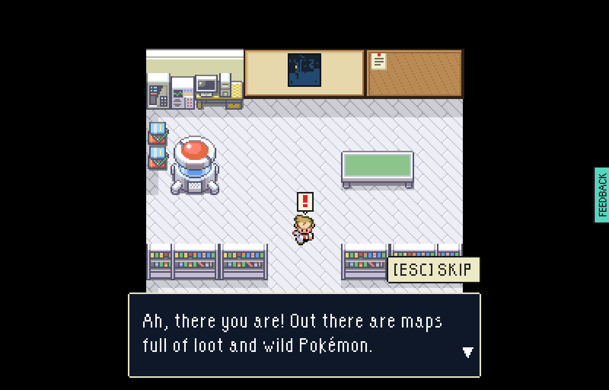 | Oak on the mat. `[ESC] SKIP` is past the lot. |
| 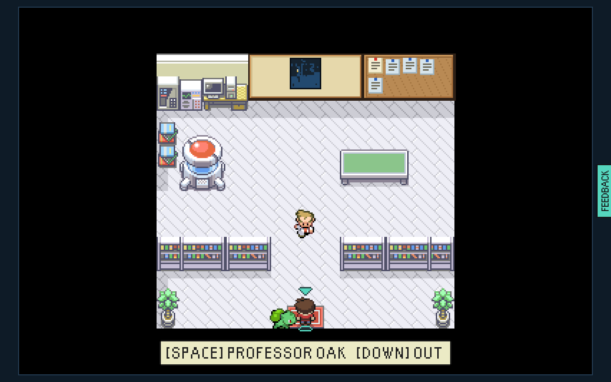 | The cork board beside the wall map: a slip a notice, cream for a contract and blue for a favour. |
| 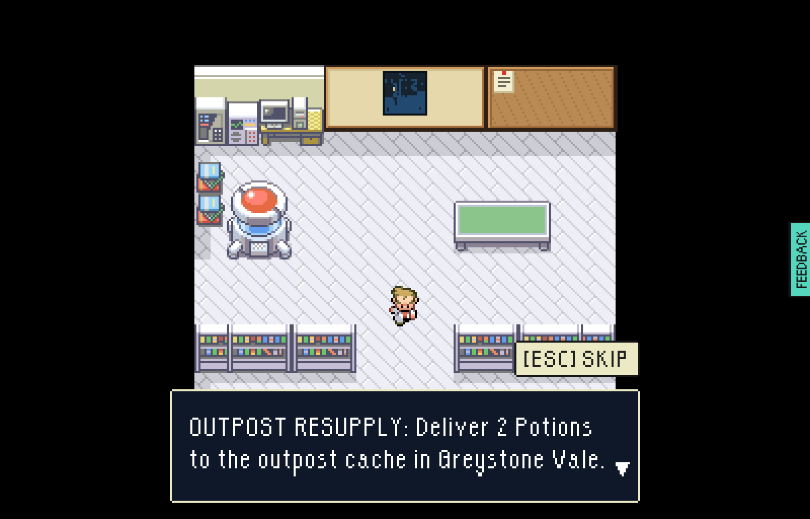 | He reads it out from the mat, a notice a line. Walked up to, it reads the same. |
| 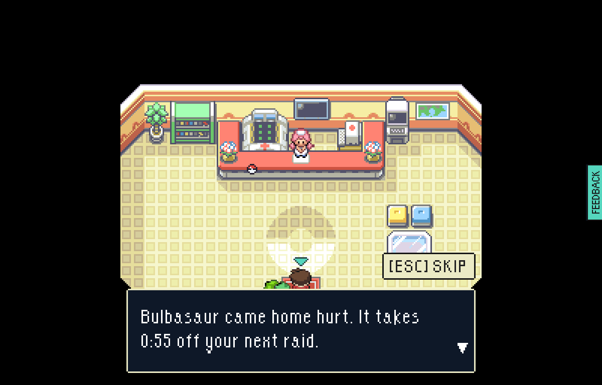 | Joy names the price, |
| 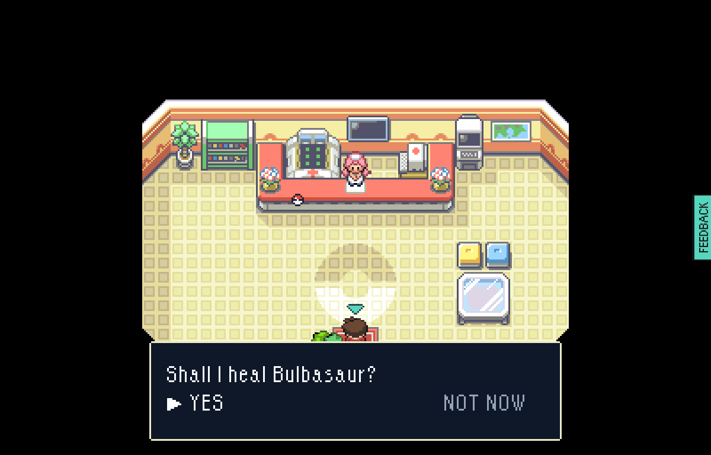 | asks, |
| 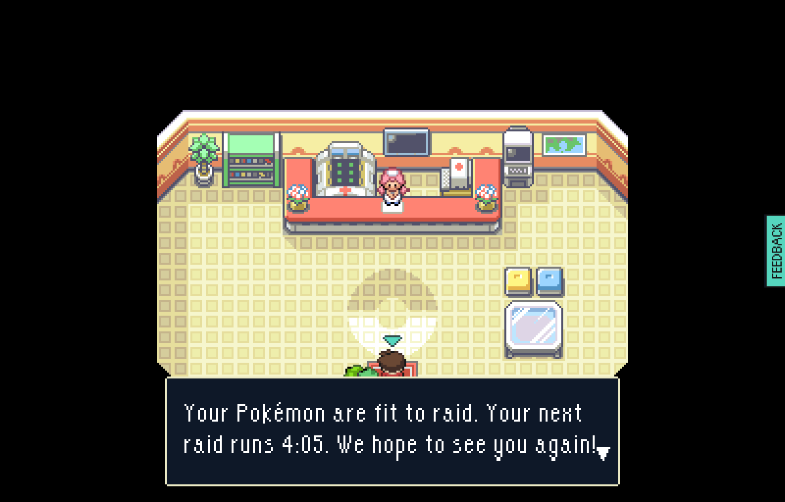 | and the Poké Balls have gone from her counter. |
| 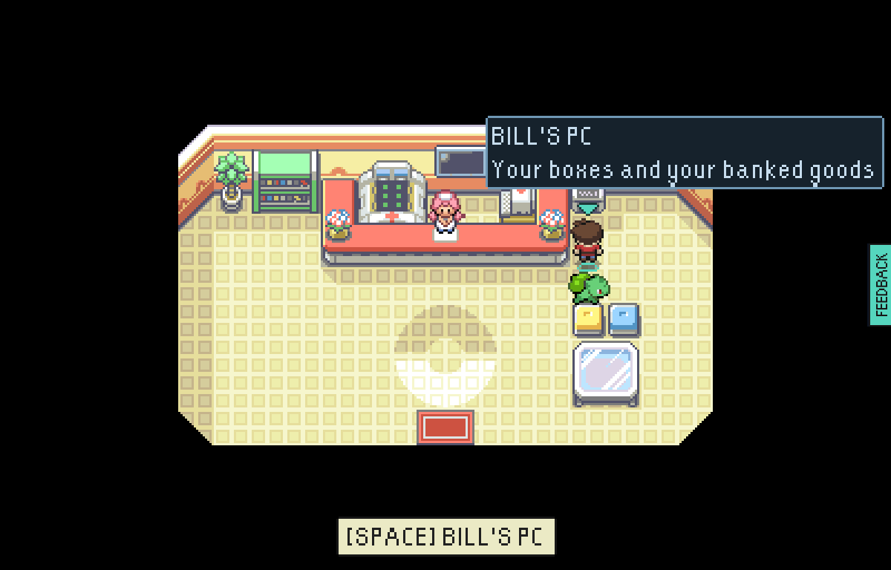 | Boxes are on BILL'S PC, beside her. |
| 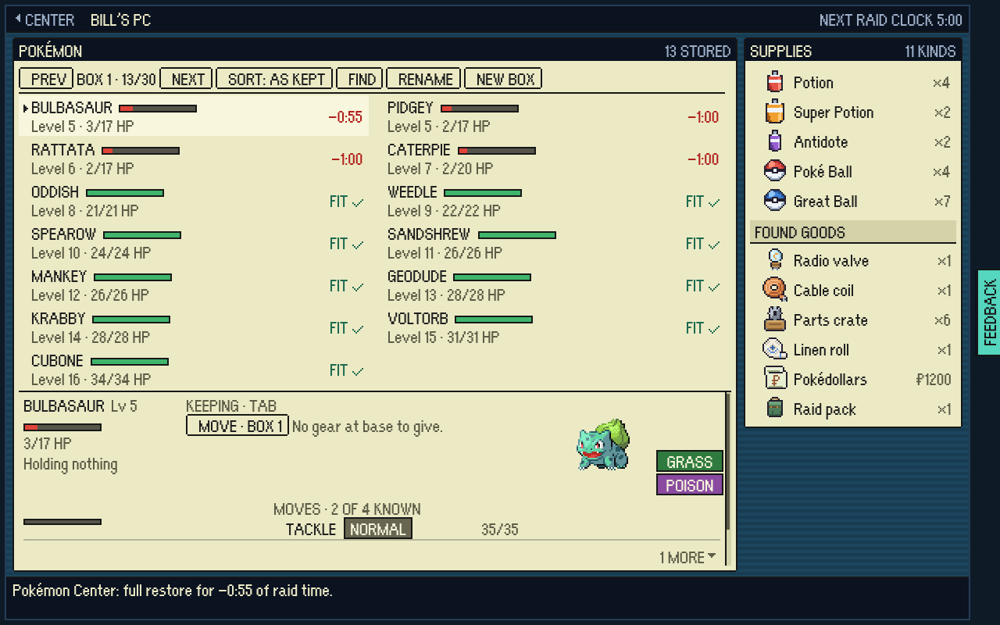 | Thirteen Pokémon, with no bill along the foot of them. |
| 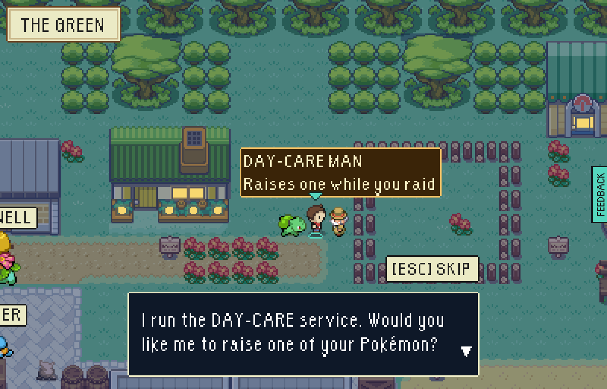 | The Day-Care Man says his piece in the yard, |
| 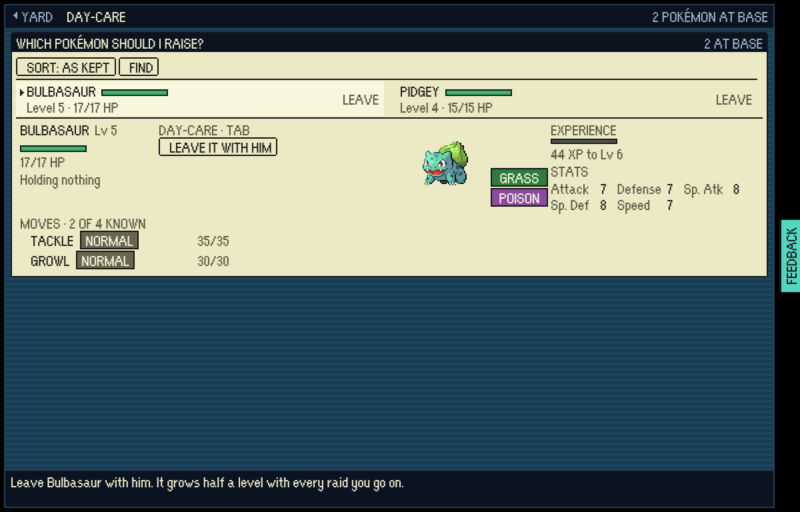 | then a short list, with room for the POISON tag, |
| 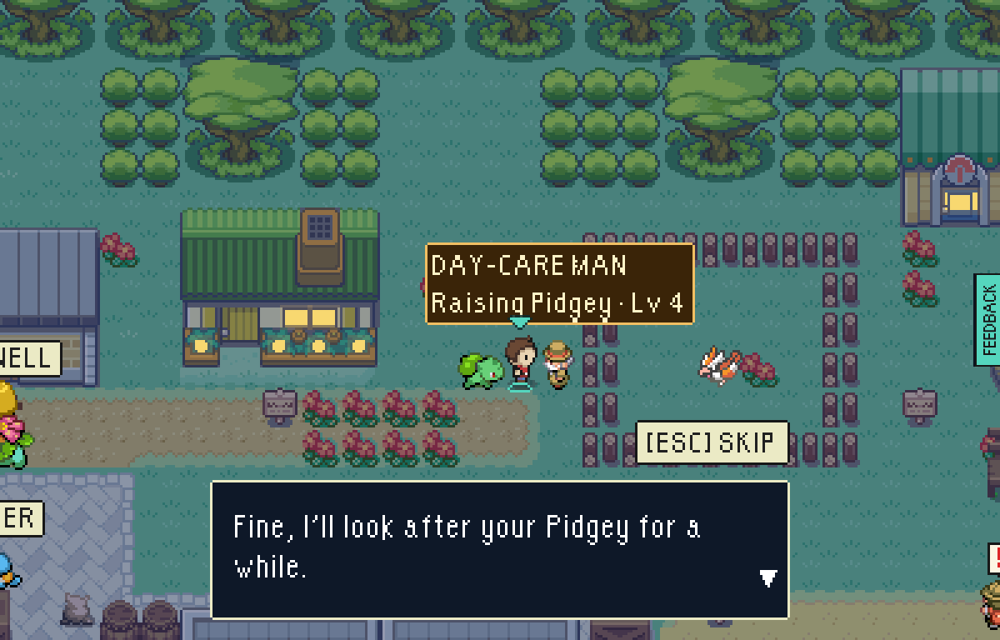 | and answers in the yard. |
| 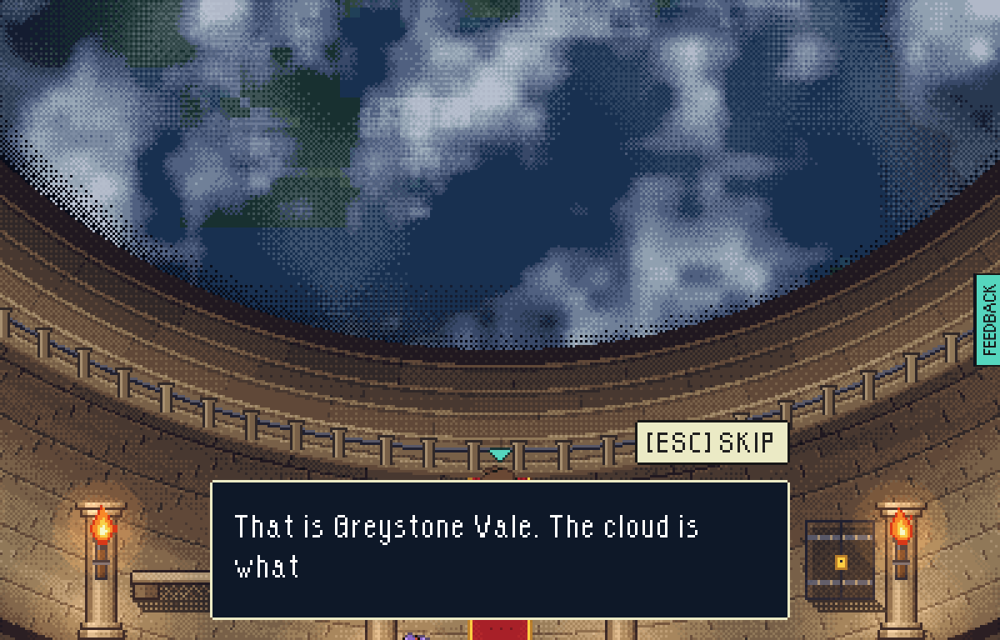 | The marshal says what is down there in the hall, once, before the rim's panel opens. |
| 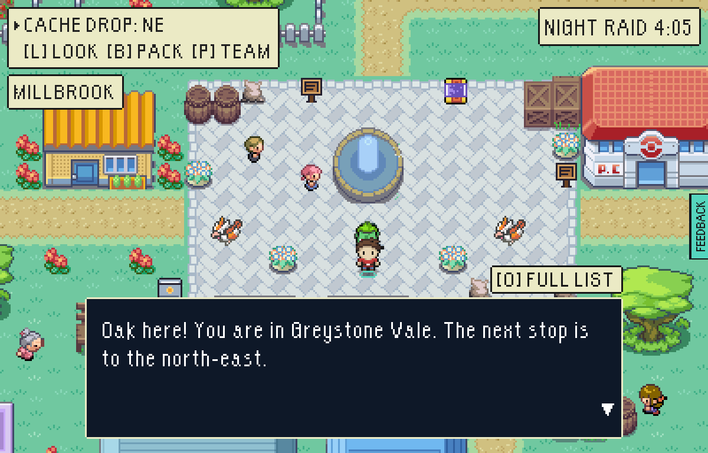 | O in a raid: Oak on the radio. O again is the full list. |

`tools/playtest/inRoomTalk.mjs` plays all of it and takes these.
