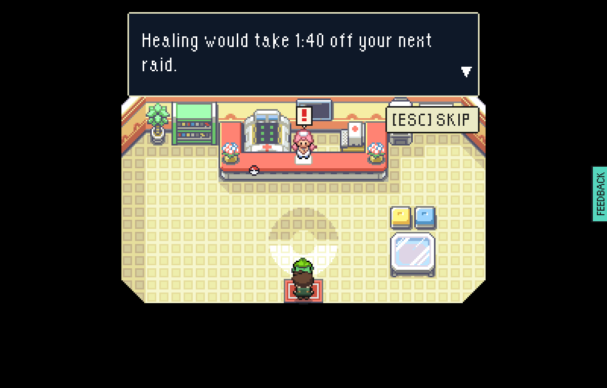
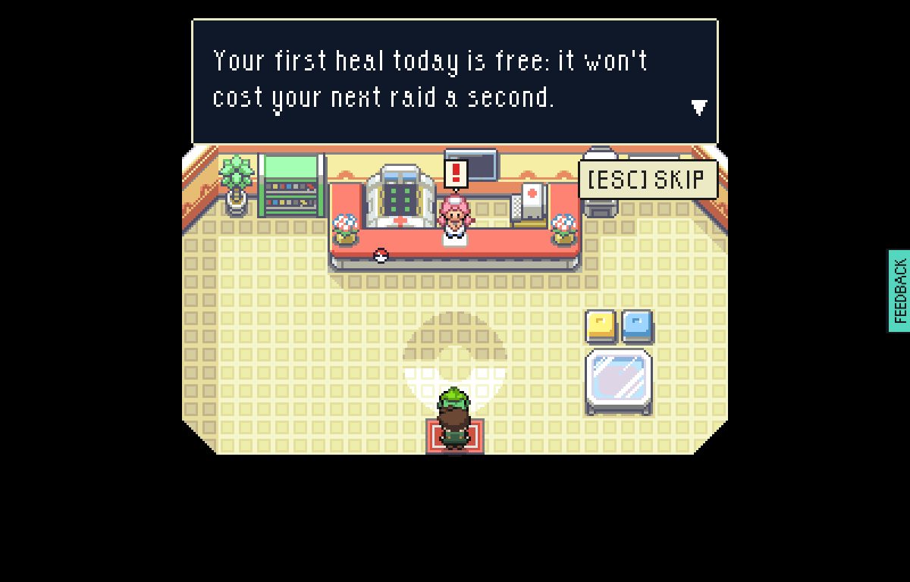
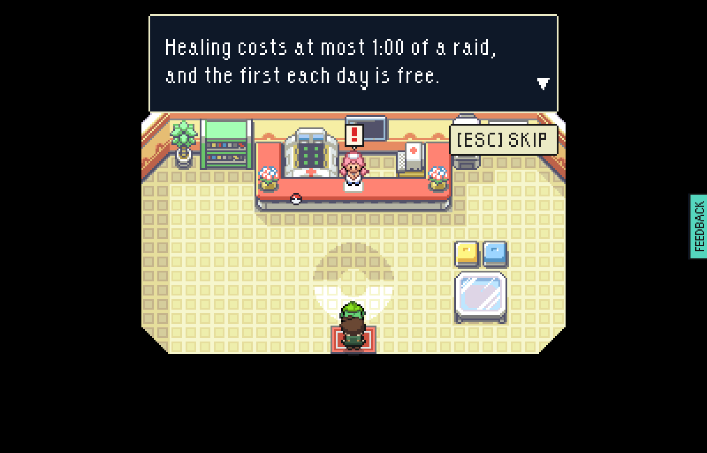
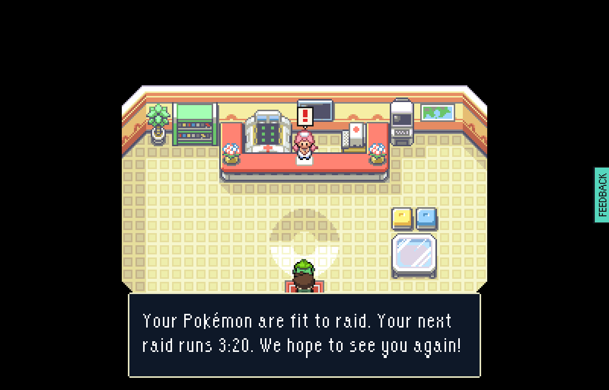
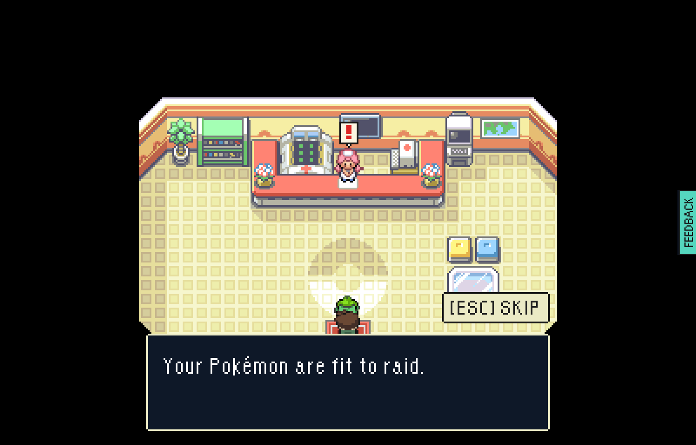

# Nurse Joy: at most 1:00, and the first heal each day free

A save whose lone Bulbasaur came home fainted from a lost raid, at Nurse Joy's counter.

| before | after |
|---|---|
|  |  |
| |  |
|  |  |

Before, standing a fainted starter back up cost 1:40 of the next five-minute raid (up to 2:30 for a team). Now a heal never costs more than 1:00, and the first heal on each day of the player's own clock is free. She says both with every price she charges. Since the retest that evening she does not say the rule (`after-rule.png`) beside the free heal, whose own line already says it, and the healed line no longer repeats it.

Made against test-mode builds (`VITE_EPTW_TEST_MODE=1 npx vite build`, served under its Pages subpath) at `?testmode=pixels`, by a one-off driver built from `tools/playtest/inRoomTalk.mjs`'s helpers: a fresh save, the starter fainted, into the Pokémon Center, and SPACE through her lines.
