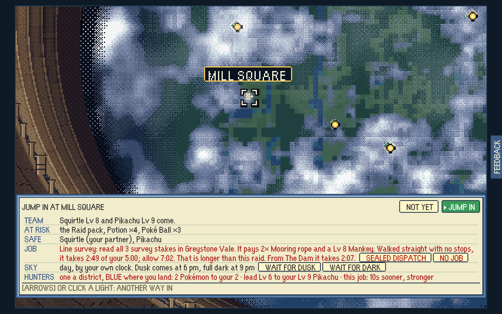
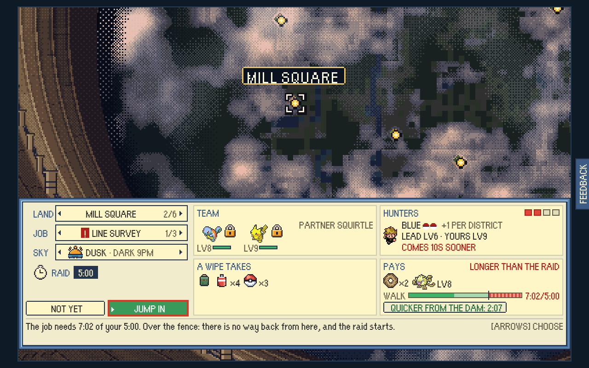
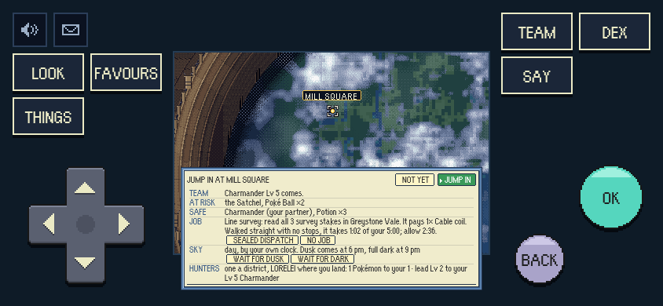
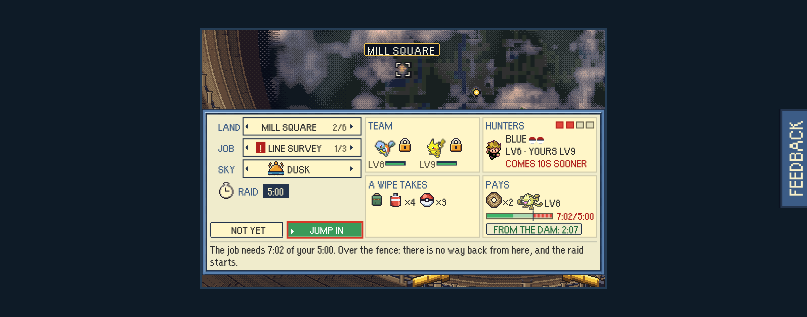
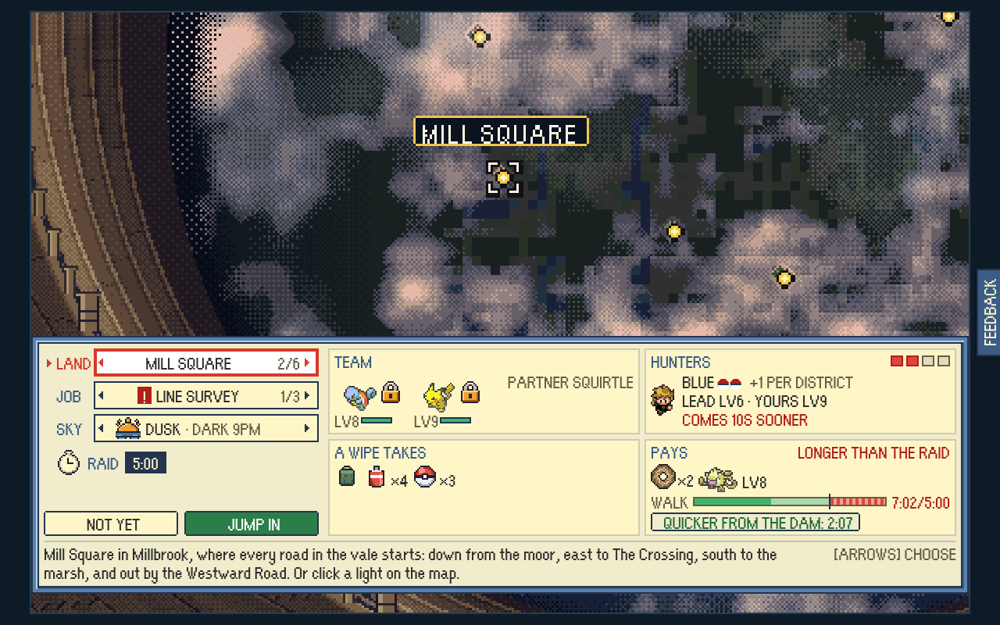

# The jump-in card, as pictures and numbers

The card at THE RAID ARENA's rim (`hub/rimCard.ts`, `HubScene.rimView`). Before, seven labelled sentences that nobody read after thirty raids; after, three `< VALUE >` rows on the left (where to land, which job, which sky), the raid clock and the two buttons, and four tiles on the right: who comes and who is padlocked safe, what a wipe takes, who hunts and how hard, and what the job pays against its walk. Every sentence the card used to print is the help line under whatever is highlighted or pointed at.

The keys do one thing each: Up and Down move between the rows and the buttons, Left and Right change the highlighted row or step between NOT YET and JUMP IN. Before, an arrow pointed at the map when a landing lay that way and moved the buttons when none did.

Made with `node tools/playtest/rimCard.mjs <test-mode build url> <out> [--device=landscape]` against a `VITE_EPTW_TEST_MODE=1` build: a save with Squirtle (partner) and Pikachu, six ways in, three jobs banked and supplies packed. The driver also plays the keys and fails if an arrow moves the landing anywhere but on the LAND row. The phone "before" is the navigation audit's shot of the same card on a phone held sideways. The real clock said dusk for the "after" shots.

| | Before | After |
| --- | --- | --- |
| Desktop 1280x800 |  |  |
| Phone on its side |  |  |
| LAND row highlighted | |  |
