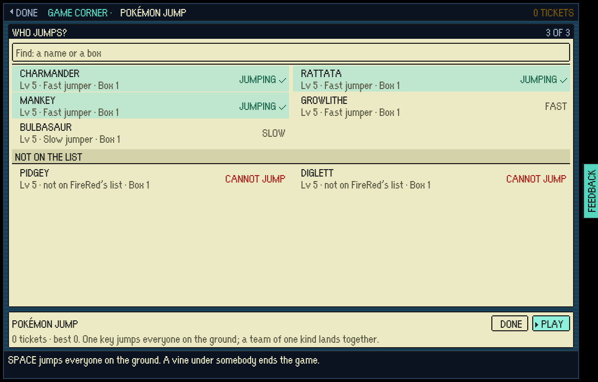
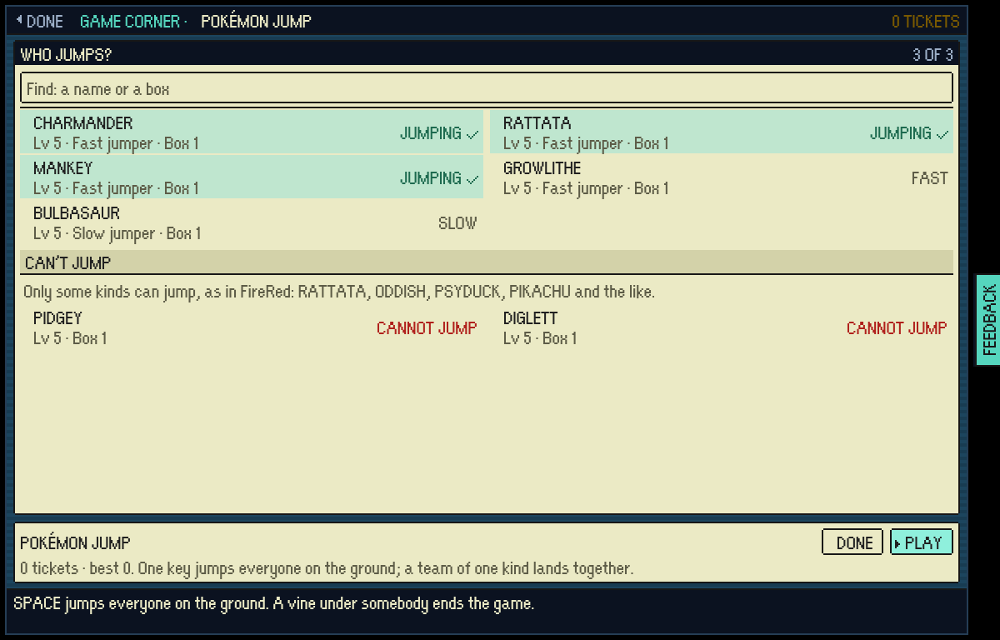

# POKéMON JUMP says which kinds can jump

THE GAME CORNER's POKéMON JUMP cabinet, with a Pidgey and a Diglett in the vault beside
the jumpers. Before, each was marked `not on FireRed's list`, under `NOT ON THE LIST`.
After, they sit under `CAN'T JUMP`, with a line naming kinds that can, all of them in the
vale's grass: `Only some kinds can jump, as in FireRed: RATTATA, ODDISH, PSYDUCK, PIKACHU
and the like.`

| before | after |
|---|---|
|  |  |

Made on 22 Nov 2026 with `tools/playtest/gameCorner.mjs` against the dev server in
`?testmode=pixels`, its vault given a Pidgey and a Diglett as well.
