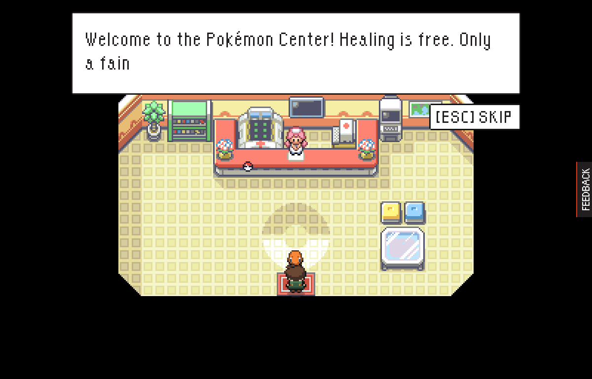
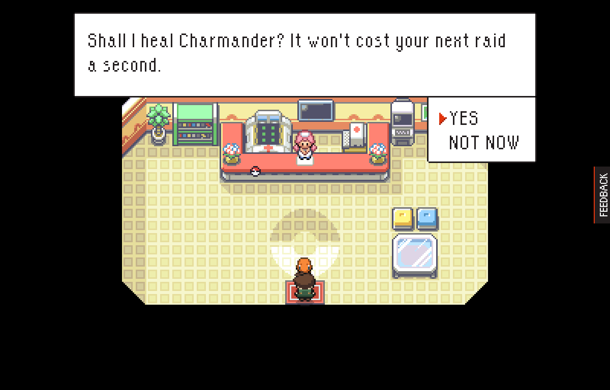
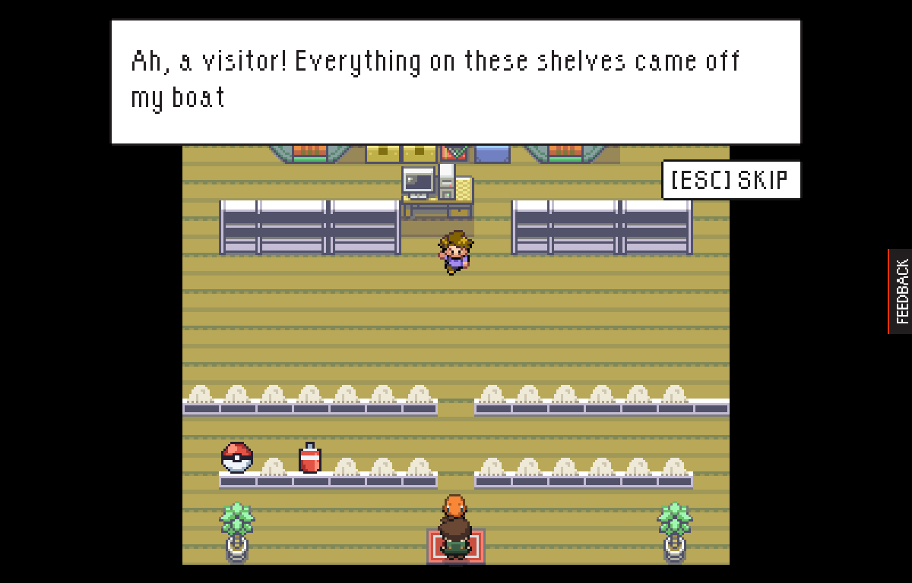
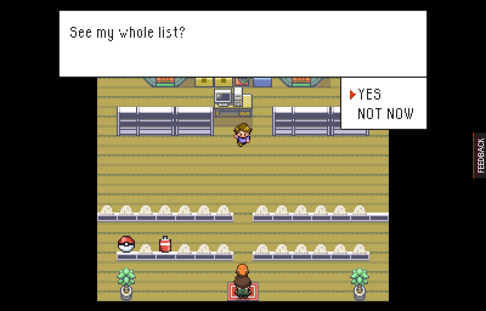
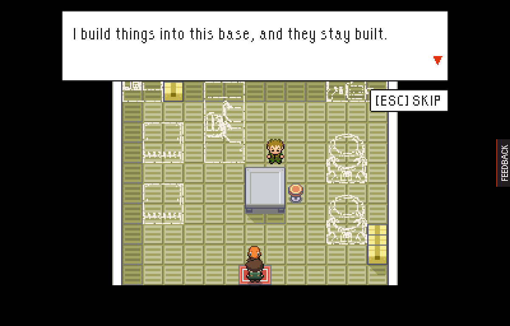
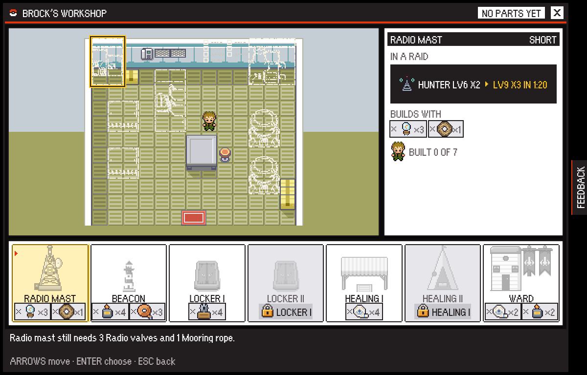

# One box before a keeper opens anything

Every keeper says one fixed greeting, the same on every visit and in every
save, and then what they keep opens (`src/game/hub/keeperGreetings.ts`). A
favour waits until the question is answered or the screen closes. Raiding with
a friend moved off THE MARSHAL onto a board of its own in THE RAID ARENA's hall.

- `hall-before.png` and `hall-after.png`: the room at the tunnel's end, before
  and after the WITH A FRIEND board, which stands across the doors from where
  the marshal stands (her figure, the captions and the torches' flames are the
  scene's, so they are not in these).
- `friend-board.png`: the board close up.

Made without a browser from the hall's own sheet and layers:

    node tools/playtest/hallCrop.mjs hall-after.png 21 59 29 16 3
    node tools/playtest/hallCrop.mjs friend-board.png 38 64 7 5 8

`hall-before.png` is the same first command run on the commit before the board.
What each keeper says now is pinned by `src/game/scenes/keeperOneBox.test.ts`,
which holds the rule for a fresh save, the critic tour's two saves and a save
every favour-giver wants a word with.

## In the game (27 Nov 2026, contest keepers-1, Olly's pick)

Sam, just home from the first raid, talking to each keeper from their room's mat, at 1200x768:

| | before (main) | after |
|---|---|---|
| Nurse Joy |  3 boxes, 8.8 s to the question |  1 box, 2.8 s |
| Bill |  5 boxes, 11.8 s |  1 box, 2.5 s |
| Brock |  5 boxes, 14.1 s |  1 box, 2.8 s |

`before-clip.webm` and `after-clip.webm` play all three, twice each (the second visit is the one a player has every session after). `friend-question.png` is the board in the hall asking, with friend rooms on.

Made with `tools/playtest/keeperClip.mjs <cdp port> <pixels build url> <save.json> <room id> <out dir> --twice` (one room per run, the reading time per box fixed at 0.9 s, so a clip's length is its number of boxes), against `VITE_EPTW_TEST_MODE=pixels` builds of `main` and this branch, and `tools/playtest/ai-player/act` with `EPTW_WINDOW=1200x768 --harbour=local` for the board.
