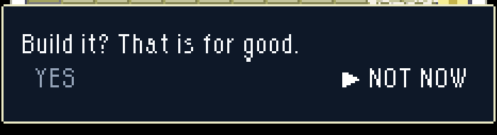
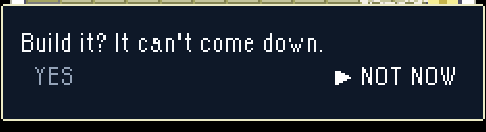

# The keepers talk like people

About thirty `ai-feel` findings in the 22 Nov AI playtest: the base's people
read their rules aloud with no contractions. Reworded, facts unchanged:

- the four keepers' and the captain's favours ('It is at ORCHARD TERRACES, and
  it takes 2 squares of your pack.' is now `It's down at ORCHARD TERRACES.
  It'll want 2 squares of your pack.`), and Oak no longer says the Poké Mart has
  his parcel when it is lying somewhere in Millbrook;
- Brock's rungs ('The hunter's team, on the raid HUD.', 'Your landing is a late
  extra exit.', 'Build it? That is for good.', 'You have it.', 'It stands for
  good.');
- every map-file trainer's defeat line was 'You win. The way is yours.'; each
  now says one of four, picked by name;
- Scout Tam's 'You look like you have got a minute. You have not.', and the
  survey job's 'a circuit rather than an errand'.

| before (main) | after |
|---|---|
|  |  |

From `tools/playtest/workshopBill.mjs` against a test-mode build, 22 Nov 2026.
The rest are pinned in `errands.test.ts`, `workshopTalk.test.ts`,
`keeperFavour.test.ts` and `keeperTalk.test.ts`.
