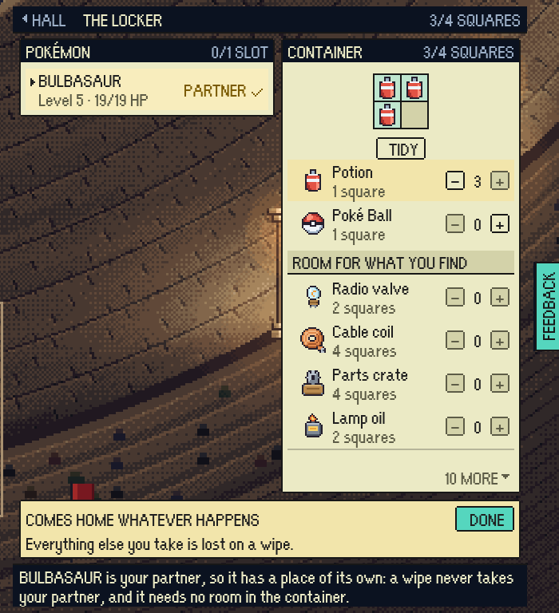

# THE LOCKER says its found-goods rows are room kept

THE LOCKER lists the goods a raid finds (materials, money, a favour's thing)
with a + that keeps squares of the container for them. On a new save the list
was headed `Found goods`, ran on into three torn charts nobody had heard of,
and a + put the thing's icon in the container's squares, so three 22 Nov AI
playtest findings read it as being handed things they did not own. The list is
now headed `ROOM FOR WHAT YOU FIND` (the help bar already said 'room kept for
what you find'), and a torn chart is only offered once the treasure hunt has
begun (a piece pinned on MARLOW's board).

From `tools/playtest/headingShots.mjs` against a test-mode build, a new save
(no heading cut), 22 Nov 2026. That driver had stopped at its first step
(`until` was never defined), and is mended in the same change.
