# Koga holds the Marsh

Step 5 of firstmate's gyms-and-loadouts plan (`eptw-gyms-loadouts-plan`): Fuchsia
Gym stands at the east end of Tanglewood, and Koga holds every road into THE MARSH
(the Safari Marsh and The Wreck). `src/game/world/valeQuarters.ts` is the quarter
as data.

Played as a player through a test-mode build (`tools/playtest/raid.mjs`,
stepped, attached to one headless browser), in three short raids from the
Farmhouse, each on a fresh save:

```
# A: no badges - the gym, its hall with Koga away, the Safari Road shut
node tools/playtest/raid.mjs <build url> --attach=<port> --pixels --stepped --window=pixel --seed=7 \
  --insertion=greystone-vale-farmhouse --starter=Charmander --level=20 "--team=ponyta:20,pidgeotto:20" \
  --skip-contract --shot=A.png \
  "--steps=walk:244:167,shot:gym-outside,into:244:167:up,shot:hall-before,read:392:375:right,shot:guide,into:391:376:down,walk:255:168,shot:safari-road-shut"

# B: Misty beaten - Koga in his hall, the fight, the Safari Road open
node tools/playtest/raid.mjs <build url> --attach=<port> --pixels --stepped --window=pixel --seed=7 \
  --beaten=vale-gym-misty --insertion=greystone-vale-farmhouse --starter=Charmander --level=22 \
  "--moves=Ember|Scratch|Growl|Smokescreen" \
  "--team=gastly:22:Lick|Hypnosis,ponyta:22:Ember|Tackle|Growl|Tail Whip,pidgeotto:22:Gust|Quick Attack|Tackle|Sand Attack" \
  --skip-contract --said --shot-battles --shot=B.png \
  "--steps=walk:244:167,into:244:167:up,shot:hall-koga,challenge:391:368:up,shot:koga-beaten,into:391:376:down,walk:255:168,shot:safari-road-open,walk:262:168,shot:into-the-marsh"

# C: Misty beaten - the Cliff Road into The Wreck still shut, and its notice
node tools/playtest/raid.mjs <build url> --attach=<port> --pixels --stepped --window=pixel --seed=7 \
  --beaten=vale-gym-misty --insertion=greystone-vale-farmhouse --starter=Charmander --level=22 \
  --skip-contract --shot=C.png "--steps=walk:255:222,shot:cliff-road-shut,read:253:224:down,shot:marsh-notice"
```

The driver presses each Pokémon's first move, so the moves are listed best
first. Clear the attached browser's `localStorage` between runs, or the next one
finds a save where it expects a new game.

## Before the CASCADE BADGE

Fuchsia Gym on the Eastern Track, its sign, a gym fan, and Koga's guard with the
Marsh's notice at the wood's edge:

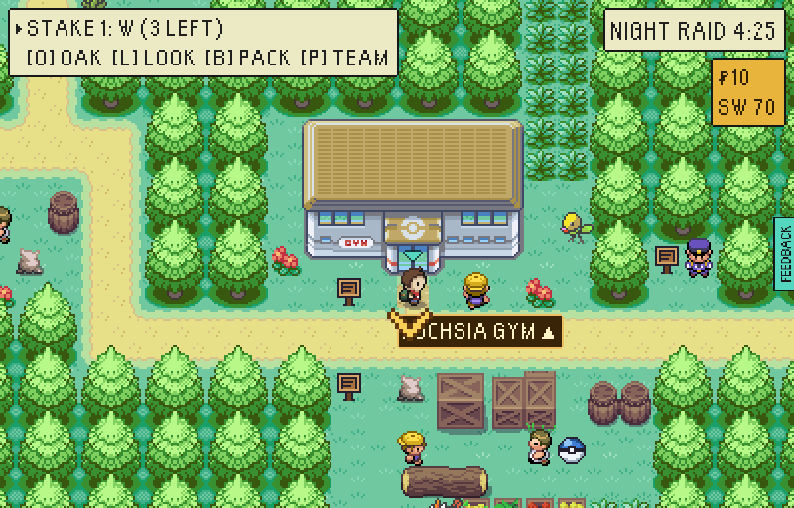

The hall is open from the first raid. Koga is away (he fights only a holder of
Misty's badge), but Juggler Nate and Tamer Phil stand in it, a free look at his
combo, with the Gym Guide by the mat:

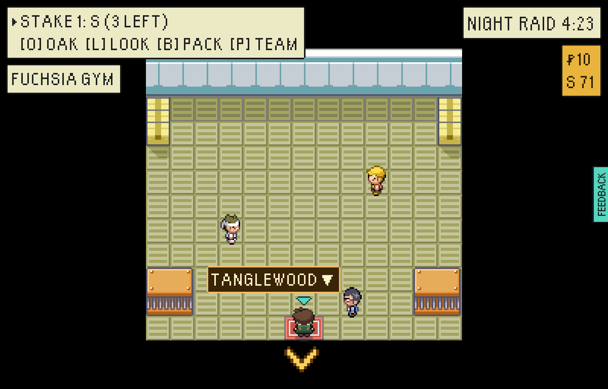

The Safari Road into the Marsh, barred, its caption asking for the SOUL BADGE:

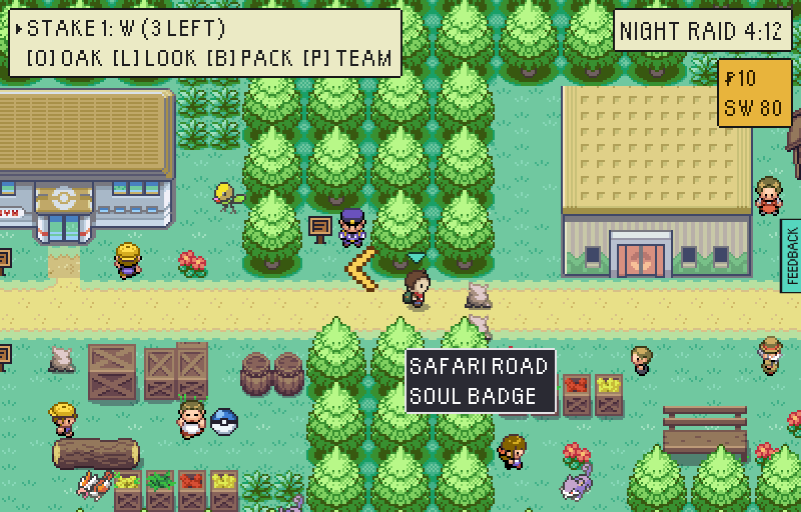

The Cliff Road into The Wreck stays shut with only the CASCADE BADGE, and the
notice beside it says what is past it:

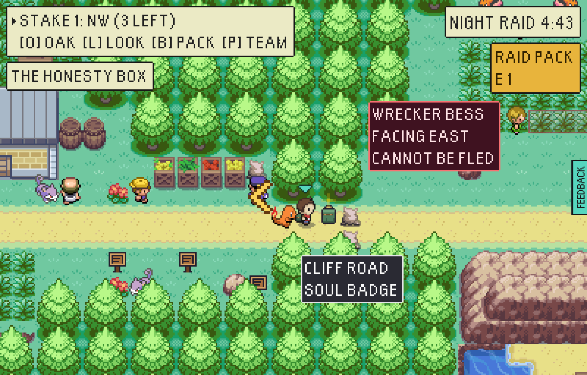
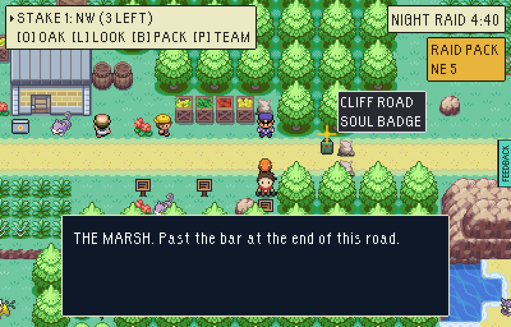

## Koga

With Misty beaten, Koga stands at the head of his hall:

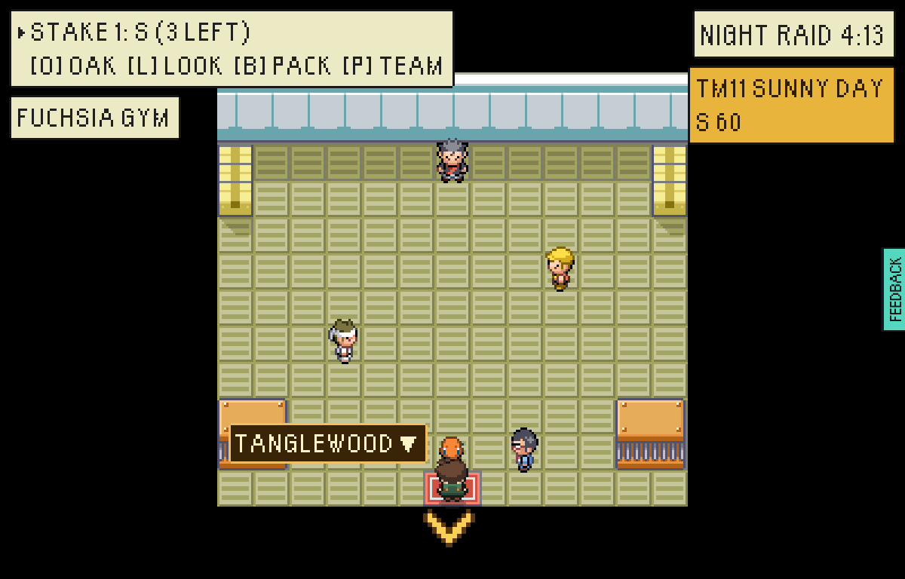

Two on two. The battle log, as the game said it:

> KOGA sent out KOFFING and GRIMER! / Go! CHARMANDER and GASTLY! / Your GASTLY
> used LICK! / Foe GRIMER is paralysed! / Your CHARMANDER used EMBER! / Foe
> KOFFING used POISON GAS! / Your CHARMANDER was poisoned! / ... / Foe KOFFING
> used SMOKESCREEN! / Your GASTLY's accuracy fell! / Foe GRIMER used SLUDGE! /
> ... / Your CHARMANDER fainted! / Go! PONYTA! / Your PONYTA used EMBER! / ... /
> Humph! You have proven your worth! Here is the SOUL BADGE. The ways into the
> Marsh are open to you.

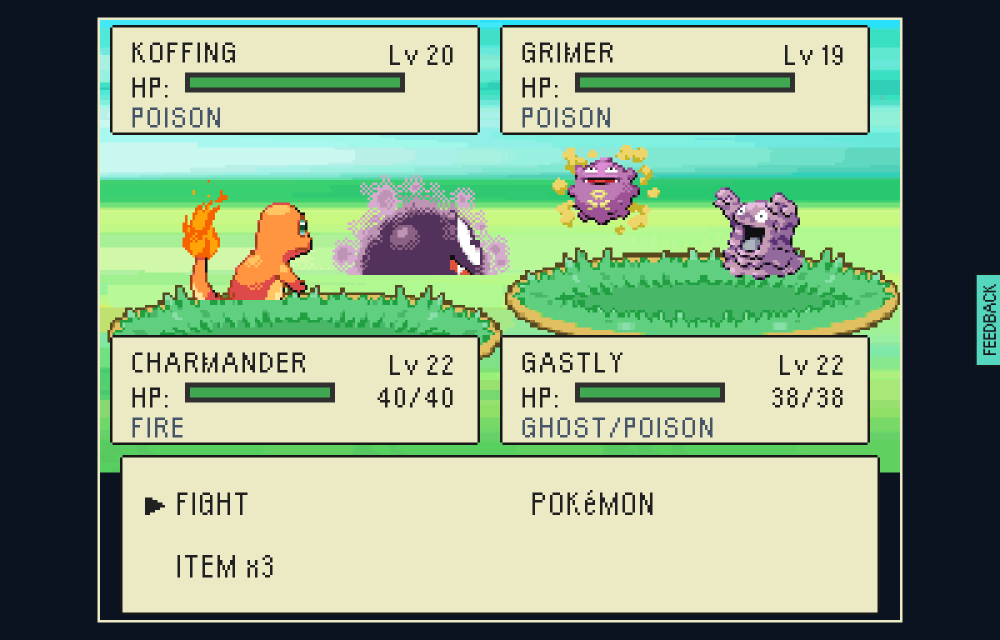

A beaten leader leaves his hall, as every keeper does:

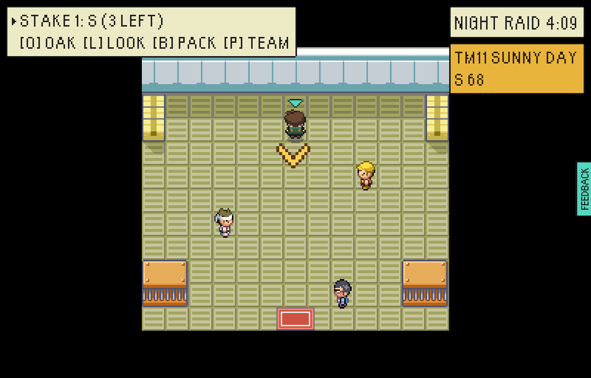

## After the SOUL BADGE

The Safari Road open, and on into the Marsh at the Safari Gate:

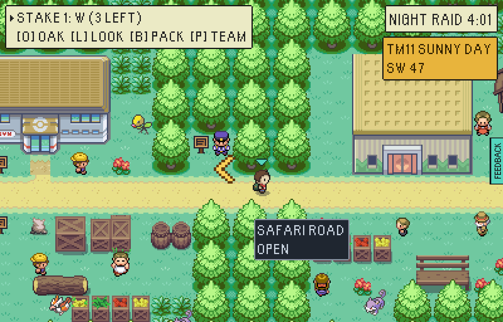
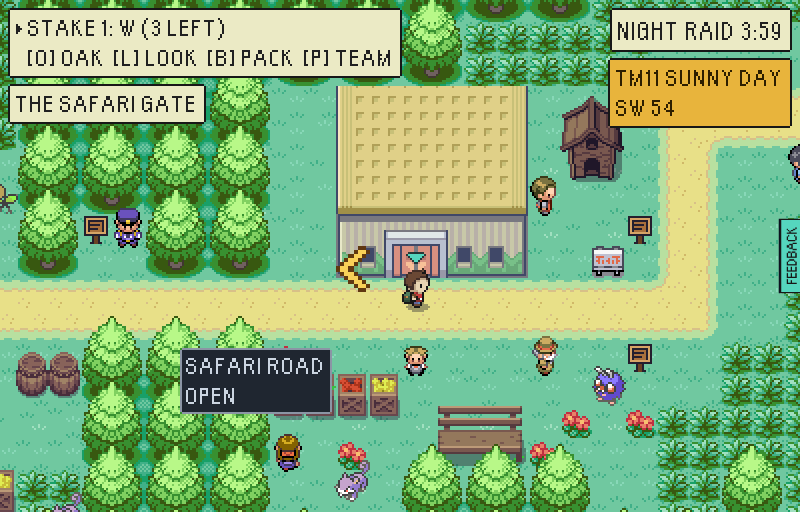

The badge case in THE BOLTHOLE
(`npx vite-node tools/base/renderBase.mts -- out.png 4 --room=bolthole --beaten=vale-gym-misty,vale-gym-koga`):
the CASCADE drop, Boatswain Cragg's ANCHOR still pressed in, and the pink SOUL
heart.

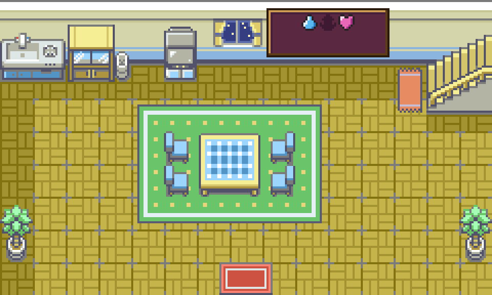
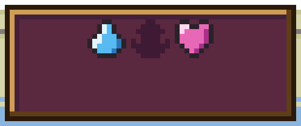

## Found on the way: Oak's cork board

THE RUMOUR MILL brought the rumours to ten, and the board's corner held nine, so
the tenth crowded the frame's foot. The corner now takes as many slip columns as
hold every rumour
(`npx vite-node tools/base/renderBase.mts -- out.png 3 --room=oaks-lab --heard=all`,
cropped to the board):

| before | after |
|---|---|
| 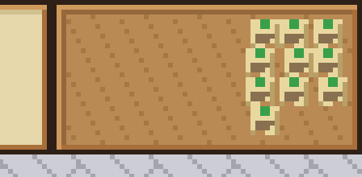 | 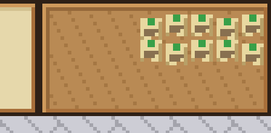 |
